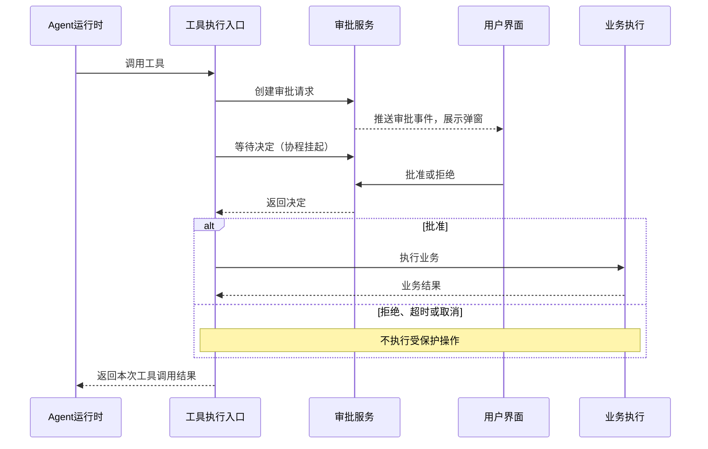
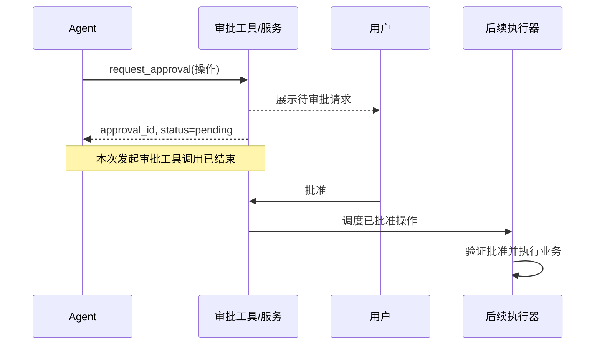

# 工具审批流程与 Trace 边界

本文为实现示意与设计建议，不代表项目已采用该实现。耗时均为示例；自定义审批 span 名称不是 GenAI 标准。

## 两种审批模型

审批弹窗出现，不代表工具调用已返回。弹窗通常由事件驱动，工具协程可以在等待用户决定时挂起。

|模型|工具返回什么|返回时操作是否完成|
|---|---|---|
|执行前审批门禁|审批通过并执行后的业务结果，或拒绝结果|是；业务执行被阻止时也应明确返回|
|独立发起审批工具|审批 ID、pending 状态|仅发起审批完成，受审批保护的业务尚未完成|

## 模型一：执行前等待批准



```text
execute_tool deploy                 32s：逻辑调用全程
├─ approval.wait                    30s：审批等待（建议的自定义 span）
└─ HTTP / 业务子调用                  2s：实际业务执行
```

建议逻辑 execute_tool 包含审批等待：这是调用方等待工具结果的总时间。审批等待与业务执行另行区分，不能将总耗时直接解释成业务处理耗时。审批如在工具入口外发生，按实际调用边界记录，不将前面的等待倒填进已定义的工具 span。

```python
async def execute_tool(call):
    with span("execute_tool deploy"):
        if requires_approval(call):
            approval = await create_approval(call)
            await publish_approval_event(approval)
            with span("approval.wait"):
                decision = await wait_for_decision(approval.id)
            if decision != "approved":
                return approval_outcome(decision)
        return await perform_action(call)
```

代码省略持久化与取消处理。真实实现应将批准绑定到具体操作及参数，执行前重新验证；不得让批准任意放行之后变化的请求。

### 本地源码依据

Codex 的 [工具编排器](../../codex-rs/core/src/tools/orchestrator.rs)在 NeedsApproval 分支中 await request_approval，再进入 run_attempt。它说明审批可以发生在同一次逻辑工具调用中，而不是发起弹窗后即返回。这里的示意 span 树是设计建议，并非声称 Codex 已按此插桩。

## 模型二：发起审批后返回



```text
Trace A
└─ execute_tool request_approval      2s：创建并投递请求

用户稍后批准

Trace B
└─ execute_tool deploy                2s：执行业务
```

用审批 ID 与任务 ID 关联；需要因果关联时，从持久化上下文创建 Span Link。审批 ID、任务 ID 的具体字段名待项目确认。弹窗由通知事件触发，但发起审批本身是 request_approval 工具的主要职责，不能将 pending 当作部署成功。

不让已经返回的 span 跨越之后的人工等待，亦不在结束后补写属性。异步审批状态适合由持久化事件记录；若采用独立的审批生命周期 span，需要另定恢复与结束边界。

## 工具输出截断的边界

|发生位置|execute_tool 是否还能记录截断属性|
|---|---|
|底层函数返回后，运行时裁剪结果，再结束逻辑工具 span|可以；底层函数返回不等于逻辑 span 已结束|
|工具 span 已结束，后续组装模型请求时再次裁剪历史结果|不可以回写；应由组装阶段或本次模型输入的内容投影记录|
|仅界面折叠展示|不代表模型收到的结果被截断|

因此 corojaw.tool.truncated 若保留，应限定为工具结果交付阶段已发生的截断，不能承诺描述未来每次请求中这条结果的可见范围。

## 标准字段与项目扩展

标准字段保持规范语义、类型及采集条件。允许扩展枚举值的字段可按规范增加值；增加字段适用位置时说明项目补充。不同业务概念使用 corojaw.*，避免后端或跨项目查询将自定义含义误当成标准含义。
