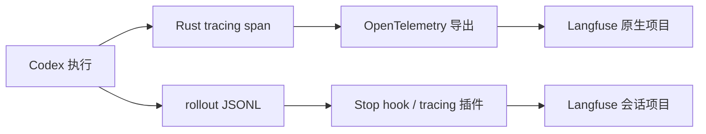

# Codex Trace 设计与本地 Langfuse 实测

本地已经将 Codex 数据导入 Langfuse，并且有两条接入路径：**原生 OTel trace** 和 **基于 rollout 重建的会话 trace**。两者描述同一次 Agent 执行，但观测边界、层级、时间与用量的表达不同。

本文先解释实际数据，再结合源码说明设计，以及哪些部分适合参考到 Corojaw 协议。

## 1. 分析范围

核验日期：2026-10-26，时区 Asia/Shanghai。本次通过本地 Langfuse API 查询两个项目，并完整读取两组已完成 turn 的 observation。查询均完成分页，没有因数量上限截断。

| 依据 | 范围 |
| --- | --- |
| 本地服务 | `http://127.0.0.1:3035` |
| 原生项目 | `codex-native-otel` |
| 插件项目 | `codex-session-plugin` |
| Codex 源码 | 本仓库 `0e824b90e9206af09ec887ab204e41c538e839cc` |
| 插件源码 | 本机安装的 `codex-observability-plugin/tracing/0.4.2` 构建产物 |
| 实测依据 | [脱敏统计与节点证据](assets/codex-langfuse-trace-evidence-2026-10-26.json) |

源码用于解释机制，历史 trace 用于验证表现。源码版本、当前安装的插件版本与产生历史数据的版本不必相同，不能据此认定某个历史 turn 使用了当前源码。

近期样本的原生 `service.version` 为 `0.164.0-alpha.11.1`，插件 `codex.cli_version` 为 `0.162.0-alpha.17.2`。插件从 rollout 的 session 元数据取版本；两者是不同来源，不能直接作为同一执行进程版本相等的证据。

## 2. 两条接入路径



| 对比项 | 原生 OTel | 会话插件 |
| --- | --- | --- |
| 数据来源 | 执行时创建的 Rust span | 持久化的 rollout 记录 |
| 主要目的 | 内部阶段、流式接收、工具调度与性能诊断 | 用户输入、模型输出、工具与会话回放 |
| 层级依据 | 运行时 span 父子关系 | 插件解析记录后建立的语义关系 |
| 时间依据 | 实际 span 生命周期 | rollout 时间戳与插件推导的边界 |
| 常见名称 | `run_turn`、`receiving`、`append_items` | `Codex Turn`、`LLM`、`exec` |
| 接入方式 | OTel exporter 向 Langfuse OTLP 接口导出 | Stop hook 解析 rollout，通过 Langfuse SDK 上报 |

当前安装插件的 `hooks/hooks.json` 注册了 Stop hook。构建产物中的 `parseSession` 解析消息、工具调用与结果、用量事件；`emitTurn` 再创建 AGENT、GENERATION、TOOL observation。因此，插件 trace 是对执行记录的重建，不是对原生 span 的直接重命名。

Langfuse 官方 [Codex 集成说明](https://langfuse.com/integrations/developer-tools/codex)也描述了这种基于 Stop hook 和 transcript 的接入方式；原生接收端见 [OTel 接入说明](https://langfuse.com/integrations/native/opentelemetry)。

## 3. 本地实测：同一 turn，两种视图

以下数量均为单条完整 trace 的 observation 数量，不是项目总量。

| 样本 | 原生项目 | 插件项目 |
| --- | --- | --- |
| 2026-09-29，10:33 起 | 16,586：16,523 SPAN、63 GENERATION | 34：1 AGENT、15 GENERATION、18 TOOL |
| 2026-10-26，00:13 起 | 18,011：17,960 SPAN、51 GENERATION | 22：1 AGENT、11 GENERATION、10 TOOL |

近期样本的共同 turn ID 为 `01a173d6-4242-7f23-9bd9-38f1adddc053`：

- [原生 trace](http://127.0.0.1:3035/project/codex-native-otel/traces/60667f0eeb25402d2197488b6cbb6805)：`60667f0eeb25402d2197488b6cbb6805`。
- [插件 trace](http://127.0.0.1:3035/project/codex-session-plugin/traces/9e4b0de0133ca582a0d8d2d74b33090d)：`9e4b0de0133ca582a0d8d2d74b33090d`。

两条路径当前形成了不同 trace ID；关联依据是 turn ID，不是 trace ID。该样本原生使用 `attributes.turn.id`，插件使用 `codex.turn_id`。插件还将会话 UUID 写入 `sessionId` 与 `codex.thread_id`；该原生样本的 Langfuse `sessionId` 为空。

这证明本地近期仍有两条路径的数据写入；不代表所有历史 turn 都有两份完整数据。

## 4. 原生 trace 的执行骨架

### 4.1 请求入口与 Agent 执行是两个生命周期

近期样本的实际父子路径如下，已省略辅助节点和重复迭代：

```text
turn/start                                      22 ms
└─ op.dispatch.turn_input
   └─ codex.turn_input
      └─ session_task.turn                      168.406 s
         └─ session_task.run
            └─ run_turn
               ├─ step_context.capture          ×11
               ├─ run_turn.prepare_sampling_request_input ×11
               └─ run_sampling_request          ×11
                  ├─ build_prompt
                  └─ try_run_sampling_request
                     ├─ codex.sampling
                     ├─ stream_request
                     │  └─ model_client.stream_responses_websocket
                     └─ receiving_stream
                        └─ handle_responses     多次迭代
                           ├─ receiving
                           └─ handle_output_item_done
                              └─ handle_tool_call_with_source
                                 └─ exec
                                    └─ 工具调度与执行细节
```

`turn/start` 表示启动请求的处理，返回后 Agent 任务继续运行。它只有 22 ms，不能用作本轮 Agent 总耗时；本轮应看 `session_task.turn` 的 168.406 s。子 span 可以在父 span 结束后继续执行，这是这里的异步任务生命周期造成的。

[任务管理源码](../../codex-rs/core/src/tasks/mod.rs)明确为任务创建独立的 turn span，使其覆盖请求分发结束后的执行过程；名称由任务类型提供，普通对话为 `session_task.turn`。

### 4.2 一次模型请求拆成多个内部阶段

| 节点 | 表达的阶段 | 阅读时注意 |
| --- | --- | --- |
| `run_sampling_request` | 一次采样流程 | 包含准备、重试与响应处理，不能直接等同纯模型推理耗时 |
| `try_run_sampling_request` | 单次尝试 | 需要结合父节点和尝试次数分析重试 |
| `build_prompt` | 组装模型 Prompt | 与捕获环境、更新上下文是不同步骤 |
| `stream_request` | 发起流式请求 | 不覆盖后续全部响应消费过程 |
| `model_client.stream_responses_websocket` | 模型客户端创建或取得响应流 | 本例首次只有 49 ms，不能据此判断模型 49 ms 完成 |
| `codex.sampling` | 专门标记的采样阶段 | 近期样本与旧样本不完全相同，需核对版本 |
| `receiving_stream` | 消费响应流 | 响应处理可能触发工具执行 |
| `handle_responses` / `receiving` | 单次取流事件及处理 | 同一次模型请求会产生大量这类节点 |

关键实现见 [turn 执行](../../codex-rs/core/src/session/turn.rs)和 [模型客户端](../../codex-rs/core/src/client.rs)。不能把这些嵌套节点的时长相加作为总耗时，父节点已经覆盖子节点的时间，并且可能存在并行或交叠。

### 4.3 工具挂载位置反映执行路径

原生样本中的工具是在消费模型响应时被触发，因此 `exec` 挂在响应处理路径下，而不是直接挂在 turn 下。继续展开还能看到锁等待、调度和工具处理器。

[工具调度源码](../../codex-rs/core/src/tools/parallel.rs)使用 `otel.name` 将调度 span 命名为工具名，并记录 call ID、turn、工具来源等信息。这种层级有利于定位“哪个响应触发了工具、工具在哪个环节等待”，但阅读 Agent 行为时会比较深。

`exec` 也可能只是执行 JavaScript 编排代码的外层工具；内部再调用 shell、文件等工具。排查失败时应继续检查实际失败操作，不能只看最外层 `exec`。

## 5. 为什么原生节点这么多

近期 trace 中，仅四类节点就占 16,187 个，约 89.9%：

| 节点 | 数量 |
| --- | ---: |
| `receiving` | 7,183 |
| `handle_responses` | 7,183 |
| `append_items` | 1,214 |
| `persist_rollout_items` | 607 |

一次流式响应包含很多事件，每次取事件都会建立处理与等待 span；rollout 追加和持久化也被单独观测。**18,011 个节点不表示调用了 18,011 次模型。**

[OTel provider](../../codex-rs/otel/src/provider.rs)的 trace 过滤逻辑主要排除 `h2`、`tokio`、`runtime` 等目标，没有把导出范围限制成少量 Agent 语义操作。因此原生数据更接近细粒度工程执行树。

`busy_ns`、`idle_ns` 反映 tracing span 的进入与未进入时间，不是 CPU 时间或模型 GPU 推理时间。异步等待、子任务和父子 span 都会影响其解释，不能直接将 idle 归因于某一个下游服务。

## 6. Langfuse observation 类型不等于原生业务语义

近期原生项目有 51 个 `GENERATION`，具体是：

| 名称 | 数量 |
| --- | ---: |
| `run_sampling_request` | 11 |
| `try_run_sampling_request` | 11 |
| `model_client.stream_responses_websocket` | 11 |
| `built_tools` | 11 |
| `get_model_info` | 6 |
| `session_task.turn` | 1 |

这 51 个是 Langfuse 接收与映射后的类型，不能据此统计模型请求次数。例如 `built_tools` 和整个 turn 都不是独立模型生成。

本例应结合 `run_sampling_request` 的 11 次执行、完成事件的 11 份用量和插件的 11 个 `LLM` 节点交叉确认。若发生重试，逻辑调用、尝试和完成响应的数量可能不同，需要分别统计。

该原生样本的 `gen_ai.*` 元数据只有四个用量字段，没有 `gen_ai.operation.name`、`gen_ai.request.model` 等完整操作描述。它复用了部分 GenAI 属性，但不是本文协议中 `invoke_agent` / `chat` / `execute_tool` 的直接实现。

## 7. 插件 trace：较浅的行为树，重建的时间线

近期样本的完整类型结构为：

```text
Codex Turn                    AGENT，167.600 s
├─ LLM                        GENERATION，11 个
├─ exec                       TOOL，9 个
└─ skill:openai-docs           TOOL，1 个
```

`LLM` 与工具都是 turn 的直接子节点，并没有逐个建立 step 父节点。插件通过 `codex.step_index` 标记模型步骤，通过工具 call ID 匹配调用与返回。这里的 skill 名称也属于插件解析后的行为表达，不能逐节点与原生函数名做一一对应。

### 7.1 零时长不代表模型瞬间完成

近期 11 个 `LLM` 中有 7 个起止时间相同；旧样本 15 个中有 11 个。插件解析器从可见 rollout 事件建立 step，并以工具开始或 step 结束推导 generation 结束。记录未提供独立请求起点时，重建的起止时间可能相同。

因此插件适合看模型输入输出和行为顺序，模型延迟应优先参考原生运行时 span。插件 turn 的 167.600 s 与原生任务的 168.406 s 也有 806 ms 差异：二者采用的结束边界不同，不能简单认为其中一条丢失了这段时间。

### 7.2 内容不是原始网络请求的完整副本

插件通过 `generationInput` 组合系统信息、历史和本次消息，再生成 Langfuse 输入；模型客户端还可能使用增量请求、前一响应 ID 等机制。插件展示的上下文与实际发送的网络载荷不是同一个对象。

本次抽查一个插件 generation，输入字段是约百万字符的字符串；原生抽查的一个 `handle_responses` 的 input/output 均为空。这只是定点抽查，不表示所有原生节点都没有内容。证据文件只保存类型、长度和统计，不保存输入输出正文。

## 8. Token 与费用如何阅读

### 8.1 原生用量主要落在响应完成节点

[SessionTelemetry::record_responses](../../codex-rs/otel/src/events/session_telemetry.rs)在响应完成时记录：

- `gen_ai.usage.input_tokens`、`gen_ai.usage.output_tokens`。
- `gen_ai.usage.cache_read.input_tokens`、`gen_ai.usage.cache_write.input_tokens`。
- `codex.usage.reasoning_output_tokens`、`codex.usage.total_tokens`。

近期样本有 11 个这样的用量节点，但它们的 Langfuse model 字段为空；`run_sampling_request` 虽显示为 GENERATION，其 `usageDetails` 又为空。因此不能假定“类型是 GENERATION，就同时具备完整模型、用量和费用”。

### 8.2 同一份用量可能有不同拆分方式

近期同一份响应用量可对齐如下：

| 含义 | 原生元数据 | 插件 `usageDetails` |
| --- | --- | --- |
| 输入，含缓存 | `input_tokens = 367239` | `input 647 + input_cached_tokens 366592` |
| 输出，含 reasoning | `output_tokens = 206` | `output 185 + output_reasoning_tokens 21` |
| 总量 | `total_tokens = 367445` | `total = 367445` |

读取 Langfuse 归一化后的字段时，要确认缓存和 reasoning 是总量的子集还是拆分项，避免重复相加。不能将原生项目和插件项目的用量再相加，二者记录的是同一批请求。

旧插件样本可见费用字段，近期样本的 generation 费用字段合计为 0。这只能说明当前数据未呈现相应计费结果，不能推断实际免费；还应检查模型识别、用量映射和价格配置。

## 9. 状态与错误的可见范围

这两组样本的 observation `level` 全部为 `DEFAULT`，不足以验证失败传播、取消和重试成功后的状态设计。Langfuse 的 level 也不能直接当作 OTel span status 的原始值。

工具执行还需要区分：工具框架是否正常返回、工具结果是否表示失败、内部命令退出码是否非零、Agent 是否恢复后继续完成。只检查外层工具有没有抛异常，无法覆盖这些情况。

> TODO：补充模型失败后重试成功、工具返回失败、用户取消、实际触发压缩的样本，核对原生 status、事件与插件显示的对应关系。

## 10. 上下文在 trace 中如何体现

Codex 没有用一个 context span 包含所有上下文活动，而是在实际处理阶段建立节点：

| 阶段 | 源码 / 样本中的节点 | 表达的工作 |
| --- | --- | --- |
| 捕获当前环境 | `step_context.capture` | 获取本次迭代使用的环境信息 |
| 构建环境状态 | `world_state.build` | 构建可用于上下文的状态 |
| 整理模型输入 | `run_turn.prepare_sampling_request_input` | 从历史中得到可用于 Prompt 的输入 |
| 组装请求 | `build_prompt` | 构建模型调用所用 Prompt |
| 压缩上下文 | `codex.compaction`、`session_task.compact` | 自动压缩阶段、手动压缩任务，具体边界随路径而异 |

近期样本实测到前四类节点；虽然有 `run_pre_sampling_compact` 检查节点，但没有 `codex.compaction`，不能据此认为发生了实际压缩。

理解上下文机制可继续阅读 [上下文学习与 Span 设计](context-learning-and-span-design.md)。

## 11. 对 Corojaw 设计的建议

可以借鉴 Codex 的阶段边界，但应围绕本项目需要回答的问题选择粒度：

1. **让 `invoke_agent` 覆盖完整执行。** 如果请求入口只提交任务，它的 span 结束不代表 Agent 已完成；同步等待结果的入口可以覆盖整个调用。
2. **区分逻辑模型调用与底层尝试。** `chat` 表示完整逻辑调用；需要诊断重试时，在其下保留 HTTP 或客户端尝试 span，统计时区分调用次数与尝试次数。
3. **统一语义节点，按需保留内部细节。** 日常看 `invoke_agent`、`chat`、`execute_tool`；流事件处理、锁等待和持久化等细节用于工程诊断，避免默认展开全部流事件节点。
4. **在真实操作边界记录内容、用量与错误。** 将模型与单次调用用量关联到对应 `chat`；运行时开始、结束时间用于耗时统计，轨迹重建结果注明时间来源。
5. **上下文按操作建 span。** 对有独立耗时或失败边界的检索、记忆读取、压缩建 span；输入 token、上下文大小和是否压缩等状态放到对应操作属性中，暂不创建范围含糊的总 context span。
6. **复用标准并保留跨视图关联。** GenAI 已有的操作与属性优先遵循；业务 session、turn、工具 call ID 用于关联 trace 和轨迹。若两条采集路径并存，明确权威统计来源。

这些是设计建议；本次只新增分析文档与脱敏证据，没有修改 [Agent Trace 协议](agent-tree-protocol-v1.5.md)。
