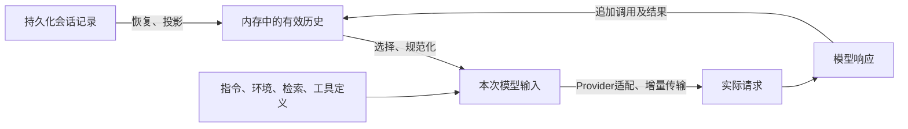

# Agent 上下文：从会话历史到模型输入，再到 Span 设计

本文先解释上下文如何工作，再对照 Codex 源码讨论 span 设计。推荐方案供后续评审，不替换 [协议中的上下文部分](agent-tree-protocol-v1.5.md#上下文)。

证据基线：Codex 本地仓库 `0e824b90e9206af09ec887ab204e41c538e839cc`；GenAI 规范 `9ffc7e00c639be7712e544e3e54331e885dccf84`。下文明确区分通用概念、源码事实和项目建议。Codex 部分为静态源码分析，未采集本轮运行 trace；不能将示意图当成实测瀑布图。

## 1. 上下文是什么

上下文是一次模型调用可利用的输入信息。模型不会因为 Agent 运行在同一个进程，就自动记住所有旧消息、工具输出或数据库内容；运行时必须通过请求或 Provider 支持的会话机制提供这些信息。

以“分析服务为什么超时”为例，输入可能包含：

|组成|内容示例|来源|
|---|---|---|
|系统与开发者指令|职责、工具使用规则、安全约束|应用配置、项目指令|
|当前用户输入|“分析服务为什么超时”|用户请求、后续 steer|
|会话历史|前几轮问题、模型回答、工具调用与结果|内存历史、持久化会话|
|当前环境|工作目录、时间、运行权限|运行时状态|
|补充资料|架构文档、用户偏好、相关代码|retrieval、memory、文件工具|
|工具定义|工具名称、说明、参数结构|工具注册表|

这些信息未必都放在一个 messages 数组里。Provider API 可能把 instructions、input、tools 分成不同字段。模型实际可用输入也可能是文本、图像等多模态内容。

这里的“上下文”与 OTel 的 trace context 不同：前者是模型输入，后者是 trace/span ID 等链路关联信息。

## 2. 三个对象要分开



|对象|解决的问题|不保证什么|
|---|---|---|
|持久化会话记录|恢复、审计、保留发生过的事实|不保证每条记录都发送给模型|
|有效历史|当前仍保留哪些消息或摘要|不保证与最早原文相同|
|本次模型请求|这一次模型具体获得哪些输入|不保证每次都通过网络重传完整历史|

因此，“日志里有这条输出”不等于“模型看见了完整输出”。工具结果可能先被截断，也可能在之后的上下文组装中被再次裁剪。

## 3. 一次多步执行如何改变上下文

用户说：“分析超时原因，重点检查数据库连接池。”

|阶段|发生什么|上下文变化|
|---|---|---|
|恢复|需要时读取会话历史|得到已有消息及压缩检查点|
|准备|加入用户输入、指令、环境、工具定义|形成第一份候选输入|
|step 1|模型决定读取日志|追加 assistant 工具调用|
|工具完成|日志工具返回结果|追加与 call ID 对应的工具结果|
|step 2 请求前|选择有效历史，检查预算，处理新输入|重新得到本次请求输入|
|step 2|模型决定检索连接池文档|又追加工具调用与检索结果|
|step 3|模型给出分析结论|追加最终回答|

如果检索发生在模型调用之前，它属于上下文准备；如果由模型在 step 2 中决定调用检索工具，则属于该 step 的工具执行。两者都合理，不能规定检索只在第一轮发生。

同理，收到 steer 后，应在后续实际发出的请求中应用；不能回头改写已经发出去的模型请求。教学示例不确定 steer 的最终 turn/trace 协议，该问题仍由现有 TODO 跟踪。

## 4. 为什么上下文需要预算、裁剪和压缩

### 4.1 预算

模型输入窗口有限，工具定义和指令也会消耗输入空间；输出预算与窗口的关系取决于模型能力和 API。运行时通常按模型信息、配置和估算结果决定还能放多少历史。

假设项目为一次请求预留 80,000 输入 token，其中指令与工具定义约 15,000，候选历史约 90,000，就需要减少历史或调整请求。这些数字只是教学示例，不是任何模型的固定限制。

本地估算 token 与 Provider 返回的实际 usage 不一定相等，不能用字符数冒充精确 token 数。

### 4.2 裁剪与压缩

|处理|做什么|适合观察什么|
|---|---|---|
|单条工具输出截断|只保留大结果的一部分|哪条结果在交付时被截断|
|历史裁剪|删除或减少部分旧内容|请求前后规模和裁剪原因|
|历史压缩|将旧上下文转换为摘要或专用压缩项|压缩耗时、规模变化、是否安装成功|
|模态适配|调整不被当前模型支持的输入|输入为什么被转换或过滤|

压缩结果不一定是可读的文字摘要，也可能是 Provider 生成的专用压缩表示。工具调用与结果有配对关系；裁剪不能只按消息时间随意删除一半，形成无效输入。

### 4.3 生成压缩结果不等于生效

```text
判断需要压缩
→ 读取待压缩的历史快照
→ 请求模型或压缩服务
→ 校验返回结果
→ 替换当前有效历史，安装检查点
→ 后续请求使用新上下文
```

后台压缩期间，主执行可能继续收到消息或工具结果。安装时需要按实现处理快照之后新增的内容，不能简单用旧摘要覆盖最新历史。

`gen_ai.conversation.compacted=true` 表示本次操作实际使用了压缩视图，不表示本次执行了压缩，也不证明摘要覆盖了所有最新信息。确认生效时才记录 true，否则不设置。

## 5. 缓存与记忆分别是什么

|机制|作用|是否等于历史压缩|
|---|---|---|
|应用上下文缓存|复用已渲染的指令、工具定义或其他片段|否|
|Provider prompt cache|复用 Provider 已处理的输入前缀，具体条件由 Provider 决定|否|
|长期记忆|按需保留、搜索跨轮或跨会话信息|否|
|历史压缩|缩小当前有效历史，保留继续执行所需的信息|是|

哈希相同只能证明参与计算的内容按算法相同，不能单独证明 Provider 缓存命中。动态时间、工具顺序、参数和模型路由都可能影响实际缓存条件。实际缓存用量以 Provider 返回的 usage 为依据。

协议里的 stable_prefix_hash、effective_render_hash、14 个 section 和 watermark 都是项目方案，不是所有 Agent 必须采用的结构。它们需要结合真实实现确认；目前不应由这些名字反推项目已具备相应能力。

## 6. GenAI 已定义什么

当前固定版本没有统一的 load_session、assemble_context、compact_context span。

|已有标准|表达内容|
|---|---|
|`gen_ai.system_instructions`、`gen_ai.input.messages`|指令和模型输入内容|
|`gen_ai.tool.definitions`|可用工具定义|
|`gen_ai.request.previous_response.id`|请求引用前序响应|
|`gen_ai.conversation.compacted`|本次输入是否应用压缩视图|
|`retrieval`、memory 操作、skill 工具专化|上下文的一部分来源操作|

复用标准字段时保留其语义；内部上下文处理阶段可定义项目 span。以上字段不是必须全部采集正文，规模、引用和原文分别解决不同需求。

来源：[GenAI spans](https://github.com/open-telemetry/semantic-conventions-genai/blob/9ffc7e00c639be7712e544e3e54331e885dccf84/docs/gen-ai/gen-ai-spans.md)、[模型属性定义](https://github.com/open-telemetry/semantic-conventions-genai/blob/9ffc7e00c639be7712e544e3e54331e885dccf84/model/gen-ai/registry.yaml)。

## 7. Codex 实际如何组织上下文

### 7.1 会话恢复与运行时上下文

[record_initial_history](../../codex-rs/core/src/session/mod.rs)区分 New、Resumed、Forked 等历史来源；新会话的初始上下文插入会延迟到真实 turn 开始，以应用 turn 设置。恢复路径会重建历史，并非每个 step 都重读持久化 rollout。

[ContextManager](../../codex-rs/core/src/context_manager/history.rs)维护有效历史及相关状态。record_annotated_items 的注释明确区分：工具输出截断应用于 live history，保留完整 rollout payload。不能因此认为所有原始输出都会完整发送给模型。

[build_initial_context_with_world_state](../../codex-rs/core/src/session/mod.rs)组装开发者指令等上下文片段；[world_state.build](../../codex-rs/core/src/session/world_state.rs)构建运行环境与指令状态；[step_context.capture](../../codex-rs/core/src/session/mod.rs)捕获当前 step 的设置和环境快照。这里的 StepContext 不等于模型 messages 数组。

### 7.2 每次采样准备请求

在 [session/turn.rs](../../codex-rs/core/src/session/turn.rs) 中：

1. 获取并记录当前环境状态变化及相关指令。
2. clone_history().for_prompt(...) 根据模型输入模态规范化历史。
3. build_prompt(...) 组合 input、工具定义、base instructions、输出 schema 等。
4. 进入模型客户端；重试时可重新获取历史并构造 Prompt。

[Prompt](../../codex-rs/core/src/client_common.rs)明确包含多个独立字段，不只是历史消息。增量工具和连接状态可能使某些字段为空，但不能据此断定模型没有相应上下文。

[client.rs](../../codex-rs/core/src/client.rs)还存在 previous_response_id 和增量输入复用路径。因此要分析模型实际获得了什么，需同时理解逻辑输入和传输复用，不能只看某次 HTTP/WS body 的新增内容。

### 7.3 压缩

自动压缩路径位于 [run_auto_compact](../../codex-rs/core/src/session/turn.rs)，手动压缩任务位于 [tasks/compact.rs](../../codex-rs/core/src/tasks/compact.rs)。实现根据能力和配置选择路径，不能概括为始终调用普通 chat 生成摘要。

远程 V2 流程在 [compact_remote_v2.rs](../../codex-rs/core/src/compact_remote_v2.rs) 和 [安装逻辑](../../codex-rs/core/src/compact_remote_v2_installation.rs)区分请求、结果检查与历史替换，并支持后台候选等路径。

OpenAI 官方文档也区分请求受理和执行生命周期：thread/compact/start 立即返回，后续通过 contextCompaction item 的开始、完成通知表达进展。这些产品事件不是自动等同于 OTel span。[官方说明](https://learn.chatgpt.com/docs/app-server#trigger-thread-compaction)

## 8. Codex 的 Span 怎么设计

以下为源码可见的埋点。名称、level 和边界来自当前固定源码；它们采用实现阶段划分，不是全部使用 GenAI 标准操作名。

|源码 span 名称或导出名称|作用|源码入口|
|---|---|---|
|`session_init`|会话初始化，内部有持久化、数据库、MCP 等阶段|[session/session.rs](../../codex-rs/core/src/session/session.rs)|
|`apply_rollout_reconstruction`|恢复持久化历史到运行状态，TRACE 级|[session/mod.rs](../../codex-rs/core/src/session/mod.rs)|
|`session_task.turn`|普通 turn 的任务生命周期；task span 使用 otel.name 设置导出名称|[tasks/mod.rs](../../codex-rs/core/src/tasks/mod.rs)、[regular.rs](../../codex-rs/core/src/tasks/regular.rs)|
|`step_context.capture`|捕获 step 设置和环境，INFO 级|[session/mod.rs](../../codex-rs/core/src/session/mod.rs)|
|`world_state.build`|构建环境与指令状态，INFO 级|[session/world_state.rs](../../codex-rs/core/src/session/world_state.rs)|
|`run_turn.prepare_sampling_request_input`|复制历史并生成可供本次采样使用的输入，TRACE 级|[session/turn.rs](../../codex-rs/core/src/session/turn.rs)|
|`build_prompt`|组合 Prompt 各部分，TRACE 级|同上|
|`run_sampling_request`、`codex.sampling`|采样与重试相关执行阶段，TRACE 级|同上|
|`model_client.stream_responses_api`、`model_client.stream_responses_websocket`|HTTP/WS 模型客户端阶段，INFO 级|[client.rs](../../codex-rs/core/src/client.rs)|
|`codex.compaction`、`run_auto_compact`|压缩阶段相关埋点，TRACE 级|[turn.rs](../../codex-rs/core/src/session/turn.rs)、[tasks/compact.rs](../../codex-rs/core/src/tasks/compact.rs)|
|`session_task.compact`|手动压缩任务的导出名称|[tasks/compact.rs](../../codex-rs/core/src/tasks/compact.rs)|

三个限制：

- build_prompt 只覆盖这个组装函数，不代表所有上下文工作；环境捕获、工具发现等发生在其他位置。
- 部分代码只创建 span 句柄，异步父子关系取决于 enter/instrument 等实际用法；不能仅据函数调用顺序画出完整导出树。
- [OTel provider](../../codex-rs/otel/src/provider.rs)负责 tracing bridge 和导出过滤；是否启用 exporter、采样和 subscriber 配置，以及后端是否收到结束数据都会影响显示。INFO/TRACE 是 Rust tracing level，不是 OTel SpanKind 或成功状态。

因此 Codex 提供的是可借鉴的阶段拆分与证据来源，不是可直接复制的 load_session → assemble_context → compact_context 标准树。

## 9. 推荐给本项目的 Span 方案

### 9.1 三类操作，按真实调用创建

|项目 span|边界|创建时机|要回答的问题|
|---|---|---|---|
|`load_session`|从历史读取到有效历史恢复完成|冷启动、恢复或确实重新加载时|慢在存储，还是恢复投影？|
|`assemble_context`|从本次输入快照到模型请求准备完成|每次实际组装请求时|这次模型用了哪些来源，大小变化和组装耗时是什么？|
|`compact_context`|从准备压缩快照到新历史安装或失败结束|实际压缩时|压缩为什么发生、成本多少、是否生效？|

三者是项目自定义阶段；优先复用已有 retrieval、embeddings、memory、chat 等标准子操作。跨后台候选生成与安装的压缩不宜强行用一个长 span 覆盖，需按实际执行拆分并关联。

```text
invoke_agent main
├─ load_session                       仅本次需要恢复时
├─ assemble_context                   第一次请求
│  └─ search_memory / retrieval        仅实际发生时
├─ chat model
├─ execute_tool read_logs
├─ compact_context                    仅实际发生时
│  └─ chat model 或实际压缩API调用      取决于实现
├─ assemble_context                   下一次请求
└─ chat model
```

上图是假设需要压缩的一种串行路径，不规定压缩与组装必须按固定先后顺序。若在组装时触发压缩，compact_context 可位于 assemble_context 内；复用已在别处完成的检索结果时，不再创建一个虚构检索 span。

assemble_context 建议表示本次有效请求的最终准备，包括读取已缓存的片段；不强制重新渲染所有静态内容。若静态渲染成本值得单独观察，可在真正重建时另建内部子 span，不将每次请求都解释成一次完整重建。

### 9.2 先记录少量能解释问题的属性

以下为候选字段，不是本轮已批准的协议修改。corojaw.* 均为项目自定义。

|span|候选属性|用途|
|---|---|---|
|通用关联|conversation ID、turn ID；属于 step 时记录 step seq|关联本次执行|
|load_session|read_source、event_count、message_count、degraded|定位读取来源、投影规模和降级|
|assemble_context|input_item_count、estimated_input_tokens、input_budget_tokens、trimmed|解释请求规模和预算处理|
|compact_context|trigger、input_items_before、input_items_after、input_tokens_before、input_tokens_after、applied|解释触发原因、规模变化与是否安装|
|实际使用压缩上下文的 chat|标准 gen_ai.conversation.compacted=true|表达本次使用状态|

token 前后值若是估算，应使用带 estimated 的字段名或明确估算来源；字符、字节、token 不混用。未采集或不可得不填 0。压缩失败也要能结束 span，不应把只有成功才存在的 after/applied 信息全部声明成无条件必填。

不在父级重复上报子模型调用的 token 消耗；若要展示压缩前后窗口大小，使用明确的上下文规模字段，不能与费用 usage 相加。

### 9.3 对当前协议草案的调整建议

|当前表述|建议|
|---|---|
|load_session 每 turn 一次|只有真实读取或恢复时创建，热会话不虚构 IO|
|assemble_context turn 级一次|区分静态片段渲染与每次模型请求准备；后者按实际组装次数记录|
|load_session 无存储子 span|已有 Redis、数据库等自动插桩可保留，属性不能替代其时延证据|
|compact_context 的子一定为 chat|根据实际压缩实现选择，专用压缩API不冒充普通推理|
|压缩区间、哈希、14个section都先固定|先确认实现和诊断用途，再决定哪些进入协议|
|effective_render_hash 用于判断整个请求复用|先明确它只覆盖哪些片段；没有历史和当前输入时不能代表整个请求|

当前 load_session、assemble_context、compact_context 三分法可以保留为候选。最需要改的是频率、边界和证据口径，而不是先增加更多属性。

## 10. 带着这些问题再决定协议

- 同一会话是否常驻内存，何时真实读取持久化数据？
- 一次 turn 内哪些信息会变化：工具结果、steer、工具目录、环境、检索结果？
- 静态片段是否缓存，最终请求是否每次重新组装？
- token 预算来自配置、估算还是 Provider usage，超过预算如何处理？
- 压缩是同步摘要、专用API还是后台生成，何时安装及如何保留新消息？
- 排障主要想看耗时，还是还要证明某次模型实际看到了什么？后者需要本次输入内容快照或引用，只有规模属性不够。

建议先用一个真实案例串起这些边界，再收敛属性表；现有上下文 TODO 保留，教学文档不替项目实现作决定。
