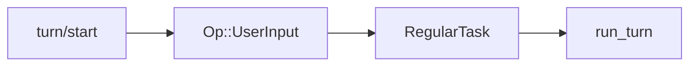
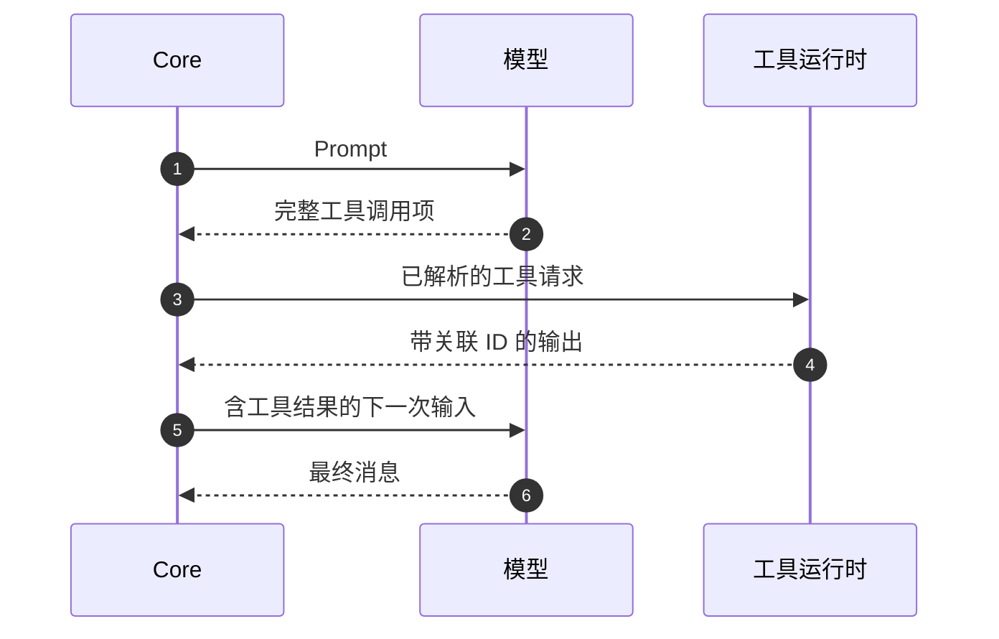
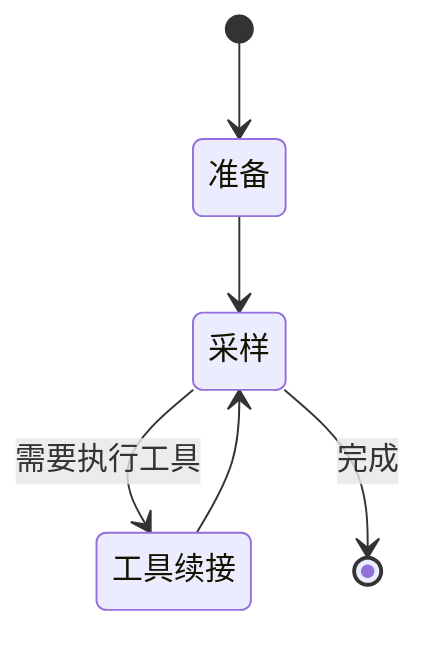

# Agent Loop

一次用户请求可以产生多次模型调用。`Session` 持有线程运行状态，`TurnContext` 携带当轮设置，`run_turn` 决定何时继续采样。阅读这一层时，可以跟踪这一轮输入、模型再次被调用的条件，以及完成状态发出的时点。 [codex-rs/core/src/session/turn.rs:131-183](https://github.com/GLBB/codex/blob/9f42c89c0112771dc29100a6f3fc904049b2655f/codex-rs/core/src/session/turn.rs#L131-L183) [codex-rs/core/src/session/turn.rs:207-326](https://github.com/GLBB/codex/blob/9f42c89c0112771dc29100a6f3fc904049b2655f/codex-rs/core/src/session/turn.rs#L207-L326) [codex-rs/core/src/tasks/mod.rs:769-808](https://github.com/GLBB/codex/blob/9f42c89c0112771dc29100a6f3fc904049b2655f/codex-rs/core/src/tasks/mod.rs#L769-L808)

| 阶段 | 读写内容 | 源码 |
| --- | --- | --- |
| 接受输入 | 解析客户端输入与设置覆盖，提交 `Op::UserInput` | [codex-rs/app-server/src/request_processors/turn_processor.rs:355-433](https://github.com/GLBB/codex/blob/9f42c89c0112771dc29100a6f3fc904049b2655f/codex-rs/app-server/src/request_processors/turn_processor.rs#L355-L433) |
| 运行任务 | 分发用户输入，普通任务调用 `run_turn` | [codex-rs/core/src/session/handlers.rs:708-766](https://github.com/GLBB/codex/blob/9f42c89c0112771dc29100a6f3fc904049b2655f/codex-rs/core/src/session/handlers.rs#L708-L766) [codex-rs/core/src/tasks/regular.rs:36-74](https://github.com/GLBB/codex/blob/9f42c89c0112771dc29100a6f3fc904049b2655f/codex-rs/core/src/tasks/regular.rs#L36-L74) |
| 组织请求 | 历史项、工具规格、基本指令和输出约束组成 `Prompt` | [codex-rs/core/src/session/turn.rs:207-326](https://github.com/GLBB/codex/blob/9f42c89c0112771dc29100a6f3fc904049b2655f/codex-rs/core/src/session/turn.rs#L207-L326) [codex-rs/core/src/session/turn.rs:863-947](https://github.com/GLBB/codex/blob/9f42c89c0112771dc29100a6f3fc904049b2655f/codex-rs/core/src/session/turn.rs#L863-L947) |
| 消费输出 | `OutputItemDone` 交给 `handle_output_item_done`。工具请求被记录并进入执行队列 | [codex-rs/core/src/session/turn.rs:1788-1878](https://github.com/GLBB/codex/blob/9f42c89c0112771dc29100a6f3fc904049b2655f/codex-rs/core/src/session/turn.rs#L1788-L1878) [codex-rs/core/src/stream_events_utils.rs:342-385](https://github.com/GLBB/codex/blob/9f42c89c0112771dc29100a6f3fc904049b2655f/codex-rs/core/src/stream_events_utils.rs#L342-L385) |
| 完成或续接 | 工具结果回到历史，后续需求或待处理输入可触发下一次采样 | [codex-rs/core/src/session/turn.rs:1655-1675](https://github.com/GLBB/codex/blob/9f42c89c0112771dc29100a6f3fc904049b2655f/codex-rs/core/src/session/turn.rs#L1655-L1675) [codex-rs/core/src/session/turn.rs:207-326](https://github.com/GLBB/codex/blob/9f42c89c0112771dc29100a6f3fc904049b2655f/codex-rs/core/src/session/turn.rs#L207-L326) |

### 一个包含工具调用的回合

1. `run_turn` 先检查预采样压缩，再更新上下文、解析 skill/plugin 引用并记录输入。输入钩子可以阻止处理继续。 [codex-rs/core/src/session/turn.rs:131-183](https://github.com/GLBB/codex/blob/9f42c89c0112771dc29100a6f3fc904049b2655f/codex-rs/core/src/session/turn.rs#L131-L183)
2. `run_sampling_request` 准备工具路由和模型提示。首次使用传入的输入，重试时可以重新从当时的会话历史构造输入。可重试错误、预算和传输降级由采样层和客户端配合处理。 [codex-rs/core/src/session/turn.rs:863-947](https://github.com/GLBB/codex/blob/9f42c89c0112771dc29100a6f3fc904049b2655f/codex-rs/core/src/session/turn.rs#L863-L947) [codex-rs/core/src/session/turn.rs:947-1021](https://github.com/GLBB/codex/blob/9f42c89c0112771dc29100a6f3fc904049b2655f/codex-rs/core/src/session/turn.rs#L947-L1021)
3. 普通完整输出经过最终化处理。工具调用先被记录，再创建工具 future。`drain_in_flight` 将工具结果写回历史。 [codex-rs/core/src/session/turn.rs:1788-1878](https://github.com/GLBB/codex/blob/9f42c89c0112771dc29100a6f3fc904049b2655f/codex-rs/core/src/session/turn.rs#L1788-L1878) [codex-rs/core/src/stream_events_utils.rs:342-385](https://github.com/GLBB/codex/blob/9f42c89c0112771dc29100a6f3fc904049b2655f/codex-rs/core/src/stream_events_utils.rs#L342-L385) [codex-rs/core/src/session/turn.rs:1655-1675](https://github.com/GLBB/codex/blob/9f42c89c0112771dc29100a6f3fc904049b2655f/codex-rs/core/src/session/turn.rs#L1655-L1675)
4. 模型后续需求或待处理输入可以延续本轮。达到阈值且仍需继续时允许内联压缩。压缩后存在延迟读取待处理输入的分支。任务层最终发送 `TurnComplete`。 [codex-rs/core/src/session/turn.rs:207-326](https://github.com/GLBB/codex/blob/9f42c89c0112771dc29100a6f3fc904049b2655f/codex-rs/core/src/session/turn.rs#L207-L326) [codex-rs/core/src/tasks/mod.rs:769-808](https://github.com/GLBB/codex/blob/9f42c89c0112771dc29100a6f3fc904049b2655f/codex-rs/core/src/tasks/mod.rs#L769-L808)

### 用 Java 阅读习惯对照

下面用 Java 风格的伪代码概括普通分支。Rust 的 `Arc` 让任务共享会话所有权，`CancellationToken` 显式把取消传给子工作。源码另外处理压缩、重试、钩子和中断。 [codex-rs/core/src/session/turn.rs:131-183](https://github.com/GLBB/codex/blob/9f42c89c0112771dc29100a6f3fc904049b2655f/codex-rs/core/src/session/turn.rs#L131-L183) [codex-rs/core/src/session/turn.rs:207-326](https://github.com/GLBB/codex/blob/9f42c89c0112771dc29100a6f3fc904049b2655f/codex-rs/core/src/session/turn.rs#L207-L326) [codex-rs/core/src/stream_events_utils.rs:342-385](https://github.com/GLBB/codex/blob/9f42c89c0112771dc29100a6f3fc904049b2655f/codex-rs/core/src/stream_events_utils.rs#L342-L385)

```java
while (turnCanContinue()) {
    Prompt prompt = buildPrompt(history.forModel(), visibleTools, instructions);
    SamplingResult result = consumeModelStream(modelSession.stream(prompt));
    appendToolResults(result);
    if (!result.needsFollowUp() && !hasPendingInput()) {
        break;
    }
}
```

## 执行入口


<!-- Sources: codex-rs/app-server/src/request_processors/turn_processor.rs:355, codex-rs/core/src/session/handlers.rs:708, codex-rs/core/src/tasks/regular.rs:36 -->

## 一次工具续接


<!-- Sources: codex-rs/core/src/session/turn.rs:863, codex-rs/core/src/session/turn.rs:1788, codex-rs/core/src/stream_events_utils.rs:342, codex-rs/core/src/session/turn.rs:1655 -->

## 回合状态简图


<!-- Sources: codex-rs/core/src/session/turn.rs:131, codex-rs/core/src/session/turn.rs:207, codex-rs/core/src/tasks/mod.rs:769 -->

## 源码索引

- [codex-rs/app-server/src/request_processors/turn_processor.rs:355-433](https://github.com/GLBB/codex/blob/9f42c89c0112771dc29100a6f3fc904049b2655f/codex-rs/app-server/src/request_processors/turn_processor.rs#L355-L433)
- [codex-rs/core/src/session/handlers.rs:708-766](https://github.com/GLBB/codex/blob/9f42c89c0112771dc29100a6f3fc904049b2655f/codex-rs/core/src/session/handlers.rs#L708-L766)
- [codex-rs/core/src/tasks/regular.rs:36-74](https://github.com/GLBB/codex/blob/9f42c89c0112771dc29100a6f3fc904049b2655f/codex-rs/core/src/tasks/regular.rs#L36-L74)
- [codex-rs/core/src/session/turn.rs:131-183](https://github.com/GLBB/codex/blob/9f42c89c0112771dc29100a6f3fc904049b2655f/codex-rs/core/src/session/turn.rs#L131-L183)
- [codex-rs/core/src/session/turn.rs:207-326](https://github.com/GLBB/codex/blob/9f42c89c0112771dc29100a6f3fc904049b2655f/codex-rs/core/src/session/turn.rs#L207-L326)
- [codex-rs/core/src/session/turn.rs:863-947](https://github.com/GLBB/codex/blob/9f42c89c0112771dc29100a6f3fc904049b2655f/codex-rs/core/src/session/turn.rs#L863-L947)
- [codex-rs/core/src/session/turn.rs:947-1021](https://github.com/GLBB/codex/blob/9f42c89c0112771dc29100a6f3fc904049b2655f/codex-rs/core/src/session/turn.rs#L947-L1021)
- [codex-rs/core/src/session/turn.rs:1788-1878](https://github.com/GLBB/codex/blob/9f42c89c0112771dc29100a6f3fc904049b2655f/codex-rs/core/src/session/turn.rs#L1788-L1878)
- [codex-rs/core/src/stream_events_utils.rs:342-385](https://github.com/GLBB/codex/blob/9f42c89c0112771dc29100a6f3fc904049b2655f/codex-rs/core/src/stream_events_utils.rs#L342-L385)
- [codex-rs/core/src/session/turn.rs:1655-1675](https://github.com/GLBB/codex/blob/9f42c89c0112771dc29100a6f3fc904049b2655f/codex-rs/core/src/session/turn.rs#L1655-L1675)
- [codex-rs/core/src/tasks/mod.rs:769-808](https://github.com/GLBB/codex/blob/9f42c89c0112771dc29100a6f3fc904049b2655f/codex-rs/core/src/tasks/mod.rs#L769-L808)

## 继续阅读

- [上下文与会话](session-state.md)
- [工具调度与权限](tools-permissions.md)
- [模型请求与响应流](../deep-dive/model-transport.md)
- [Rollout Trace](../deep-dive/trajectory.md)
