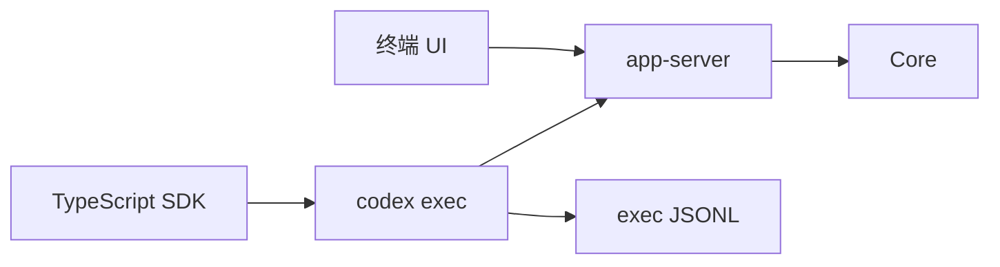
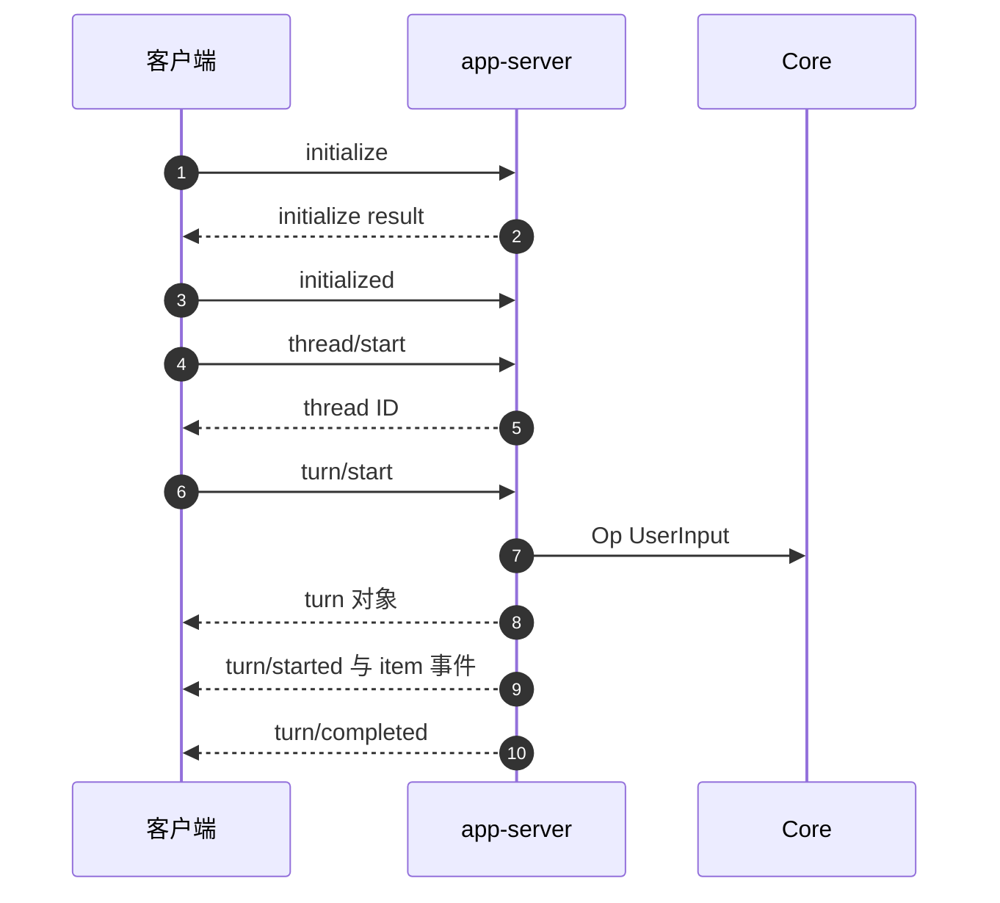
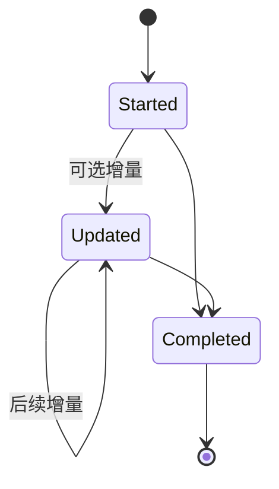

# app-server 与客户端协议

app-server 给客户端提供会话、回合与进度协议。客户端在同一连接上收发请求、响应和通知。RPC ID 用于匹配请求，线程、回合和项目也有各自的标识。 [codex-rs/app-server/README.md:20-89](https://github.com/GLBB/codex/blob/9f42c89c0112771dc29100a6f3fc904049b2655f/codex-rs/app-server/README.md#L20-L89) [codex-rs/app-server/README.md:1211-1247](https://github.com/GLBB/codex/blob/9f42c89c0112771dc29100a6f3fc904049b2655f/codex-rs/app-server/README.md#L1211-L1247)

| 调用方或边界 | 入口 | 主要责任与源码 |
| --- | --- | --- |
| TUI | `AppServerSession::turn_start` | 组装和提交类型化请求。 [codex-rs/tui/src/app_server_session.rs:639-689](https://github.com/GLBB/codex/blob/9f42c89c0112771dc29100a6f3fc904049b2655f/codex-rs/tui/src/app_server_session.rs#L639-L689) |
| `codex exec` | `run_exec_session` | 建立 app-server 会话、启动 turn，选择人类输出或 JSONL。 [codex-rs/exec/src/lib.rs:564-602](https://github.com/GLBB/codex/blob/9f42c89c0112771dc29100a6f3fc904049b2655f/codex-rs/exec/src/lib.rs#L564-L602) [codex-rs/exec/src/lib.rs:749-807](https://github.com/GLBB/codex/blob/9f42c89c0112771dc29100a6f3fc904049b2655f/codex-rs/exec/src/lib.rs#L749-L807) |
| app-server | `process_request` | 将连接上下文和类型化请求交给对应处理器。 [codex-rs/app-server/src/message_processor.rs:516-565](https://github.com/GLBB/codex/blob/9f42c89c0112771dc29100a6f3fc904049b2655f/codex-rs/app-server/src/message_processor.rs#L516-L565) |
| Core | `Op::UserInput` | 接收转译后的输入、环境和线程设置。 [codex-rs/app-server/src/request_processors/turn_processor.rs:355-433](https://github.com/GLBB/codex/blob/9f42c89c0112771dc29100a6f3fc904049b2655f/codex-rs/app-server/src/request_processors/turn_processor.rs#L355-L433) [codex-rs/core/src/session/handlers.rs:708-766](https://github.com/GLBB/codex/blob/9f42c89c0112771dc29100a6f3fc904049b2655f/codex-rs/core/src/session/handlers.rs#L708-L766) |
| TypeScript SDK | `Thread.runStreamed` | 通过 `codex exec` 子进程读取事件。 [sdk/typescript/src/thread.ts:66-135](https://github.com/GLBB/codex/blob/9f42c89c0112771dc29100a6f3fc904049b2655f/sdk/typescript/src/thread.ts#L66-L135) [sdk/typescript/src/exec.ts:165-215](https://github.com/GLBB/codex/blob/9f42c89c0112771dc29100a6f3fc904049b2655f/sdk/typescript/src/exec.ts#L165-L215) |

### 一轮怎样开始和结束

连接发 `initialize`，再发 `initialized`。`thread/start` 创建线程并订阅相关事件。`turn/start` 返回 turn 对象，客户端继续消费 `turn/started`、同一 item 的开始与增量，以及最终 `turn/completed`。最终 turn 状态来自回合通知。 [codex-rs/app-server/README.md:20-89](https://github.com/GLBB/codex/blob/9f42c89c0112771dc29100a6f3fc904049b2655f/codex-rs/app-server/README.md#L20-L89) [codex-rs/app-server/src/request_processors/initialize_processor.rs:44-92](https://github.com/GLBB/codex/blob/9f42c89c0112771dc29100a6f3fc904049b2655f/codex-rs/app-server/src/request_processors/initialize_processor.rs#L44-L92) [codex-rs/app-server/src/request_processors/thread_processor.rs:822-921](https://github.com/GLBB/codex/blob/9f42c89c0112771dc29100a6f3fc904049b2655f/codex-rs/app-server/src/request_processors/thread_processor.rs#L822-L921) [codex-rs/app-server/README.md:1211-1247](https://github.com/GLBB/codex/blob/9f42c89c0112771dc29100a6f3fc904049b2655f/codex-rs/app-server/README.md#L1211-L1247)

### 同一连接上的反向请求

审批用服务器发起的 RPC。客户端展示工具请求，收集决定后用原请求 ID 回复。工具项的最终状态出现在后续事件流。存储中的历史 turn 列表可从 rollout 重建。 [codex-rs/app-server/README.md:1300-1327](https://github.com/GLBB/codex/blob/9f42c89c0112771dc29100a6f3fc904049b2655f/codex-rs/app-server/README.md#L1300-L1327) [codex-rs/app-server-protocol/src/protocol/thread_history.rs:74-92](https://github.com/GLBB/codex/blob/9f42c89c0112771dc29100a6f3fc904049b2655f/codex-rs/app-server-protocol/src/protocol/thread_history.rs#L74-L92)

默认 stdio 监听使用逐行 JSON。该提交也提供 Unix 套接字、实验 WebSocket 和关闭本地监听的方式。调试时用请求 ID 对齐交互，用 thread ID 和 turn ID 对齐运行生命周期。 [codex-rs/app-server/README.md:20-89](https://github.com/GLBB/codex/blob/9f42c89c0112771dc29100a6f3fc904049b2655f/codex-rs/app-server/README.md#L20-L89) [codex-rs/app-server-protocol/src/protocol/v2/turn.rs:39-122](https://github.com/GLBB/codex/blob/9f42c89c0112771dc29100a6f3fc904049b2655f/codex-rs/app-server-protocol/src/protocol/v2/turn.rs#L39-L122)

## 调用方与输出边界

<!-- Sources: codex-rs/tui/src/app_server_session.rs:639, codex-rs/exec/src/lib.rs:564, sdk/typescript/src/exec.ts:165, codex-rs/app-server/src/request_processors/turn_processor.rs:355 -->

## 从连接建立到回合完成

<!-- Sources: codex-rs/app-server/README.md:20, codex-rs/app-server/src/request_processors/turn_processor.rs:355, codex-rs/app-server/README.md:1211 -->

## 项目的生命周期

<!-- Sources: codex-rs/app-server/README.md:1211 -->

## 源码索引

- [codex-rs/app-server/README.md:20-89](https://github.com/GLBB/codex/blob/9f42c89c0112771dc29100a6f3fc904049b2655f/codex-rs/app-server/README.md#L20-L89)
- [codex-rs/app-server/src/request_processors/initialize_processor.rs:44-92](https://github.com/GLBB/codex/blob/9f42c89c0112771dc29100a6f3fc904049b2655f/codex-rs/app-server/src/request_processors/initialize_processor.rs#L44-L92)
- [codex-rs/app-server/src/message_processor.rs:516-565](https://github.com/GLBB/codex/blob/9f42c89c0112771dc29100a6f3fc904049b2655f/codex-rs/app-server/src/message_processor.rs#L516-L565)
- [codex-rs/app-server-protocol/src/protocol/v2/turn.rs:39-122](https://github.com/GLBB/codex/blob/9f42c89c0112771dc29100a6f3fc904049b2655f/codex-rs/app-server-protocol/src/protocol/v2/turn.rs#L39-L122)
- [codex-rs/app-server/src/request_processors/thread_processor.rs:822-921](https://github.com/GLBB/codex/blob/9f42c89c0112771dc29100a6f3fc904049b2655f/codex-rs/app-server/src/request_processors/thread_processor.rs#L822-L921)
- [codex-rs/app-server/src/request_processors/turn_processor.rs:355-433](https://github.com/GLBB/codex/blob/9f42c89c0112771dc29100a6f3fc904049b2655f/codex-rs/app-server/src/request_processors/turn_processor.rs#L355-L433)
- [codex-rs/app-server/README.md:1211-1247](https://github.com/GLBB/codex/blob/9f42c89c0112771dc29100a6f3fc904049b2655f/codex-rs/app-server/README.md#L1211-L1247)
- [codex-rs/app-server/README.md:1300-1327](https://github.com/GLBB/codex/blob/9f42c89c0112771dc29100a6f3fc904049b2655f/codex-rs/app-server/README.md#L1300-L1327)
- [codex-rs/app-server-protocol/src/protocol/thread_history.rs:74-92](https://github.com/GLBB/codex/blob/9f42c89c0112771dc29100a6f3fc904049b2655f/codex-rs/app-server-protocol/src/protocol/thread_history.rs#L74-L92)
- [codex-rs/tui/src/app_server_session.rs:639-689](https://github.com/GLBB/codex/blob/9f42c89c0112771dc29100a6f3fc904049b2655f/codex-rs/tui/src/app_server_session.rs#L639-L689)
- [codex-rs/exec/src/lib.rs:564-602](https://github.com/GLBB/codex/blob/9f42c89c0112771dc29100a6f3fc904049b2655f/codex-rs/exec/src/lib.rs#L564-L602)
- [codex-rs/exec/src/lib.rs:749-807](https://github.com/GLBB/codex/blob/9f42c89c0112771dc29100a6f3fc904049b2655f/codex-rs/exec/src/lib.rs#L749-L807)
- [sdk/typescript/src/thread.ts:66-135](https://github.com/GLBB/codex/blob/9f42c89c0112771dc29100a6f3fc904049b2655f/sdk/typescript/src/thread.ts#L66-L135)
- [sdk/typescript/src/exec.ts:165-215](https://github.com/GLBB/codex/blob/9f42c89c0112771dc29100a6f3fc904049b2655f/sdk/typescript/src/exec.ts#L165-L215)

## 继续阅读

- [Agent Loop](agent-loop.md)
- [上下文与会话](session-state.md)
- [本地运行与读日志](../getting-started/run-locally.md)
- [app-server、CLI 与 SDK 的线协议](../protocols/app-server-wire.md)
