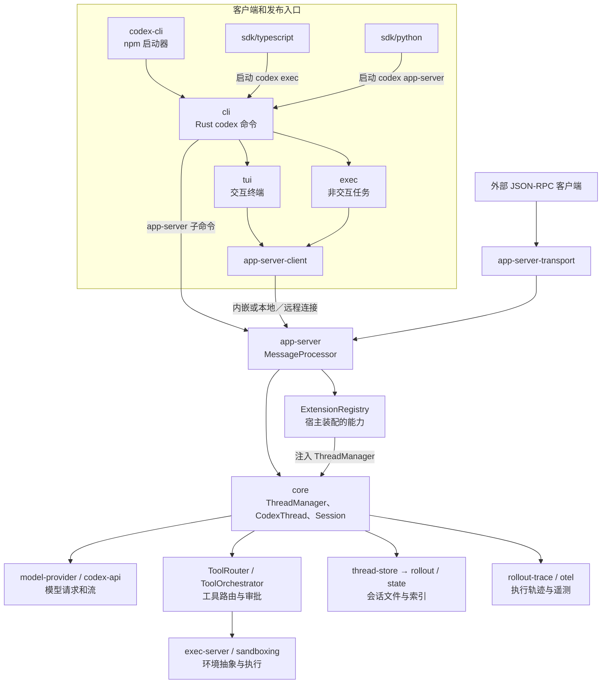
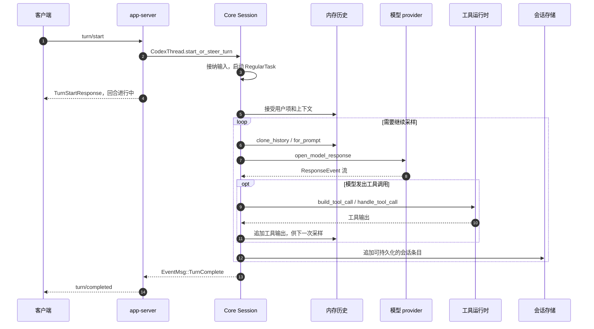
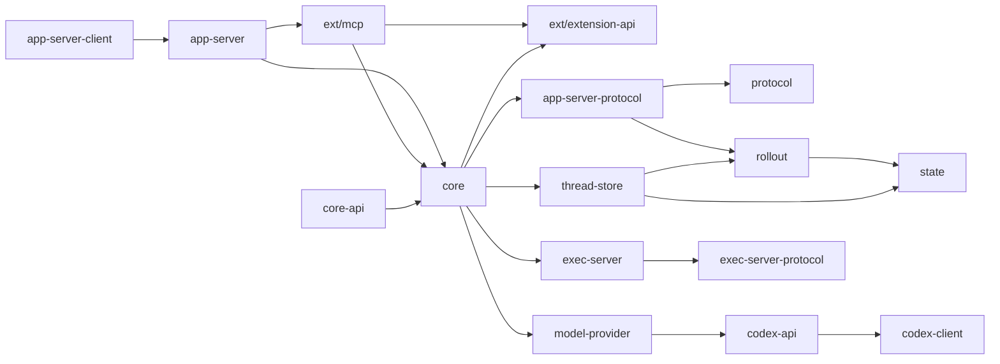
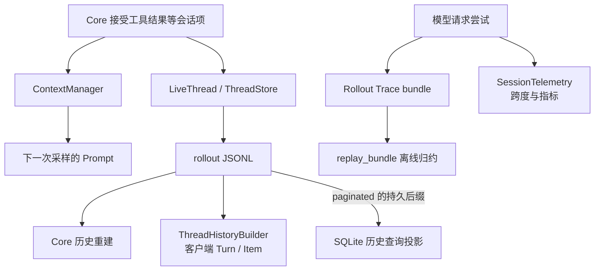
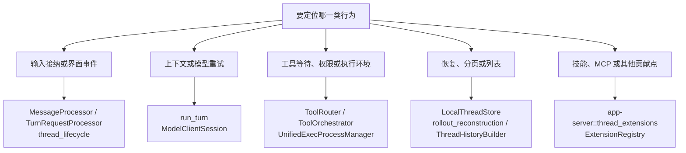

# Codex 模块架构全景

一次普通任务由 **客户端提交输入 → app-server 管理线程与回合 → Core 驱动模型和工具 → app-server 投影事件** 串起来。沿着 Core 再往外看，模型请求送往 provider，工具使用所选的执行环境，会话条目经存储层落盘。本文以 `learning/codex` 的源码提交 `4b7a20f60c` 为准。图里的主链按实现核对，文末清单覆盖全部 179 个 Rust workspace 成员，以及仓库中的 SDK、发布包和独立维护项目。 [codex-rs/Cargo.toml:1-176](https://github.com/GLBB/codex/blob/4b7a20f60cd186c0bfbb0aec2027b51b1c99efa9/codex-rs/Cargo.toml#L1-L176) [codex-rs/app-server/src/message_processor.rs:372-423](https://github.com/GLBB/codex/blob/4b7a20f60cd186c0bfbb0aec2027b51b1c99efa9/codex-rs/app-server/src/message_processor.rs#L372-L423) [codex-rs/core/src/session/turn.rs:663-698](https://github.com/GLBB/codex/blob/4b7a20f60cd186c0bfbb0aec2027b51b1c99efa9/codex-rs/core/src/session/turn.rs#L663-L698)

## 1. 结构与入口

<!-- Sources: codex-cli/bin/codex.js:247-252, sdk/typescript/src/exec.ts:94-105, sdk/typescript/src/exec.ts:203-209, sdk/python/src/openai_codex/client.py:242-281, codex-rs/cli/src/main.rs:1129-1150, codex-rs/cli/src/main.rs:1207-1228, codex-rs/cli/src/main.rs:1291-1369, codex-rs/tui/src/lib.rs:507-566, codex-rs/exec/src/lib.rs:1120-1128, codex-rs/app-server-client/src/lib.rs:285-303, codex-rs/app-server/src/lib.rs:837-887, codex-rs/app-server/src/lib.rs:1036-1071, codex-rs/app-server/src/message_processor.rs:372-423, codex-rs/core/src/client.rs:2855-2900, codex-rs/core/src/tools/orchestrator.rs:126-170, codex-rs/core/src/unified_exec/process_manager.rs:1365-1397, codex-rs/core/src/session/mod.rs:5497-5512, codex-rs/core/src/session/turn.rs:3125-3175 -->

| 模块组 | 职责与边界 | 源码入口 |
| --- | --- | --- |
| 产品入口与客户端 | npm 包启动平台原生二进制。TUI 可走内嵌、本地 daemon 或远端连接。Rust `exec` 创建进程内 app-server 客户端。| [codex-cli/bin/codex.js:247-252](https://github.com/GLBB/codex/blob/4b7a20f60cd186c0bfbb0aec2027b51b1c99efa9/codex-cli/bin/codex.js#L247-L252) [codex-rs/tui/src/lib.rs:507-566](https://github.com/GLBB/codex/blob/4b7a20f60cd186c0bfbb0aec2027b51b1c99efa9/codex-rs/tui/src/lib.rs#L507-L566) [codex-rs/tui/src/lib.rs:1021-1058](https://github.com/GLBB/codex/blob/4b7a20f60cd186c0bfbb0aec2027b51b1c99efa9/codex-rs/tui/src/lib.rs#L1021-L1058) [codex-rs/exec/src/lib.rs:1120-1128](https://github.com/GLBB/codex/blob/4b7a20f60cd186c0bfbb0aec2027b51b1c99efa9/codex-rs/exec/src/lib.rs#L1120-L1128) |
| SDK | TypeScript SDK 启动 `codex exec` 并读取 JSONL 事件。Python SDK 默认从 `openai-codex-cli-bin` 定位二进制，启动 `codex app-server --listen stdio://`，以逐行 JSON-RPC 收发请求、响应和通知。Python 的异步接口复用同一套子进程传输。 | [sdk/typescript/src/exec.ts:203-209](https://github.com/GLBB/codex/blob/4b7a20f60cd186c0bfbb0aec2027b51b1c99efa9/sdk/typescript/src/exec.ts#L203-L209) [sdk/typescript/src/exec.ts:238-248](https://github.com/GLBB/codex/blob/4b7a20f60cd186c0bfbb0aec2027b51b1c99efa9/sdk/typescript/src/exec.ts#L238-L248) [sdk/python/src/openai_codex/client.py:113-123](https://github.com/GLBB/codex/blob/4b7a20f60cd186c0bfbb0aec2027b51b1c99efa9/sdk/python/src/openai_codex/client.py#L113-L123) [sdk/python/src/openai_codex/client.py:242-281](https://github.com/GLBB/codex/blob/4b7a20f60cd186c0bfbb0aec2027b51b1c99efa9/sdk/python/src/openai_codex/client.py#L242-L281) [sdk/python/src/openai_codex/client.py:896-920](https://github.com/GLBB/codex/blob/4b7a20f60cd186c0bfbb0aec2027b51b1c99efa9/sdk/python/src/openai_codex/client.py#L896-L920) [sdk/python/src/openai_codex/async_client.py:57-95](https://github.com/GLBB/codex/blob/4b7a20f60cd186c0bfbb0aec2027b51b1c99efa9/sdk/python/src/openai_codex/async_client.py#L57-L95) |
| Core 与上下文 | `ThreadManager` 管理线程生命周期，`CodexThread` 接收带类型的输入，`Session` 消费提交并管理任务、历史与事件。 | [codex-rs/core/src/thread_manager.rs:1439-1473](https://github.com/GLBB/codex/blob/4b7a20f60cd186c0bfbb0aec2027b51b1c99efa9/codex-rs/core/src/thread_manager.rs#L1439-L1473) [codex-rs/core/src/codex_thread.rs:620-636](https://github.com/GLBB/codex/blob/4b7a20f60cd186c0bfbb0aec2027b51b1c99efa9/codex-rs/core/src/codex_thread.rs#L620-L636) [codex-rs/core/src/session/handlers.rs:640-669](https://github.com/GLBB/codex/blob/4b7a20f60cd186c0bfbb0aec2027b51b1c99efa9/codex-rs/core/src/session/handlers.rs#L640-L669) |
| 模型与传输 | 模型目录与 provider 负责模型信息、路由和认证。Core 组装请求，`codex-api` 编解码 Responses，`codex-client` 提供其 HTTP 传输抽象。 | [codex-rs/app-server/src/message_processor.rs:381-391](https://github.com/GLBB/codex/blob/4b7a20f60cd186c0bfbb0aec2027b51b1c99efa9/codex-rs/app-server/src/message_processor.rs#L381-L391) [codex-rs/model-provider/src/provider.rs:229-275](https://github.com/GLBB/codex/blob/4b7a20f60cd186c0bfbb0aec2027b51b1c99efa9/codex-rs/model-provider/src/provider.rs#L229-L275) [codex-rs/core/src/client.rs:1239-1293](https://github.com/GLBB/codex/blob/4b7a20f60cd186c0bfbb0aec2027b51b1c99efa9/codex-rs/core/src/client.rs#L1239-L1293) [codex-rs/codex-api/Cargo.toml:10-19](https://github.com/GLBB/codex/blob/4b7a20f60cd186c0bfbb0aec2027b51b1c99efa9/codex-rs/codex-api/Cargo.toml#L10-L19) |
| 工具与执行环境 | `ToolRouter` 从模型项解析调用，注册表派给相应 handler。命令执行由编排器应用审批策略，通过所选环境开启进程或走本机启动分支。 | [codex-rs/core/src/tools/router.rs:285-349](https://github.com/GLBB/codex/blob/4b7a20f60cd186c0bfbb0aec2027b51b1c99efa9/codex-rs/core/src/tools/router.rs#L285-L349) [codex-rs/core/src/tools/registry.rs:794-840](https://github.com/GLBB/codex/blob/4b7a20f60cd186c0bfbb0aec2027b51b1c99efa9/codex-rs/core/src/tools/registry.rs#L794-L840) [codex-rs/core/src/tools/orchestrator.rs:126-170](https://github.com/GLBB/codex/blob/4b7a20f60cd186c0bfbb0aec2027b51b1c99efa9/codex-rs/core/src/tools/orchestrator.rs#L126-L170) [codex-rs/core/src/unified_exec/process_manager.rs:1356-1406](https://github.com/GLBB/codex/blob/4b7a20f60cd186c0bfbb0aec2027b51b1c99efa9/codex-rs/core/src/unified_exec/process_manager.rs#L1356-L1406) |
| 扩展与能力 | app-server 安装扩展，部分能力取决于 feature、数据库或宿主服务。扩展可贡献工具、上下文和生命周期处理。 | [codex-rs/app-server/src/extensions.rs:52-149](https://github.com/GLBB/codex/blob/4b7a20f60cd186c0bfbb0aec2027b51b1c99efa9/codex-rs/app-server/src/extensions.rs#L52-L149) [codex-rs/ext/extension-api/src/lib.rs:68-111](https://github.com/GLBB/codex/blob/4b7a20f60cd186c0bfbb0aec2027b51b1c99efa9/codex-rs/ext/extension-api/src/lib.rs#L68-L111) |
| 会话历史与状态 | Core 收集历史项，`ThreadStore` 封装会话操作，`rollout` 写 JSONL，`state` 保存 SQLite 元数据与查询投影。 | [codex-rs/core/src/session/mod.rs:5497-5524](https://github.com/GLBB/codex/blob/4b7a20f60cd186c0bfbb0aec2027b51b1c99efa9/codex-rs/core/src/session/mod.rs#L5497-L5524) [codex-rs/thread-store/src/store.rs:216-257](https://github.com/GLBB/codex/blob/4b7a20f60cd186c0bfbb0aec2027b51b1c99efa9/codex-rs/thread-store/src/store.rs#L216-L257) [codex-rs/thread-store/src/local/live_writer.rs:539-595](https://github.com/GLBB/codex/blob/4b7a20f60cd186c0bfbb0aec2027b51b1c99efa9/codex-rs/thread-store/src/local/live_writer.rs#L539-L595) |
| 配置与诊断 | `config` 形成配置层，Core 据此构建运行配置。执行轨迹 bundle 支持离线重放，`otel` 按配置注册并导出遥测。 | [codex-rs/config/src/loader/mod.rs:157-202](https://github.com/GLBB/codex/blob/4b7a20f60cd186c0bfbb0aec2027b51b1c99efa9/codex-rs/config/src/loader/mod.rs#L157-L202) [codex-rs/core/src/config/mod.rs:1635-1698](https://github.com/GLBB/codex/blob/4b7a20f60cd186c0bfbb0aec2027b51b1c99efa9/codex-rs/core/src/config/mod.rs#L1635-L1698) [codex-rs/rollout-trace/src/reducer/mod.rs:53-83](https://github.com/GLBB/codex/blob/4b7a20f60cd186c0bfbb0aec2027b51b1c99efa9/codex-rs/rollout-trace/src/reducer/mod.rs#L53-L83) [codex-rs/otel/src/provider.rs:206-274](https://github.com/GLBB/codex/blob/4b7a20f60cd186c0bfbb0aec2027b51b1c99efa9/codex-rs/otel/src/provider.rs#L206-L274) |

## 2. 一次回合里的数据和状态

选取一条普通文本输入、触发一次工具调用、最终产生答案的路径。`turn/start` 通过 `TurnInputRequest` 进入 Core 的提交队列。若已有活动回合，Core 还可能把输入交给现有回合，RPC 会返回相应的回合 ID。 [codex-rs/app-server/src/request_processors/turn_processor.rs:727-776](https://github.com/GLBB/codex/blob/4b7a20f60cd186c0bfbb0aec2027b51b1c99efa9/codex-rs/app-server/src/request_processors/turn_processor.rs#L727-L776) [codex-rs/core/src/session/mod.rs:1266-1294](https://github.com/GLBB/codex/blob/4b7a20f60cd186c0bfbb0aec2027b51b1c99efa9/codex-rs/core/src/session/mod.rs#L1266-L1294) [codex-rs/core/src/session/turn_input.rs:516-566](https://github.com/GLBB/codex/blob/4b7a20f60cd186c0bfbb0aec2027b51b1c99efa9/codex-rs/core/src/session/turn_input.rs#L516-L566)

<!-- Sources: codex-rs/app-server/src/request_processors/turn_processor.rs:727-809, codex-rs/core/src/session/handlers.rs:650-668, codex-rs/core/src/session/turn_input.rs:742-786, codex-rs/core/src/tasks/regular.rs:140-178, codex-rs/core/src/session/turn.rs:663-698, codex-rs/core/src/session/turn.rs:2140-2177, codex-rs/core/src/session/turn.rs:3053-3073, codex-rs/core/src/session/turn.rs:3155-3188, codex-rs/core/src/stream_events_utils.rs:351-422, codex-rs/core/src/session/mod.rs:5497-5512, codex-rs/core/src/tasks/mod.rs:1064-1099, codex-rs/app-server/src/request_processors/thread_lifecycle.rs:555-637, codex-rs/app-server/src/bespoke_event_handling.rs:1427-1447 -->

时序按职责简化。通知与 RPC 回复经各自的路径发送，会话条目随接收及处理过程追加，工具也可与剩余响应流重叠执行。Core 等待并记录工具输出，后续采样重新读取历史。 [codex-rs/app-server/src/request_processors/turn_processor.rs:177-214](https://github.com/GLBB/codex/blob/4b7a20f60cd186c0bfbb0aec2027b51b1c99efa9/codex-rs/app-server/src/request_processors/turn_processor.rs#L177-L214) [codex-rs/app-server/src/bespoke_event_handling.rs:174-216](https://github.com/GLBB/codex/blob/4b7a20f60cd186c0bfbb0aec2027b51b1c99efa9/codex-rs/app-server/src/bespoke_event_handling.rs#L174-L216) [codex-rs/core/src/session/turn.rs:3530-3548](https://github.com/GLBB/codex/blob/4b7a20f60cd186c0bfbb0aec2027b51b1c99efa9/codex-rs/core/src/session/turn.rs#L3530-L3548) [codex-rs/core/src/session/turn.rs:3994-4016](https://github.com/GLBB/codex/blob/4b7a20f60cd186c0bfbb0aec2027b51b1c99efa9/codex-rs/core/src/session/turn.rs#L3994-L4016)

| 数据形态 | 所有者及变化 | 排查意义 |
| --- | --- | --- |
| `TurnStartParams → TurnInputRequest → SubmissionOp::TurnInput` | app-server 转换客户端输入、收集线程设置。Core 通过 `Submission` 发送到 session loop，由 `turn_input::handle` 接纳。 | 回合 ID 和输入投递问题从两层交界处查起。 [codex-rs/app-server/src/request_processors/turn_processor.rs:683-754](https://github.com/GLBB/codex/blob/4b7a20f60cd186c0bfbb0aec2027b51b1c99efa9/codex-rs/app-server/src/request_processors/turn_processor.rs#L683-L754) [codex-rs/core/src/codex_thread.rs:805-861](https://github.com/GLBB/codex/blob/4b7a20f60cd186c0bfbb0aec2027b51b1c99efa9/codex-rs/core/src/codex_thread.rs#L805-L861) [codex-rs/core/src/session/handlers.rs:650-665](https://github.com/GLBB/codex/blob/4b7a20f60cd186c0bfbb0aec2027b51b1c99efa9/codex-rs/core/src/session/handlers.rs#L650-L665) |
| `ContextManager → Prompt → ResponsesApiRequest` | `for_prompt` 按模型输入模态取得请求候选项。请求构建会注入基础指令，并按模型类型处理工具和内容元数据。 | 对照实际模型请求时，需要追到最终编码。 [codex-rs/core/src/session/turn.rs:2140-2179](https://github.com/GLBB/codex/blob/4b7a20f60cd186c0bfbb0aec2027b51b1c99efa9/codex-rs/core/src/session/turn.rs#L2140-L2179) [codex-rs/core/src/client.rs:1239-1293](https://github.com/GLBB/codex/blob/4b7a20f60cd186c0bfbb0aec2027b51b1c99efa9/codex-rs/core/src/client.rs#L1239-L1293) [codex-rs/codex-api/src/endpoint/responses.rs:85-145](https://github.com/GLBB/codex/blob/4b7a20f60cd186c0bfbb0aec2027b51b1c99efa9/codex-rs/codex-api/src/endpoint/responses.rs#L85-L145) |
| `ResponseEvent → ToolCall → ResponseItemEnvelope` | 工具调用先记录模型项，在线程的工具运行时调度。结果连同元数据进入历史，下一次采样可读取。 | `call_id` 可以把调用、执行和结果串起来。 [codex-rs/core/src/stream_events_utils.rs:351-422](https://github.com/GLBB/codex/blob/4b7a20f60cd186c0bfbb0aec2027b51b1c99efa9/codex-rs/core/src/stream_events_utils.rs#L351-L422) [codex-rs/core/src/session/turn.rs:3053-3073](https://github.com/GLBB/codex/blob/4b7a20f60cd186c0bfbb0aec2027b51b1c99efa9/codex-rs/core/src/session/turn.rs#L3053-L3073) |
| `EventMsg → ServerNotification` | app-server 线程监听器消费 Core 事件，转换成 `turn/started`、`turn/completed` 等通知。 | 请求接受、一次模型响应完成、整个 Codex 回合结束是三个时间点。 [codex-rs/app-server/src/request_processors/thread_lifecycle.rs:555-637](https://github.com/GLBB/codex/blob/4b7a20f60cd186c0bfbb0aec2027b51b1c99efa9/codex-rs/app-server/src/request_processors/thread_lifecycle.rs#L555-L637) [codex-rs/app-server/src/bespoke_event_handling.rs:174-216](https://github.com/GLBB/codex/blob/4b7a20f60cd186c0bfbb0aec2027b51b1c99efa9/codex-rs/app-server/src/bespoke_event_handling.rs#L174-L216) [codex-rs/core/src/session/turn.rs:747-773](https://github.com/GLBB/codex/blob/4b7a20f60cd186c0bfbb0aec2027b51b1c99efa9/codex-rs/core/src/session/turn.rs#L747-L773) |

## 3. 依赖方向与外部集成

箭头表示 Cargo manifest 声明的普通 workspace 依赖，图中保留主链的代表关系。`core-api` 会再导出 Core 类型。app-server 直接依赖 Core，Core 同时引用 `app-server-protocol` 的共享类型。扩展注册的运行时方向与各 crate 的静态依赖方向应分别阅读。 [codex-rs/app-server/Cargo.toml:38-60](https://github.com/GLBB/codex/blob/4b7a20f60cd186c0bfbb0aec2027b51b1c99efa9/codex-rs/app-server/Cargo.toml#L38-L60) [codex-rs/core/Cargo.toml:24-44](https://github.com/GLBB/codex/blob/4b7a20f60cd186c0bfbb0aec2027b51b1c99efa9/codex-rs/core/Cargo.toml#L24-L44) [codex-rs/core-api/src/lib.rs:31-58](https://github.com/GLBB/codex/blob/4b7a20f60cd186c0bfbb0aec2027b51b1c99efa9/codex-rs/core-api/src/lib.rs#L31-L58) [codex-rs/ext/mcp/Cargo.toml:15-29](https://github.com/GLBB/codex/blob/4b7a20f60cd186c0bfbb0aec2027b51b1c99efa9/codex-rs/ext/mcp/Cargo.toml#L15-L29)

<!-- Sources: codex-rs/app-server-client/Cargo.toml:17-31, codex-rs/app-server/Cargo.toml:38-55, codex-rs/app-server/Cargo.toml:84-86, codex-rs/core/Cargo.toml:24-77, codex-rs/core-api/Cargo.toml:18-33, codex-rs/app-server-protocol/Cargo.toml:16-26, codex-rs/ext/mcp/Cargo.toml:15-29, codex-rs/model-provider/Cargo.toml:11-34, codex-rs/codex-api/Cargo.toml:10-19, codex-rs/exec-server/Cargo.toml:26-40, codex-rs/thread-store/Cargo.toml:16-26, codex-rs/rollout/Cargo.toml:17-29 -->

| 集成边界 | 适配与契约 | 源码依据 |
| --- | --- | --- |
| 外部客户端 ↔ app-server | 独立服务分派 stdio、Unix socket、WebSocket 等传输。进程内客户端直接启动 app-server runtime，两条路都创建 `MessageProcessor`。 | [codex-rs/app-server/src/lib.rs:837-887](https://github.com/GLBB/codex/blob/4b7a20f60cd186c0bfbb0aec2027b51b1c99efa9/codex-rs/app-server/src/lib.rs#L837-L887) [codex-rs/app-server/src/lib.rs:1031-1069](https://github.com/GLBB/codex/blob/4b7a20f60cd186c0bfbb0aec2027b51b1c99efa9/codex-rs/app-server/src/lib.rs#L1031-L1069) [codex-rs/app-server/src/in_process.rs:594-621](https://github.com/GLBB/codex/blob/4b7a20f60cd186c0bfbb0aec2027b51b1c99efa9/codex-rs/app-server/src/in_process.rs#L594-L621) |
| Core ↔ 模型服务 | `open_model_response` 在启用时尝试 Responses WebSocket。HTTP 路径向 `/responses` 发送 POST，SSE 解码器产生内部事件。 | [codex-rs/core/src/client.rs:2855-2901](https://github.com/GLBB/codex/blob/4b7a20f60cd186c0bfbb0aec2027b51b1c99efa9/codex-rs/core/src/client.rs#L2855-L2901) [codex-rs/codex-api/src/endpoint/responses.rs:165-198](https://github.com/GLBB/codex/blob/4b7a20f60cd186c0bfbb0aec2027b51b1c99efa9/codex-rs/codex-api/src/endpoint/responses.rs#L165-L198) [codex-rs/codex-api/src/sse/responses.rs:400-440](https://github.com/GLBB/codex/blob/4b7a20f60cd186c0bfbb0aec2027b51b1c99efa9/codex-rs/codex-api/src/sse/responses.rs#L400-L440) |
| Core ↔ 执行环境 | 以 `exec_command` 为例，`UnifiedExecProcessManager` 经编排器调用统一执行运行时。远端环境或带 exec-server shell snapshot 的请求调用环境的 `ExecBackend`，其余进入本地进程分支。远端实现通过客户端开启远程进程。 | [codex-rs/core/src/unified_exec/process_manager.rs:1356-1477](https://github.com/GLBB/codex/blob/4b7a20f60cd186c0bfbb0aec2027b51b1c99efa9/codex-rs/core/src/unified_exec/process_manager.rs#L1356-L1477) [codex-rs/core/src/unified_exec/process_manager.rs:1479-1535](https://github.com/GLBB/codex/blob/4b7a20f60cd186c0bfbb0aec2027b51b1c99efa9/codex-rs/core/src/unified_exec/process_manager.rs#L1479-L1535) [codex-rs/core/src/tools/runtimes/unified_exec.rs:633-663](https://github.com/GLBB/codex/blob/4b7a20f60cd186c0bfbb0aec2027b51b1c99efa9/codex-rs/core/src/tools/runtimes/unified_exec.rs#L633-L663) [codex-rs/exec-server/src/remote_process.rs:30-56](https://github.com/GLBB/codex/blob/4b7a20f60cd186c0bfbb0aec2027b51b1c99efa9/codex-rs/exec-server/src/remote_process.rs#L30-L56) |
| Codex ↔ MCP 服务与 Hook | MCP 的连接管理器将工具调用交给活动客户端。Core 在生命周期点调用 Hook，例如 `PreToolUse` 可修改输入或阻止工具。 | [codex-rs/codex-mcp/src/connection_manager.rs:1515-1605](https://github.com/GLBB/codex/blob/4b7a20f60cd186c0bfbb0aec2027b51b1c99efa9/codex-rs/codex-mcp/src/connection_manager.rs#L1515-L1605) [codex-rs/codex-mcp/src/rmcp_client/managed_client.rs:74-113](https://github.com/GLBB/codex/blob/4b7a20f60cd186c0bfbb0aec2027b51b1c99efa9/codex-rs/codex-mcp/src/rmcp_client/managed_client.rs#L74-L113) [codex-rs/core/src/hook_runtime.rs:197-269](https://github.com/GLBB/codex/blob/4b7a20f60cd186c0bfbb0aec2027b51b1c99efa9/codex-rs/core/src/hook_runtime.rs#L197-L269) |
| Core ↔ 扩展宿主 | 注册表支持生命周期、工具、上下文等贡献点。app-server 结合配置、存储与环境装配，随 `ThreadManager` 传入运行时。 | [codex-rs/app-server/src/extensions.rs:72-149](https://github.com/GLBB/codex/blob/4b7a20f60cd186c0bfbb0aec2027b51b1c99efa9/codex-rs/app-server/src/extensions.rs#L72-L149) [codex-rs/app-server/src/message_processor.rs:387-419](https://github.com/GLBB/codex/blob/4b7a20f60cd186c0bfbb0aec2027b51b1c99efa9/codex-rs/app-server/src/message_processor.rs#L387-L419) [codex-rs/core/src/session/mod.rs:3144-3170](https://github.com/GLBB/codex/blob/4b7a20f60cd186c0bfbb0aec2027b51b1c99efa9/codex-rs/core/src/session/mod.rs#L3144-L3170) |
| 多代理线程 | Core 的 `AgentControl` 在创建子线程前计算继承配置，可选择全新历史或 fork。创建后把用户输入或代理间通信交给子线程自己的运行循环。 | [codex-rs/core/src/agent/control/spawn.rs:713-775](https://github.com/GLBB/codex/blob/4b7a20f60cd186c0bfbb0aec2027b51b1c99efa9/codex-rs/core/src/agent/control/spawn.rs#L713-L775) [codex-rs/core/src/agent/control/spawn.rs:858-936](https://github.com/GLBB/codex/blob/4b7a20f60cd186c0bfbb0aec2027b51b1c99efa9/codex-rs/core/src/agent/control/spawn.rs#L858-L936) [codex-rs/core/src/agent/control/spawn.rs:991-1017](https://github.com/GLBB/codex/blob/4b7a20f60cd186c0bfbb0aec2027b51b1c99efa9/codex-rs/core/src/agent/control/spawn.rs#L991-L1017) |
| Code Mode ↔ 代码运行时 | Core 的 Code Mode handler 把代码和允许使用的工具交给会话服务。独立 app-server 可配置通过 gRPC 连接 `code-mode-host`，宿主再提供代码运行服务。 | [codex-rs/core/src/tools/code_mode/execute_handler.rs:69-102](https://github.com/GLBB/codex/blob/4b7a20f60cd186c0bfbb0aec2027b51b1c99efa9/codex-rs/core/src/tools/code_mode/execute_handler.rs#L69-L102) [codex-rs/app-server/src/lib.rs:622-640](https://github.com/GLBB/codex/blob/4b7a20f60cd186c0bfbb0aec2027b51b1c99efa9/codex-rs/app-server/src/lib.rs#L622-L640) [codex-rs/code-mode-host/src/lib.rs:60-86](https://github.com/GLBB/codex/blob/4b7a20f60cd186c0bfbb0aec2027b51b1c99efa9/codex-rs/code-mode-host/src/lib.rs#L60-L86) |

## 4. 常见架构取舍

同一线程的几份数据分别服务于运行、恢复、展示和排查。

<!-- Sources: codex-rs/core/src/session/inject.rs:181-196, codex-rs/core/src/session/mod.rs:4119-4288, codex-rs/core/src/session/mod.rs:5497-5524, codex-rs/core/src/session/turn.rs:2140-2179, codex-rs/core/src/session/rollout_reconstruction.rs:190-220, codex-rs/app-server-protocol/src/protocol/thread_history.rs:91-102, codex-rs/thread-store/src/local/live_writer.rs:539-595, codex-rs/core/src/client.rs:2220-2257, codex-rs/rollout-trace/src/reducer/mod.rs:53-83, codex-rs/core/src/session/turn.rs:3125-3175 -->

| 设计点 | 直接证据 | 收益与代价 |
| --- | --- | --- |
| JSONL 先落盘，分页投影随后推进 | `write_and_project` 先写并 flush，之后才在 paginated 模式 materialize 已落盘后缀。投影失败走告警分支。 | SQLite 投影可重建。历史显示滞后时可检查当前历史模式及物化进度。 [codex-rs/thread-store/src/local/live_writer.rs:539-595](https://github.com/GLBB/codex/blob/4b7a20f60cd186c0bfbb0aec2027b51b1c99efa9/codex-rs/thread-store/src/local/live_writer.rs#L539-L595) |
| 模型请求有会话级传输状态 | `open_model_response` 从客户端会话打开请求，启用 WebSocket 时尝试复用连接，满足回落条件时改用 HTTP。 | 请求失败时可以按 provider、传输分支和具体请求尝试定位。 [codex-rs/core/src/client.rs:1971-2058](https://github.com/GLBB/codex/blob/4b7a20f60cd186c0bfbb0aec2027b51b1c99efa9/codex-rs/core/src/client.rs#L1971-L2058) [codex-rs/core/src/client.rs:2855-2946](https://github.com/GLBB/codex/blob/4b7a20f60cd186c0bfbb0aec2027b51b1c99efa9/codex-rs/core/src/client.rs#L2855-L2946) |
| 扩展由宿主装配 | `thread_extensions` 依 feature、状态库和宿主服务装配扩展。技能 provider 可分别来自宿主、执行环境或云端。 | 贡献点使功能独立接入。排查功能缺失时，需要沿注册入口确认当前配置。 [codex-rs/app-server/src/extensions.rs:72-149](https://github.com/GLBB/codex/blob/4b7a20f60cd186c0bfbb0aec2027b51b1c99efa9/codex-rs/app-server/src/extensions.rs#L72-L149) |
| 多个输出面保留不同粒度 | 历史构建器产出客户端 `Turn`。模型传输层记录请求尝试，Trace bundle 支持离线归约。 | 恢复、前端展示、执行诊断各有自己的证据入口。复盘时可用线程、回合、请求尝试与工具调用标识逐层关联。 [codex-rs/app-server-protocol/src/protocol/thread_history.rs:91-102](https://github.com/GLBB/codex/blob/4b7a20f60cd186c0bfbb0aec2027b51b1c99efa9/codex-rs/app-server-protocol/src/protocol/thread_history.rs#L91-L102) [codex-rs/core/src/client.rs:2229-2257](https://github.com/GLBB/codex/blob/4b7a20f60cd186c0bfbb0aec2027b51b1c99efa9/codex-rs/core/src/client.rs#L2229-L2257) [codex-rs/rollout-trace/src/reducer/mod.rs:53-92](https://github.com/GLBB/codex/blob/4b7a20f60cd186c0bfbb0aec2027b51b1c99efa9/codex-rs/rollout-trace/src/reducer/mod.rs#L53-L92) |

## 5. 按问题选择阅读入口

<!-- Sources: codex-rs/app-server/src/message_processor.rs:1850-1859, codex-rs/app-server/src/request_processors/thread_lifecycle.rs:555-637, codex-rs/core/src/session/turn.rs:227-245, codex-rs/core/src/client.rs:2855-2901, codex-rs/core/src/tools/router.rs:285-349, codex-rs/core/src/tools/orchestrator.rs:126-170, codex-rs/core/src/unified_exec/process_manager.rs:1356-1397, codex-rs/thread-store/src/local/mod.rs:549-558, codex-rs/core/src/session/rollout_reconstruction.rs:190-220, codex-rs/app-server-protocol/src/protocol/thread_history.rs:91-102, codex-rs/app-server/src/extensions.rs:52-149 -->

| 阅读顺序 | 问题与入口 | 证据范围 |
| --- | --- | --- |
| 1 | 看 [Agent Loop](agent-loop.md) 时，用本页的源码链接从 `turn_start_inner` 追到 `RegularTask::run_turns`，再看 `run_sampling_request` 如何组合历史与工具。 | 高，已核对普通文本回合的提交与循环。 [codex-rs/app-server/src/request_processors/turn_processor.rs:727-809](https://github.com/GLBB/codex/blob/4b7a20f60cd186c0bfbb0aec2027b51b1c99efa9/codex-rs/app-server/src/request_processors/turn_processor.rs#L727-L809) [codex-rs/core/src/tasks/regular.rs:140-178](https://github.com/GLBB/codex/blob/4b7a20f60cd186c0bfbb0aec2027b51b1c99efa9/codex-rs/core/src/tasks/regular.rs#L140-L178) [codex-rs/core/src/session/turn.rs:2140-2179](https://github.com/GLBB/codex/blob/4b7a20f60cd186c0bfbb0aec2027b51b1c99efa9/codex-rs/core/src/session/turn.rs#L2140-L2179) |
| 2 | 对照 [工具调度与权限](tools-permissions.md) 和 [exec-server 协议](../protocols/execution.md)，沿 `call_id` 查 handler、审批和进程启动。 | 高，已核对统一命令执行的编排和分支。平台相关的沙箱行为需要进各自 crate 继续追踪。 [codex-rs/core/src/tools/orchestrator.rs:126-170](https://github.com/GLBB/codex/blob/4b7a20f60cd186c0bfbb0aec2027b51b1c99efa9/codex-rs/core/src/tools/orchestrator.rs#L126-L170) [codex-rs/core/src/unified_exec/process_manager.rs:1356-1477](https://github.com/GLBB/codex/blob/4b7a20f60cd186c0bfbb0aec2027b51b1c99efa9/codex-rs/core/src/unified_exec/process_manager.rs#L1356-L1477) |
| 3 | 追踪恢复时，先看 [Rollout JSONL](../protocols/rollout-wire.md)，再对照同一批条目怎样变成 Core 上下文与客户端回合。 | 高，已核对两条读取入口和 paginated 写后投影顺序。 [codex-rs/core/src/session/rollout_reconstruction.rs:190-220](https://github.com/GLBB/codex/blob/4b7a20f60cd186c0bfbb0aec2027b51b1c99efa9/codex-rs/core/src/session/rollout_reconstruction.rs#L190-L220) [codex-rs/app-server-protocol/src/protocol/thread_history.rs:91-102](https://github.com/GLBB/codex/blob/4b7a20f60cd186c0bfbb0aec2027b51b1c99efa9/codex-rs/app-server-protocol/src/protocol/thread_history.rs#L91-L102) [codex-rs/thread-store/src/local/live_writer.rs:539-595](https://github.com/GLBB/codex/blob/4b7a20f60cd186c0bfbb0aec2027b51b1c99efa9/codex-rs/thread-store/src/local/live_writer.rs#L539-L595) |
| 4 | 查扩展从 `thread_extensions` 找实际装配。行为跨越多个线程时，结合 [子代理与线程关系](../deep-dive/multi-agent.md) 和 [Rollout Trace](../deep-dive/trajectory.md) 查关联。 | 高，已核对注册入口和依赖方向。每个扩展的启用条件及特性组合需要逐条查看。 [codex-rs/app-server/src/extensions.rs:52-149](https://github.com/GLBB/codex/blob/4b7a20f60cd186c0bfbb0aec2027b51b1c99efa9/codex-rs/app-server/src/extensions.rs#L52-L149) [codex-rs/rollout-trace/src/reducer/mod.rs:53-83](https://github.com/GLBB/codex/blob/4b7a20f60cd186c0bfbb0aec2027b51b1c99efa9/codex-rs/rollout-trace/src/reducer/mod.rs#L53-L83) |

运行路径来自本地源码静态核对。详细追踪范围覆盖普通文本、模型工具续接、会话写读和扩展装配。语音、云端代理、平台专用沙箱、测试与原型 crate 在清单中定位。功能是否启用取决于宿主、配置和构建目标。 [codex-rs/tui/src/lib.rs:1021-1058](https://github.com/GLBB/codex/blob/4b7a20f60cd186c0bfbb0aec2027b51b1c99efa9/codex-rs/tui/src/lib.rs#L1021-L1058) [codex-rs/app-server/src/extensions.rs:72-149](https://github.com/GLBB/codex/blob/4b7a20f60cd186c0bfbb0aec2027b51b1c99efa9/codex-rs/app-server/src/extensions.rs#L72-L149)

## Rust workspace 成员清单

目录相对于 `codex-rs/`。每个 Cargo workspace 成员按主要职责归入一组。清单包括 Cargo 元数据识别的同仓库路径依赖成员，例如 `core/tests/common`、`app-server/tests/common` 和 `windows-sandbox-rs`。可从 `codex-rs/` 执行 `cargo metadata --offline --no-deps --format-version 1`，检查输出的 `workspace_members` 字段。 [codex-rs/Cargo.toml:1-176](https://github.com/GLBB/codex/blob/4b7a20f60cd186c0bfbb0aec2027b51b1c99efa9/codex-rs/Cargo.toml#L1-L176) [codex-rs/Cargo.toml:190-212](https://github.com/GLBB/codex/blob/4b7a20f60cd186c0bfbb0aec2027b51b1c99efa9/codex-rs/Cargo.toml#L190-L212) [codex-rs/core/Cargo.toml:103-147](https://github.com/GLBB/codex/blob/4b7a20f60cd186c0bfbb0aec2027b51b1c99efa9/codex-rs/core/Cargo.toml#L103-L147)

| 模块组 | 数量 | 成员目录 |
| --- | ---: | --- |
| 产品入口与客户端 | 11 | `app-server`、`app-server-client`、`app-server-daemon`、`app-server-protocol`、`app-server-protocol-noop-macros`、`app-server-remote-client`、`app-server-transport`、`cli`、`codex-experimental-api-macros`、`exec`、`tui` |
| Core 与上下文类型 | 10 | `attachment-store`、`collaboration-mode-templates`、`context-fragments`、`core`、`core-api`、`prompts`、`protocol`、`thread-context-ids`、`tool-call-id`、`user-input` |
| 模型、认证与传输 | 18 | `aws-auth`、`codex-api`、`codex-client`、`http-client`、`http-headers-helper`、`keyring-store`、`lmstudio`、`login`、`model-provider`、`model-provider-info`、`models-manager`、`ollama`、`responses-api-proxy`、`runtime-agent-instance`、`secrets`、`websocket-auth`、`websocket-client`、`workload-identity` |
| 工具、执行环境与沙箱 | 26 | `apply-patch`、`bwrap`、`code-mode`、`code-mode-host`、`code-mode-protocol`、`code-mode-runtime`、`exec-server`、`exec-server-cli`、`exec-server-protocol`、`execpolicy`、`execpolicy-rules`、`file-search`、`file-system`、`file-watcher`、`git-utils`、`linux-sandbox`、`mxc-sandbox`、`network-proxy`、`process-hardening`、`sandboxing`、`shell-command`、`tcp-tunnel`、`tools`、`windows-sandbox-rs`、`windows-sandbox-service`、`worktree` |
| 扩展、插件与外部工具 | 36 | `agent-graph-store`、`agent-identity`、`agent-message-board-client`、`agent-message-board-host`、`agent-roles`、`codex-mcp`、`connectors`、`core-plugin-common`、`core-plugins`、`ext/agent`、`ext/agent-message-board`、`ext/connectors`、`ext/extension-api`、`ext/git-attribution`、`ext/goal`、`ext/guardian-reviewer`、`ext/guardian-v2`、`ext/guardian-v3`、`ext/history-notes`、`ext/image-generation`、`ext/items`、`ext/mcp`、`ext/memories`、`ext/multi-env-copy-file`、`ext/queue`、`ext/skills`、`ext/web-search`、`external-agent-migration`、`guardian-context`、`hooks`、`message-board`、`message-board-mcp`、`plugin`、`plugin-host`、`rmcp-client`、`skills` |
| 历史与持久化 | 7 | `history`、`memories/read`、`memories/write`、`message-history`、`rollout`、`state`、`thread-store` |
| 诊断与遥测 | 8 | `analytics`、`diagnostics`、`direct-tool-timing`、`feedback`、`otel`、`otel-trace-websocket`、`response-debug-context`、`rollout-trace` |
| 配置、产品集成与平台支持 | 52 | `ansi-escape`、`arg0`、`async-utils`、`backend-client`、`build-info`、`chatgpt`、`cloud-client`、`cloud-config`、`cloud-tasks`、`cloud-tasks-client`、`codex-backend-openapi-models`、`codex-home`、`config`、`config-schema`、`features`、`install-context`、`mermaid`、`realtime-webrtc`、`terminal-detection`、`uds`、`user-verification`、`utils/absolute-path`、`utils/approval-presets`、`utils/audio`、`utils/cache`、`utils/cargo-bin`、`utils/cli`、`utils/critical-path`、`utils/elapsed`、`utils/fuzzy-match`、`utils/git-discovery`、`utils/head-tail-buffer`、`utils/home-dir`、`utils/image`、`utils/json-to-toml`、`utils/model-facing-id`、`utils/oss`、`utils/output-truncation`、`utils/path-uri`、`utils/path-utils`、`utils/plugins`、`utils/process`、`utils/pty`、`utils/readiness`、`utils/redacted-string`、`utils/rustls-provider`、`utils/sandbox-summary`、`utils/sleep-inhibitor`、`utils/stream-parser`、`utils/string`、`utils/template`、`voice-host` |
| 测试、示例与原型 | 11 | `app-server-test-client`、`app-server/tests/common`、`cloud-tasks-mock-client`、`core/tests/common`、`exec-server/tests/support`、`protocol/tests/support`、`test-binary-support`、`thread-context-ids/tests/support`、`thread-manager-sample`、`v8-poc`、`windows-sandbox-rs/tests/support` |

## 仓库内的其他包与项目

清单以当前源码提交中 Git 跟踪的 `Cargo.toml`、`package.json` 和 `pyproject.toml` 为依据。上表统计 `codex-rs/` 的 179 个 workspace 成员，`codex-rs/Cargo.toml` 定义工作区。下表补全仓库中的其他包和项目。Bazel 构建、平台资源和第三方依赖分别从 `MODULE.bazel`、`bazel/` 和 `third_party/` 查起。crate 内部的 Rust 模块可从各 crate 的 `src/lib.rs`、`src/main.rs` 或 manifest 声明的源码入口继续查。 [codex-rs/Cargo.toml:1-5](https://github.com/GLBB/codex/blob/4b7a20f60cd186c0bfbb0aec2027b51b1c99efa9/codex-rs/Cargo.toml#L1-L5) [MODULE.bazel:1-23](https://github.com/GLBB/codex/blob/4b7a20f60cd186c0bfbb0aec2027b51b1c99efa9/MODULE.bazel#L1-L23)

| 类别 | 目录与项目名 | 职责 |
| --- | --- | --- |
| pnpm 子包 | `codex-cli` · `@openai/codex` | npm 的 Codex 命令入口，启动对应平台的原生 CLI。 [codex-cli/package.json:1-9](https://github.com/GLBB/codex/blob/4b7a20f60cd186c0bfbb0aec2027b51b1c99efa9/codex-cli/package.json#L1-L9) [codex-cli/bin/codex.js:247-252](https://github.com/GLBB/codex/blob/4b7a20f60cd186c0bfbb0aec2027b51b1c99efa9/codex-cli/bin/codex.js#L247-L252) |
| pnpm 子包 | `sdk/typescript` · `@openai/codex-sdk` | TypeScript SDK，包装 `codex exec` 的 JSONL 接口。 [sdk/typescript/package.json:1-9](https://github.com/GLBB/codex/blob/4b7a20f60cd186c0bfbb0aec2027b51b1c99efa9/sdk/typescript/package.json#L1-L9) [sdk/typescript/src/exec.ts:94-105](https://github.com/GLBB/codex/blob/4b7a20f60cd186c0bfbb0aec2027b51b1c99efa9/sdk/typescript/src/exec.ts#L94-L105) |
| pnpm 子包 | `codex-rs/responses-api-proxy/npm` · `@openai/codex-responses-api-proxy` | npm 启动器，启动同名 Rust proxy 二进制。 [codex-rs/responses-api-proxy/npm/package.json:1-9](https://github.com/GLBB/codex/blob/4b7a20f60cd186c0bfbb0aec2027b51b1c99efa9/codex-rs/responses-api-proxy/npm/package.json#L1-L9) [codex-rs/responses-api-proxy/npm/bin/codex-responses-api-proxy.js:53-63](https://github.com/GLBB/codex/blob/4b7a20f60cd186c0bfbb0aec2027b51b1c99efa9/codex-rs/responses-api-proxy/npm/bin/codex-responses-api-proxy.js#L53-L63) |
| Python 产品包 | `sdk/python` · `openai-codex` | Python SDK，通过 app-server 的 stdio JSON-RPC 接口管理线程与回合。 [sdk/python/pyproject.toml:5-19](https://github.com/GLBB/codex/blob/4b7a20f60cd186c0bfbb0aec2027b51b1c99efa9/sdk/python/pyproject.toml#L5-L19) [sdk/python/src/openai_codex/client.py:242-281](https://github.com/GLBB/codex/blob/4b7a20f60cd186c0bfbb0aec2027b51b1c99efa9/sdk/python/src/openai_codex/client.py#L242-L281) |
| Python 产品包 | `sdk/python-runtime` · `openai-codex-cli-bin` | 按平台构建的 wheel，向 Python SDK 提供固定版本的原生 CLI 和配套资源。 [sdk/python-runtime/README.md:1-9](https://github.com/GLBB/codex/blob/4b7a20f60cd186c0bfbb0aec2027b51b1c99efa9/sdk/python-runtime/README.md#L1-L9) [sdk/python-runtime/pyproject.toml:36-45](https://github.com/GLBB/codex/blob/4b7a20f60cd186c0bfbb0aec2027b51b1c99efa9/sdk/python-runtime/pyproject.toml#L36-L45) |
| 独立 Rust 工具 | `tools/argument-comment-lint` · `argument_comment_lint` | 自有 Cargo workspace 的 Dylint crate，检查 Rust 参数名注释。 [tools/argument-comment-lint/Cargo.toml:1-9](https://github.com/GLBB/codex/blob/4b7a20f60cd186c0bfbb0aec2027b51b1c99efa9/tools/argument-comment-lint/Cargo.toml#L1-L9) [tools/argument-comment-lint/Cargo.toml:18-24](https://github.com/GLBB/codex/blob/4b7a20f60cd186c0bfbb0aec2027b51b1c99efa9/tools/argument-comment-lint/Cargo.toml#L18-L24) |
| JavaScript 维护项目 | 仓库根目录 · `codex-monorepo` | 私有 pnpm workspace 根包，提供仓库级格式化与 schema 生成命令。 [pnpm-workspace.yaml:1-4](https://github.com/GLBB/codex/blob/4b7a20f60cd186c0bfbb0aec2027b51b1c99efa9/pnpm-workspace.yaml#L1-L4) [package.json:1-12](https://github.com/GLBB/codex/blob/4b7a20f60cd186c0bfbb0aec2027b51b1c99efa9/package.json#L1-L12) |
| JavaScript 维护项目 | `wiki` · `codex-source-wiki` | 独立 npm 项目，用 VitePress 构建源码 Wiki。 [wiki/package.json:1-16](https://github.com/GLBB/codex/blob/4b7a20f60cd186c0bfbb0aec2027b51b1c99efa9/wiki/package.json#L1-L16) |
| Python 维护项目 | `scripts` · `codex-scripts` | 仓库脚本的 Ruff 工具环境。 [scripts/pyproject.toml:1-9](https://github.com/GLBB/codex/blob/4b7a20f60cd186c0bfbb0aec2027b51b1c99efa9/scripts/pyproject.toml#L1-L9) |
| Python 维护项目 | `scripts/codex_package/smoke_tests` · `codex-package-smoke-tests` | 检查构建产物的 smoke test 环境。 [scripts/codex_package/smoke_tests/pyproject.toml:1-12](https://github.com/GLBB/codex/blob/4b7a20f60cd186c0bfbb0aec2027b51b1c99efa9/scripts/codex_package/smoke_tests/pyproject.toml#L1-L12) |
| Python 维护项目 | `.github/actions/setup-python-release-tools` · `codex-python-release-tools` | CI 发布环境，为 Python SDK 与运行时 wheel 安装各自的构建工具。 [.github/actions/setup-python-release-tools/pyproject.toml:1-9](https://github.com/GLBB/codex/blob/4b7a20f60cd186c0bfbb0aec2027b51b1c99efa9/.github/actions/setup-python-release-tools/pyproject.toml#L1-L9) [.github/actions/setup-python-release-tools/action.yml:1-13](https://github.com/GLBB/codex/blob/4b7a20f60cd186c0bfbb0aec2027b51b1c99efa9/.github/actions/setup-python-release-tools/action.yml#L1-L13) |
