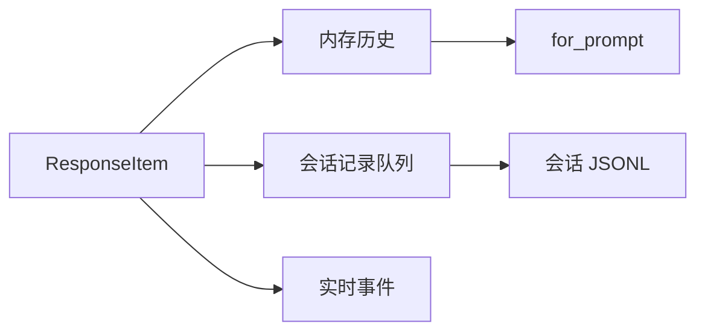
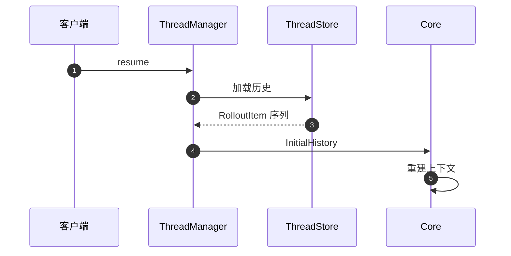
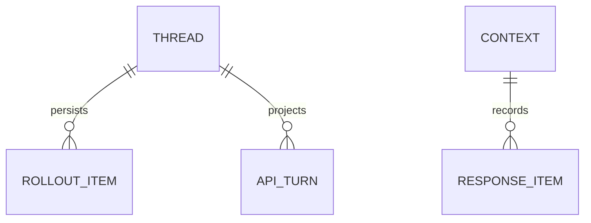

# 上下文与会话

连续对话需要准备下一次模型输入，也需要让结束的线程将来可以恢复。可恢复历史还得兼容压缩、归档与旧记录。一次记录操作可以同时送往内存、持久化和实时输出。 [codex-rs/core/src/session/mod.rs:2527-2547](https://github.com/GLBB/codex/blob/9f42c89c0112771dc29100a6f3fc904049b2655f/codex-rs/core/src/session/mod.rs#L2527-L2547) [codex-rs/protocol/src/protocol.rs:2698-2728](https://github.com/GLBB/codex/blob/9f42c89c0112771dc29100a6f3fc904049b2655f/codex-rs/protocol/src/protocol.rs#L2698-L2728) [codex-rs/core/src/thread_manager.rs:640-685](https://github.com/GLBB/codex/blob/9f42c89c0112771dc29100a6f3fc904049b2655f/codex-rs/core/src/thread_manager.rs#L640-L685)

| 载体 | 表达内容 | 源码 |
| --- | --- | --- |
| `ContextManager` | 经筛选与截断的内存项，`for_prompt` 再规范化和过滤模态 | [codex-rs/core/src/context_manager/history.rs:98-125](https://github.com/GLBB/codex/blob/9f42c89c0112771dc29100a6f3fc904049b2655f/codex-rs/core/src/context_manager/history.rs#L98-L125) [codex-rs/core/src/context_manager/history.rs:362-390](https://github.com/GLBB/codex/blob/9f42c89c0112771dc29100a6f3fc904049b2655f/codex-rs/core/src/context_manager/history.rs#L362-L390) |
| `RolloutItem` | 会话元数据、模型响应项、压缩、回合上下文及事件 | [codex-rs/protocol/src/protocol.rs:2698-2728](https://github.com/GLBB/codex/blob/9f42c89c0112771dc29100a6f3fc904049b2655f/codex-rs/protocol/src/protocol.rs#L2698-L2728) |
| `RolloutRecorder` | 经 writer 队列写入会话记录，提供 `persist` 与 `flush` | [codex-rs/rollout/src/recorder.rs:749-827](https://github.com/GLBB/codex/blob/9f42c89c0112771dc29100a6f3fc904049b2655f/codex-rs/rollout/src/recorder.rs#L749-L827) |
| `ThreadStore` | 读取会话和归档项，结合会话文件与可用的索引 | [codex-rs/thread-store/src/store.rs:28-114](https://github.com/GLBB/codex/blob/9f42c89c0112771dc29100a6f3fc904049b2655f/codex-rs/thread-store/src/store.rs#L28-L114) [codex-rs/thread-store/src/local/read_thread.rs:28-97](https://github.com/GLBB/codex/blob/9f42c89c0112771dc29100a6f3fc904049b2655f/codex-rs/thread-store/src/local/read_thread.rs#L28-L97) |
| app-server 历史视图 | 从 rollout 重建供客户端展示的 turn 列表 | [codex-rs/app-server-protocol/src/protocol/thread_history.rs:74-92](https://github.com/GLBB/codex/blob/9f42c89c0112771dc29100a6f3fc904049b2655f/codex-rs/app-server-protocol/src/protocol/thread_history.rs#L74-L92) |

### 从新记录到模型请求

`record_conversation_items` 先写内存，再交给 rollout 存储，随后发送 raw response item 事件。内存历史先按策略截断工具输出。`for_prompt` 在历史副本中补齐需要的调用结果、移除无匹配调用的输出，并按模型模态移除图片。最终请求还需要请求组装层的字段。 [codex-rs/core/src/session/mod.rs:2527-2547](https://github.com/GLBB/codex/blob/9f42c89c0112771dc29100a6f3fc904049b2655f/codex-rs/core/src/session/mod.rs#L2527-L2547) [codex-rs/core/src/context_manager/history.rs:98-125](https://github.com/GLBB/codex/blob/9f42c89c0112771dc29100a6f3fc904049b2655f/codex-rs/core/src/context_manager/history.rs#L98-L125) [codex-rs/core/src/context_manager/history.rs:362-390](https://github.com/GLBB/codex/blob/9f42c89c0112771dc29100a6f3fc904049b2655f/codex-rs/core/src/context_manager/history.rs#L362-L390) [codex-rs/core/src/client.rs:717-805](https://github.com/GLBB/codex/blob/9f42c89c0112771dc29100a6f3fc904049b2655f/codex-rs/core/src/client.rs#L717-L805)

### 恢复、分叉与压缩

`resume_thread_from_rollout` 从存储加载历史，再进入 `resume_thread_with_history`。Core 根据 rollout 条目重建历史与引用上下文，按压缩和回滚记录调整重放范围。`fork_thread` 根据分叉快照选择历史并启动新线程。客户端从会话条目构建面向展示的 turn 视图。 [codex-rs/core/src/thread_manager.rs:640-685](https://github.com/GLBB/codex/blob/9f42c89c0112771dc29100a6f3fc904049b2655f/codex-rs/core/src/thread_manager.rs#L640-L685) [codex-rs/core/src/session/rollout_reconstruction.rs:87-155](https://github.com/GLBB/codex/blob/9f42c89c0112771dc29100a6f3fc904049b2655f/codex-rs/core/src/session/rollout_reconstruction.rs#L87-L155) [codex-rs/core/src/thread_manager.rs:803-872](https://github.com/GLBB/codex/blob/9f42c89c0112771dc29100a6f3fc904049b2655f/codex-rs/core/src/thread_manager.rs#L803-L872) [codex-rs/app-server-protocol/src/protocol/thread_history.rs:74-92](https://github.com/GLBB/codex/blob/9f42c89c0112771dc29100a6f3fc904049b2655f/codex-rs/app-server-protocol/src/protocol/thread_history.rs#L74-L92)

`record_canonical_items` 成功表示交给了 writer 队列。`persist` 将文件实体化并写入缓冲数据，`flush` 等待 writer 应答。SQLite 状态数据库的路径和会话条目结构各有定义。 [codex-rs/rollout/src/recorder.rs:749-827](https://github.com/GLBB/codex/blob/9f42c89c0112771dc29100a6f3fc904049b2655f/codex-rs/rollout/src/recorder.rs#L749-L827) [codex-rs/state/src/lib.rs:70-90](https://github.com/GLBB/codex/blob/9f42c89c0112771dc29100a6f3fc904049b2655f/codex-rs/state/src/lib.rs#L70-L90) [codex-rs/protocol/src/protocol.rs:2698-2728](https://github.com/GLBB/codex/blob/9f42c89c0112771dc29100a6f3fc904049b2655f/codex-rs/protocol/src/protocol.rs#L2698-L2728)

## 响应项的去向

<!-- Sources: codex-rs/core/src/session/mod.rs:2527, codex-rs/core/src/context_manager/history.rs:98, codex-rs/rollout/src/recorder.rs:749 -->

## 恢复一条会话

<!-- Sources: codex-rs/core/src/thread_manager.rs:640, codex-rs/core/src/session/rollout_reconstruction.rs:87, codex-rs/thread-store/src/store.rs:28 -->

## 会话数据关系

<!-- Sources: codex-rs/protocol/src/protocol.rs:2698, codex-rs/app-server-protocol/src/protocol/thread_history.rs:74, codex-rs/core/src/context_manager/history.rs:98 -->

## 源码索引

- [codex-rs/core/src/session/mod.rs:2527-2547](https://github.com/GLBB/codex/blob/9f42c89c0112771dc29100a6f3fc904049b2655f/codex-rs/core/src/session/mod.rs#L2527-L2547)
- [codex-rs/core/src/context_manager/history.rs:98-125](https://github.com/GLBB/codex/blob/9f42c89c0112771dc29100a6f3fc904049b2655f/codex-rs/core/src/context_manager/history.rs#L98-L125)
- [codex-rs/core/src/context_manager/history.rs:362-390](https://github.com/GLBB/codex/blob/9f42c89c0112771dc29100a6f3fc904049b2655f/codex-rs/core/src/context_manager/history.rs#L362-L390)
- [codex-rs/protocol/src/protocol.rs:2698-2728](https://github.com/GLBB/codex/blob/9f42c89c0112771dc29100a6f3fc904049b2655f/codex-rs/protocol/src/protocol.rs#L2698-L2728)
- [codex-rs/rollout/src/recorder.rs:749-827](https://github.com/GLBB/codex/blob/9f42c89c0112771dc29100a6f3fc904049b2655f/codex-rs/rollout/src/recorder.rs#L749-L827)
- [codex-rs/thread-store/src/store.rs:28-114](https://github.com/GLBB/codex/blob/9f42c89c0112771dc29100a6f3fc904049b2655f/codex-rs/thread-store/src/store.rs#L28-L114)
- [codex-rs/thread-store/src/local/read_thread.rs:28-97](https://github.com/GLBB/codex/blob/9f42c89c0112771dc29100a6f3fc904049b2655f/codex-rs/thread-store/src/local/read_thread.rs#L28-L97)
- [codex-rs/core/src/thread_manager.rs:640-685](https://github.com/GLBB/codex/blob/9f42c89c0112771dc29100a6f3fc904049b2655f/codex-rs/core/src/thread_manager.rs#L640-L685)
- [codex-rs/core/src/session/rollout_reconstruction.rs:87-155](https://github.com/GLBB/codex/blob/9f42c89c0112771dc29100a6f3fc904049b2655f/codex-rs/core/src/session/rollout_reconstruction.rs#L87-L155)
- [codex-rs/core/src/thread_manager.rs:803-872](https://github.com/GLBB/codex/blob/9f42c89c0112771dc29100a6f3fc904049b2655f/codex-rs/core/src/thread_manager.rs#L803-L872)
- [codex-rs/app-server-protocol/src/protocol/thread_history.rs:74-92](https://github.com/GLBB/codex/blob/9f42c89c0112771dc29100a6f3fc904049b2655f/codex-rs/app-server-protocol/src/protocol/thread_history.rs#L74-L92)
- [codex-rs/state/src/lib.rs:70-90](https://github.com/GLBB/codex/blob/9f42c89c0112771dc29100a6f3fc904049b2655f/codex-rs/state/src/lib.rs#L70-L90)
- [codex-rs/core/src/client.rs:717-805](https://github.com/GLBB/codex/blob/9f42c89c0112771dc29100a6f3fc904049b2655f/codex-rs/core/src/client.rs#L717-L805)

## 继续阅读

- [Agent Loop](agent-loop.md)
- [可观测性](../deep-dive/observability.md)
- [长期记忆](../deep-dive/memories.md)
- [Rollout 会话日志](../deep-dive/rollout-session.md)
