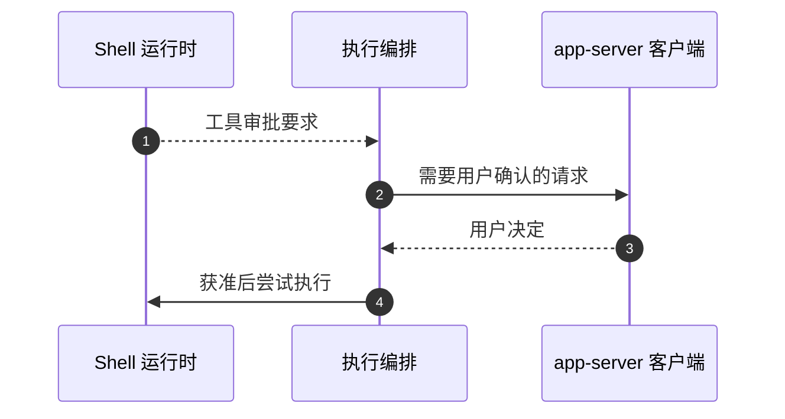
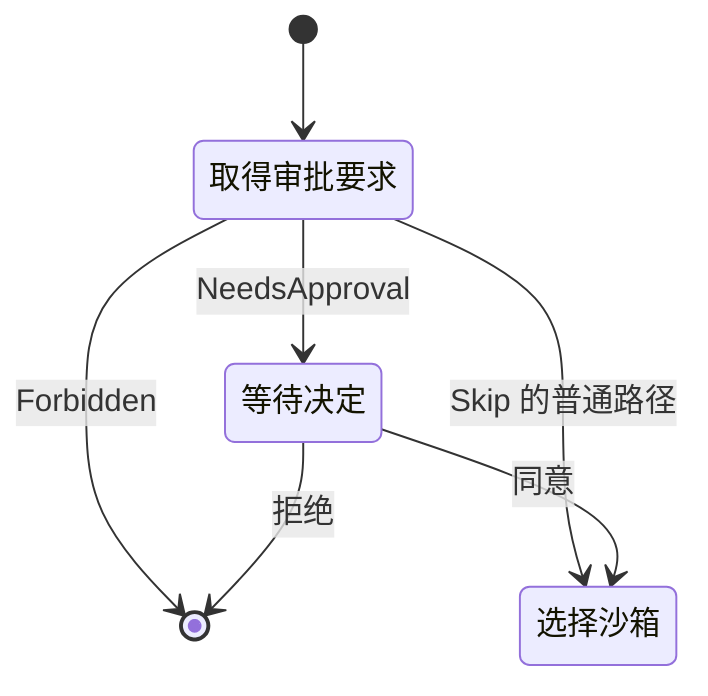

# 工具调度与权限

模型选择工具时产生结构化调用。Core 用已注册的工具处理参数、关联调用 ID，并根据运行配置决定能否执行及在哪个边界内执行。 [codex-rs/core/src/tools/router.rs:89-137](https://github.com/GLBB/codex/blob/9f42c89c0112771dc29100a6f3fc904049b2655f/codex-rs/core/src/tools/router.rs#L89-L137) [codex-rs/core/src/tools/registry.rs:397-475](https://github.com/GLBB/codex/blob/9f42c89c0112771dc29100a6f3fc904049b2655f/codex-rs/core/src/tools/registry.rs#L397-L475) [codex-rs/core/src/tools/orchestrator.rs:128-263](https://github.com/GLBB/codex/blob/9f42c89c0112771dc29100a6f3fc904049b2655f/codex-rs/core/src/tools/orchestrator.rs#L128-L263)

| 角色 | 处理的数据 | 源码 |
| --- | --- | --- |
| `ToolRouter` | 把模型输出解析为工具名、调用 ID 和参数载荷 | [codex-rs/core/src/tools/router.rs:89-137](https://github.com/GLBB/codex/blob/9f42c89c0112771dc29100a6f3fc904049b2655f/codex-rs/core/src/tools/router.rs#L89-L137) |
| `ToolCallRuntime` | 将执行与取消绑定到当前回合，产生可回给模型的输入项 | [codex-rs/core/src/tools/parallel.rs:63-154](https://github.com/GLBB/codex/blob/9f42c89c0112771dc29100a6f3fc904049b2655f/codex-rs/core/src/tools/parallel.rs#L63-L154) |
| `ToolRegistry` | 按名字查运行时，校验载荷类型，处理分派错误 | [codex-rs/core/src/tools/registry.rs:397-475](https://github.com/GLBB/codex/blob/9f42c89c0112771dc29100a6f3fc904049b2655f/codex-rs/core/src/tools/registry.rs#L397-L475) |
| `ToolOrchestrator` | 处理可跳过、禁止及需审批等分支，选择首次尝试的沙箱 | [codex-rs/core/src/tools/orchestrator.rs:128-263](https://github.com/GLBB/codex/blob/9f42c89c0112771dc29100a6f3fc904049b2655f/codex-rs/core/src/tools/orchestrator.rs#L128-L263) |
| Shell 运行时 | 给出请求的审批要求，并落实执行 | [codex-rs/core/src/tools/runtimes/shell.rs:184-257](https://github.com/GLBB/codex/blob/9f42c89c0112771dc29100a6f3fc904049b2655f/codex-rs/core/src/tools/runtimes/shell.rs#L184-L257) |

### 沿命令调用找错误

`handle_output_item_done` 记录模型发出的调用，再创建工具 future。`ToolRegistry` 缺少运行时或接到不匹配的载荷时，会返回可反馈给模型的错误。复核一次工具失败时，可以先查看工具已注册且载荷可接受，再查命令执行结果。 [codex-rs/core/src/stream_events_utils.rs:342-385](https://github.com/GLBB/codex/blob/9f42c89c0112771dc29100a6f3fc904049b2655f/codex-rs/core/src/stream_events_utils.rs#L342-L385) [codex-rs/core/src/tools/router.rs:89-137](https://github.com/GLBB/codex/blob/9f42c89c0112771dc29100a6f3fc904049b2655f/codex-rs/core/src/tools/router.rs#L89-L137) [codex-rs/core/src/tools/registry.rs:397-475](https://github.com/GLBB/codex/blob/9f42c89c0112771dc29100a6f3fc904049b2655f/codex-rs/core/src/tools/registry.rs#L397-L475)

### 规则、询问与执行约束

`AskForApproval` 表达审批策略。Shell runtime 按执行规则等信息给 orchestrator 提供要求，orchestrator 根据审批判定结束或开始一次尝试。初次沙箱还受文件系统、网络和平台配置影响。用户确认通过 app-server 发出的带 ID 请求往返。 [codex-rs/protocol/src/protocol.rs:764-821](https://github.com/GLBB/codex/blob/9f42c89c0112771dc29100a6f3fc904049b2655f/codex-rs/protocol/src/protocol.rs#L764-L821) [codex-rs/execpolicy/src/policy.rs:24-94](https://github.com/GLBB/codex/blob/9f42c89c0112771dc29100a6f3fc904049b2655f/codex-rs/execpolicy/src/policy.rs#L24-L94) [codex-rs/core/src/tools/runtimes/shell.rs:184-257](https://github.com/GLBB/codex/blob/9f42c89c0112771dc29100a6f3fc904049b2655f/codex-rs/core/src/tools/runtimes/shell.rs#L184-L257) [codex-rs/core/src/tools/orchestrator.rs:128-263](https://github.com/GLBB/codex/blob/9f42c89c0112771dc29100a6f3fc904049b2655f/codex-rs/core/src/tools/orchestrator.rs#L128-L263) [codex-rs/app-server/README.md:1300-1327](https://github.com/GLBB/codex/blob/9f42c89c0112771dc29100a6f3fc904049b2655f/codex-rs/app-server/README.md#L1300-L1327)

用 `call_id` 对齐模型调用、调度上下文和返回项。提交给下一次模型采样的是写回内存历史的工具结果。 [codex-rs/core/src/tools/router.rs:89-137](https://github.com/GLBB/codex/blob/9f42c89c0112771dc29100a6f3fc904049b2655f/codex-rs/core/src/tools/router.rs#L89-L137) [codex-rs/core/src/tools/registry.rs:397-475](https://github.com/GLBB/codex/blob/9f42c89c0112771dc29100a6f3fc904049b2655f/codex-rs/core/src/tools/registry.rs#L397-L475) [codex-rs/core/src/session/turn.rs:1655-1675](https://github.com/GLBB/codex/blob/9f42c89c0112771dc29100a6f3fc904049b2655f/codex-rs/core/src/session/turn.rs#L1655-L1675)

## 工具调用分层

<!-- Sources: codex-rs/core/src/stream_events_utils.rs:342, codex-rs/core/src/tools/router.rs:89, codex-rs/core/src/tools/registry.rs:397 -->

## 审批交互

<!-- Sources: codex-rs/core/src/tools/runtimes/shell.rs:184, codex-rs/core/src/tools/orchestrator.rs:128, codex-rs/app-server/README.md:1300 -->

## 初次执行前的决策

<!-- Sources: codex-rs/protocol/src/protocol.rs:764, codex-rs/core/src/tools/orchestrator.rs:128 -->

## 源码索引

- [codex-rs/core/src/stream_events_utils.rs:342-385](https://github.com/GLBB/codex/blob/9f42c89c0112771dc29100a6f3fc904049b2655f/codex-rs/core/src/stream_events_utils.rs#L342-L385)
- [codex-rs/core/src/tools/router.rs:89-137](https://github.com/GLBB/codex/blob/9f42c89c0112771dc29100a6f3fc904049b2655f/codex-rs/core/src/tools/router.rs#L89-L137)
- [codex-rs/core/src/tools/parallel.rs:63-154](https://github.com/GLBB/codex/blob/9f42c89c0112771dc29100a6f3fc904049b2655f/codex-rs/core/src/tools/parallel.rs#L63-L154)
- [codex-rs/core/src/tools/registry.rs:397-475](https://github.com/GLBB/codex/blob/9f42c89c0112771dc29100a6f3fc904049b2655f/codex-rs/core/src/tools/registry.rs#L397-L475)
- [codex-rs/protocol/src/protocol.rs:764-821](https://github.com/GLBB/codex/blob/9f42c89c0112771dc29100a6f3fc904049b2655f/codex-rs/protocol/src/protocol.rs#L764-L821)
- [codex-rs/execpolicy/src/policy.rs:24-94](https://github.com/GLBB/codex/blob/9f42c89c0112771dc29100a6f3fc904049b2655f/codex-rs/execpolicy/src/policy.rs#L24-L94)
- [codex-rs/core/src/tools/runtimes/shell.rs:184-257](https://github.com/GLBB/codex/blob/9f42c89c0112771dc29100a6f3fc904049b2655f/codex-rs/core/src/tools/runtimes/shell.rs#L184-L257)
- [codex-rs/core/src/tools/orchestrator.rs:128-263](https://github.com/GLBB/codex/blob/9f42c89c0112771dc29100a6f3fc904049b2655f/codex-rs/core/src/tools/orchestrator.rs#L128-L263)
- [codex-rs/app-server/README.md:1300-1327](https://github.com/GLBB/codex/blob/9f42c89c0112771dc29100a6f3fc904049b2655f/codex-rs/app-server/README.md#L1300-L1327)
- [codex-rs/core/src/session/turn.rs:1655-1675](https://github.com/GLBB/codex/blob/9f42c89c0112771dc29100a6f3fc904049b2655f/codex-rs/core/src/session/turn.rs#L1655-L1675)

## 继续阅读

- [Agent Loop](agent-loop.md)
- [配置、技能与 MCP](../deep-dive/config-extensions.md)
- [工具调用、审批与动态工具](../protocols/tools-approval.md)
