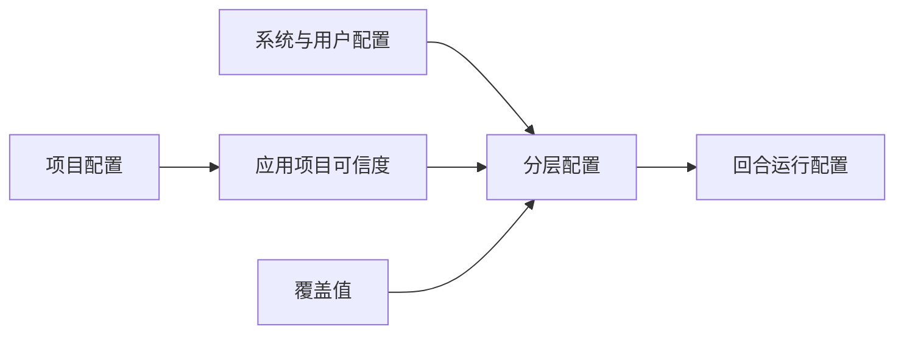
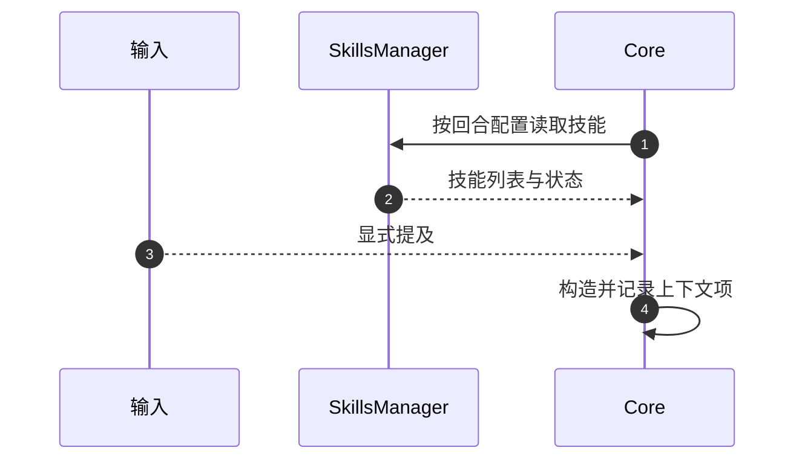

# 配置、技能与 MCP

同一程序需要适配用户偏好、组织要求和工作目录。配置加载阶段解析这些来源，执行阶段按回合选择指令和可用能力。Skill 通过上下文给模型补充操作说明，MCP 连接管理器提供远端或外部进程中的工具列表和调用接口。 [codex-rs/config/src/loader/mod.rs:111-245](https://github.com/GLBB/codex/blob/9f42c89c0112771dc29100a6f3fc904049b2655f/codex-rs/config/src/loader/mod.rs#L111-L245) [codex-rs/core-skills/src/manager.rs:90-165](https://github.com/GLBB/codex/blob/9f42c89c0112771dc29100a6f3fc904049b2655f/codex-rs/core-skills/src/manager.rs#L90-L165) [codex-rs/core/src/session/turn.rs:432-552](https://github.com/GLBB/codex/blob/9f42c89c0112771dc29100a6f3fc904049b2655f/codex-rs/core/src/session/turn.rs#L432-L552) [codex-rs/codex-mcp/src/connection_manager.rs:368-403](https://github.com/GLBB/codex/blob/9f42c89c0112771dc29100a6f3fc904049b2655f/codex-rs/codex-mcp/src/connection_manager.rs#L368-L403) [codex-rs/codex-mcp/src/connection_manager.rs:590-641](https://github.com/GLBB/codex/blob/9f42c89c0112771dc29100a6f3fc904049b2655f/codex-rs/codex-mcp/src/connection_manager.rs#L590-L641)

| 边界 | 产物 | 源码 |
| --- | --- | --- |
| 配置加载 | 系统、用户、profile、项目和覆盖值组成分层配置，管理要求带来源 | [codex-rs/config/src/loader/mod.rs:111-245](https://github.com/GLBB/codex/blob/9f42c89c0112771dc29100a6f3fc904049b2655f/codex-rs/config/src/loader/mod.rs#L111-L245) [codex-rs/config/src/state.rs:449-475](https://github.com/GLBB/codex/blob/9f42c89c0112771dc29100a6f3fc904049b2655f/codex-rs/config/src/state.rs#L449-L475) |
| 项目可信度 | 对配置层标记禁用原因并清理特定键 | [codex-rs/config/src/loader/mod.rs:864-914](https://github.com/GLBB/codex/blob/9f42c89c0112771dc29100a6f3fc904049b2655f/codex-rs/config/src/loader/mod.rs#L864-L914) |
| Skill 读取 | 按配置计算目录与缓存，通过 outcome 返回能力 | [codex-rs/core-skills/src/manager.rs:90-165](https://github.com/GLBB/codex/blob/9f42c89c0112771dc29100a6f3fc904049b2655f/codex-rs/core-skills/src/manager.rs#L90-L165) |
| 回合注入 | 消费用户显式提到的 skill、plugin 和 app，准备输入项 | [codex-rs/core/src/session/turn.rs:432-552](https://github.com/GLBB/codex/blob/9f42c89c0112771dc29100a6f3fc904049b2655f/codex-rs/core/src/session/turn.rs#L432-L552) |
| MCP | 枚举已连接服务器的工具，按服务器名和工具名发起调用 | [codex-rs/codex-mcp/src/connection_manager.rs:368-403](https://github.com/GLBB/codex/blob/9f42c89c0112771dc29100a6f3fc904049b2655f/codex-rs/codex-mcp/src/connection_manager.rs#L368-L403) [codex-rs/core/src/session/mcp.rs:290-326](https://github.com/GLBB/codex/blob/9f42c89c0112771dc29100a6f3fc904049b2655f/codex-rs/core/src/session/mcp.rs#L290-L326) [codex-rs/codex-mcp/src/connection_manager.rs:590-641](https://github.com/GLBB/codex/blob/9f42c89c0112771dc29100a6f3fc904049b2655f/codex-rs/codex-mcp/src/connection_manager.rs#L590-L641) |

### 排查同一配置为何在两个目录不同

先确定 `cwd` 与相应的可信度，再查 `ConfigLayerStack::effective_config` 中启用层的合并结果。管理要求与请求的覆盖值分别进入加载过程。最终由 `ConfigBuilder` 等入口把外部设置导入 Core 的配置。 [codex-rs/config/src/loader/mod.rs:111-245](https://github.com/GLBB/codex/blob/9f42c89c0112771dc29100a6f3fc904049b2655f/codex-rs/config/src/loader/mod.rs#L111-L245) [codex-rs/config/src/loader/mod.rs:864-914](https://github.com/GLBB/codex/blob/9f42c89c0112771dc29100a6f3fc904049b2655f/codex-rs/config/src/loader/mod.rs#L864-L914) [codex-rs/config/src/state.rs:449-475](https://github.com/GLBB/codex/blob/9f42c89c0112771dc29100a6f3fc904049b2655f/codex-rs/config/src/state.rs#L449-L475) [codex-rs/core/src/config/mod.rs:1063-1140](https://github.com/GLBB/codex/blob/9f42c89c0112771dc29100a6f3fc904049b2655f/codex-rs/core/src/config/mod.rs#L1063-L1140)

### 从说明到工具执行

`build_skills_and_plugins` 解析输入引用后构造要注入的上下文项，`run_turn` 把它们加入历史。模型后续选择 MCP 工具时，Core 会把调用交给会话的 MCP 连接管理器，后者找到相应客户端并执行调用。调试时用「能否发现 skill」「是否出现在这轮上下文」「工具是否可调用」三个问题分别定位。 [codex-rs/core/src/session/turn.rs:131-183](https://github.com/GLBB/codex/blob/9f42c89c0112771dc29100a6f3fc904049b2655f/codex-rs/core/src/session/turn.rs#L131-L183) [codex-rs/core/src/session/turn.rs:432-552](https://github.com/GLBB/codex/blob/9f42c89c0112771dc29100a6f3fc904049b2655f/codex-rs/core/src/session/turn.rs#L432-L552) [codex-rs/core/src/session/mcp.rs:290-326](https://github.com/GLBB/codex/blob/9f42c89c0112771dc29100a6f3fc904049b2655f/codex-rs/core/src/session/mcp.rs#L290-L326) [codex-rs/codex-mcp/src/connection_manager.rs:590-641](https://github.com/GLBB/codex/blob/9f42c89c0112771dc29100a6f3fc904049b2655f/codex-rs/codex-mcp/src/connection_manager.rs#L590-L641)

## 配置来源

<!-- Sources: codex-rs/config/src/loader/mod.rs:111, codex-rs/config/src/loader/mod.rs:864, codex-rs/config/src/state.rs:449, codex-rs/core/src/config/mod.rs:1063 -->

## Skill 进入回合

<!-- Sources: codex-rs/core-skills/src/manager.rs:90, codex-rs/core/src/session/turn.rs:432, codex-rs/core/src/session/turn.rs:131 -->

## MCP 工具调用

<!-- Sources: codex-rs/codex-mcp/src/connection_manager.rs:368, codex-rs/core/src/session/mcp.rs:290, codex-rs/codex-mcp/src/connection_manager.rs:590 -->

## 源码索引

- [codex-rs/config/src/loader/mod.rs:111-245](https://github.com/GLBB/codex/blob/9f42c89c0112771dc29100a6f3fc904049b2655f/codex-rs/config/src/loader/mod.rs#L111-L245)
- [codex-rs/config/src/loader/mod.rs:864-914](https://github.com/GLBB/codex/blob/9f42c89c0112771dc29100a6f3fc904049b2655f/codex-rs/config/src/loader/mod.rs#L864-L914)
- [codex-rs/config/src/state.rs:449-475](https://github.com/GLBB/codex/blob/9f42c89c0112771dc29100a6f3fc904049b2655f/codex-rs/config/src/state.rs#L449-L475)
- [codex-rs/core/src/config/mod.rs:1063-1140](https://github.com/GLBB/codex/blob/9f42c89c0112771dc29100a6f3fc904049b2655f/codex-rs/core/src/config/mod.rs#L1063-L1140)
- [codex-rs/core-skills/src/manager.rs:90-165](https://github.com/GLBB/codex/blob/9f42c89c0112771dc29100a6f3fc904049b2655f/codex-rs/core-skills/src/manager.rs#L90-L165)
- [codex-rs/core/src/session/turn.rs:432-552](https://github.com/GLBB/codex/blob/9f42c89c0112771dc29100a6f3fc904049b2655f/codex-rs/core/src/session/turn.rs#L432-L552)
- [codex-rs/core/src/session/turn.rs:131-183](https://github.com/GLBB/codex/blob/9f42c89c0112771dc29100a6f3fc904049b2655f/codex-rs/core/src/session/turn.rs#L131-L183)
- [codex-rs/codex-mcp/src/connection_manager.rs:368-403](https://github.com/GLBB/codex/blob/9f42c89c0112771dc29100a6f3fc904049b2655f/codex-rs/codex-mcp/src/connection_manager.rs#L368-L403)
- [codex-rs/core/src/session/mcp.rs:290-326](https://github.com/GLBB/codex/blob/9f42c89c0112771dc29100a6f3fc904049b2655f/codex-rs/core/src/session/mcp.rs#L290-L326)
- [codex-rs/codex-mcp/src/connection_manager.rs:590-641](https://github.com/GLBB/codex/blob/9f42c89c0112771dc29100a6f3fc904049b2655f/codex-rs/codex-mcp/src/connection_manager.rs#L590-L641)

## 继续阅读

- [工具调度与权限](../architecture/tools-permissions.md)
- [模型请求与响应流](model-transport.md)
- [MCP 与 Hook 扩展协议](../protocols/mcp-hooks.md)
