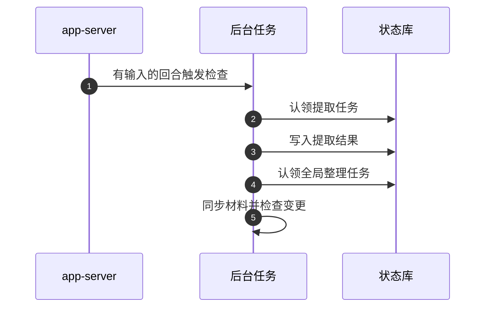
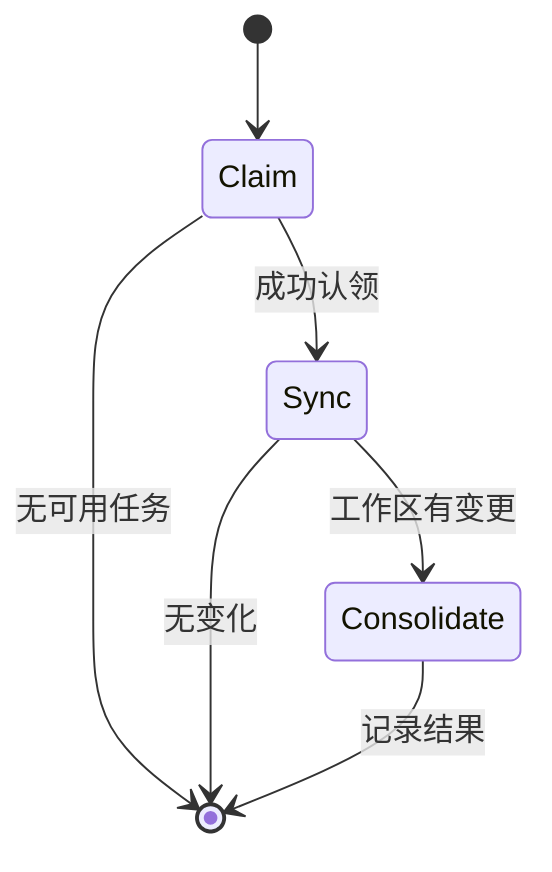

# 长期记忆的写入与读取

会话历史提供恢复某个线程所需的记录。记忆管道从符合条件的历史提取信息，整理供其他线程使用的材料，读取侧再按配置向当前上下文注入说明或提供工具。 [codex-rs/core/src/thread_manager.rs:640-685](https://github.com/GLBB/codex/blob/9f42c89c0112771dc29100a6f3fc904049b2655f/codex-rs/core/src/thread_manager.rs#L640-L685) [codex-rs/memories/write/src/start.rs:22-75](https://github.com/GLBB/codex/blob/9f42c89c0112771dc29100a6f3fc904049b2655f/codex-rs/memories/write/src/start.rs#L22-L75) [codex-rs/memories/write/src/phase1.rs:225-322](https://github.com/GLBB/codex/blob/9f42c89c0112771dc29100a6f3fc904049b2655f/codex-rs/memories/write/src/phase1.rs#L225-L322) [codex-rs/memories/write/src/phase2.rs:43-153](https://github.com/GLBB/codex/blob/9f42c89c0112771dc29100a6f3fc904049b2655f/codex-rs/memories/write/src/phase2.rs#L43-L153) [codex-rs/ext/memories/src/extension.rs:23-98](https://github.com/GLBB/codex/blob/9f42c89c0112771dc29100a6f3fc904049b2655f/codex-rs/ext/memories/src/extension.rs#L23-L98)

| 阶段 | 输入和输出 | 源码 |
| --- | --- | --- |
| 后台入口 | 收到符合运行条件的线程，后台做清理和限额检查，先后调度两阶段 | [codex-rs/app-server/src/request_processors/turn_processor.rs:355-433](https://github.com/GLBB/codex/blob/9f42c89c0112771dc29100a6f3fc904049b2655f/codex-rs/app-server/src/request_processors/turn_processor.rs#L355-L433) [codex-rs/memories/write/src/start.rs:22-75](https://github.com/GLBB/codex/blob/9f42c89c0112771dc29100a6f3fc904049b2655f/codex-rs/memories/write/src/start.rs#L22-L75) |
| Phase 1 | 从有租约的会话任务读取历史，过滤响应项，采样得到原始记忆与摘要 | [codex-rs/memories/README.md:31-78](https://github.com/GLBB/codex/blob/9f42c89c0112771dc29100a6f3fc904049b2655f/codex-rs/memories/README.md#L31-L78) [codex-rs/memories/write/src/phase1.rs:225-322](https://github.com/GLBB/codex/blob/9f42c89c0112771dc29100a6f3fc904049b2655f/codex-rs/memories/write/src/phase1.rs#L225-L322) |
| Phase 2 | 取得全局任务租约，按规则载入 Stage 1 结果，同步本地目录并判断变化 | [codex-rs/memories/write/src/phase2.rs:43-153](https://github.com/GLBB/codex/blob/9f42c89c0112771dc29100a6f3fc904049b2655f/codex-rs/memories/write/src/phase2.rs#L43-L153) |
| 整理代理 | 使用单独构造的配置运行整理任务 | [codex-rs/memories/write/src/phase2.rs:294-358](https://github.com/GLBB/codex/blob/9f42c89c0112771dc29100a6f3fc904049b2655f/codex-rs/memories/write/src/phase2.rs#L294-L358) |
| 读取 | 在启用记忆及读取选项时，加载摘要，并向当前线程提供本地工具 | [codex-rs/memories/read/src/prompts.rs:22-55](https://github.com/GLBB/codex/blob/9f42c89c0112771dc29100a6f3fc904049b2655f/codex-rs/memories/read/src/prompts.rs#L22-L55) [codex-rs/ext/memories/src/extension.rs:23-98](https://github.com/GLBB/codex/blob/9f42c89c0112771dc29100a6f3fc904049b2655f/codex-rs/ext/memories/src/extension.rs#L23-L98) |

### 一次生成何时开始

应用服务器的 turn 处理器在有用户输入的启动请求后调用 `start_memories_startup_task`。入口排除临时线程、未启用记忆工具的配置及非根代理。状态库缺失会跳过后台处理，限额检查发生在两个阶段之前。排查未生成时，按入口判断和任务认领顺序检查。 [codex-rs/app-server/src/request_processors/turn_processor.rs:355-433](https://github.com/GLBB/codex/blob/9f42c89c0112771dc29100a6f3fc904049b2655f/codex-rs/app-server/src/request_processors/turn_processor.rs#L355-L433) [codex-rs/memories/write/src/start.rs:22-75](https://github.com/GLBB/codex/blob/9f42c89c0112771dc29100a6f3fc904049b2655f/codex-rs/memories/write/src/start.rs#L22-L75) [codex-rs/memories/write/src/phase1.rs:225-322](https://github.com/GLBB/codex/blob/9f42c89c0112771dc29100a6f3fc904049b2655f/codex-rs/memories/write/src/phase1.rs#L225-L322)

### 原始记录怎样变成可读记忆

提取任务把会话条目过滤后交给模型，读取结构化结果，再写回 Stage 1 结果。整理阶段从状态库选择输入，同步原始记忆和各线程摘要，用工作区变化决定是否启动整理代理。记忆目录由 `memory_root` 根据 Codex home 解析。 [codex-rs/memories/write/src/phase1.rs:225-322](https://github.com/GLBB/codex/blob/9f42c89c0112771dc29100a6f3fc904049b2655f/codex-rs/memories/write/src/phase1.rs#L225-L322) [codex-rs/memories/write/src/phase2.rs:43-153](https://github.com/GLBB/codex/blob/9f42c89c0112771dc29100a6f3fc904049b2655f/codex-rs/memories/write/src/phase2.rs#L43-L153) [codex-rs/memories/write/src/phase2.rs:294-358](https://github.com/GLBB/codex/blob/9f42c89c0112771dc29100a6f3fc904049b2655f/codex-rs/memories/write/src/phase2.rs#L294-L358) [codex-rs/memories/write/src/lib.rs:118-136](https://github.com/GLBB/codex/blob/9f42c89c0112771dc29100a6f3fc904049b2655f/codex-rs/memories/write/src/lib.rs#L118-L136)

读取侧用线程配置控制上下文贡献和工具。`build_memory_tool_developer_instructions` 尝试读取 `memory_summary.md`，按预算截断并跳过空摘要。扩展把结果包装成开发者说明，并提供依赖本地后端的记忆工具。已有原始摘要与实际注入量要分别查这两个位置。 [codex-rs/memories/read/src/prompts.rs:22-55](https://github.com/GLBB/codex/blob/9f42c89c0112771dc29100a6f3fc904049b2655f/codex-rs/memories/read/src/prompts.rs#L22-L55) [codex-rs/ext/memories/src/extension.rs:23-98](https://github.com/GLBB/codex/blob/9f42c89c0112771dc29100a6f3fc904049b2655f/codex-rs/ext/memories/src/extension.rs#L23-L98)

## 写入与读取

<!-- Sources: codex-rs/memories/write/src/phase1.rs:225, codex-rs/memories/write/src/phase2.rs:43, codex-rs/ext/memories/src/extension.rs:23 -->

## 后端触发与两阶段工作

<!-- Sources: codex-rs/app-server/src/request_processors/turn_processor.rs:355, codex-rs/memories/write/src/start.rs:22, codex-rs/memories/write/src/phase1.rs:225, codex-rs/memories/write/src/phase2.rs:43 -->

## 整理步骤

<!-- Sources: codex-rs/memories/write/src/phase2.rs:43, codex-rs/memories/write/src/phase2.rs:294 -->

## 源码索引

- [codex-rs/app-server/src/request_processors/turn_processor.rs:355-433](https://github.com/GLBB/codex/blob/9f42c89c0112771dc29100a6f3fc904049b2655f/codex-rs/app-server/src/request_processors/turn_processor.rs#L355-L433)
- [codex-rs/memories/write/src/start.rs:22-75](https://github.com/GLBB/codex/blob/9f42c89c0112771dc29100a6f3fc904049b2655f/codex-rs/memories/write/src/start.rs#L22-L75)
- [codex-rs/memories/README.md:31-78](https://github.com/GLBB/codex/blob/9f42c89c0112771dc29100a6f3fc904049b2655f/codex-rs/memories/README.md#L31-L78)
- [codex-rs/memories/write/src/phase1.rs:225-322](https://github.com/GLBB/codex/blob/9f42c89c0112771dc29100a6f3fc904049b2655f/codex-rs/memories/write/src/phase1.rs#L225-L322)
- [codex-rs/memories/write/src/phase2.rs:43-153](https://github.com/GLBB/codex/blob/9f42c89c0112771dc29100a6f3fc904049b2655f/codex-rs/memories/write/src/phase2.rs#L43-L153)
- [codex-rs/memories/write/src/phase2.rs:294-358](https://github.com/GLBB/codex/blob/9f42c89c0112771dc29100a6f3fc904049b2655f/codex-rs/memories/write/src/phase2.rs#L294-L358)
- [codex-rs/memories/write/src/lib.rs:118-136](https://github.com/GLBB/codex/blob/9f42c89c0112771dc29100a6f3fc904049b2655f/codex-rs/memories/write/src/lib.rs#L118-L136)
- [codex-rs/memories/read/src/prompts.rs:22-55](https://github.com/GLBB/codex/blob/9f42c89c0112771dc29100a6f3fc904049b2655f/codex-rs/memories/read/src/prompts.rs#L22-L55)
- [codex-rs/ext/memories/src/extension.rs:23-98](https://github.com/GLBB/codex/blob/9f42c89c0112771dc29100a6f3fc904049b2655f/codex-rs/ext/memories/src/extension.rs#L23-L98)
- [codex-rs/core/src/thread_manager.rs:640-685](https://github.com/GLBB/codex/blob/9f42c89c0112771dc29100a6f3fc904049b2655f/codex-rs/core/src/thread_manager.rs#L640-L685)

## 继续阅读

- [上下文与会话](../architecture/session-state.md)
- [配置、技能与 MCP](config-extensions.md)
- [可观测性](observability.md)
