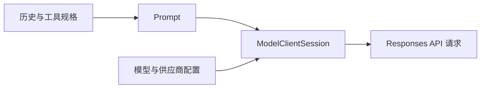
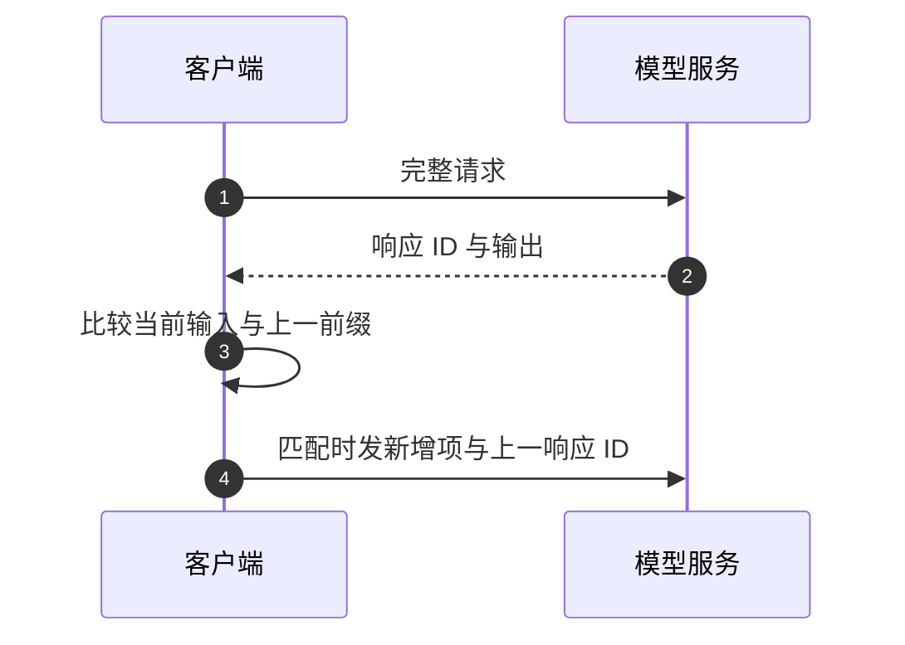
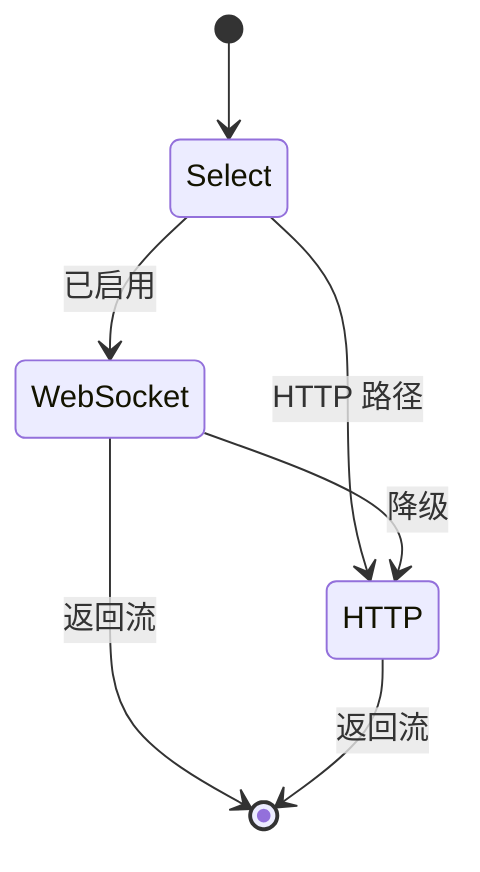

# 模型请求与响应流

采样循环需要把 Core 的历史与工具设置转换成模型可接受的请求，并把流式输出还原为内部事件。`ModelClient` 管理客户端状态，`ModelClientSession` 为回合保留连接缓存和路由状态。 [codex-rs/core/src/client_common.rs:25-62](https://github.com/GLBB/codex/blob/9f42c89c0112771dc29100a6f3fc904049b2655f/codex-rs/core/src/client_common.rs#L25-L62) [codex-rs/core/src/client.rs:219-247](https://github.com/GLBB/codex/blob/9f42c89c0112771dc29100a6f3fc904049b2655f/codex-rs/core/src/client.rs#L219-L247) [codex-rs/core/src/session/turn.rs:131-183](https://github.com/GLBB/codex/blob/9f42c89c0112771dc29100a6f3fc904049b2655f/codex-rs/core/src/session/turn.rs#L131-L183)

| 阶段 | 输入与输出 | 源码 |
| --- | --- | --- |
| 模型配置 | 供应商提供认证及 API 客户端信息，模型管理器提供 `ModelInfo` | [codex-rs/model-provider/src/provider.rs:81-155](https://github.com/GLBB/codex/blob/9f42c89c0112771dc29100a6f3fc904049b2655f/codex-rs/model-provider/src/provider.rs#L81-L155) [codex-rs/models-manager/src/manager.rs:140-174](https://github.com/GLBB/codex/blob/9f42c89c0112771dc29100a6f3fc904049b2655f/codex-rs/models-manager/src/manager.rs#L140-L174) |
| 请求构建 | `Prompt` 加模型、服务档次和推理设置，得到 Responses 请求 | [codex-rs/core/src/session/turn.rs:863-947](https://github.com/GLBB/codex/blob/9f42c89c0112771dc29100a6f3fc904049b2655f/codex-rs/core/src/session/turn.rs#L863-L947) [codex-rs/core/src/client.rs:717-805](https://github.com/GLBB/codex/blob/9f42c89c0112771dc29100a6f3fc904049b2655f/codex-rs/core/src/client.rs#L717-L805) |
| 发送 | 客户端按 provider 和连接状态选 WebSocket 或 HTTP | [codex-rs/core/src/client.rs:1570-1642](https://github.com/GLBB/codex/blob/9f42c89c0112771dc29100a6f3fc904049b2655f/codex-rs/core/src/client.rs#L1570-L1642) [codex-rs/codex-api/src/endpoint/responses.rs:69-115](https://github.com/GLBB/codex/blob/9f42c89c0112771dc29100a6f3fc904049b2655f/codex-rs/codex-api/src/endpoint/responses.rs#L69-L115) |
| 解码 | 传输层产生 `ResponseEvent`，Core 处理完整输出项和增量 | [codex-rs/codex-api/src/common.rs:72-150](https://github.com/GLBB/codex/blob/9f42c89c0112771dc29100a6f3fc904049b2655f/codex-rs/codex-api/src/common.rs#L72-L150) [codex-rs/core/src/session/turn.rs:1788-1878](https://github.com/GLBB/codex/blob/9f42c89c0112771dc29100a6f3fc904049b2655f/codex-rs/core/src/session/turn.rs#L1788-L1878) |

### 连续采样如何省去重复传输

WebSocket 增量路径检查上一请求与当前请求的设置和输入前缀，并需要上一响应 ID。满足条件时，下一次发送新增输入和 `previous_response_id`。分析一轮完整模型上下文时，要先找出该请求引用的数据，传输中出现的短请求可能只是同一上下文的增量。 [codex-rs/core/src/client.rs:996-1074](https://github.com/GLBB/codex/blob/9f42c89c0112771dc29100a6f3fc904049b2655f/codex-rs/core/src/client.rs#L996-L1074)

`ModelClientSession::stream` 会在 WebSocket 返回 HTTP 降级信号时走 HTTP。采样循环还根据错误类型和重试预算决定重试、切换或结束，使用量达到上限和上下文窗口超出有专门分支。 [codex-rs/core/src/client.rs:1570-1642](https://github.com/GLBB/codex/blob/9f42c89c0112771dc29100a6f3fc904049b2655f/codex-rs/core/src/client.rs#L1570-L1642) [codex-rs/core/src/session/turn.rs:947-1021](https://github.com/GLBB/codex/blob/9f42c89c0112771dc29100a6f3fc904049b2655f/codex-rs/core/src/session/turn.rs#L947-L1021)

### 并排观察协议与模型结果

读取 `ResponseEvent` 中的增量、完整项与完成事件。工具调用在完整项阶段进入执行，最终工具结果只有被记录并进入下一次 prompt 时才成为模型的新输入。查一次请求的准确证据时，可使用[Trajectory](trajectory.md)记录的请求形态。 [codex-rs/codex-api/src/common.rs:72-150](https://github.com/GLBB/codex/blob/9f42c89c0112771dc29100a6f3fc904049b2655f/codex-rs/codex-api/src/common.rs#L72-L150) [codex-rs/core/src/session/turn.rs:1788-1878](https://github.com/GLBB/codex/blob/9f42c89c0112771dc29100a6f3fc904049b2655f/codex-rs/core/src/session/turn.rs#L1788-L1878) [codex-rs/core/src/stream_events_utils.rs:342-385](https://github.com/GLBB/codex/blob/9f42c89c0112771dc29100a6f3fc904049b2655f/codex-rs/core/src/stream_events_utils.rs#L342-L385) [codex-rs/core/src/session/turn.rs:1655-1675](https://github.com/GLBB/codex/blob/9f42c89c0112771dc29100a6f3fc904049b2655f/codex-rs/core/src/session/turn.rs#L1655-L1675) [codex-rs/rollout-trace/src/inference.rs:174-237](https://github.com/GLBB/codex/blob/9f42c89c0112771dc29100a6f3fc904049b2655f/codex-rs/rollout-trace/src/inference.rs#L174-L237)

## 模型适配结构

<!-- Sources: codex-rs/model-provider/src/provider.rs:81, codex-rs/models-manager/src/manager.rs:140, codex-rs/core/src/client_common.rs:25, codex-rs/core/src/client.rs:717 -->

## 连续请求与增量

<!-- Sources: codex-rs/core/src/client.rs:996 -->

## 传输选择

<!-- Sources: codex-rs/core/src/client.rs:1570, codex-rs/codex-api/src/endpoint/responses.rs:69 -->

## 源码索引

- [codex-rs/model-provider/src/provider.rs:81-155](https://github.com/GLBB/codex/blob/9f42c89c0112771dc29100a6f3fc904049b2655f/codex-rs/model-provider/src/provider.rs#L81-L155)
- [codex-rs/models-manager/src/manager.rs:140-174](https://github.com/GLBB/codex/blob/9f42c89c0112771dc29100a6f3fc904049b2655f/codex-rs/models-manager/src/manager.rs#L140-L174)
- [codex-rs/core/src/client.rs:219-247](https://github.com/GLBB/codex/blob/9f42c89c0112771dc29100a6f3fc904049b2655f/codex-rs/core/src/client.rs#L219-L247)
- [codex-rs/core/src/client_common.rs:25-62](https://github.com/GLBB/codex/blob/9f42c89c0112771dc29100a6f3fc904049b2655f/codex-rs/core/src/client_common.rs#L25-L62)
- [codex-rs/core/src/session/turn.rs:863-947](https://github.com/GLBB/codex/blob/9f42c89c0112771dc29100a6f3fc904049b2655f/codex-rs/core/src/session/turn.rs#L863-L947)
- [codex-rs/core/src/client.rs:717-805](https://github.com/GLBB/codex/blob/9f42c89c0112771dc29100a6f3fc904049b2655f/codex-rs/core/src/client.rs#L717-L805)
- [codex-rs/core/src/client.rs:996-1074](https://github.com/GLBB/codex/blob/9f42c89c0112771dc29100a6f3fc904049b2655f/codex-rs/core/src/client.rs#L996-L1074)
- [codex-rs/core/src/client.rs:1570-1642](https://github.com/GLBB/codex/blob/9f42c89c0112771dc29100a6f3fc904049b2655f/codex-rs/core/src/client.rs#L1570-L1642)
- [codex-rs/codex-api/src/endpoint/responses.rs:69-115](https://github.com/GLBB/codex/blob/9f42c89c0112771dc29100a6f3fc904049b2655f/codex-rs/codex-api/src/endpoint/responses.rs#L69-L115)
- [codex-rs/codex-api/src/common.rs:72-150](https://github.com/GLBB/codex/blob/9f42c89c0112771dc29100a6f3fc904049b2655f/codex-rs/codex-api/src/common.rs#L72-L150)
- [codex-rs/core/src/session/turn.rs:1788-1878](https://github.com/GLBB/codex/blob/9f42c89c0112771dc29100a6f3fc904049b2655f/codex-rs/core/src/session/turn.rs#L1788-L1878)
- [codex-rs/core/src/session/turn.rs:947-1021](https://github.com/GLBB/codex/blob/9f42c89c0112771dc29100a6f3fc904049b2655f/codex-rs/core/src/session/turn.rs#L947-L1021)
- [codex-rs/rollout-trace/src/inference.rs:174-237](https://github.com/GLBB/codex/blob/9f42c89c0112771dc29100a6f3fc904049b2655f/codex-rs/rollout-trace/src/inference.rs#L174-L237)

## 继续阅读

- [Agent Loop](../architecture/agent-loop.md)
- [上下文与会话](../architecture/session-state.md)
- [模型请求与响应协议](../protocols/model-wire.md)
