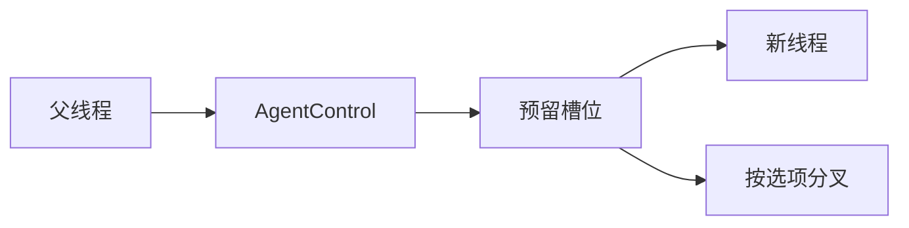
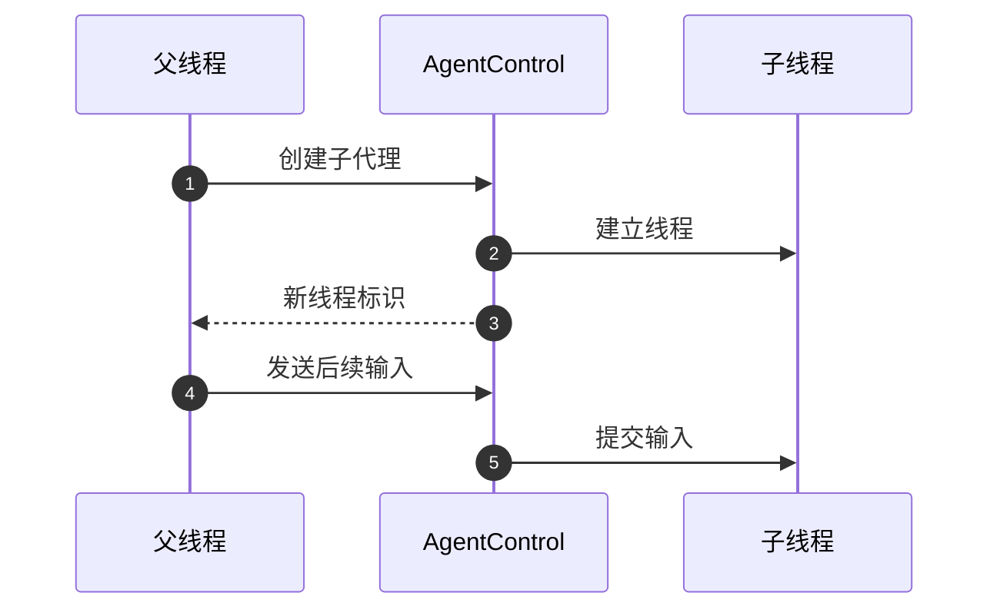
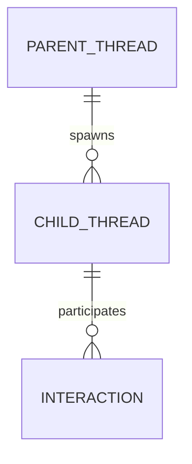

# 子代理与线程关系

子代理把一段任务放进独立线程，让调度可以追踪每个线程的生命周期。线程创建、关系登记和输入递送属于运行时，模型能否看见相应工具还取决于特性配置。 [codex-rs/core/src/agent/control.rs:185-281](https://github.com/GLBB/codex/blob/9f42c89c0112771dc29100a6f3fc904049b2655f/codex-rs/core/src/agent/control.rs#L185-L281) [codex-rs/features/src/lib.rs:916-936](https://github.com/GLBB/codex/blob/9f42c89c0112771dc29100a6f3fc904049b2655f/codex-rs/features/src/lib.rs#L916-L936) [codex-rs/core/src/tools/handlers/multi_agents_v2/spawn.rs:1-85](https://github.com/GLBB/codex/blob/9f42c89c0112771dc29100a6f3fc904049b2655f/codex-rs/core/src/tools/handlers/multi_agents_v2/spawn.rs#L1-L85)

| 能力 | 行为与证据 | 源码 |
| --- | --- | --- |
| 创建 | `spawn_agent_internal` 预留线程配额，按来源和选项新建或分叉 | [codex-rs/core/src/agent/control.rs:185-281](https://github.com/GLBB/codex/blob/9f42c89c0112771dc29100a6f3fc904049b2655f/codex-rs/core/src/agent/control.rs#L185-L281) |
| 继承 | 创建路径可以继承 Shell 快照和执行策略。满足分叉条件时复制选定历史 | [codex-rs/core/src/agent/control.rs:185-281](https://github.com/GLBB/codex/blob/9f42c89c0112771dc29100a6f3fc904049b2655f/codex-rs/core/src/agent/control.rs#L185-L281) [codex-rs/core/src/thread_manager.rs:803-872](https://github.com/GLBB/codex/blob/9f42c89c0112771dc29100a6f3fc904049b2655f/codex-rs/core/src/thread_manager.rs#L803-L872) |
| 输入 | `send_input` 对指定线程提交后续输入 | [codex-rs/core/src/agent/control.rs:682-733](https://github.com/GLBB/codex/blob/9f42c89c0112771dc29100a6f3fc904049b2655f/codex-rs/core/src/agent/control.rs#L682-L733) |
| 关闭 | 针对活跃代理及内存创建树中的后代执行关闭逻辑 | [codex-rs/core/src/agent/control.rs:784-827](https://github.com/GLBB/codex/blob/9f42c89c0112771dc29100a6f3fc904049b2655f/codex-rs/core/src/agent/control.rs#L784-L827) |
| 追踪 | 多代理 v2 轨迹记录创建、任务、结果与关闭边 | [codex-rs/rollout-trace/README.md:172-212](https://github.com/GLBB/codex/blob/9f42c89c0112771dc29100a6f3fc904049b2655f/codex-rs/rollout-trace/README.md#L172-L212) |

### 一次创建到底创建了什么

`spawn_agent_internal` 先预留配额，再准备父线程来源和子代理元数据。调用新建或分叉路径后，子代理 ID 对应新线程 ID。有继承需求时阅读分叉的历史选择逻辑，可判断哪些输入随分叉一起进入新上下文。 [codex-rs/core/src/agent/control.rs:185-281](https://github.com/GLBB/codex/blob/9f42c89c0112771dc29100a6f3fc904049b2655f/codex-rs/core/src/agent/control.rs#L185-L281) [codex-rs/core/src/thread_manager.rs:803-872](https://github.com/GLBB/codex/blob/9f42c89c0112771dc29100a6f3fc904049b2655f/codex-rs/core/src/thread_manager.rs#L803-L872)

### 什么时候查哪个 ID

创建关系从父线程与新线程 ID 开始。工具链路还有独立调用 ID。分析日志时可以按父线程工具调用找到新线程，再按后续输入和结果记录定位交互。多代理 v2 的可回放边保存这些联系，历史协议也提供部分协作项展示。 [codex-rs/core/src/tools/handlers/multi_agents_v2/spawn.rs:1-85](https://github.com/GLBB/codex/blob/9f42c89c0112771dc29100a6f3fc904049b2655f/codex-rs/core/src/tools/handlers/multi_agents_v2/spawn.rs#L1-L85) [codex-rs/rollout-trace/README.md:172-212](https://github.com/GLBB/codex/blob/9f42c89c0112771dc29100a6f3fc904049b2655f/codex-rs/rollout-trace/README.md#L172-L212) [codex-rs/app-server/README.md:1211-1247](https://github.com/GLBB/codex/blob/9f42c89c0112771dc29100a6f3fc904049b2655f/codex-rs/app-server/README.md#L1211-L1247)

## 创建与继承

<!-- Sources: codex-rs/core/src/agent/control.rs:185, codex-rs/core/src/thread_manager.rs:803 -->

## 子代理输入

<!-- Sources: codex-rs/core/src/agent/control.rs:185, codex-rs/core/src/agent/control.rs:682 -->

## 关系投影

<!-- Sources: codex-rs/core/src/agent/control.rs:185, codex-rs/rollout-trace/README.md:172 -->

## 源码索引

- [codex-rs/core/src/agent/control.rs:185-281](https://github.com/GLBB/codex/blob/9f42c89c0112771dc29100a6f3fc904049b2655f/codex-rs/core/src/agent/control.rs#L185-L281)
- [codex-rs/core/src/agent/control.rs:682-733](https://github.com/GLBB/codex/blob/9f42c89c0112771dc29100a6f3fc904049b2655f/codex-rs/core/src/agent/control.rs#L682-L733)
- [codex-rs/core/src/agent/control.rs:784-827](https://github.com/GLBB/codex/blob/9f42c89c0112771dc29100a6f3fc904049b2655f/codex-rs/core/src/agent/control.rs#L784-L827)
- [codex-rs/features/src/lib.rs:916-936](https://github.com/GLBB/codex/blob/9f42c89c0112771dc29100a6f3fc904049b2655f/codex-rs/features/src/lib.rs#L916-L936)
- [codex-rs/core/src/tools/handlers/multi_agents_v2/spawn.rs:1-85](https://github.com/GLBB/codex/blob/9f42c89c0112771dc29100a6f3fc904049b2655f/codex-rs/core/src/tools/handlers/multi_agents_v2/spawn.rs#L1-L85)
- [codex-rs/core/src/thread_manager.rs:803-872](https://github.com/GLBB/codex/blob/9f42c89c0112771dc29100a6f3fc904049b2655f/codex-rs/core/src/thread_manager.rs#L803-L872)
- [codex-rs/rollout-trace/README.md:172-212](https://github.com/GLBB/codex/blob/9f42c89c0112771dc29100a6f3fc904049b2655f/codex-rs/rollout-trace/README.md#L172-L212)
- [codex-rs/app-server/README.md:1211-1247](https://github.com/GLBB/codex/blob/9f42c89c0112771dc29100a6f3fc904049b2655f/codex-rs/app-server/README.md#L1211-L1247)

## 继续阅读

- [上下文与会话](../architecture/session-state.md)
- [可观测性](observability.md)
- [Rollout Trace](trajectory.md)
