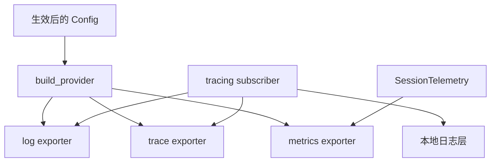
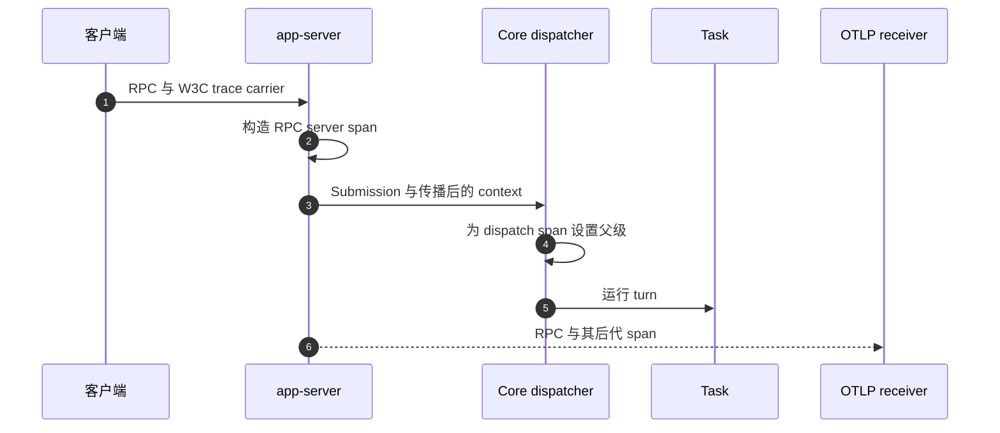
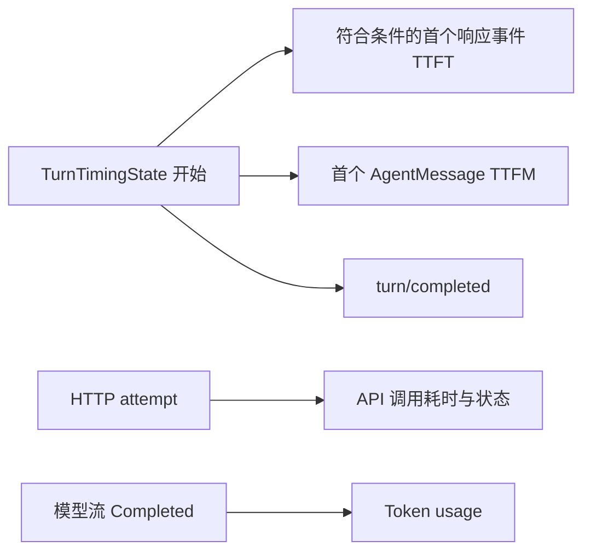
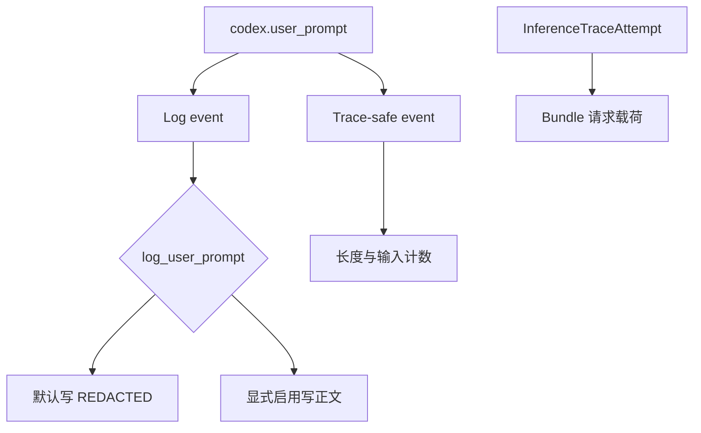
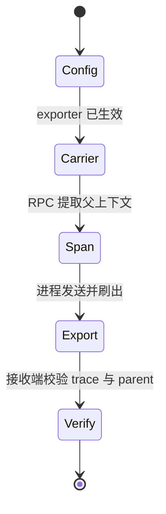

# 可观测性

一次 Codex 运行可以从客户端进度、可恢复会话、诊断轨迹和遥测观察。这个专题从源码解释正在运行的进程发出哪些信号、各条记录如何关联，以及接收器拿到的数据够回答什么。需要还原模型请求与工具关系时参见 [Trajectory](trajectory.md)。 [codex-rs/app-server/README.md:1211-1247](https://github.com/GLBB/codex/blob/9f42c89c0112771dc29100a6f3fc904049b2655f/codex-rs/app-server/README.md#L1211-L1247) [codex-rs/core/src/session/mod.rs:2527-2547](https://github.com/GLBB/codex/blob/9f42c89c0112771dc29100a6f3fc904049b2655f/codex-rs/core/src/session/mod.rs#L2527-L2547) [codex-rs/rollout-trace/README.md:1-38](https://github.com/GLBB/codex/blob/9f42c89c0112771dc29100a6f3fc904049b2655f/codex-rs/rollout-trace/README.md#L1-L38) [codex-rs/otel/src/provider.rs:77-153](https://github.com/GLBB/codex/blob/9f42c89c0112771dc29100a6f3fc904049b2655f/codex-rs/otel/src/provider.rs#L77-L153)

## 一、信号的所有者与去向

| 信号 | 生产路径 | 保存或消费位置 | 置信度 |
| --- | --- | --- | --- |
| 普通 diagnostics | Rust `tracing` 订阅层，按入口选择日志配置 | app-server stderr，TUI 本地日志库或显式配置的明文日志。 [codex-rs/app-server/src/lib.rs:613-651](https://github.com/GLBB/codex/blob/9f42c89c0112771dc29100a6f3fc904049b2655f/codex-rs/app-server/src/lib.rs#L613-L651) [codex-rs/tui/src/lib.rs:1216-1256](https://github.com/GLBB/codex/blob/9f42c89c0112771dc29100a6f3fc904049b2655f/codex-rs/tui/src/lib.rs#L1216-L1256) [docs/install.md:20-62](https://github.com/GLBB/codex/blob/9f42c89c0112771dc29100a6f3fc904049b2655f/docs/install.md#L20-L62) | 高 |
| OpenTelemetry Logs | `OtelProvider::logger_layer` → `OpenTelemetryTracingBridge` | 本次配置的 log exporter。过滤只接纳规定目标。 [codex-rs/otel/src/provider.rs:156-190](https://github.com/GLBB/codex/blob/9f42c89c0112771dc29100a6f3fc904049b2655f/codex-rs/otel/src/provider.rs#L156-L190) [codex-rs/otel/src/targets.rs:1-11](https://github.com/GLBB/codex/blob/9f42c89c0112771dc29100a6f3fc904049b2655f/codex-rs/otel/src/targets.rs#L1-L11) | 高 |
| OpenTelemetry Traces | `tracing_layer` 导出跨度与允许附带的事件 | trace exporter，按 trace ID 和 parent span ID 关联。 [codex-rs/otel/src/provider.rs:156-190](https://github.com/GLBB/codex/blob/9f42c89c0112771dc29100a6f3fc904049b2655f/codex-rs/otel/src/provider.rs#L156-L190) [codex-rs/otel/src/trace_context.rs:29-129](https://github.com/GLBB/codex/blob/9f42c89c0112771dc29100a6f3fc904049b2655f/codex-rs/otel/src/trace_context.rs#L29-L129) | 高 |
| OpenTelemetry Metrics | `SessionTelemetry` 和各子系统 metric API | metrics exporter，观察次数、分布、标签。 [codex-rs/otel/src/events/session_telemetry.rs:86-133](https://github.com/GLBB/codex/blob/9f42c89c0112771dc29100a6f3fc904049b2655f/codex-rs/otel/src/events/session_telemetry.rs#L86-L133) [codex-rs/otel/src/events/session_telemetry.rs:511-570](https://github.com/GLBB/codex/blob/9f42c89c0112771dc29100a6f3fc904049b2655f/codex-rs/otel/src/events/session_telemetry.rs#L511-L570) [codex-rs/core/src/otel_init.rs:22-94](https://github.com/GLBB/codex/blob/9f42c89c0112771dc29100a6f3fc904049b2655f/codex-rs/core/src/otel_init.rs#L22-L94) | 高 |
| 产品分析事件 | app-server outgoing 等处投送事实，`AnalyticsReducer` 聚合，后台客户端发出 | 独立客户端与队列，有自己的 enable 开关。 [codex-rs/app-server/src/outgoing_message.rs:155-173](https://github.com/GLBB/codex/blob/9f42c89c0112771dc29100a6f3fc904049b2655f/codex-rs/app-server/src/outgoing_message.rs#L155-L173) [codex-rs/analytics/src/client.rs:55-136](https://github.com/GLBB/codex/blob/9f42c89c0112771dc29100a6f3fc904049b2655f/codex-rs/analytics/src/client.rs#L55-L136) [codex-rs/analytics/src/reducer.rs:373-437](https://github.com/GLBB/codex/blob/9f42c89c0112771dc29100a6f3fc904049b2655f/codex-rs/analytics/src/reducer.rs#L373-L437) | 高 |
| Rollout Trace | thread trace、推理 attempt、工具执行 hook | 本地 bundle 与离线 reducer。 [codex-rs/core/src/session/session.rs:675-711](https://github.com/GLBB/codex/blob/9f42c89c0112771dc29100a6f3fc904049b2655f/codex-rs/core/src/session/session.rs#L675-L711) [codex-rs/rollout-trace/src/inference.rs:121-196](https://github.com/GLBB/codex/blob/9f42c89c0112771dc29100a6f3fc904049b2655f/codex-rs/rollout-trace/src/inference.rs#L121-L196) [codex-rs/rollout-trace/src/reducer/mod.rs:44-82](https://github.com/GLBB/codex/blob/9f42c89c0112771dc29100a6f3fc904049b2655f/codex-rs/rollout-trace/src/reducer/mod.rs#L44-L82) | 高 |

app-server、exec、TUI 各有入口调用 `build_provider`。它从 `Config` 转换 log、trace、metrics 三个 exporter，`analytics_enabled` 影响 metrics 的分支。`OtelProvider::from` 可按信号独立装配 provider，建立进程全局的 tracer 或 metrics。默认配置选择 log 和 trace 为 `none`，metrics 选择 `Statsig`；有效行为还受默认分析开关与 exporter 解析约束。内建 Statsig 选项在 debug build 被解析为禁用。多线程 Tokio 中的 HTTP trace 走异步 HTTP client 和 batch span processor，正常关闭时有显式 shutdown 路径。 [codex-rs/app-server/src/lib.rs:498-525](https://github.com/GLBB/codex/blob/9f42c89c0112771dc29100a6f3fc904049b2655f/codex-rs/app-server/src/lib.rs#L498-L525) [codex-rs/exec/src/lib.rs:451-502](https://github.com/GLBB/codex/blob/9f42c89c0112771dc29100a6f3fc904049b2655f/codex-rs/exec/src/lib.rs#L451-L502) [codex-rs/tui/src/lib.rs:1068-1104](https://github.com/GLBB/codex/blob/9f42c89c0112771dc29100a6f3fc904049b2655f/codex-rs/tui/src/lib.rs#L1068-L1104) [codex-rs/core/src/otel_init.rs:22-94](https://github.com/GLBB/codex/blob/9f42c89c0112771dc29100a6f3fc904049b2655f/codex-rs/core/src/otel_init.rs#L22-L94) [codex-rs/config/src/types.rs:476-548](https://github.com/GLBB/codex/blob/9f42c89c0112771dc29100a6f3fc904049b2655f/codex-rs/config/src/types.rs#L476-L548) [codex-rs/otel/src/provider.rs:77-153](https://github.com/GLBB/codex/blob/9f42c89c0112771dc29100a6f3fc904049b2655f/codex-rs/otel/src/provider.rs#L77-L153) [codex-rs/otel/src/config.rs:13-35](https://github.com/GLBB/codex/blob/9f42c89c0112771dc29100a6f3fc904049b2655f/codex-rs/otel/src/config.rs#L13-L35) [codex-rs/otel/src/provider.rs:391-449](https://github.com/GLBB/codex/blob/9f42c89c0112771dc29100a6f3fc904049b2655f/codex-rs/otel/src/provider.rs#L391-L449) [codex-rs/otel/src/provider.rs:63-75](https://github.com/GLBB/codex/blob/9f42c89c0112771dc29100a6f3fc904049b2655f/codex-rs/otel/src/provider.rs#L63-L75)


<!-- Sources: codex-rs/core/src/otel_init.rs:22, codex-rs/otel/src/provider.rs:77, codex-rs/otel/src/provider.rs:156, codex-rs/app-server/src/lib.rs:613, codex-rs/tui/src/lib.rs:1216 -->

## 二、跨 app-server、Core 与模型的关联

| 边界 | 关联依据 | 信号缺失时先查 |
| --- | --- | --- |
| 客户端 → app-server | 请求载体中的 `trace.traceparent`、`tracestate`。RPC span 记录 method、request ID、连接属性 | 输入 carrier 和订阅层是否启用。 [codex-rs/app-server-protocol/src/jsonrpc_lite.rs:17-84](https://github.com/GLBB/codex/blob/9f42c89c0112771dc29100a6f3fc904049b2655f/codex-rs/app-server-protocol/src/jsonrpc_lite.rs#L17-L84) [codex-rs/app-server/src/app_server_tracing.rs:24-83](https://github.com/GLBB/codex/blob/9f42c89c0112771dc29100a6f3fc904049b2655f/codex-rs/app-server/src/app_server_tracing.rs#L24-L83) [codex-rs/app-server/src/app_server_tracing.rs:94-141](https://github.com/GLBB/codex/blob/9f42c89c0112771dc29100a6f3fc904049b2655f/codex-rs/app-server/src/app_server_tracing.rs#L94-L141) |
| app-server → Core | `turn/start` 取请求 trace 并 `submit_with_trace`，Core 分发跨度重设 parent | 是否跨任务边界丢了 trace。 [codex-rs/app-server/src/outgoing_message.rs:52-76](https://github.com/GLBB/codex/blob/9f42c89c0112771dc29100a6f3fc904049b2655f/codex-rs/app-server/src/outgoing_message.rs#L52-L76) [codex-rs/app-server/src/request_processors/turn_processor.rs:317-339](https://github.com/GLBB/codex/blob/9f42c89c0112771dc29100a6f3fc904049b2655f/codex-rs/app-server/src/request_processors/turn_processor.rs#L317-L339) [codex-rs/core/src/session/handlers.rs:887-929](https://github.com/GLBB/codex/blob/9f42c89c0112771dc29100a6f3fc904049b2655f/codex-rs/core/src/session/handlers.rs#L887-L929) |
| 执行 turn | `spawn_task` 建立计时及任务跨度，追随当前上下文 | 测试断言 turn span 位于 RPC span 后代链。 [codex-rs/core/src/tasks/mod.rs:301-365](https://github.com/GLBB/codex/blob/9f42c89c0112771dc29100a6f3fc904049b2655f/codex-rs/core/src/tasks/mod.rs#L301-L365) [codex-rs/app-server/src/message_processor_tracing_tests.rs:637-707](https://github.com/GLBB/codex/blob/9f42c89c0112771dc29100a6f3fc904049b2655f/codex-rs/app-server/src/message_processor_tracing_tests.rs#L637-L707) |
| Core → provider | WebSocket 路径取得当前 span 的载体。HTTP rollout 产出时加入本地推理关联头 | 先问需要关联哪种 ID，检查实际 transport 与代码路径。 [codex-rs/core/src/client.rs:1570-1642](https://github.com/GLBB/codex/blob/9f42c89c0112771dc29100a6f3fc904049b2655f/codex-rs/core/src/client.rs#L1570-L1642) [codex-rs/core/src/client.rs:1423-1467](https://github.com/GLBB/codex/blob/9f42c89c0112771dc29100a6f3fc904049b2655f/codex-rs/core/src/client.rs#L1423-L1467) [codex-rs/core/src/client.rs:1262-1319](https://github.com/GLBB/codex/blob/9f42c89c0112771dc29100a6f3fc904049b2655f/codex-rs/core/src/client.rs#L1262-L1319) [codex-rs/rollout-trace/src/inference.rs:121-196](https://github.com/GLBB/codex/blob/9f42c89c0112771dc29100a6f3fc904049b2655f/codex-rs/rollout-trace/src/inference.rs#L121-L196) |
| Core → MCP backend | 调用实际走到 backend 时将 `mcp_call_id` 加进 meta | 调度被拦、失败或使用不同对端会改变可见证据。 [codex-rs/core/src/mcp_tool_call.rs:547-591](https://github.com/GLBB/codex/blob/9f42c89c0112771dc29100a6f3fc904049b2655f/codex-rs/core/src/mcp_tool_call.rs#L547-L591) [codex-rs/rollout-trace/src/thread.rs:401-417](https://github.com/GLBB/codex/blob/9f42c89c0112771dc29100a6f3fc904049b2655f/codex-rs/rollout-trace/src/thread.rs#L401-L417) [codex-rs/rollout-trace/src/mcp.rs:1-67](https://github.com/GLBB/codex/blob/9f42c89c0112771dc29100a6f3fc904049b2655f/codex-rs/rollout-trace/src/mcp.rs#L1-L67) |

`request_span` 优先处理显式请求载体。没有载体时可以从环境得到父上下文。in-process typed request 在相同模板下使用 `in-process` transport 标签。配置支持为导出的 span 增加属性，也可在 W3C tracestate 的指定成员内更新字段。两者用不同的数据结构和配置验证。置信度高。 [codex-rs/app-server/src/app_server_tracing.rs:24-83](https://github.com/GLBB/codex/blob/9f42c89c0112771dc29100a6f3fc904049b2655f/codex-rs/app-server/src/app_server_tracing.rs#L24-L83) [codex-rs/app-server/src/app_server_tracing.rs:94-141](https://github.com/GLBB/codex/blob/9f42c89c0112771dc29100a6f3fc904049b2655f/codex-rs/app-server/src/app_server_tracing.rs#L94-L141) [codex-rs/otel/src/trace_context.rs:29-129](https://github.com/GLBB/codex/blob/9f42c89c0112771dc29100a6f3fc904049b2655f/codex-rs/otel/src/trace_context.rs#L29-L129) [codex-rs/otel/src/trace_context.rs:135-166](https://github.com/GLBB/codex/blob/9f42c89c0112771dc29100a6f3fc904049b2655f/codex-rs/otel/src/trace_context.rs#L135-L166) [codex-rs/config/src/types.rs:476-548](https://github.com/GLBB/codex/blob/9f42c89c0112771dc29100a6f3fc904049b2655f/codex-rs/config/src/types.rs#L476-L548) [codex-rs/otel/src/provider.rs:77-153](https://github.com/GLBB/codex/blob/9f42c89c0112771dc29100a6f3fc904049b2655f/codex-rs/otel/src/provider.rs#L77-L153)


<!-- Sources: codex-rs/app-server/src/app_server_tracing.rs:24, codex-rs/app-server/src/app_server_tracing.rs:94, codex-rs/app-server/src/request_processors/turn_processor.rs:317, codex-rs/core/src/session/handlers.rs:887, codex-rs/core/src/tasks/mod.rs:301, codex-rs/app-server/src/message_processor_tracing_tests.rs:637 -->

## 三、指标的计时起止

| 观察项 | 实际计时或归档位置 | 常见误读 |
| --- | --- | --- |
| Turn TTFT | turn 启动时记录 `Instant`。流里第一个符合规则的输出事件触发一次上报，包括部分推理输出内容 | 从 RPC 入队算起的等待、首个可见正文与 TTFT 会有差异。 [codex-rs/core/src/tasks/mod.rs:301-365](https://github.com/GLBB/codex/blob/9f42c89c0112771dc29100a6f3fc904049b2655f/codex-rs/core/src/tasks/mod.rs#L301-L365) [codex-rs/core/src/turn_timing.rs:53-101](https://github.com/GLBB/codex/blob/9f42c89c0112771dc29100a6f3fc904049b2655f/codex-rs/core/src/turn_timing.rs#L53-L101) [codex-rs/core/src/turn_timing.rs:114-172](https://github.com/GLBB/codex/blob/9f42c89c0112771dc29100a6f3fc904049b2655f/codex-rs/core/src/turn_timing.rs#L114-L172) |
| Turn TTFM | Core 在发出 item completed 时检查 `TurnItem::AgentMessage`，记录首条助手消息计时 | 比较页面性能时应同时核对客户端的渲染时刻。 [codex-rs/core/src/turn_timing.rs:53-101](https://github.com/GLBB/codex/blob/9f42c89c0112771dc29100a6f3fc904049b2655f/codex-rs/core/src/turn_timing.rs#L53-L101) [codex-rs/core/src/session/mod.rs:1786-1817](https://github.com/GLBB/codex/blob/9f42c89c0112771dc29100a6f3fc904049b2655f/codex-rs/core/src/session/mod.rs#L1786-L1817) |
| HTTP API 计次与耗时 | `RequestTelemetry` → `SessionTelemetry::record_api_request`。按 attempt 记录状态和耗时 | 连上或返回 HTTP 2xx 后，模型流仍可能失败或取消。 [codex-rs/core/src/client.rs:2117-2150](https://github.com/GLBB/codex/blob/9f42c89c0112771dc29100a6f3fc904049b2655f/codex-rs/core/src/client.rs#L2117-L2150) [codex-rs/otel/src/events/session_telemetry.rs:511-570](https://github.com/GLBB/codex/blob/9f42c89c0112771dc29100a6f3fc904049b2655f/codex-rs/otel/src/events/session_telemetry.rs#L511-L570) [codex-rs/core/src/client.rs:1777-1899](https://github.com/GLBB/codex/blob/9f42c89c0112771dc29100a6f3fc904049b2655f/codex-rs/core/src/client.rs#L1777-L1899) |
| 流事件与 token usage | 传输侧 SSE 事件或 WebSocket 遥测；收到 Responses `Completed` 时将 usage 送入遥测与 trace | 一轮多次模型调用时须明确每次用量和哪一层做汇总。 [codex-rs/otel/src/events/session_telemetry.rs:695-752](https://github.com/GLBB/codex/blob/9f42c89c0112771dc29100a6f3fc904049b2655f/codex-rs/otel/src/events/session_telemetry.rs#L695-L752) [codex-rs/core/src/client.rs:1777-1899](https://github.com/GLBB/codex/blob/9f42c89c0112771dc29100a6f3fc904049b2655f/codex-rs/core/src/client.rs#L1777-L1899) |
| 终态与用户体验 | app-server `turn/completed`，以及 item 最终状态 | 模型 transport 完成、工具完成、最终 turn 完成分别有时点。 [codex-rs/app-server/README.md:1211-1247](https://github.com/GLBB/codex/blob/9f42c89c0112771dc29100a6f3fc904049b2655f/codex-rs/app-server/README.md#L1211-L1247) [codex-rs/core/src/session/turn.rs:1788-1878](https://github.com/GLBB/codex/blob/9f42c89c0112771dc29100a6f3fc904049b2655f/codex-rs/core/src/session/turn.rs#L1788-L1878) [codex-rs/core/src/tasks/mod.rs:769-808](https://github.com/GLBB/codex/blob/9f42c89c0112771dc29100a6f3fc904049b2655f/codex-rs/core/src/tasks/mod.rs#L769-L808) |

延迟诊断时先确定是「连接」「收到模型内容」「工具执行」「客户端可见」哪个时钟。工具 future 可在模型流仍运行时开始；直接将每段 wall-clock 相加可能重复计时。这个归因规则是针对并行分支的推论，具体任务要用实际跨度与 trajectory 时序核对。 [codex-rs/core/src/session/turn.rs:1788-1878](https://github.com/GLBB/codex/blob/9f42c89c0112771dc29100a6f3fc904049b2655f/codex-rs/core/src/session/turn.rs#L1788-L1878) [codex-rs/core/src/client.rs:1777-1899](https://github.com/GLBB/codex/blob/9f42c89c0112771dc29100a6f3fc904049b2655f/codex-rs/core/src/client.rs#L1777-L1899) [codex-rs/core/src/turn_timing.rs:53-101](https://github.com/GLBB/codex/blob/9f42c89c0112771dc29100a6f3fc904049b2655f/codex-rs/core/src/turn_timing.rs#L53-L101) [codex-rs/rollout-trace/src/model/runtime.rs:23-130](https://github.com/GLBB/codex/blob/9f42c89c0112771dc29100a6f3fc904049b2655f/codex-rs/rollout-trace/src/model/runtime.rs#L23-L130)


<!-- Sources: codex-rs/core/src/tasks/mod.rs:301, codex-rs/core/src/turn_timing.rs:53, codex-rs/core/src/turn_timing.rs:114, codex-rs/core/src/client.rs:2117, codex-rs/core/src/client.rs:1777, codex-rs/app-server/README.md:1211 -->

## 四、内容边界、关联键与丢失条件

| 边界 | 实现与影响 | 置信度 |
| --- | --- | --- |
| 提示正文 | `codex.user_prompt` 的日志分支按 `log_user_prompt` 写正文或 `[REDACTED]`。trace 事件分支记录长度与输入类型计数 | 高。该配置作用于此事件的日志字段，trace bundle 和 SQLite 有各自的输入与保留规则。 [codex-rs/otel/src/events/session_telemetry.rs:948-990](https://github.com/GLBB/codex/blob/9f42c89c0112771dc29100a6f3fc904049b2655f/codex-rs/otel/src/events/session_telemetry.rs#L948-L990) [codex-rs/otel/src/provider.rs:156-190](https://github.com/GLBB/codex/blob/9f42c89c0112771dc29100a6f3fc904049b2655f/codex-rs/otel/src/provider.rs#L156-L190) [codex-rs/otel/src/targets.rs:1-11](https://github.com/GLBB/codex/blob/9f42c89c0112771dc29100a6f3fc904049b2655f/codex-rs/otel/src/targets.rs#L1-L11) [codex-rs/rollout-trace/src/inference.rs:121-196](https://github.com/GLBB/codex/blob/9f42c89c0112771dc29100a6f3fc904049b2655f/codex-rs/rollout-trace/src/inference.rs#L121-L196) [codex-rs/state/src/log_db.rs:286-334](https://github.com/GLBB/codex/blob/9f42c89c0112771dc29100a6f3fc904049b2655f/codex-rs/state/src/log_db.rs#L286-L334) |
| Logs 与 traces 路由 | logger 筛选 `codex_otel` 前缀并排除 `trace_safe`。tracer 层接纳跨度及 `trace_safe` 目标事件 | 高。排查 log collector 缺一条 span event 时先核对路由。 [codex-rs/otel/src/provider.rs:156-190](https://github.com/GLBB/codex/blob/9f42c89c0112771dc29100a6f3fc904049b2655f/codex-rs/otel/src/provider.rs#L156-L190) [codex-rs/otel/src/targets.rs:1-11](https://github.com/GLBB/codex/blob/9f42c89c0112771dc29100a6f3fc904049b2655f/codex-rs/otel/src/targets.rs#L1-L11) |
| 本地日志缓存 | `LogDbLayer` 用有界通道，常规事件用 `try_send`。显式 `flush` 通过队列发命令并等应答 | 高。数据库里缺少事件时，需要考虑入队与保留时点。 [codex-rs/state/src/log_db.rs:112-162](https://github.com/GLBB/codex/blob/9f42c89c0112771dc29100a6f3fc904049b2655f/codex-rs/state/src/log_db.rs#L112-L162) [codex-rs/state/src/log_db.rs:356-410](https://github.com/GLBB/codex/blob/9f42c89c0112771dc29100a6f3fc904049b2655f/codex-rs/state/src/log_db.rs#L356-L410) |
| 关联主键 | OTel trace/span、thread/turn、inference call、upstream request、response、MCP call 来自不同协议或分配点 | 高。只在明确载体有映射时做 join，避免按同名字字段直接关联。 [codex-rs/otel/src/trace_context.rs:29-129](https://github.com/GLBB/codex/blob/9f42c89c0112771dc29100a6f3fc904049b2655f/codex-rs/otel/src/trace_context.rs#L29-L129) [codex-rs/app-server-protocol/src/jsonrpc_lite.rs:17-84](https://github.com/GLBB/codex/blob/9f42c89c0112771dc29100a6f3fc904049b2655f/codex-rs/app-server-protocol/src/jsonrpc_lite.rs#L17-L84) [codex-rs/rollout-trace/src/raw_event.rs:29-162](https://github.com/GLBB/codex/blob/9f42c89c0112771dc29100a6f3fc904049b2655f/codex-rs/rollout-trace/src/raw_event.rs#L29-L162) [codex-rs/rollout-trace/src/inference.rs:121-196](https://github.com/GLBB/codex/blob/9f42c89c0112771dc29100a6f3fc904049b2655f/codex-rs/rollout-trace/src/inference.rs#L121-L196) [codex-rs/rollout-trace/src/thread.rs:401-417](https://github.com/GLBB/codex/blob/9f42c89c0112771dc29100a6f3fc904049b2655f/codex-rs/rollout-trace/src/thread.rs#L401-L417) |
| 产品分析与诊断分离 | reducer 处理行为事实，trace 由 exporter 处理，bundle 由独立 writer 保存 | 高。分析队列可见性、诊断图和 OTLP 送达需要分别验证。 [codex-rs/analytics/src/client.rs:55-136](https://github.com/GLBB/codex/blob/9f42c89c0112771dc29100a6f3fc904049b2655f/codex-rs/analytics/src/client.rs#L55-L136) [codex-rs/analytics/src/reducer.rs:373-437](https://github.com/GLBB/codex/blob/9f42c89c0112771dc29100a6f3fc904049b2655f/codex-rs/analytics/src/reducer.rs#L373-L437) [codex-rs/rollout-trace/src/writer.rs:49-147](https://github.com/GLBB/codex/blob/9f42c89c0112771dc29100a6f3fc904049b2655f/codex-rs/rollout-trace/src/writer.rs#L49-L147) [codex-rs/otel/src/provider.rs:77-153](https://github.com/GLBB/codex/blob/9f42c89c0112771dc29100a6f3fc904049b2655f/codex-rs/otel/src/provider.rs#L77-L153) |

推理关联 ID 或上游 `x-request-id` 是否可 join 取决于响应是否出现并被客户端观测。业务跨度能解释本进程耗时与父子关系，完整请求输入应回到 bundle 中的 payload 和 reducer。置信度高。接入其它后端时，名称映射、指标聚合和采样策略需要用实际接收器另做验证。 [codex-rs/otel/src/events/session_telemetry.rs:511-570](https://github.com/GLBB/codex/blob/9f42c89c0112771dc29100a6f3fc904049b2655f/codex-rs/otel/src/events/session_telemetry.rs#L511-L570) [codex-rs/rollout-trace/src/raw_event.rs:29-162](https://github.com/GLBB/codex/blob/9f42c89c0112771dc29100a6f3fc904049b2655f/codex-rs/rollout-trace/src/raw_event.rs#L29-L162) [codex-rs/core/src/client.rs:1777-1899](https://github.com/GLBB/codex/blob/9f42c89c0112771dc29100a6f3fc904049b2655f/codex-rs/core/src/client.rs#L1777-L1899) [codex-rs/rollout-trace/src/reducer/conversation.rs:34-129](https://github.com/GLBB/codex/blob/9f42c89c0112771dc29100a6f3fc904049b2655f/codex-rs/rollout-trace/src/reducer/conversation.rs#L34-L129)


<!-- Sources: codex-rs/otel/src/events/session_telemetry.rs:948, codex-rs/otel/src/targets.rs:1, codex-rs/rollout-trace/src/inference.rs:121 -->

## 五、本地验证与排障顺序

在临时 Codex home 配置本地 OTLP HTTP JSON 接收器，对既有 CLI 发出 `initialize`、`initialized` 和带显式 W3C carrier 的 `thread/list`，正常关闭 stdin 等待进程退出。接收器确实收到了 `/v1/traces`，其中 `thread/list` span 的 `traceId` 和 `parentSpanId` 分别等于注入值。这个实验覆盖客户端到导出端的 RPC 关联，没有发起模型推理。代码库的 loopback 测试另行检查可配置 span 属性、tracestate 和 trace/metrics HTTP 导出。 [codex-rs/app-server-protocol/src/jsonrpc_lite.rs:17-84](https://github.com/GLBB/codex/blob/9f42c89c0112771dc29100a6f3fc904049b2655f/codex-rs/app-server-protocol/src/jsonrpc_lite.rs#L17-L84) [codex-rs/app-server/src/app_server_tracing.rs:24-83](https://github.com/GLBB/codex/blob/9f42c89c0112771dc29100a6f3fc904049b2655f/codex-rs/app-server/src/app_server_tracing.rs#L24-L83) [codex-rs/otel/tests/suite/otlp_http_loopback.rs:257-345](https://github.com/GLBB/codex/blob/9f42c89c0112771dc29100a6f3fc904049b2655f/codex-rs/otel/tests/suite/otlp_http_loopback.rs#L257-L345) [codex-rs/otel/tests/suite/otlp_http_loopback.rs:143-226](https://github.com/GLBB/codex/blob/9f42c89c0112771dc29100a6f3fc904049b2655f/codex-rs/otel/tests/suite/otlp_http_loopback.rs#L143-L226)

以下片段用于临时 `config.toml`，端口与实际接收器一致。

```toml
[analytics]
enabled = false

[otel]
environment = "wiki-test"
exporter = "none"
metrics_exporter = "none"
log_user_prompt = false

[otel.trace_exporter.otlp-http]
endpoint = "http://127.0.0.1:4318/v1/traces"
protocol = "json"
```

| 优先级 | 现象 | 快速核对 |
| --- | --- | --- |
| 高 | 完全没有 span | 找实际执行入口和生效的三路 exporter。用本地接收器确认是否送达。 [codex-rs/app-server/src/lib.rs:498-525](https://github.com/GLBB/codex/blob/9f42c89c0112771dc29100a6f3fc904049b2655f/codex-rs/app-server/src/lib.rs#L498-L525) [codex-rs/exec/src/lib.rs:451-502](https://github.com/GLBB/codex/blob/9f42c89c0112771dc29100a6f3fc904049b2655f/codex-rs/exec/src/lib.rs#L451-L502) [codex-rs/tui/src/lib.rs:1068-1104](https://github.com/GLBB/codex/blob/9f42c89c0112771dc29100a6f3fc904049b2655f/codex-rs/tui/src/lib.rs#L1068-L1104) [codex-rs/otel/src/provider.rs:77-153](https://github.com/GLBB/codex/blob/9f42c89c0112771dc29100a6f3fc904049b2655f/codex-rs/otel/src/provider.rs#L77-L153) |
| 高 | 客户端与 Core 是两条 trace | 验证 inbound `traceparent`、RPC span parent、`submit_with_trace`、Core dispatch parent。 [codex-rs/app-server/src/app_server_tracing.rs:94-141](https://github.com/GLBB/codex/blob/9f42c89c0112771dc29100a6f3fc904049b2655f/codex-rs/app-server/src/app_server_tracing.rs#L94-L141) [codex-rs/app-server/src/request_processors/turn_processor.rs:317-339](https://github.com/GLBB/codex/blob/9f42c89c0112771dc29100a6f3fc904049b2655f/codex-rs/app-server/src/request_processors/turn_processor.rs#L317-L339) [codex-rs/core/src/session/handlers.rs:887-929](https://github.com/GLBB/codex/blob/9f42c89c0112771dc29100a6f3fc904049b2655f/codex-rs/core/src/session/handlers.rs#L887-L929) [codex-rs/app-server/src/message_processor_tracing_tests.rs:637-707](https://github.com/GLBB/codex/blob/9f42c89c0112771dc29100a6f3fc904049b2655f/codex-rs/app-server/src/message_processor_tracing_tests.rs#L637-L707) |
| 高 | 调用成功但没有后续结果 | 检查 flow 中的 turn 终态、模型流终态、工具结果。三者用各自关联键。 [codex-rs/app-server/README.md:1211-1247](https://github.com/GLBB/codex/blob/9f42c89c0112771dc29100a6f3fc904049b2655f/codex-rs/app-server/README.md#L1211-L1247) [codex-rs/core/src/client.rs:1777-1899](https://github.com/GLBB/codex/blob/9f42c89c0112771dc29100a6f3fc904049b2655f/codex-rs/core/src/client.rs#L1777-L1899) [codex-rs/rollout-trace/src/model/runtime.rs:23-130](https://github.com/GLBB/codex/blob/9f42c89c0112771dc29100a6f3fc904049b2655f/codex-rs/rollout-trace/src/model/runtime.rs#L23-L130) |
| 中 | 想接入 Langfuse 或同类后端 | 先以 OTLP 接收器验证选定数据的模型名、用量、父子关系和敏感字段，再核对目标站点接收配置和展示映射。此处的实验范围是本地 OTLP。 [codex-rs/core/src/client.rs:1777-1899](https://github.com/GLBB/codex/blob/9f42c89c0112771dc29100a6f3fc904049b2655f/codex-rs/core/src/client.rs#L1777-L1899) [codex-rs/otel/tests/suite/otlp_http_loopback.rs:257-345](https://github.com/GLBB/codex/blob/9f42c89c0112771dc29100a6f3fc904049b2655f/codex-rs/otel/tests/suite/otlp_http_loopback.rs#L257-L345) [codex-rs/otel/src/events/session_telemetry.rs:948-990](https://github.com/GLBB/codex/blob/9f42c89c0112771dc29100a6f3fc904049b2655f/codex-rs/otel/src/events/session_telemetry.rs#L948-L990) |


<!-- Sources: codex-rs/core/src/otel_init.rs:22, codex-rs/app-server/src/app_server_tracing.rs:94, codex-rs/otel/tests/suite/otlp_http_loopback.rs:257, codex-rs/app-server/src/message_processor_tracing_tests.rs:637 -->

继续阅读 [Trajectory](trajectory.md)、[app-server 与客户端线协议](../protocols/app-server-wire.md) 和 [模型协议](../protocols/model-wire.md)。
