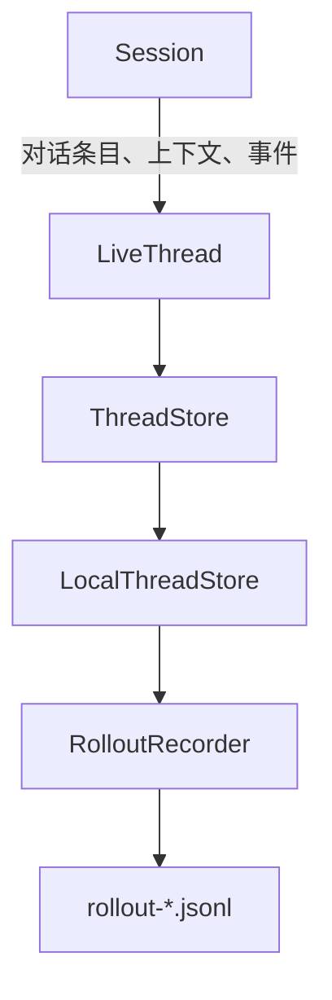
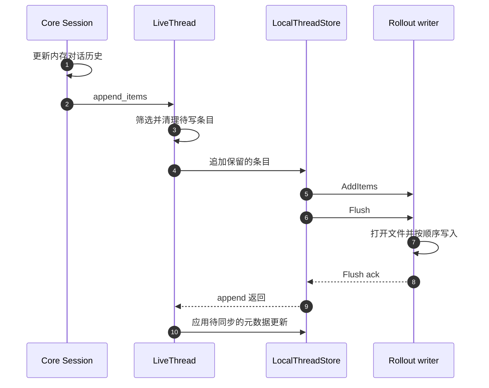
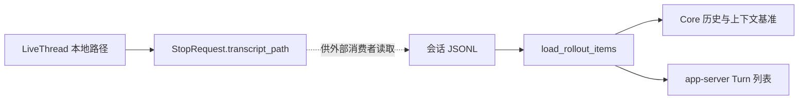
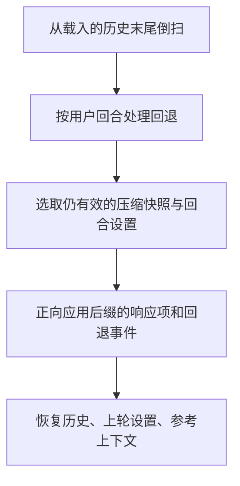
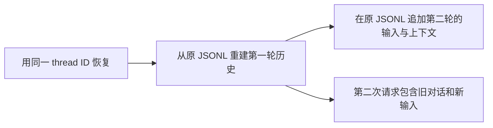

# Rollout 会话日志

运行 `codex resume` 时，Codex 从会话 rollout 恢复线程历史。本地存储将历史保存为 `$CODEX_HOME/sessions/YYYY/MM/DD/rollout-<时间>-<thread-id>.jsonl`，默认的 `CODEX_HOME` 是 `~/.codex`。同一个文件也可供客户端读历史或供 hook 插件读取。要查某次模型请求的实际输入与工具关联，见 [Rollout Trace](trajectory.md)。 [codex-rs/rollout/src/recorder.rs:1325-1355](https://github.com/GLBB/codex/blob/9f42c89c0112771dc29100a6f3fc904049b2655f/codex-rs/rollout/src/recorder.rs#L1325-L1355) [codex-rs/core/src/session/mod.rs:1184-1221](https://github.com/GLBB/codex/blob/9f42c89c0112771dc29100a6f3fc904049b2655f/codex-rs/core/src/session/mod.rs#L1184-L1221) [codex-rs/core/src/session/mod.rs:3250-3265](https://github.com/GLBB/codex/blob/9f42c89c0112771dc29100a6f3fc904049b2655f/codex-rs/core/src/session/mod.rs#L3250-L3265) [codex-rs/utils/home-dir/src/lib.rs:13-60](https://github.com/GLBB/codex/blob/9f42c89c0112771dc29100a6f3fc904049b2655f/codex-rs/utils/home-dir/src/lib.rs#L13-L60)

## 一、文件里有什么

每行的外层是 `RolloutLine`。它把 `RolloutItem` 展平，所以一行的顶层有 `timestamp`、`type` 和 `payload`。文件日期和文件名使用进程的本地时间，行时间使用 UTC，并在 writer 写行时生成。按行时间可以定位写入顺序与时间范围，计算推理耗时要用推理自身的开始和终态。 [codex-rs/protocol/src/protocol.rs:2705-2720](https://github.com/GLBB/codex/blob/9f42c89c0112771dc29100a6f3fc904049b2655f/codex-rs/protocol/src/protocol.rs#L2705-L2720) [codex-rs/protocol/src/protocol.rs:2849-2854](https://github.com/GLBB/codex/blob/9f42c89c0112771dc29100a6f3fc904049b2655f/codex-rs/protocol/src/protocol.rs#L2849-L2854) [codex-rs/rollout/src/recorder.rs:1325-1355](https://github.com/GLBB/codex/blob/9f42c89c0112771dc29100a6f3fc904049b2655f/codex-rs/rollout/src/recorder.rs#L1325-L1355) [codex-rs/rollout/src/recorder.rs:1633-1653](https://github.com/GLBB/codex/blob/9f42c89c0112771dc29100a6f3fc904049b2655f/codex-rs/rollout/src/recorder.rs#L1633-L1653)

| 顶层 `type` | 保存的内容 | 读取时用来做什么 |
| --- | --- | --- |
| `session_meta` | 线程 ID、来源、工作目录、provider、基础指令、分页与 fork 信息等 | 识别线程。reader 采用遇到的第一条 `session_meta` 作为主会话元数据。 [codex-rs/rollout/src/recorder.rs:673-706](https://github.com/GLBB/codex/blob/9f42c89c0112771dc29100a6f3fc904049b2655f/codex-rs/rollout/src/recorder.rs#L673-L706) [codex-rs/rollout/src/recorder.rs:841-849](https://github.com/GLBB/codex/blob/9f42c89c0112771dc29100a6f3fc904049b2655f/codex-rs/rollout/src/recorder.rs#L841-L849) |
| `response_item` | 消息、工具调用与工具输出等保留的 `ResponseItem`，行级可带宿主元数据 | 为重建模型历史提供条目。 [codex-rs/rollout/src/policy.rs:65-85](https://github.com/GLBB/codex/blob/9f42c89c0112771dc29100a6f3fc904049b2655f/codex-rs/rollout/src/policy.rs#L65-L85) [codex-rs/core/src/session/rollout_reconstruction.rs:242-249](https://github.com/GLBB/codex/blob/9f42c89c0112771dc29100a6f3fc904049b2655f/codex-rs/core/src/session/rollout_reconstruction.rs#L242-L249) |
| `turn_context` | 当前回合的配置快照 | 恢复模型等设置及下一轮计算上下文差异的参考快照。正常用户回合即使没有可见的设置差异也会写快照。 [codex-rs/core/src/session/mod.rs:2916-2959](https://github.com/GLBB/codex/blob/9f42c89c0112771dc29100a6f3fc904049b2655f/codex-rs/core/src/session/mod.rs#L2916-L2959) [codex-rs/core/src/session/rollout_reconstruction.rs:162-185](https://github.com/GLBB/codex/blob/9f42c89c0112771dc29100a6f3fc904049b2655f/codex-rs/core/src/session/rollout_reconstruction.rs#L162-L185) |
| `compacted` | 压缩摘要、可选的替换历史，以及窗口和恢复元数据 | 确定恢复所用的替换历史与后续条目起点。 [codex-rs/protocol/src/protocol.rs:2715-2720](https://github.com/GLBB/codex/blob/9f42c89c0112771dc29100a6f3fc904049b2655f/codex-rs/protocol/src/protocol.rs#L2715-L2720) [codex-rs/core/src/session/rollout_reconstruction.rs:110-128](https://github.com/GLBB/codex/blob/9f42c89c0112771dc29100a6f3fc904049b2655f/codex-rs/core/src/session/rollout_reconstruction.rs#L110-L128) |
| `event_msg` | 经筛选的回合生命周期、消息、用量、回退等事件 | 标记用户回合边界、应用回退，以及重建部分客户端历史。 [codex-rs/rollout/src/policy.rs:109-174](https://github.com/GLBB/codex/blob/9f42c89c0112771dc29100a6f3fc904049b2655f/codex-rs/rollout/src/policy.rs#L109-L174) [codex-rs/core/src/session/rollout_reconstruction.rs:130-161](https://github.com/GLBB/codex/blob/9f42c89c0112771dc29100a6f3fc904049b2655f/codex-rs/core/src/session/rollout_reconstruction.rs#L130-L161) [codex-rs/app-server-protocol/src/protocol/thread_history.rs:74-84](https://github.com/GLBB/codex/blob/9f42c89c0112771dc29100a6f3fc904049b2655f/codex-rs/app-server-protocol/src/protocol/thread_history.rs#L74-L84) |
| `token_usage_record` | 每次模型响应的用量、回合累计和线程累计 | 恢复 token 计数与上下文占用，不必回扫全部历史。 |
| `world_state` | 模型可见世界状态的完整快照或 merge patch | 恢复上下文差异的比较基线；压缩或回退后重新建立。 |
| `dynamic_tools_updated` | 线程的完整动态工具目录 | 恢复后续模型步骤的工具声明，空目录表示清空。 |
| `inter_agent_communication` | 子代理之间的消息 | 恢复代理间通信的顺序与内容。 |
| `inter_agent_communication_metadata` | 通信是否触发回合的标记 | 判定通信对回合边界的影响。 |
| `retained_context` | 宿主保留的已接受回答、投递证据等 | 恢复不可信但需保留的上下文证据。 |
| `security_risk_score` | 安全风险分类器的分值快照 | 线程内风险参考，不进入模型上下文。 |
| `realtime_item` | 实时语音帧、转写与回合交接记录 | 在 `paginated` 模式下重建实时会话。 |

字段、必选性和嵌套形状逐项列在 [Rollout 会话 JSONL 字段表](../protocols/rollout-wire.md)。


<!-- Sources: codex-rs/core/src/session/mod.rs:2527, codex-rs/core/src/session/mod.rs:2898, codex-rs/thread-store/src/live_thread.rs:139, codex-rs/thread-store/src/local/live_writer.rs:76, codex-rs/rollout/src/recorder.rs:1634 -->

## 二、一轮对话怎样落盘

Core 的 `record_conversation_items` 先更新内存历史，再提交 `ResponseItem`。`send_event_raw` 则单独提交 `EventMsg`，随后把事件送往客户端。这解释了为何一条用户输入可能同时有模型历史项和用户消息事件。读取时要按消费者选择相应记录。 [codex-rs/core/src/session/mod.rs:1758-1774](https://github.com/GLBB/codex/blob/9f42c89c0112771dc29100a6f3fc904049b2655f/codex-rs/core/src/session/mod.rs#L1758-L1774) [codex-rs/core/src/session/mod.rs:2527-2547](https://github.com/GLBB/codex/blob/9f42c89c0112771dc29100a6f3fc904049b2655f/codex-rs/core/src/session/mod.rs#L2527-L2547) [codex-rs/core/src/session/mod.rs:3113-3124](https://github.com/GLBB/codex/blob/9f42c89c0112771dc29100a6f3fc904049b2655f/codex-rs/core/src/session/mod.rs#L3113-L3124)

| 阶段 | 代码行为 | 看到的结果 |
| --- | --- | --- |
| 启动 | 普通新线程先计算文件路径并准备 `SessionMeta`。恢复时以追加模式打开既有文件。Core 对 ephemeral 线程跳过 `LiveThread` 初始化。 | 新线程可以先有路径、后有文件。恢复沿用原路径。 [codex-rs/core/src/session/session.rs:537-584](https://github.com/GLBB/codex/blob/9f42c89c0112771dc29100a6f3fc904049b2655f/codex-rs/core/src/session/session.rs#L537-L584) [codex-rs/rollout/src/recorder.rs:647-708](https://github.com/GLBB/codex/blob/9f42c89c0112771dc29100a6f3fc904049b2655f/codex-rs/rollout/src/recorder.rs#L647-L708) |
| 筛选 | `LiveThread::append_items` 先按持久化策略筛选条目，再调用 store。 | `Limited` 保留用户消息、回合终态、用量、MCP 结束等事件。`Extended` 额外保留 `ExecCommandEnd` 等事件，并截断其聚合输出、清空单独的 stdout、stderr 和格式化输出。流式文本 delta 在两种模式下均被过滤。 [codex-rs/thread-store/src/live_thread.rs:139-149](https://github.com/GLBB/codex/blob/9f42c89c0112771dc29100a6f3fc904049b2655f/codex-rs/thread-store/src/live_thread.rs#L139-L149) [codex-rs/rollout/src/policy.rs:28-63](https://github.com/GLBB/codex/blob/9f42c89c0112771dc29100a6f3fc904049b2655f/codex-rs/rollout/src/policy.rs#L28-L63) [codex-rs/rollout/src/policy.rs:133-220](https://github.com/GLBB/codex/blob/9f42c89c0112771dc29100a6f3fc904049b2655f/codex-rs/rollout/src/policy.rs#L133-L220) |
| 入队和刷新 | 本地 `append_items` 提交 `AddItems`，再等待 writer 的 `Flush` 确认。writer 按队列顺序处理命令，有待写条目时打开文件、先写元数据，再写条目。 | 单独的入队成功只代表命令已提交。正常本地 append 还等待文件刷新，随后才观察该批条目并更新线程元数据。 [codex-rs/thread-store/src/local/live_writer.rs:76-88](https://github.com/GLBB/codex/blob/9f42c89c0112771dc29100a6f3fc904049b2655f/codex-rs/thread-store/src/local/live_writer.rs#L76-L88) [codex-rs/thread-store/src/live_thread.rs:139-168](https://github.com/GLBB/codex/blob/9f42c89c0112771dc29100a6f3fc904049b2655f/codex-rs/thread-store/src/live_thread.rs#L139-L168) [codex-rs/rollout/src/recorder.rs:1418-1427](https://github.com/GLBB/codex/blob/9f42c89c0112771dc29100a6f3fc904049b2655f/codex-rs/rollout/src/recorder.rs#L1418-L1427) [codex-rs/rollout/src/recorder.rs:1497-1573](https://github.com/GLBB/codex/blob/9f42c89c0112771dc29100a6f3fc904049b2655f/codex-rs/rollout/src/recorder.rs#L1497-L1573) |
| 显式持久化 | 用户消息记录完成和 hook 查询 transcript 路径都可经 `ensure_rollout_materialized` 到 `persist`。 | `persist` 可以创建尚无待写条目的新文件。`flush` 遇到尚未打开且没有待写条目的新文件会直接返回。 [codex-rs/core/src/session/mod.rs:1057-1068](https://github.com/GLBB/codex/blob/9f42c89c0112771dc29100a6f3fc904049b2655f/codex-rs/core/src/session/mod.rs#L1057-L1068) [codex-rs/core/src/session/mod.rs:3113-3124](https://github.com/GLBB/codex/blob/9f42c89c0112771dc29100a6f3fc904049b2655f/codex-rs/core/src/session/mod.rs#L3113-L3124) [codex-rs/core/src/session/mod.rs:3250-3265](https://github.com/GLBB/codex/blob/9f42c89c0112771dc29100a6f3fc904049b2655f/codex-rs/core/src/session/mod.rs#L3250-L3265) [codex-rs/rollout/src/recorder.rs:1418-1427](https://github.com/GLBB/codex/blob/9f42c89c0112771dc29100a6f3fc904049b2655f/codex-rs/rollout/src/recorder.rs#L1418-L1427) |


<!-- Sources: codex-rs/core/src/session/mod.rs:2527, codex-rs/thread-store/src/live_thread.rs:139, codex-rs/thread-store/src/local/live_writer.rs:76, codex-rs/rollout/src/recorder.rs:1497, codex-rs/rollout/src/recorder.rs:1541 -->

## 三、哪些代码会读同一份历史

本地 store 读历史时会先尝试活动 writer 的路径。没有活动 writer 时，按线程 ID 读取，可能使用 SQLite 中可用的路径或查找会话文件。需要历史正文时，仍由 `RolloutRecorder::load_rollout_items` 读 JSONL。本地归档移动原文件到 `$CODEX_HOME/archived_sessions/`，然后尝试更新 SQLite 归档信息。 [codex-rs/thread-store/src/local/mod.rs:203-243](https://github.com/GLBB/codex/blob/9f42c89c0112771dc29100a6f3fc904049b2655f/codex-rs/thread-store/src/local/mod.rs#L203-L243) [codex-rs/thread-store/src/local/read_thread.rs:28-95](https://github.com/GLBB/codex/blob/9f42c89c0112771dc29100a6f3fc904049b2655f/codex-rs/thread-store/src/local/read_thread.rs#L28-L95) [codex-rs/thread-store/src/local/read_thread.rs:145-213](https://github.com/GLBB/codex/blob/9f42c89c0112771dc29100a6f3fc904049b2655f/codex-rs/thread-store/src/local/read_thread.rs#L145-L213) [codex-rs/thread-store/src/local/read_thread.rs:248-256](https://github.com/GLBB/codex/blob/9f42c89c0112771dc29100a6f3fc904049b2655f/codex-rs/thread-store/src/local/read_thread.rs#L248-L256) [codex-rs/thread-store/src/local/archive_thread.rs:30-60](https://github.com/GLBB/codex/blob/9f42c89c0112771dc29100a6f3fc904049b2655f/codex-rs/thread-store/src/local/archive_thread.rs#L30-L60)

| 消费者 | 入口 | 输出 |
| --- | --- | --- |
| Core 恢复 | `record_initial_history` → `apply_rollout_reconstruction` | 恢复内存历史、上轮设置和上下文基准。Fork 走新线程的持久化路径，并复制经过 store 筛选的历史。 [codex-rs/core/src/session/mod.rs:1184-1279](https://github.com/GLBB/codex/blob/9f42c89c0112771dc29100a6f3fc904049b2655f/codex-rs/core/src/session/mod.rs#L1184-L1279) |
| app-server 历史读取 | `build_turns_from_rollout_items` → `ThreadHistoryBuilder` | 生成客户端的 `Turn` 列表，有 `TurnContext.turn_id` 时可保留原回合 ID。 [codex-rs/app-server/src/request_processors/thread_processor.rs:2200-2231](https://github.com/GLBB/codex/blob/9f42c89c0112771dc29100a6f3fc904049b2655f/codex-rs/app-server/src/request_processors/thread_processor.rs#L2200-L2231) [codex-rs/app-server-protocol/src/protocol/thread_history.rs:74-84](https://github.com/GLBB/codex/blob/9f42c89c0112771dc29100a6f3fc904049b2655f/codex-rs/app-server-protocol/src/protocol/thread_history.rs#L74-L84) |
| Stop hook | `hook_transcript_path` → `StopRequest` | 提供可选的本地 `transcript_path` 和当前 `turn_id`。Langfuse 会话插件的导出路径见 [可观测性](observability.md#langfuse-的会话插件与原生-otlp)。 [codex-rs/thread-store/src/live_thread.rs:252-267](https://github.com/GLBB/codex/blob/9f42c89c0112771dc29100a6f3fc904049b2655f/codex-rs/thread-store/src/live_thread.rs#L252-L267) [codex-rs/core/src/session/mod.rs:3250-3265](https://github.com/GLBB/codex/blob/9f42c89c0112771dc29100a6f3fc904049b2655f/codex-rs/core/src/session/mod.rs#L3250-L3265) [codex-rs/core/src/hook_runtime.rs:342-359](https://github.com/GLBB/codex/blob/9f42c89c0112771dc29100a6f3fc904049b2655f/codex-rs/core/src/hook_runtime.rs#L342-L359) |


<!-- Sources: codex-rs/rollout/src/recorder.rs:812, codex-rs/core/src/session/mod.rs:1250, codex-rs/app-server/src/request_processors/thread_processor.rs:2223, codex-rs/core/src/hook_runtime.rs:342 -->

## 四、压缩、回退和读取失败

假设文件里依次出现第一轮、第二轮中的压缩检查点、第二轮结束，随后又写入 `thread_rolled_back(num_turns=1)`。本地 reader 先加载 JSONL 中可解析的条目，Core 再在内存中从尾部倒扫。与第二轮一并被回退的压缩检查点和上下文基准不能成为恢复起点。Core 在确定可用的历史基线后，从该基线向前应用后续条目与回退事件。文件里的第二轮记录仍可供排查。 [codex-rs/core/src/session/handlers.rs:508-548](https://github.com/GLBB/codex/blob/9f42c89c0112771dc29100a6f3fc904049b2655f/codex-rs/core/src/session/handlers.rs#L508-L548) [codex-rs/core/src/session/rollout_reconstruction.rs:43-108](https://github.com/GLBB/codex/blob/9f42c89c0112771dc29100a6f3fc904049b2655f/codex-rs/core/src/session/rollout_reconstruction.rs#L43-L108) [codex-rs/core/src/session/rollout_reconstruction.rs:234-299](https://github.com/GLBB/codex/blob/9f42c89c0112771dc29100a6f3fc904049b2655f/codex-rs/core/src/session/rollout_reconstruction.rs#L234-L299) [codex-rs/core/src/session/rollout_reconstruction_tests.rs:719-807](https://github.com/GLBB/codex/blob/9f42c89c0112771dc29100a6f3fc904049b2655f/codex-rs/core/src/session/rollout_reconstruction_tests.rs#L719-L807)

| 情况 | 恢复语义 | 排查时看什么 |
| --- | --- | --- |
| 有 `replacement_history` | 倒扫定位最近仍生效的替换历史，正向应用其后的后缀。压缩会清除旧的上下文基准，之后的快照可重新建立基准。 [codex-rs/core/src/session/rollout_reconstruction.rs:110-128](https://github.com/GLBB/codex/blob/9f42c89c0112771dc29100a6f3fc904049b2655f/codex-rs/core/src/session/rollout_reconstruction.rs#L110-L128) [codex-rs/core/src/session/rollout_reconstruction.rs:213-255](https://github.com/GLBB/codex/blob/9f42c89c0112771dc29100a6f3fc904049b2655f/codex-rs/core/src/session/rollout_reconstruction.rs#L213-L255) | 看最近的 `compacted`、随后的 `turn_context` 和后续回退。 |
| 旧版压缩条目只有摘要 | 由已恢复的用户消息与压缩摘要重建历史，并清除参考快照，以便后续重新注入上下文。 [codex-rs/core/src/session/rollout_reconstruction.rs:250-299](https://github.com/GLBB/codex/blob/9f42c89c0112771dc29100a6f3fc904049b2655f/codex-rs/core/src/session/rollout_reconstruction.rs#L250-L299) | 检查压缩载荷是否有 `replacement_history`。 |
| 写入出错或 JSONL 存在坏行 | writer 遇到写入错误会重新打开并重试。reader 跳过无法解析的行并计数，空文件直接报错。 [codex-rs/rollout/src/recorder.rs:812-879](https://github.com/GLBB/codex/blob/9f42c89c0112771dc29100a6f3fc904049b2655f/codex-rs/rollout/src/recorder.rs#L812-L879) [codex-rs/rollout/src/recorder.rs:1436-1477](https://github.com/GLBB/codex/blob/9f42c89c0112771dc29100a6f3fc904049b2655f/codex-rs/rollout/src/recorder.rs#L1436-L1477) [codex-rs/rollout/src/recorder.rs:1518-1537](https://github.com/GLBB/codex/blob/9f42c89c0112771dc29100a6f3fc904049b2655f/codex-rs/rollout/src/recorder.rs#L1518-L1537) | 恢复成功仍可能有缺行。核对原始文件和 writer 日志。 |


<!-- Sources: codex-rs/core/src/session/rollout_reconstruction.rs:43, codex-rs/core/src/session/rollout_reconstruction.rs:87, codex-rs/core/src/session/rollout_reconstruction.rs:234 -->

## 五、本地对照验证

用临时 `CODEX_HOME` 和本机模拟 Responses 服务跑了一次 `codex exec`，然后按线程 ID 执行 `codex exec resume`。恢复前后只有一个会话 JSONL，行数由 11 增至 19，原有行保留，且只有一条 `session_meta`。模拟服务收到的第二次请求同时含第一轮的用户输入、助手回复和新的用户输入。同一线程各次运行生成的 bundle 见 [Rollout Trace 的重放验证](trajectory.md#五、实际取证与验证)。这个实验验证了本地 HTTP 路径的续写和恢复。压缩、回退和旧文件处理依据上面的实现和仓库测试。

```bash
jq -r '[.timestamp, .type,
  (.payload.type // ""),
  (.payload.turn_id // "")] | @tsv' "$rollout_file"
```

| 场景 | 先检查 |
| --- | --- |
| 想找回某个线程 | 按线程 ID 找文件名，并检查首个 `session_meta.payload.id`。已归档的线程查 `archived_sessions/`。 [codex-rs/rollout/src/recorder.rs:841-849](https://github.com/GLBB/codex/blob/9f42c89c0112771dc29100a6f3fc904049b2655f/codex-rs/rollout/src/recorder.rs#L841-L849) [codex-rs/rollout/src/recorder.rs:1325-1355](https://github.com/GLBB/codex/blob/9f42c89c0112771dc29100a6f3fc904049b2655f/codex-rs/rollout/src/recorder.rs#L1325-L1355) [codex-rs/thread-store/src/local/archive_thread.rs:30-58](https://github.com/GLBB/codex/blob/9f42c89c0112771dc29100a6f3fc904049b2655f/codex-rs/thread-store/src/local/archive_thread.rs#L30-L58) |
| 客户端内容和历史条目数量不同 | 对照 `event_msg`、`response_item` 与 app-server 的历史投影。 [codex-rs/rollout/src/policy.rs:15-25](https://github.com/GLBB/codex/blob/9f42c89c0112771dc29100a6f3fc904049b2655f/codex-rs/rollout/src/policy.rs#L15-L25) [codex-rs/app-server-protocol/src/protocol/thread_history.rs:74-84](https://github.com/GLBB/codex/blob/9f42c89c0112771dc29100a6f3fc904049b2655f/codex-rs/app-server-protocol/src/protocol/thread_history.rs#L74-L84) |
| 要确认本次采样的完整输入、工具声明或响应 ID | 查 [Rollout Trace](trajectory.md#二、数据流与模型输入重建) 的请求和响应载荷。Core 构造 prompt 时还会应用历史整理、运行时设置与工具列表。 [codex-rs/core/src/context_manager/history.rs:98-125](https://github.com/GLBB/codex/blob/9f42c89c0112771dc29100a6f3fc904049b2655f/codex-rs/core/src/context_manager/history.rs#L98-L125) [codex-rs/core/src/session/turn.rs:863-893](https://github.com/GLBB/codex/blob/9f42c89c0112771dc29100a6f3fc904049b2655f/codex-rs/core/src/session/turn.rs#L863-L893) [codex-rs/rollout-trace/src/inference.rs:174-237](https://github.com/GLBB/codex/blob/9f42c89c0112771dc29100a6f3fc904049b2655f/codex-rs/rollout-trace/src/inference.rs#L174-L237) |


<!-- Sources: codex-rs/rollout/src/recorder.rs:697, codex-rs/core/src/session/mod.rs:1184, codex-rs/core/src/session/mod.rs:1250, codex-rs/core/src/session/turn.rs:863 -->

继续阅读 [上下文与会话](../architecture/session-state.md)、[Rollout 会话 JSONL 字段表](../protocols/rollout-wire.md) 和 [Rollout Trace](trajectory.md)。
