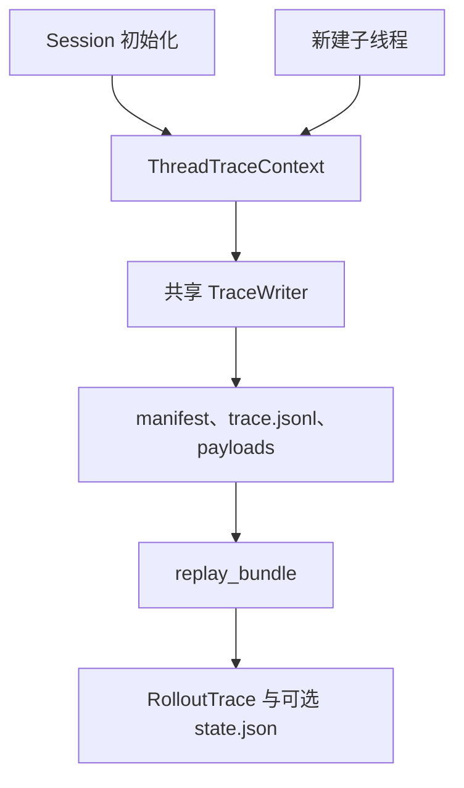
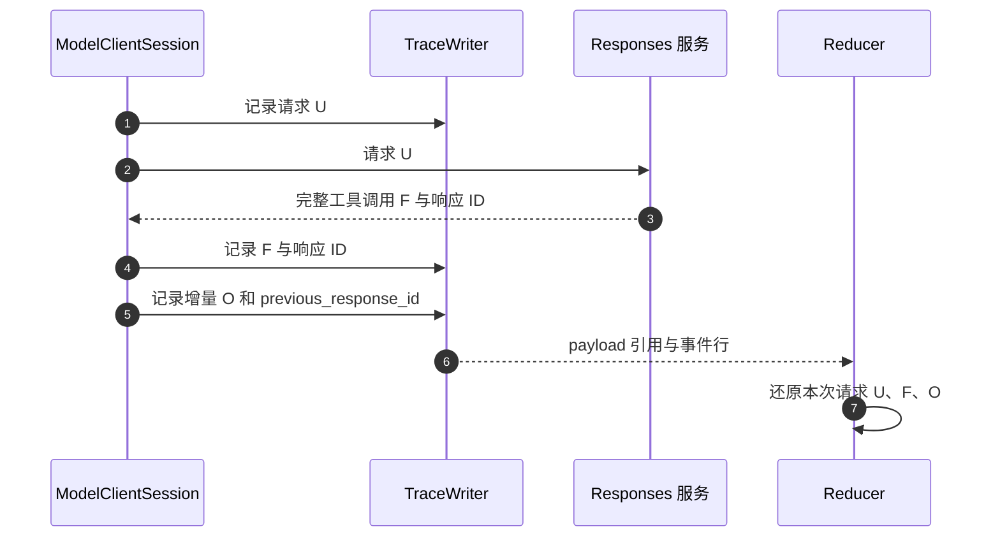
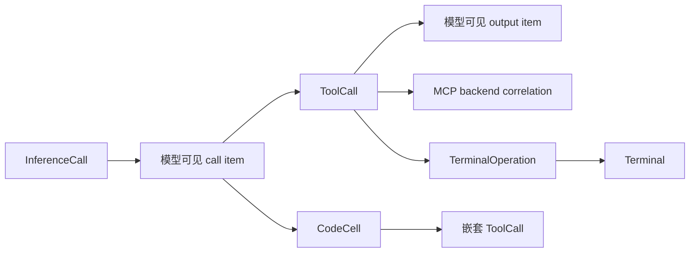
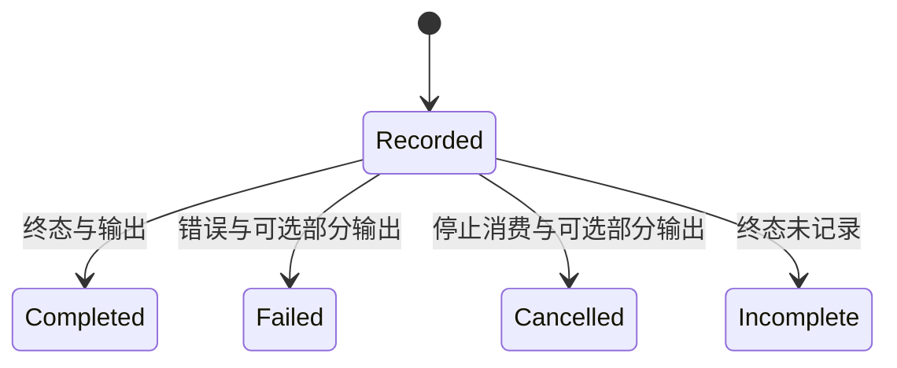
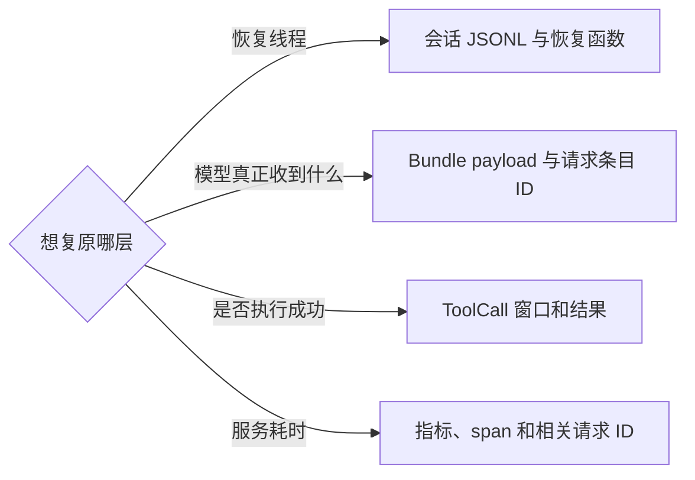

# Trajectory 的设计与实现

这里沿一次含工具调用的任务，追踪 `codex-rollout-trace` 如何保存运行证据，并从原始记录构造诊断图。源码同时保留可恢复会话、模型输入、运行对象和时序度量。它们各有独立的生成时点和可回答的问题。 [codex-rs/core/src/session/mod.rs:2527-2547](https://github.com/GLBB/codex/blob/9f42c89c0112771dc29100a6f3fc904049b2655f/codex-rs/core/src/session/mod.rs#L2527-L2547) [codex-rs/core/src/context_manager/history.rs:98-125](https://github.com/GLBB/codex/blob/9f42c89c0112771dc29100a6f3fc904049b2655f/codex-rs/core/src/context_manager/history.rs#L98-L125) [codex-rs/rollout-trace/README.md:1-38](https://github.com/GLBB/codex/blob/9f42c89c0112771dc29100a6f3fc904049b2655f/codex-rs/rollout-trace/README.md#L1-L38) [codex-rs/rollout-trace/src/model/mod.rs:56-90](https://github.com/GLBB/codex/blob/9f42c89c0112771dc29100a6f3fc904049b2655f/codex-rs/rollout-trace/src/model/mod.rs#L56-L90)

## 一、结构与生命周期

| 证据 | 写入点与去向 | 适合回答的问题 |
| --- | --- | --- |
| 公开的客户端进度 | app-server 发回合和项目通知，历史读取还能从 `RolloutItem` 另行投影 | 客户端看到了哪些变化。 [codex-rs/app-server/README.md:1211-1247](https://github.com/GLBB/codex/blob/9f42c89c0112771dc29100a6f3fc904049b2655f/codex-rs/app-server/README.md#L1211-L1247) [codex-rs/app-server-protocol/src/protocol/thread_history.rs:74-104](https://github.com/GLBB/codex/blob/9f42c89c0112771dc29100a6f3fc904049b2655f/codex-rs/app-server-protocol/src/protocol/thread_history.rs#L74-L104) |
| 恢复历史 | `record_conversation_items` 更新内存并交给 rollout，`RolloutRecorder` 异步写入 | 重启后可恢复哪些内容。 [codex-rs/core/src/session/mod.rs:2527-2547](https://github.com/GLBB/codex/blob/9f42c89c0112771dc29100a6f3fc904049b2655f/codex-rs/core/src/session/mod.rs#L2527-L2547) [codex-rs/rollout/src/recorder.rs:755-811](https://github.com/GLBB/codex/blob/9f42c89c0112771dc29100a6f3fc904049b2655f/codex-rs/rollout/src/recorder.rs#L755-L811) [codex-rs/core/src/session/rollout_reconstruction.rs:87-176](https://github.com/GLBB/codex/blob/9f42c89c0112771dc29100a6f3fc904049b2655f/codex-rs/core/src/session/rollout_reconstruction.rs#L87-L176) |
| 诊断 bundle | `ThreadTraceContext` 在 session 初始化时启用，持有共享 writer | 从哪次推理来，哪些动作最终进入上下文。 [codex-rs/core/src/session/session.rs:675-711](https://github.com/GLBB/codex/blob/9f42c89c0112771dc29100a6f3fc904049b2655f/codex-rs/core/src/session/session.rs#L675-L711) [codex-rs/rollout-trace/src/thread.rs:93-117](https://github.com/GLBB/codex/blob/9f42c89c0112771dc29100a6f3fc904049b2655f/codex-rs/rollout-trace/src/thread.rs#L93-L117) [codex-rs/rollout-trace/src/writer.rs:49-147](https://github.com/GLBB/codex/blob/9f42c89c0112771dc29100a6f3fc904049b2655f/codex-rs/rollout-trace/src/writer.rs#L49-L147) |
| 派生图 | `replay_bundle` 按文件行读取事件，构造 `RolloutTrace` | 输入、输出、工具、终端、代码单元和跨代理动作如何关联。 [codex-rs/rollout-trace/src/reducer/mod.rs:44-82](https://github.com/GLBB/codex/blob/9f42c89c0112771dc29100a6f3fc904049b2655f/codex-rs/rollout-trace/src/reducer/mod.rs#L44-L82) [codex-rs/rollout-trace/src/model/mod.rs:56-90](https://github.com/GLBB/codex/blob/9f42c89c0112771dc29100a6f3fc904049b2655f/codex-rs/rollout-trace/src/model/mod.rs#L56-L90) |

启动 session 时会用线程 ID、代理路径、模型及权限信息构造元数据，同时保留可选的普通会话路径。`CODEX_ROLLOUT_TRACE_ROOT` 只由 trace 启动入口读取，启用后建 `trace-{uuid}-{thread_id}`。新建 `ThreadSpawn` 子线程复用父 writer。父线程查找竞态、恢复的子线程、初始化失败分别走禁用分支，其中恢复分支避免重复的 `ThreadStarted`。结束子线程只更新该线程，根线程的结束路径才追加 `RolloutEnded`。置信度高，依据是启动与关闭实现。 [codex-rs/core/src/session/session.rs:675-711](https://github.com/GLBB/codex/blob/9f42c89c0112771dc29100a6f3fc904049b2655f/codex-rs/core/src/session/session.rs#L675-L711) [codex-rs/rollout-trace/src/thread.rs:93-117](https://github.com/GLBB/codex/blob/9f42c89c0112771dc29100a6f3fc904049b2655f/codex-rs/rollout-trace/src/thread.rs#L93-L117) [codex-rs/rollout-trace/src/thread.rs:420-443](https://github.com/GLBB/codex/blob/9f42c89c0112771dc29100a6f3fc904049b2655f/codex-rs/rollout-trace/src/thread.rs#L420-L443) [codex-rs/core/src/thread_manager.rs:1307-1335](https://github.com/GLBB/codex/blob/9f42c89c0112771dc29100a6f3fc904049b2655f/codex-rs/core/src/thread_manager.rs#L1307-L1335) [codex-rs/rollout-trace/src/thread.rs:148-202](https://github.com/GLBB/codex/blob/9f42c89c0112771dc29100a6f3fc904049b2655f/codex-rs/rollout-trace/src/thread.rs#L148-L202)


<!-- Sources: codex-rs/core/src/session/session.rs:675, codex-rs/core/src/thread_manager.rs:1307, codex-rs/rollout-trace/src/writer.rs:49, codex-rs/rollout-trace/src/reducer/mod.rs:44, codex-rs/cli/src/main.rs:1635 -->

## 二、数据流与模型输入重建

| 阶段 | 记录事实 | 读取方式 |
| --- | --- | --- |
| 采样准备 | `try_run_sampling_request` 取得 turn 对应的 trace 上下文 | 一轮内可能出现多次推理 attempt。 [codex-rs/core/src/session/turn.rs:1689-1734](https://github.com/GLBB/codex/blob/9f42c89c0112771dc29100a6f3fc904049b2655f/codex-rs/core/src/session/turn.rs#L1689-L1734) [codex-rs/rollout-trace/src/inference.rs:121-196](https://github.com/GLBB/codex/blob/9f42c89c0112771dc29100a6f3fc904049b2655f/codex-rs/rollout-trace/src/inference.rs#L121-L196) |
| 出站 | HTTP 在调用前记录构造后的请求并增加关联头。WebSocket 在 prepare 后记录对应请求 | 请求载荷用于确认模型逻辑输入与工具声明。 [codex-rs/core/src/client.rs:1262-1319](https://github.com/GLBB/codex/blob/9f42c89c0112771dc29100a6f3fc904049b2655f/codex-rs/core/src/client.rs#L1262-L1319) [codex-rs/core/src/client.rs:1423-1467](https://github.com/GLBB/codex/blob/9f42c89c0112771dc29100a6f3fc904049b2655f/codex-rs/core/src/client.rs#L1423-L1467) [codex-rs/rollout-trace/src/inference.rs:121-196](https://github.com/GLBB/codex/blob/9f42c89c0112771dc29100a6f3fc904049b2655f/codex-rs/rollout-trace/src/inference.rs#L121-L196) |
| 流式回包 | 消费方累积 `OutputItemDone`，结束时保存响应 ID、可选上游请求 ID、用量、完整输出项 | 已完成项可以在取消或失败时作为部分证据保留。 [codex-rs/core/src/client.rs:1777-1899](https://github.com/GLBB/codex/blob/9f42c89c0112771dc29100a6f3fc904049b2655f/codex-rs/core/src/client.rs#L1777-L1899) [codex-rs/rollout-trace/src/inference.rs:205-313](https://github.com/GLBB/codex/blob/9f42c89c0112771dc29100a6f3fc904049b2655f/codex-rs/rollout-trace/src/inference.rs#L205-L313) |
| 工具续接 | Core 处理完整工具请求，并把执行输出写回历史 | 只有进入下一次推理输入才成为后续模型已见信息。 [codex-rs/core/src/stream_events_utils.rs:342-385](https://github.com/GLBB/codex/blob/9f42c89c0112771dc29100a6f3fc904049b2655f/codex-rs/core/src/stream_events_utils.rs#L342-L385) [codex-rs/core/src/session/turn.rs:1655-1675](https://github.com/GLBB/codex/blob/9f42c89c0112771dc29100a6f3fc904049b2655f/codex-rs/core/src/session/turn.rs#L1655-L1675) [codex-rs/rollout-trace/src/reducer/conversation.rs:34-129](https://github.com/GLBB/codex/blob/9f42c89c0112771dc29100a6f3fc904049b2655f/codex-rs/rollout-trace/src/reducer/conversation.rs#L34-L129) |

WebSocket 预热的 `generate=false` 使用禁用的 attempt。实质推理若复用了这个未跟踪的预热响应，trace 写完整的逻辑请求，保证 reducer 有足够数据恢复上下文。其余增量请求可以保留 `previous_response_id`。因此原始 request payload 代表代码选定的推理证据，分析传输字节时还需要核对该次是否复用了预热连接。置信度高。 [codex-rs/core/src/client.rs:1423-1467](https://github.com/GLBB/codex/blob/9f42c89c0112771dc29100a6f3fc904049b2655f/codex-rs/core/src/client.rs#L1423-L1467) [codex-rs/rollout-trace/src/inference.rs:121-196](https://github.com/GLBB/codex/blob/9f42c89c0112771dc29100a6f3fc904049b2655f/codex-rs/rollout-trace/src/inference.rs#L121-L196)

用 `U` 表示第一轮用户项，`F` 表示模型回的工具调用，`O` 表示下一次输入的新工具结果。增量请求在线路上只有 `O`，reducer 在同一个 thread 中通过 `previous_response_id` 找到前一次推理的 `request_item_ids` 与 `response_item_ids`，再追加 `O` 的条目 ID，得到 `[U,F,O]`。找不到引用会报错。全量快照走 reconcile，在位置优先和未使用候选的约束下复用历史项。出现同一文字的两次话语仍可能是两个不同条目。 [codex-rs/rollout-trace/src/reducer/conversation.rs:34-129](https://github.com/GLBB/codex/blob/9f42c89c0112771dc29100a6f3fc904049b2655f/codex-rs/rollout-trace/src/reducer/conversation.rs#L34-L129) [codex-rs/rollout-trace/src/reducer/conversation.rs:193-280](https://github.com/GLBB/codex/blob/9f42c89c0112771dc29100a6f3fc904049b2655f/codex-rs/rollout-trace/src/reducer/conversation.rs#L193-L280) [codex-rs/rollout-trace/src/reducer/conversation_tests.rs:171-248](https://github.com/GLBB/codex/blob/9f42c89c0112771dc29100a6f3fc904049b2655f/codex-rs/rollout-trace/src/reducer/conversation_tests.rs#L171-L248) [codex-rs/rollout-trace/src/reducer/conversation_tests.rs:668-684](https://github.com/GLBB/codex/blob/9f42c89c0112771dc29100a6f3fc904049b2655f/codex-rs/rollout-trace/src/reducer/conversation_tests.rs#L668-L684)


<!-- Sources: codex-rs/core/src/client.rs:1423, codex-rs/core/src/client.rs:1777, codex-rs/rollout-trace/src/writer.rs:49, codex-rs/rollout-trace/src/reducer/conversation.rs:34 -->

## 三、语义图如何接上执行对象

| 关联 | reducer 桥接方式 | 什么时候需要 |
| --- | --- | --- |
| 推理 → 模型可见工具调用 → 运行时 `ToolCall` | 使用模型 `call_id` 找相关对话项，分别挂到调用端与输出端，再从响应归属追到推理 | 区分调用来源、执行结果和模型最终看到的结果。 [codex-rs/rollout-trace/src/raw_event.rs:29-162](https://github.com/GLBB/codex/blob/9f42c89c0112771dc29100a6f3fc904049b2655f/codex-rs/rollout-trace/src/raw_event.rs#L29-L162) [codex-rs/rollout-trace/src/reducer/tool.rs:341-370](https://github.com/GLBB/codex/blob/9f42c89c0112771dc29100a6f3fc904049b2655f/codex-rs/rollout-trace/src/reducer/tool.rs#L341-L370) [codex-rs/rollout-trace/src/reducer/tool.rs:411-510](https://github.com/GLBB/codex/blob/9f42c89c0112771dc29100a6f3fc904049b2655f/codex-rs/rollout-trace/src/reducer/tool.rs#L411-L510) |
| `ToolCall` → MCP backend | 实际进入 backend 路径时生成独立 `mcp_call_id` 并随 metadata 传给对端 | 将本地调度与远端 MCP 请求日志对齐。 [codex-rs/core/src/mcp_tool_call.rs:547-591](https://github.com/GLBB/codex/blob/9f42c89c0112771dc29100a6f3fc904049b2655f/codex-rs/core/src/mcp_tool_call.rs#L547-L591) [codex-rs/rollout-trace/src/thread.rs:401-417](https://github.com/GLBB/codex/blob/9f42c89c0112771dc29100a6f3fc904049b2655f/codex-rs/rollout-trace/src/thread.rs#L401-L417) [codex-rs/rollout-trace/src/mcp.rs:1-67](https://github.com/GLBB/codex/blob/9f42c89c0112771dc29100a6f3fc904049b2655f/codex-rs/rollout-trace/src/mcp.rs#L1-L67) |
| `exec` 对话项 → `CodeCell` → 嵌套工具及 `wait` | graph ID 源自模型可见调用。runtime cell handle 以线程为作用域，早到的 cell 事件等待源项出现 | 初次调用可以先 yield，JavaScript 运行窗口可能更长。 [codex-rs/rollout-trace/src/model/runtime.rs:23-130](https://github.com/GLBB/codex/blob/9f42c89c0112771dc29100a6f3fc904049b2655f/codex-rs/rollout-trace/src/model/runtime.rs#L23-L130) [codex-rs/rollout-trace/src/reducer/code_cell.rs:88-161](https://github.com/GLBB/codex/blob/9f42c89c0112771dc29100a6f3fc904049b2655f/codex-rs/rollout-trace/src/reducer/code_cell.rs#L88-L161) [codex-rs/rollout-trace/src/reducer/mod.rs:44-82](https://github.com/GLBB/codex/blob/9f42c89c0112771dc29100a6f3fc904049b2655f/codex-rs/rollout-trace/src/reducer/mod.rs#L44-L82) |
| 工具执行 → 终端操作 → 终端会话 | terminal reducer 从运行载荷和工具结果关联执行或写入操作与终端 ID | 一次终端会话可以服务多次工具操作。 [codex-rs/rollout-trace/src/reducer/tool/terminal.rs:156-249](https://github.com/GLBB/codex/blob/9f42c89c0112771dc29100a6f3fc904049b2655f/codex-rs/rollout-trace/src/reducer/tool/terminal.rs#L156-L249) [codex-rs/rollout-trace/src/model/runtime.rs:23-130](https://github.com/GLBB/codex/blob/9f42c89c0112771dc29100a6f3fc904049b2655f/codex-rs/rollout-trace/src/model/runtime.rs#L23-L130) |
| 调用或结果 → 子线程接收项 | 交互边等待接收方模型请求中对应条目出现。特定 spawn 在重放结束时可退化到 child thread | 区分已经发出、已被目标线程见到、只有子线程建立证据。 [codex-rs/rollout-trace/src/reducer/tool/agents.rs:373-475](https://github.com/GLBB/codex/blob/9f42c89c0112771dc29100a6f3fc904049b2655f/codex-rs/rollout-trace/src/reducer/tool/agents.rs#L373-L475) [codex-rs/rollout-trace/src/reducer/mod.rs:44-82](https://github.com/GLBB/codex/blob/9f42c89c0112771dc29100a6f3fc904049b2655f/codex-rs/rollout-trace/src/reducer/mod.rs#L44-L82) |

工具调度已经开始时，推理流可能尚未收到最后的 `Completed`。`ToolDispatchTrace::start` 在 registry 内创建执行观测，模型输入和响应分别独立归约。reducer 允许某些原始事件先到并延后建立边，便于生产端按真实时点记录。置信度高，现有 code cell 开始队列和工具关联实现都直接支持。 [codex-rs/core/src/tools/registry.rs:415-462](https://github.com/GLBB/codex/blob/9f42c89c0112771dc29100a6f3fc904049b2655f/codex-rs/core/src/tools/registry.rs#L415-L462) [codex-rs/core/src/client.rs:1777-1899](https://github.com/GLBB/codex/blob/9f42c89c0112771dc29100a6f3fc904049b2655f/codex-rs/core/src/client.rs#L1777-L1899) [codex-rs/rollout-trace/src/reducer/code_cell.rs:88-161](https://github.com/GLBB/codex/blob/9f42c89c0112771dc29100a6f3fc904049b2655f/codex-rs/rollout-trace/src/reducer/code_cell.rs#L88-L161) [codex-rs/rollout-trace/src/reducer/tool.rs:411-510](https://github.com/GLBB/codex/blob/9f42c89c0112771dc29100a6f3fc904049b2655f/codex-rs/rollout-trace/src/reducer/tool.rs#L411-L510)


<!-- Sources: codex-rs/rollout-trace/src/reducer/tool.rs:411, codex-rs/rollout-trace/src/thread.rs:401, codex-rs/rollout-trace/src/model/runtime.rs:23, codex-rs/rollout-trace/src/reducer/tool/terminal.rs:156 -->

## 四、归约边界与失败语义

| 实现取舍 | 源码证据 | 分析时的影响 |
| --- | --- | --- |
| 先写载荷再附引用 | `TraceWriter` 通过互斥锁分配独立序号。每条事件写行末并 `flush` | 推断上，进程中断可能留下未引用载荷。`flush` 提供可读时机，持久性要按文件系统和实际写入验证。 [codex-rs/rollout-trace/src/writer.rs:49-147](https://github.com/GLBB/codex/blob/9f42c89c0112771dc29100a6f3fc904049b2655f/codex-rs/rollout-trace/src/writer.rs#L49-L147) [codex-rs/rollout-trace/src/payload.rs:12-49](https://github.com/GLBB/codex/blob/9f42c89c0112771dc29100a6f3fc904049b2655f/codex-rs/rollout-trace/src/payload.rs#L12-L49) |
| trace 尽力写，重放严格读 | 启动失败转为 disabled。reducer 解析错误携带行号，读取引用失败会报错 | 主任务可能完成且 bundle 只有部分证据。最后一行截断时要先保留原始样本，再检查错误位置。 [codex-rs/rollout-trace/src/thread.rs:93-117](https://github.com/GLBB/codex/blob/9f42c89c0112771dc29100a6f3fc904049b2655f/codex-rs/rollout-trace/src/thread.rs#L93-L117) [codex-rs/rollout-trace/src/inference.rs:121-196](https://github.com/GLBB/codex/blob/9f42c89c0112771dc29100a6f3fc904049b2655f/codex-rs/rollout-trace/src/inference.rs#L121-L196) [codex-rs/rollout-trace/src/writer.rs:49-147](https://github.com/GLBB/codex/blob/9f42c89c0112771dc29100a6f3fc904049b2655f/codex-rs/rollout-trace/src/writer.rs#L49-L147) [codex-rs/rollout-trace/src/reducer/mod.rs:44-82](https://github.com/GLBB/codex/blob/9f42c89c0112771dc29100a6f3fc904049b2655f/codex-rs/rollout-trace/src/reducer/mod.rs#L44-L82) |
| 模型尝试有自己的终态 | `take_terminal_attempt` 用原子标志拒绝重复终态，失败与取消可带部分已完成项 | UI 看到一些输出也可能是失败或取消的 attempt。终态的写入故障依然会形成缺口。 [codex-rs/core/src/client.rs:1777-1899](https://github.com/GLBB/codex/blob/9f42c89c0112771dc29100a6f3fc904049b2655f/codex-rs/core/src/client.rs#L1777-L1899) [codex-rs/rollout-trace/src/inference.rs:205-313](https://github.com/GLBB/codex/blob/9f42c89c0112771dc29100a6f3fc904049b2655f/codex-rs/rollout-trace/src/inference.rs#L205-L313) |
| 压缩请求与安装检查点分离 | 远端 v2 压缩先记录尝试，安装后记录替换快照。reducer 将它作为下一次全量请求的参考快照 | 可定位耗时打在哪次请求、实际换入哪些项、哪些前缀后来重新注入。 [codex-rs/core/src/compact_remote_v2.rs:209-275](https://github.com/GLBB/codex/blob/9f42c89c0112771dc29100a6f3fc904049b2655f/codex-rs/core/src/compact_remote_v2.rs#L209-L275) [codex-rs/rollout-trace/src/model/runtime.rs:23-130](https://github.com/GLBB/codex/blob/9f42c89c0112771dc29100a6f3fc904049b2655f/codex-rs/rollout-trace/src/model/runtime.rs#L23-L130) [codex-rs/rollout-trace/src/reducer/conversation.rs:283-355](https://github.com/GLBB/codex/blob/9f42c89c0112771dc29100a6f3fc904049b2655f/codex-rs/rollout-trace/src/reducer/conversation.rs#L283-L355) [codex-rs/rollout-trace/src/reducer/conversation.rs:34-129](https://github.com/GLBB/codex/blob/9f42c89c0112771dc29100a6f3fc904049b2655f/codex-rs/rollout-trace/src/reducer/conversation.rs#L34-L129) |
| 版本和顺序由各层定义 | Raw event 与 manifest 内带 schema 字段。当前 `replay_bundle` 按文件行遍历 | 文档发布或导入要保留原始顺序和版本。跨提交兼容需要用目标版本的 reducer 试读。 [codex-rs/rollout-trace/src/raw_event.rs:29-162](https://github.com/GLBB/codex/blob/9f42c89c0112771dc29100a6f3fc904049b2655f/codex-rs/rollout-trace/src/raw_event.rs#L29-L162) [codex-rs/rollout-trace/src/writer.rs:49-147](https://github.com/GLBB/codex/blob/9f42c89c0112771dc29100a6f3fc904049b2655f/codex-rs/rollout-trace/src/writer.rs#L49-L147) [codex-rs/rollout-trace/src/reducer/mod.rs:44-82](https://github.com/GLBB/codex/blob/9f42c89c0112771dc29100a6f3fc904049b2655f/codex-rs/rollout-trace/src/reducer/mod.rs#L44-L82) |

重放生成 `state.json` 后，原始载荷通过相对路径可回看。reducer 使用模型结构进行语义规范化，完整 transport 逐帧时序、后端实际执行细节、进程突然退出后的覆盖率，需要相应层的记录。这里分析的是当前源码和已验证的合成事件。 [codex-rs/rollout-trace/src/payload.rs:12-49](https://github.com/GLBB/codex/blob/9f42c89c0112771dc29100a6f3fc904049b2655f/codex-rs/rollout-trace/src/payload.rs#L12-L49) [codex-rs/core/src/client.rs:1777-1899](https://github.com/GLBB/codex/blob/9f42c89c0112771dc29100a6f3fc904049b2655f/codex-rs/core/src/client.rs#L1777-L1899) [codex-rs/rollout-trace/src/reducer/mod.rs:44-82](https://github.com/GLBB/codex/blob/9f42c89c0112771dc29100a6f3fc904049b2655f/codex-rs/rollout-trace/src/reducer/mod.rs#L44-L82) [codex-rs/rollout-trace/README.md:1-38](https://github.com/GLBB/codex/blob/9f42c89c0112771dc29100a6f3fc904049b2655f/codex-rs/rollout-trace/README.md#L1-L38)


<!-- Sources: codex-rs/rollout-trace/src/inference.rs:121, codex-rs/rollout-trace/src/inference.rs:205, codex-rs/core/src/client.rs:1777, codex-rs/rollout-trace/src/reducer/mod.rs:44 -->

## 五、实际取证与验证

离线实验按仓库增量测试的格式生成六条 raw 事件和三个 payload。使用工作区已有的 CLI 二进制重放，两次生成的 JSON 字节相同。第二次请求在文件中只有一个输入项，`state.json` 中的 `request_item_ids` 为三个。将引用改为不存在的响应 ID 后，reducer 返回 `referenced unknown previous_response_id`。可在当前提交的 Rust 测试里复现同样的核心断言。 [codex-rs/rollout-trace/src/reducer/conversation_tests.rs:171-248](https://github.com/GLBB/codex/blob/9f42c89c0112771dc29100a6f3fc904049b2655f/codex-rs/rollout-trace/src/reducer/conversation_tests.rs#L171-L248) [codex-rs/rollout-trace/src/reducer/conversation_tests.rs:668-684](https://github.com/GLBB/codex/blob/9f42c89c0112771dc29100a6f3fc904049b2655f/codex-rs/rollout-trace/src/reducer/conversation_tests.rs#L668-L684) [codex-rs/cli/src/main.rs:1635-1645](https://github.com/GLBB/codex/blob/9f42c89c0112771dc29100a6f3fc904049b2655f/codex-rs/cli/src/main.rs#L1635-L1645)

```bash
just test -p codex-rollout-trace
codex debug trace-reduce "$trace_bundle"
jq '.inference_calls | to_entries[] | {
  id: .key,
  response_id: .value.response_id,
  upstream_request_id: .value.upstream_request_id,
  input_count: (.value.request_item_ids | length)
}' "$trace_bundle/state.json"
```

| 优先级 | 问题 | 选用证据 | 置信度及研究边界 |
| --- | --- | --- | --- |
| 高 | 一次模型为何输出某调用 | request、response、`request_item_ids`、模型 `call_id` | 高。增量重建已用合成样本重放。模型端内部行为需要服务端证据。 [codex-rs/rollout-trace/src/reducer/conversation.rs:34-129](https://github.com/GLBB/codex/blob/9f42c89c0112771dc29100a6f3fc904049b2655f/codex-rs/rollout-trace/src/reducer/conversation.rs#L34-L129) [codex-rs/rollout-trace/src/reducer/tool.rs:411-510](https://github.com/GLBB/codex/blob/9f42c89c0112771dc29100a6f3fc904049b2655f/codex-rs/rollout-trace/src/reducer/tool.rs#L411-L510) |
| 高 | 一次工具成功是否被模型利用 | 比对 runtime 结果与下一次推理输入 | 高。两个观察点分别有字段和代码入口。 [codex-rs/rollout-trace/src/model/runtime.rs:23-130](https://github.com/GLBB/codex/blob/9f42c89c0112771dc29100a6f3fc904049b2655f/codex-rs/rollout-trace/src/model/runtime.rs#L23-L130) [codex-rs/core/src/session/turn.rs:1655-1675](https://github.com/GLBB/codex/blob/9f42c89c0112771dc29100a6f3fc904049b2655f/codex-rs/core/src/session/turn.rs#L1655-L1675) |
| 高 | 恢复后为何改变了上下文 | 查看 session JSONL、压缩 checkpoint 和恢复重建；有 bundle 时对齐下一次请求 | 高。相关实现已查阅，跨版本兼容需要对旧记录另做回放。 [codex-rs/core/src/session/rollout_reconstruction.rs:87-176](https://github.com/GLBB/codex/blob/9f42c89c0112771dc29100a6f3fc904049b2655f/codex-rs/core/src/session/rollout_reconstruction.rs#L87-L176) [codex-rs/rollout-trace/src/reducer/conversation.rs:283-355](https://github.com/GLBB/codex/blob/9f42c89c0112771dc29100a6f3fc904049b2655f/codex-rs/rollout-trace/src/reducer/conversation.rs#L283-L355) [codex-rs/rollout-trace/src/reducer/conversation.rs:34-129](https://github.com/GLBB/codex/blob/9f42c89c0112771dc29100a6f3fc904049b2655f/codex-rs/rollout-trace/src/reducer/conversation.rs#L34-L129) |
| 中 | 这轮因何变慢 | 先按回合内 attempts 和工具窗口定位，再按 [可观测性](observability.md) 核对延迟语义 | 高。时间窗口有实现，线上耗时归因需实际样本。 [codex-rs/rollout-trace/src/model/runtime.rs:23-130](https://github.com/GLBB/codex/blob/9f42c89c0112771dc29100a6f3fc904049b2655f/codex-rs/rollout-trace/src/model/runtime.rs#L23-L130) [codex-rs/core/src/turn_timing.rs:53-101](https://github.com/GLBB/codex/blob/9f42c89c0112771dc29100a6f3fc904049b2655f/codex-rs/core/src/turn_timing.rs#L53-L101) |
| 中 | 是否可直接用于评估 | 固定 schema 与源码版本，保留引用和样本采集条件 | 设计推论。当前记录能解释执行，任务正确性还需要外部断言或评估标签。 [codex-rs/rollout-trace/src/raw_event.rs:29-162](https://github.com/GLBB/codex/blob/9f42c89c0112771dc29100a6f3fc904049b2655f/codex-rs/rollout-trace/src/raw_event.rs#L29-L162) [codex-rs/rollout-trace/src/model/mod.rs:56-90](https://github.com/GLBB/codex/blob/9f42c89c0112771dc29100a6f3fc904049b2655f/codex-rs/rollout-trace/src/model/mod.rs#L56-L90) [codex-rs/rollout-trace/src/reducer/mod.rs:44-82](https://github.com/GLBB/codex/blob/9f42c89c0112771dc29100a6f3fc904049b2655f/codex-rs/rollout-trace/src/reducer/mod.rs#L44-L82) |


<!-- Sources: codex-rs/core/src/session/rollout_reconstruction.rs:87, codex-rs/rollout-trace/src/reducer/conversation.rs:34, codex-rs/rollout-trace/src/model/runtime.rs:23, codex-rs/core/src/turn_timing.rs:53 -->

继续阅读 [可观测性](observability.md)、[Core 与会话协议](../protocols/core-history.md) 和 [模型协议](../protocols/model-wire.md)。
