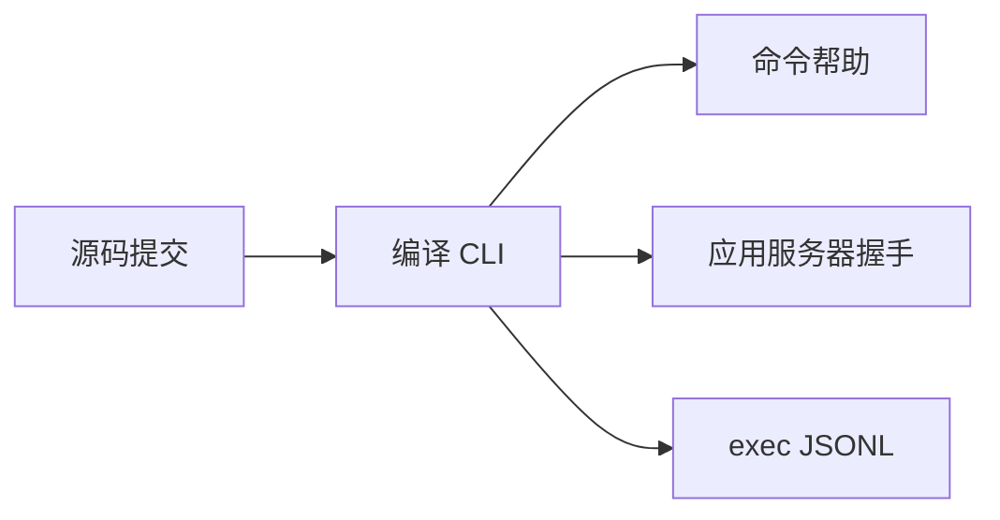
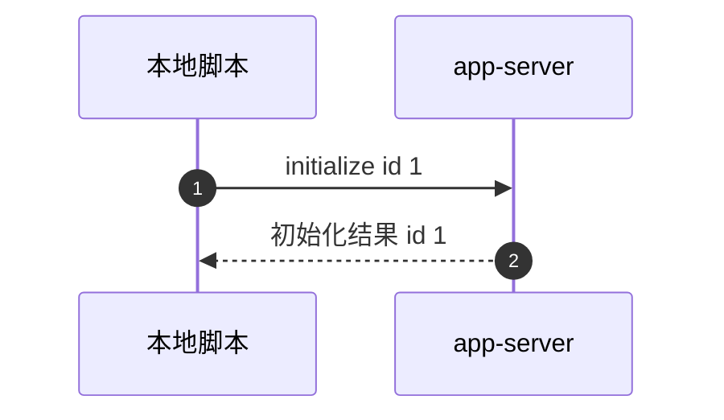
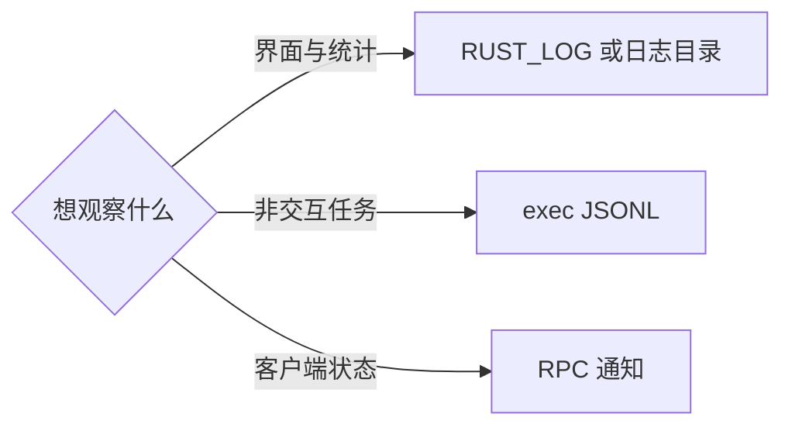

# 本地运行与读日志

从构建和小实验入手，可以在进入 Core 前确定当前运行的是哪一个二进制，以及看到的是哪一种输出协议。下面的构建与日志命令取自当前仓库，模型观察命令需要可用的登录和服务。 [docs/install.md:20-62](https://github.com/GLBB/codex/blob/9f42c89c0112771dc29100a6f3fc904049b2655f/docs/install.md#L20-L62) [codex-rs/exec/src/lib.rs:564-602](https://github.com/GLBB/codex/blob/9f42c89c0112771dc29100a6f3fc904049b2655f/codex-rs/exec/src/lib.rs#L564-L602) [codex-rs/app-server/README.md:20-89](https://github.com/GLBB/codex/blob/9f42c89c0112771dc29100a6f3fc904049b2655f/codex-rs/app-server/README.md#L20-L89)

| 目标 | 入口 | 源码 |
| --- | --- | --- |
| 查固定 Rust 版本 | `codex-rs/rust-toolchain.toml` | [codex-rs/rust-toolchain.toml:1-3](https://github.com/GLBB/codex/blob/9f42c89c0112771dc29100a6f3fc904049b2655f/codex-rs/rust-toolchain.toml#L1-L3) |
| 编译并打印 CLI 帮助 | `cargo build --bin codex` | [docs/install.md:20-62](https://github.com/GLBB/codex/blob/9f42c89c0112771dc29100a6f3fc904049b2655f/docs/install.md#L20-L62) [codex-rs/cli/src/main.rs:823-880](https://github.com/GLBB/codex/blob/9f42c89c0112771dc29100a6f3fc904049b2655f/codex-rs/cli/src/main.rs#L823-L880) |
| 无模型请求检查握手 | `codex app-server` 和 `initialize` | [codex-rs/app-server/README.md:20-89](https://github.com/GLBB/codex/blob/9f42c89c0112771dc29100a6f3fc904049b2655f/codex-rs/app-server/README.md#L20-L89) [codex-rs/app-server/src/request_processors/initialize_processor.rs:44-92](https://github.com/GLBB/codex/blob/9f42c89c0112771dc29100a6f3fc904049b2655f/codex-rs/app-server/src/request_processors/initialize_processor.rs#L44-L92) |
| 观察一轮模型行为 | `codex exec --json` | [codex-rs/exec/src/lib.rs:564-602](https://github.com/GLBB/codex/blob/9f42c89c0112771dc29100a6f3fc904049b2655f/codex-rs/exec/src/lib.rs#L564-L602) [codex-rs/exec/src/event_processor_with_jsonl_output.rs:591-608](https://github.com/GLBB/codex/blob/9f42c89c0112771dc29100a6f3fc904049b2655f/codex-rs/exec/src/event_processor_with_jsonl_output.rs#L591-L608) |
| 检查协议 crate | `just test -p codex-app-server-protocol` | [justfile:28-58](https://github.com/GLBB/codex/blob/9f42c89c0112771dc29100a6f3fc904049b2655f/justfile#L28-L58) [AGENTS.md:54-69](https://github.com/GLBB/codex/blob/9f42c89c0112771dc29100a6f3fc904049b2655f/AGENTS.md#L54-L69) |

### 从同一提交构建

```bash
cd codex-rs
rustc --version
cargo build --bin codex
./target/debug/codex --help
./target/debug/codex exec --help
```

安装文档列出 Rust 和测试工具的准备方式。构建成功后运行 `./target/debug/codex` 可以明确指向这次构建的产物。需要格式化与定向测试时，仓库提供 `just fmt` 和基于 nextest 的 `just test`。 [docs/install.md:20-62](https://github.com/GLBB/codex/blob/9f42c89c0112771dc29100a6f3fc904049b2655f/docs/install.md#L20-L62) [codex-rs/rust-toolchain.toml:1-3](https://github.com/GLBB/codex/blob/9f42c89c0112771dc29100a6f3fc904049b2655f/codex-rs/rust-toolchain.toml#L1-L3) [AGENTS.md:54-69](https://github.com/GLBB/codex/blob/9f42c89c0112771dc29100a6f3fc904049b2655f/AGENTS.md#L54-L69) [justfile:28-58](https://github.com/GLBB/codex/blob/9f42c89c0112771dc29100a6f3fc904049b2655f/justfile#L28-L58)

### 观察两个接口

应用服务器客户端可以通过下例检查一次初始化，并从响应中的 `id` 对齐请求。完整客户端要保持连接，收到响应后发出 `initialized`，再继续其他调用。 [codex-rs/app-server/README.md:20-89](https://github.com/GLBB/codex/blob/9f42c89c0112771dc29100a6f3fc904049b2655f/codex-rs/app-server/README.md#L20-L89) [codex-rs/app-server/src/request_processors/initialize_processor.rs:44-92](https://github.com/GLBB/codex/blob/9f42c89c0112771dc29100a6f3fc904049b2655f/codex-rs/app-server/src/request_processors/initialize_processor.rs#L44-L92)

```python
import json
from subprocess import PIPE, Popen

with Popen(["./target/debug/codex", "app-server"], stdin=PIPE, stdout=PIPE, text=True) as server:
    request = {
        "id": 1,
        "method": "initialize",
        "params": {"clientInfo": {"name": "wiki-study", "version": "0.1.0"}},
    }
    print(json.dumps(request), file=server.stdin, flush=True)
    for line in server.stdout:
        message = json.loads(line)
        if message.get("id") == 1:
            print(json.dumps(message, ensure_ascii=False))
            if "result" in message:
                print('{"method":"initialized"}', file=server.stdin, flush=True)
            break
    server.stdin.close()
```

模型实验可以运行以下命令，再用 `jq` 提取事件类型。JSONL 是 exec 输出，应用服务器的通知则用 RPC 的 `method` 字段。测试工作目录使用项目的临时副本，工具权限由实际配置决定。 [codex-rs/exec/src/lib.rs:564-602](https://github.com/GLBB/codex/blob/9f42c89c0112771dc29100a6f3fc904049b2655f/codex-rs/exec/src/lib.rs#L564-L602) [codex-rs/exec/src/lib.rs:749-807](https://github.com/GLBB/codex/blob/9f42c89c0112771dc29100a6f3fc904049b2655f/codex-rs/exec/src/lib.rs#L749-L807) [codex-rs/exec/src/event_processor_with_jsonl_output.rs:591-608](https://github.com/GLBB/codex/blob/9f42c89c0112771dc29100a6f3fc904049b2655f/codex-rs/exec/src/event_processor_with_jsonl_output.rs#L591-L608) [codex-rs/app-server/README.md:20-89](https://github.com/GLBB/codex/blob/9f42c89c0112771dc29100a6f3fc904049b2655f/codex-rs/app-server/README.md#L20-L89)

```bash
./target/debug/codex exec --json '用一句话描述你的当前任务。' > /tmp/codex-study.jsonl
jq -r '.type' /tmp/codex-study.jsonl
```

### 日志与验证口径

安装文档描述了 `RUST_LOG` 过滤和显式 `log_dir` 生成 TUI 明文日志的方式。先选择待验证的边界，再确定取证来源。Wiki 运行检查覆盖站点本身，以上 Rust 和模型命令供本地学习使用。 [docs/install.md:20-62](https://github.com/GLBB/codex/blob/9f42c89c0112771dc29100a6f3fc904049b2655f/docs/install.md#L20-L62) [codex-rs/app-server/README.md:1211-1247](https://github.com/GLBB/codex/blob/9f42c89c0112771dc29100a6f3fc904049b2655f/codex-rs/app-server/README.md#L1211-L1247)

## 实验入口


<!-- Sources: docs/install.md:20, codex-rs/cli/src/main.rs:823, codex-rs/app-server/README.md:20, codex-rs/exec/src/lib.rs:564 -->

## 一个离线握手


<!-- Sources: codex-rs/app-server/README.md:20, codex-rs/app-server/src/request_processors/initialize_processor.rs:44 -->

## 选择输出


<!-- Sources: docs/install.md:20, codex-rs/exec/src/lib.rs:564, codex-rs/app-server/README.md:1211 -->

## 源码索引

- [docs/install.md:20-62](https://github.com/GLBB/codex/blob/9f42c89c0112771dc29100a6f3fc904049b2655f/docs/install.md#L20-L62)
- [codex-rs/rust-toolchain.toml:1-3](https://github.com/GLBB/codex/blob/9f42c89c0112771dc29100a6f3fc904049b2655f/codex-rs/rust-toolchain.toml#L1-L3)
- [codex-rs/cli/src/main.rs:823-880](https://github.com/GLBB/codex/blob/9f42c89c0112771dc29100a6f3fc904049b2655f/codex-rs/cli/src/main.rs#L823-L880)
- [justfile:28-58](https://github.com/GLBB/codex/blob/9f42c89c0112771dc29100a6f3fc904049b2655f/justfile#L28-L58)
- [AGENTS.md:54-69](https://github.com/GLBB/codex/blob/9f42c89c0112771dc29100a6f3fc904049b2655f/AGENTS.md#L54-L69)
- [codex-rs/app-server/README.md:20-89](https://github.com/GLBB/codex/blob/9f42c89c0112771dc29100a6f3fc904049b2655f/codex-rs/app-server/README.md#L20-L89)
- [codex-rs/app-server/src/request_processors/initialize_processor.rs:44-92](https://github.com/GLBB/codex/blob/9f42c89c0112771dc29100a6f3fc904049b2655f/codex-rs/app-server/src/request_processors/initialize_processor.rs#L44-L92)
- [codex-rs/exec/src/lib.rs:564-602](https://github.com/GLBB/codex/blob/9f42c89c0112771dc29100a6f3fc904049b2655f/codex-rs/exec/src/lib.rs#L564-L602)
- [codex-rs/exec/src/lib.rs:749-807](https://github.com/GLBB/codex/blob/9f42c89c0112771dc29100a6f3fc904049b2655f/codex-rs/exec/src/lib.rs#L749-L807)
- [codex-rs/exec/src/event_processor_with_jsonl_output.rs:591-608](https://github.com/GLBB/codex/blob/9f42c89c0112771dc29100a6f3fc904049b2655f/codex-rs/exec/src/event_processor_with_jsonl_output.rs#L591-L608)
- [codex-rs/app-server/README.md:1211-1247](https://github.com/GLBB/codex/blob/9f42c89c0112771dc29100a6f3fc904049b2655f/codex-rs/app-server/README.md#L1211-L1247)

## 继续阅读

- [app-server 与客户端协议](../architecture/app-server.md)
- [可观测性](../deep-dive/observability.md)
- [协议设计总览](../protocols/index.md)
