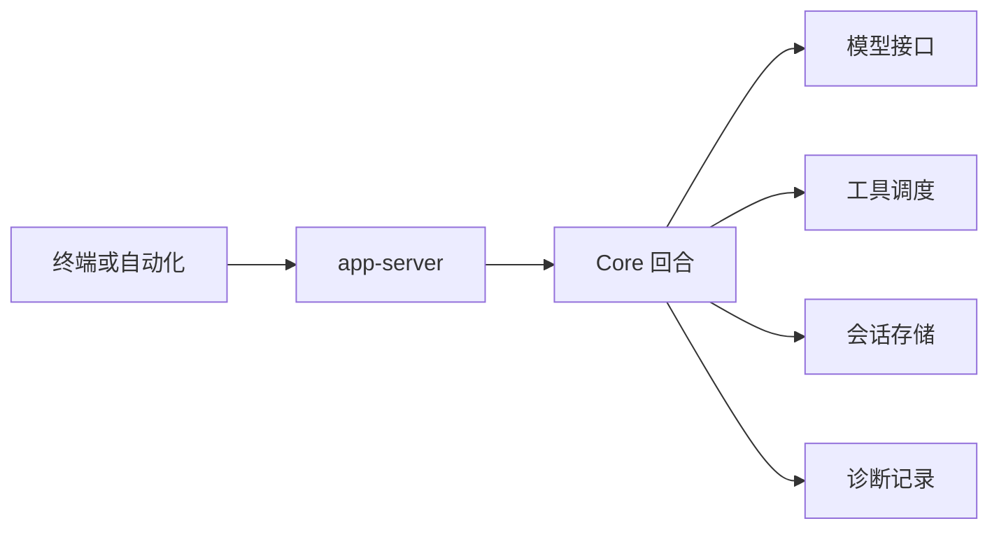
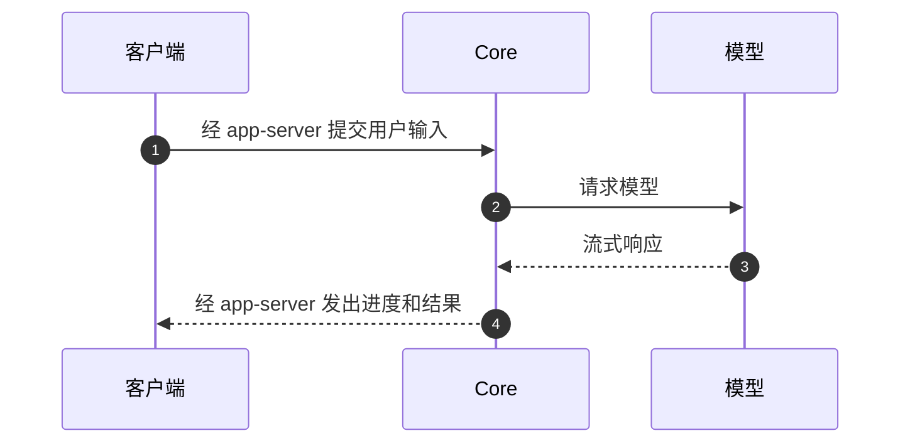
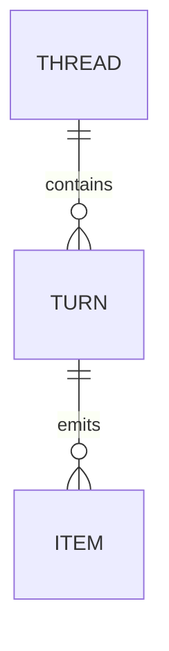

# Codex 源码 Wiki

这份中文 Wiki 对应 `learning/codex` 生成时的源码提交 `9f42c89c01`。从发起任务入手，可以一路看到 app-server 如何提交输入、Core 如何反复请求模型、工具和历史又如何参与回合。原有专题的源码链接固定到这一提交。[模块架构全景](architecture/module-overview.md) 和 [Rollout 会话 JSONL 字段表](protocols/rollout-wire.md) 以较新的 `4b7a20f60c` 为准。 [codex-rs/cli/src/main.rs:823-880](https://github.com/GLBB/codex/blob/9f42c89c0112771dc29100a6f3fc904049b2655f/codex-rs/cli/src/main.rs#L823-L880) [codex-rs/app-server/src/request_processors/turn_processor.rs:355-433](https://github.com/GLBB/codex/blob/9f42c89c0112771dc29100a6f3fc904049b2655f/codex-rs/app-server/src/request_processors/turn_processor.rs#L355-L433) [codex-rs/core/src/session/turn.rs:131-183](https://github.com/GLBB/codex/blob/9f42c89c0112771dc29100a6f3fc904049b2655f/codex-rs/core/src/session/turn.rs#L131-L183) [codex-rs/core/src/session/turn.rs:207-326](https://github.com/GLBB/codex/blob/9f42c89c0112771dc29100a6f3fc904049b2655f/codex-rs/core/src/session/turn.rs#L207-L326)

## 快速开始

在仓库根目录运行以下命令，打开终端打印的本地地址。

```bash
npm --prefix wiki ci
npm --prefix wiki run dev
```

生成可部署的网站文件。

```bash
npm --prefix wiki run build
```

## 文档地图

| 入口 | 从这里开始 |
| --- | --- |
| [角色指南](onboarding/index.md) | 贡献者、架构工程师、工程管理者与产品经理 |
| [本地运行与读日志](getting-started/run-locally.md) | 先编译启动，观察协议与 JSONL |
| [模块架构全景](architecture/module-overview.md) | 看入口、Core、模型、工具、扩展和存储的全景，再按职责查 179 个 Rust workspace 成员 |
| [Agent Loop](architecture/agent-loop.md) | 顺着一轮输入看模型采样和工具续接 |
| [工具调度与权限](architecture/tools-permissions.md) | 查调用解析、工具运行时、审批和执行边界 |
| [上下文与会话](architecture/session-state.md) | 看内存历史、会话文件和恢复逻辑 |
| [app-server 与客户端协议](architecture/app-server.md) | 看连接、线程、回合、通知和审批回包 |
| [模型请求与响应流](deep-dive/model-transport.md) | 看请求构建、传输和模型响应事件 |
| [配置、技能与 MCP](deep-dive/config-extensions.md) | 看配置分层、说明注入和工具调用 |
| [子代理与线程关系](deep-dive/multi-agent.md) | 看线程创建、继承和任务递送 |
| [Rollout 会话日志](deep-dive/rollout-session.md) | 查会话 JSONL 的写入、恢复、压缩和回退 |
| [Rollout Trace](deep-dive/trajectory.md) | 回放诊断 bundle，重建模型请求、工具执行和跨线程关系 |
| [可观测性](deep-dive/observability.md) | 查本地日志、跨度传播、指标语义与 OTLP 导出 |
| [协议设计总览](protocols/index.md) | 查阅十个专题的字段表、关联标识及完成条件 |
| [长期记忆](deep-dive/memories.md) | 看会话提取、全局整理与新线程读取 |

## 技术栈与关键文件

| 组件 | 第一处阅读位置 | 源码 |
| --- | --- | --- |
| Rust 工作区 | 成员 crate 与固定工具链 | [codex-rs/Cargo.toml:1-45](https://github.com/GLBB/codex/blob/9f42c89c0112771dc29100a6f3fc904049b2655f/codex-rs/Cargo.toml#L1-L45) [codex-rs/rust-toolchain.toml:1-3](https://github.com/GLBB/codex/blob/9f42c89c0112771dc29100a6f3fc904049b2655f/codex-rs/rust-toolchain.toml#L1-L3) |
| 客户端与协议 | CLI 分派、app-server 协议及 TypeScript SDK | [codex-rs/cli/src/main.rs:823-880](https://github.com/GLBB/codex/blob/9f42c89c0112771dc29100a6f3fc904049b2655f/codex-rs/cli/src/main.rs#L823-L880) [codex-rs/app-server/README.md:20-89](https://github.com/GLBB/codex/blob/9f42c89c0112771dc29100a6f3fc904049b2655f/codex-rs/app-server/README.md#L20-L89) [sdk/typescript/src/thread.ts:66-135](https://github.com/GLBB/codex/blob/9f42c89c0112771dc29100a6f3fc904049b2655f/sdk/typescript/src/thread.ts#L66-L135) |
| 运行循环 | Core 的回合执行和请求组装 | [codex-rs/core/src/session/turn.rs:131-183](https://github.com/GLBB/codex/blob/9f42c89c0112771dc29100a6f3fc904049b2655f/codex-rs/core/src/session/turn.rs#L131-L183) [codex-rs/core/src/session/turn.rs:207-326](https://github.com/GLBB/codex/blob/9f42c89c0112771dc29100a6f3fc904049b2655f/codex-rs/core/src/session/turn.rs#L207-L326) [codex-rs/core/src/session/turn.rs:863-947](https://github.com/GLBB/codex/blob/9f42c89c0112771dc29100a6f3fc904049b2655f/codex-rs/core/src/session/turn.rs#L863-L947) |
| 持久化 | 会话条目、writer 与 SQLite 文件 | [codex-rs/protocol/src/protocol.rs:2698-2728](https://github.com/GLBB/codex/blob/9f42c89c0112771dc29100a6f3fc904049b2655f/codex-rs/protocol/src/protocol.rs#L2698-L2728) [codex-rs/rollout/src/recorder.rs:749-827](https://github.com/GLBB/codex/blob/9f42c89c0112771dc29100a6f3fc904049b2655f/codex-rs/rollout/src/recorder.rs#L749-L827) [codex-rs/state/src/lib.rs:70-90](https://github.com/GLBB/codex/blob/9f42c89c0112771dc29100a6f3fc904049b2655f/codex-rs/state/src/lib.rs#L70-L90) |
| 诊断 | 原始执行记录与派生图 | [codex-rs/rollout-trace/README.md:1-38](https://github.com/GLBB/codex/blob/9f42c89c0112771dc29100a6f3fc904049b2655f/codex-rs/rollout-trace/README.md#L1-L38) [codex-rs/rollout-trace/src/reducer/mod.rs:44-82](https://github.com/GLBB/codex/blob/9f42c89c0112771dc29100a6f3fc904049b2655f/codex-rs/rollout-trace/src/reducer/mod.rs#L44-L82) |

## 一轮请求的运行结构


<!-- Sources: codex-rs/cli/src/main.rs:823, codex-rs/app-server/src/request_processors/turn_processor.rs:355, codex-rs/core/src/session/turn.rs:131, codex-rs/core/src/tools/registry.rs:397, codex-rs/rollout/src/recorder.rs:749, codex-rs/rollout-trace/README.md:1 -->

## 从开始到完成


<!-- Sources: codex-rs/app-server/src/request_processors/turn_processor.rs:355, codex-rs/core/src/session/turn.rs:207, codex-rs/app-server/README.md:1211 -->

## 会话中的工作单元


<!-- Sources: codex-rs/app-server/README.md:20, codex-rs/app-server/README.md:1211 -->

## 源码索引

- [codex-rs/Cargo.toml:1-45](https://github.com/GLBB/codex/blob/9f42c89c0112771dc29100a6f3fc904049b2655f/codex-rs/Cargo.toml#L1-L45)
- [codex-rs/rust-toolchain.toml:1-3](https://github.com/GLBB/codex/blob/9f42c89c0112771dc29100a6f3fc904049b2655f/codex-rs/rust-toolchain.toml#L1-L3)
- [codex-rs/cli/src/main.rs:823-880](https://github.com/GLBB/codex/blob/9f42c89c0112771dc29100a6f3fc904049b2655f/codex-rs/cli/src/main.rs#L823-L880)
- [codex-rs/app-server/README.md:20-89](https://github.com/GLBB/codex/blob/9f42c89c0112771dc29100a6f3fc904049b2655f/codex-rs/app-server/README.md#L20-L89)
- [sdk/typescript/src/thread.ts:66-135](https://github.com/GLBB/codex/blob/9f42c89c0112771dc29100a6f3fc904049b2655f/sdk/typescript/src/thread.ts#L66-L135)
- [codex-rs/app-server/src/request_processors/turn_processor.rs:355-433](https://github.com/GLBB/codex/blob/9f42c89c0112771dc29100a6f3fc904049b2655f/codex-rs/app-server/src/request_processors/turn_processor.rs#L355-L433)
- [codex-rs/core/src/session/turn.rs:131-183](https://github.com/GLBB/codex/blob/9f42c89c0112771dc29100a6f3fc904049b2655f/codex-rs/core/src/session/turn.rs#L131-L183)
- [codex-rs/core/src/session/turn.rs:207-326](https://github.com/GLBB/codex/blob/9f42c89c0112771dc29100a6f3fc904049b2655f/codex-rs/core/src/session/turn.rs#L207-L326)
- [codex-rs/core/src/tools/registry.rs:397-475](https://github.com/GLBB/codex/blob/9f42c89c0112771dc29100a6f3fc904049b2655f/codex-rs/core/src/tools/registry.rs#L397-L475)
- [codex-rs/rollout/src/recorder.rs:749-827](https://github.com/GLBB/codex/blob/9f42c89c0112771dc29100a6f3fc904049b2655f/codex-rs/rollout/src/recorder.rs#L749-L827)
- [codex-rs/rollout-trace/README.md:1-38](https://github.com/GLBB/codex/blob/9f42c89c0112771dc29100a6f3fc904049b2655f/codex-rs/rollout-trace/README.md#L1-L38)
- [codex-rs/rollout-trace/src/reducer/mod.rs:44-82](https://github.com/GLBB/codex/blob/9f42c89c0112771dc29100a6f3fc904049b2655f/codex-rs/rollout-trace/src/reducer/mod.rs#L44-L82)

## 继续阅读

- [贡献者指南](onboarding/contributor-guide.md)
- [Agent Loop](architecture/agent-loop.md)
