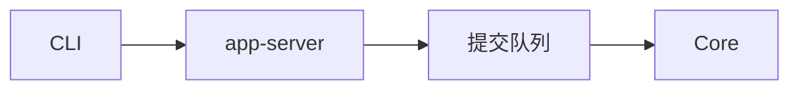
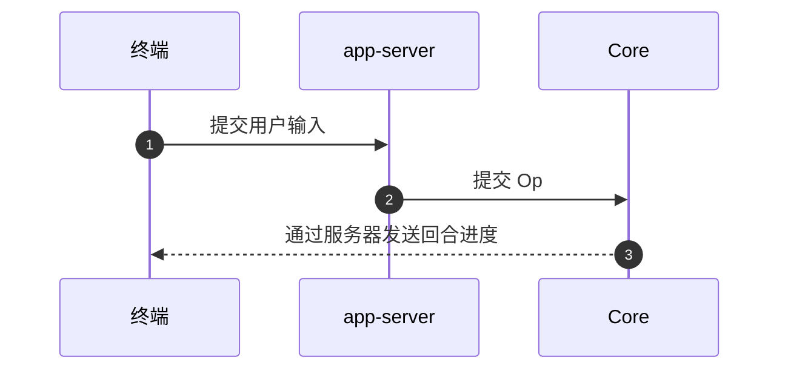
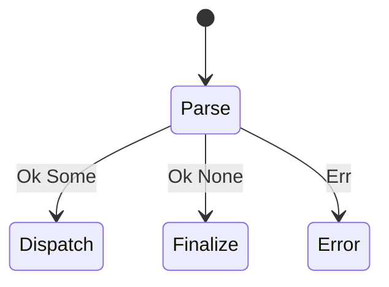

# 贡献者指南

| 任务 | 起点 | 源码 |
| --- | --- | --- |
| 搭建工作区 | 固定 Rust 工具链，安装 `just` 与 nextest | [codex-rs/rust-toolchain.toml:1-3](https://github.com/GLBB/codex/blob/9f42c89c0112771dc29100a6f3fc904049b2655f/codex-rs/rust-toolchain.toml#L1-L3) [docs/install.md:20-62](https://github.com/GLBB/codex/blob/9f42c89c0112771dc29100a6f3fc904049b2655f/docs/install.md#L20-L62) |
| 定位入口 | 从命令行解析走到目标子命令 | [codex-rs/cli/src/main.rs:823-880](https://github.com/GLBB/codex/blob/9f42c89c0112771dc29100a6f3fc904049b2655f/codex-rs/cli/src/main.rs#L823-L880) |
| 熟悉数据流 | 对齐 `Op::UserInput`、`Prompt` 和响应事件 | [codex-rs/app-server/src/request_processors/turn_processor.rs:355-433](https://github.com/GLBB/codex/blob/9f42c89c0112771dc29100a6f3fc904049b2655f/codex-rs/app-server/src/request_processors/turn_processor.rs#L355-L433) [codex-rs/core/src/session/turn.rs:863-947](https://github.com/GLBB/codex/blob/9f42c89c0112771dc29100a6f3fc904049b2655f/codex-rs/core/src/session/turn.rs#L863-L947) [codex-rs/codex-api/src/common.rs:72-150](https://github.com/GLBB/codex/blob/9f42c89c0112771dc29100a6f3fc904049b2655f/codex-rs/codex-api/src/common.rs#L72-L150) |
| 添加验证 | 在对应 crate 的现有测试中找同类场景 | [AGENTS.md:54-69](https://github.com/GLBB/codex/blob/9f42c89c0112771dc29100a6f3fc904049b2655f/AGENTS.md#L54-L69) [justfile:28-58](https://github.com/GLBB/codex/blob/9f42c89c0112771dc29100a6f3fc904049b2655f/justfile#L28-L58) |

## 阅读 Rust 的最短路径

| 熟悉的概念 | 在源码中如何识别 | 样例 |
| --- | --- | --- |
| Java 的共享对象 | `Arc<T>` 明确参与者共享所有权，锁由字段类型单独表达 | turn 任务克隆多个共享对象。 [codex-rs/core/src/session/turn.rs:131-183](https://github.com/GLBB/codex/blob/9f42c89c0112771dc29100a6f3fc904049b2655f/codex-rs/core/src/session/turn.rs#L131-L183) [codex-rs/core/src/session/turn.rs:207-326](https://github.com/GLBB/codex/blob/9f42c89c0112771dc29100a6f3fc904049b2655f/codex-rs/core/src/session/turn.rs#L207-L326) |
| Java sealed 类型或 TypeScript 可辨识联合 | Rust `enum` 让不同变体携带自己的数据，`match` 将分支和数据解构写在一起 | 模型输出解析和 Core 操作分发。 [codex-rs/core/src/tools/router.rs:89-137](https://github.com/GLBB/codex/blob/9f42c89c0112771dc29100a6f3fc904049b2655f/codex-rs/core/src/tools/router.rs#L89-L137) [codex-rs/core/src/session/handlers.rs:708-766](https://github.com/GLBB/codex/blob/9f42c89c0112771dc29100a6f3fc904049b2655f/codex-rs/core/src/session/handlers.rs#L708-L766) |
| Java `CompletableFuture` 或 Python coroutine | `async fn` 定义异步工作，`.await` 在读码时标出等待位置 | 模型流处理与工具队列。 [codex-rs/core/src/session/turn.rs:1788-1878](https://github.com/GLBB/codex/blob/9f42c89c0112771dc29100a6f3fc904049b2655f/codex-rs/core/src/session/turn.rs#L1788-L1878) [codex-rs/core/src/session/turn.rs:1655-1675](https://github.com/GLBB/codex/blob/9f42c89c0112771dc29100a6f3fc904049b2655f/codex-rs/core/src/session/turn.rs#L1655-L1675) |
| Java interface | Rust `trait` 定义可替换边界，方法签名可返回异步结果 | 存储接口及本地实现。 [codex-rs/thread-store/src/store.rs:28-114](https://github.com/GLBB/codex/blob/9f42c89c0112771dc29100a6f3fc904049b2655f/codex-rs/thread-store/src/store.rs#L28-L114) [codex-rs/thread-store/src/local/read_thread.rs:28-97](https://github.com/GLBB/codex/blob/9f42c89c0112771dc29100a6f3fc904049b2655f/codex-rs/thread-store/src/local/read_thread.rs#L28-L97) |
| Java Maven 多模块 | `Cargo.toml` 汇总成员 crate，`justfile` 提供仓库命令 | [codex-rs/Cargo.toml:1-45](https://github.com/GLBB/codex/blob/9f42c89c0112771dc29100a6f3fc904049b2655f/codex-rs/Cargo.toml#L1-L45) [justfile:28-58](https://github.com/GLBB/codex/blob/9f42c89c0112771dc29100a6f3fc904049b2655f/justfile#L28-L58) |

下面把仓库使用的返回类型收敛成可读的 Rust 形状，帮助识别「没有调用」「解析失败」「有调用」三种结果。实际解析入口见引用。 [codex-rs/core/src/tools/router.rs:89-137](https://github.com/GLBB/codex/blob/9f42c89c0112771dc29100a6f3fc904049b2655f/codex-rs/core/src/tools/router.rs#L89-L137)

```rust
match ToolRouter::build_tool_call(output_item) {
    Ok(Some(call)) => { /* schedule the tool */ }
    Ok(None) => { /* finalize the ordinary output item */ }
    Err(error) => { /* handle the parse error */ }
}
```

## 第一次源码练习

1. 打开 `cli/src/main.rs`，对照 `codex exec --help` 定位非交互入口。沿 `run_exec_session` 找它建立会话和挑选 JSONL 输出的地方。 [codex-rs/cli/src/main.rs:823-880](https://github.com/GLBB/codex/blob/9f42c89c0112771dc29100a6f3fc904049b2655f/codex-rs/cli/src/main.rs#L823-L880) [codex-rs/exec/src/lib.rs:564-602](https://github.com/GLBB/codex/blob/9f42c89c0112771dc29100a6f3fc904049b2655f/codex-rs/exec/src/lib.rs#L564-L602)
2. 找 `turn_start_inner` 中的 `Op::UserInput`。从提交分发到普通任务，画出一个包含用户消息、模型和工具结果的回合。 [codex-rs/app-server/src/request_processors/turn_processor.rs:355-433](https://github.com/GLBB/codex/blob/9f42c89c0112771dc29100a6f3fc904049b2655f/codex-rs/app-server/src/request_processors/turn_processor.rs#L355-L433) [codex-rs/core/src/session/handlers.rs:708-766](https://github.com/GLBB/codex/blob/9f42c89c0112771dc29100a6f3fc904049b2655f/codex-rs/core/src/session/handlers.rs#L708-L766) [codex-rs/core/src/tasks/regular.rs:36-74](https://github.com/GLBB/codex/blob/9f42c89c0112771dc29100a6f3fc904049b2655f/codex-rs/core/src/tasks/regular.rs#L36-L74)
3. 用一条完全本地的练习熟悉验证流程。在协议 crate 的现有测试里找 turn 历史构建的用例，先解释输入项如何变成 turn，再尝试在学习分支给同一行为增加边界断言。运行 `just test -p codex-app-server-protocol`。 [codex-rs/app-server-protocol/src/protocol/thread_history.rs:74-92](https://github.com/GLBB/codex/blob/9f42c89c0112771dc29100a6f3fc904049b2655f/codex-rs/app-server-protocol/src/protocol/thread_history.rs#L74-L92) [AGENTS.md:54-69](https://github.com/GLBB/codex/blob/9f42c89c0112771dc29100a6f3fc904049b2655f/AGENTS.md#L54-L69) [justfile:28-58](https://github.com/GLBB/codex/blob/9f42c89c0112771dc29100a6f3fc904049b2655f/justfile#L28-L58)
4. 修改 Rust 代码时执行 `just fmt` 及对应 crate 的检查。涉及公开协议或配置时，到根规范查看生成工件与验证要求。仓库的上游贡献政策记录在贡献指南中。 [AGENTS.md:54-69](https://github.com/GLBB/codex/blob/9f42c89c0112771dc29100a6f3fc904049b2655f/AGENTS.md#L54-L69) [docs/contributing.md:3-37](https://github.com/GLBB/codex/blob/9f42c89c0112771dc29100a6f3fc904049b2655f/docs/contributing.md#L3-L37)

## 排查入口

| 现象 | 首先观察 | 源码 |
| --- | --- | --- |
| 启动失败 | 确认二进制、固定 Rust 版本与编译诊断 | [docs/install.md:20-62](https://github.com/GLBB/codex/blob/9f42c89c0112771dc29100a6f3fc904049b2655f/docs/install.md#L20-L62) [codex-rs/rust-toolchain.toml:1-3](https://github.com/GLBB/codex/blob/9f42c89c0112771dc29100a6f3fc904049b2655f/codex-rs/rust-toolchain.toml#L1-L3) |
| 已受理但 UI 没变化 | 按 thread、turn、item 逐层关联通知 | [codex-rs/app-server/README.md:1211-1247](https://github.com/GLBB/codex/blob/9f42c89c0112771dc29100a6f3fc904049b2655f/codex-rs/app-server/README.md#L1211-L1247) |
| 工具没有启动 | 看路由、载荷类型和审批要求 | [codex-rs/core/src/tools/registry.rs:397-475](https://github.com/GLBB/codex/blob/9f42c89c0112771dc29100a6f3fc904049b2655f/codex-rs/core/src/tools/registry.rs#L397-L475) [codex-rs/core/src/tools/orchestrator.rs:128-263](https://github.com/GLBB/codex/blob/9f42c89c0112771dc29100a6f3fc904049b2655f/codex-rs/core/src/tools/orchestrator.rs#L128-L263) |
| 恢复的上下文不同 | 对照 rollout 原始条目和重建后的历史 | [codex-rs/protocol/src/protocol.rs:2698-2728](https://github.com/GLBB/codex/blob/9f42c89c0112771dc29100a6f3fc904049b2655f/codex-rs/protocol/src/protocol.rs#L2698-L2728) [codex-rs/core/src/session/rollout_reconstruction.rs:87-155](https://github.com/GLBB/codex/blob/9f42c89c0112771dc29100a6f3fc904049b2655f/codex-rs/core/src/session/rollout_reconstruction.rs#L87-L155) |
| 不确定上次发送的是哪些输入 | 对照请求构建、增量选择与可选 trace | [codex-rs/core/src/client.rs:717-805](https://github.com/GLBB/codex/blob/9f42c89c0112771dc29100a6f3fc904049b2655f/codex-rs/core/src/client.rs#L717-L805) [codex-rs/core/src/client.rs:996-1074](https://github.com/GLBB/codex/blob/9f42c89c0112771dc29100a6f3fc904049b2655f/codex-rs/core/src/client.rs#L996-L1074) [codex-rs/rollout-trace/src/inference.rs:174-237](https://github.com/GLBB/codex/blob/9f42c89c0112771dc29100a6f3fc904049b2655f/codex-rs/rollout-trace/src/inference.rs#L174-L237) |

## 术语表

| 术语 | 在本仓库中的定位 | 源码 |
| --- | --- | --- |
| crate | Cargo 的构建单元 | [codex-rs/Cargo.toml:1-45](https://github.com/GLBB/codex/blob/9f42c89c0112771dc29100a6f3fc904049b2655f/codex-rs/Cargo.toml#L1-L45) |
| workspace | 统一依赖与成员 crate 的根清单 | [codex-rs/Cargo.toml:1-45](https://github.com/GLBB/codex/blob/9f42c89c0112771dc29100a6f3fc904049b2655f/codex-rs/Cargo.toml#L1-L45) |
| toolchain | 编译器及相关工具的固定配置 | [codex-rs/rust-toolchain.toml:1-3](https://github.com/GLBB/codex/blob/9f42c89c0112771dc29100a6f3fc904049b2655f/codex-rs/rust-toolchain.toml#L1-L3) |
| nextest | `just test` 的测试运行器 | [justfile:28-58](https://github.com/GLBB/codex/blob/9f42c89c0112771dc29100a6f3fc904049b2655f/justfile#L28-L58) |
| TUI | 终端交互界面 | [codex-rs/tui/src/app_server_session.rs:639-689](https://github.com/GLBB/codex/blob/9f42c89c0112771dc29100a6f3fc904049b2655f/codex-rs/tui/src/app_server_session.rs#L639-L689) |
| exec | 非交互 CLI 路径 | [codex-rs/exec/src/lib.rs:564-602](https://github.com/GLBB/codex/blob/9f42c89c0112771dc29100a6f3fc904049b2655f/codex-rs/exec/src/lib.rs#L564-L602) |
| SDK | 调用 exec 的 TypeScript 封装 | [sdk/typescript/src/thread.ts:66-135](https://github.com/GLBB/codex/blob/9f42c89c0112771dc29100a6f3fc904049b2655f/sdk/typescript/src/thread.ts#L66-L135) |
| stdio | 基于标准输入/输出的连接 | [codex-rs/app-server/README.md:20-89](https://github.com/GLBB/codex/blob/9f42c89c0112771dc29100a6f3fc904049b2655f/codex-rs/app-server/README.md#L20-L89) |
| JSONL | 每行一条 JSON 记录 | [codex-rs/app-server/README.md:20-89](https://github.com/GLBB/codex/blob/9f42c89c0112771dc29100a6f3fc904049b2655f/codex-rs/app-server/README.md#L20-L89) |
| RPC | 有请求 ID 的远程过程调用 | [codex-rs/app-server/README.md:20-89](https://github.com/GLBB/codex/blob/9f42c89c0112771dc29100a6f3fc904049b2655f/codex-rs/app-server/README.md#L20-L89) |
| notification | 无需对应结果的事件消息 | [codex-rs/app-server/README.md:20-89](https://github.com/GLBB/codex/blob/9f42c89c0112771dc29100a6f3fc904049b2655f/codex-rs/app-server/README.md#L20-L89) |
| initialize | 建立客户端连接上下文 | [codex-rs/app-server/src/request_processors/initialize_processor.rs:44-92](https://github.com/GLBB/codex/blob/9f42c89c0112771dc29100a6f3fc904049b2655f/codex-rs/app-server/src/request_processors/initialize_processor.rs#L44-L92) |
| thread | 可保存和恢复的会话 | [codex-rs/app-server/README.md:20-89](https://github.com/GLBB/codex/blob/9f42c89c0112771dc29100a6f3fc904049b2655f/codex-rs/app-server/README.md#L20-L89) |
| turn | 一轮用户任务 | [codex-rs/app-server/README.md:1211-1247](https://github.com/GLBB/codex/blob/9f42c89c0112771dc29100a6f3fc904049b2655f/codex-rs/app-server/README.md#L1211-L1247) |
| item | 一轮中的消息或活动单元 | [codex-rs/app-server/README.md:1211-1247](https://github.com/GLBB/codex/blob/9f42c89c0112771dc29100a6f3fc904049b2655f/codex-rs/app-server/README.md#L1211-L1247) |
| Op | 提交给 Core 的操作 | [codex-rs/protocol/src/protocol.rs:479-500](https://github.com/GLBB/codex/blob/9f42c89c0112771dc29100a6f3fc904049b2655f/codex-rs/protocol/src/protocol.rs#L479-L500) |
| Submission | 附带操作和标识的提交 | [codex-rs/core/src/session/handlers.rs:708-766](https://github.com/GLBB/codex/blob/9f42c89c0112771dc29100a6f3fc904049b2655f/codex-rs/core/src/session/handlers.rs#L708-L766) |
| EventMsg | Core 的运行事件枚举 | [codex-rs/protocol/src/protocol.rs:1137-1160](https://github.com/GLBB/codex/blob/9f42c89c0112771dc29100a6f3fc904049b2655f/codex-rs/protocol/src/protocol.rs#L1137-L1160) |
| Task | Core 的任务执行入口 | [codex-rs/core/src/tasks/regular.rs:36-74](https://github.com/GLBB/codex/blob/9f42c89c0112771dc29100a6f3fc904049b2655f/codex-rs/core/src/tasks/regular.rs#L36-L74) |
| TurnContext | Core 当轮设置与运行上下文 | [codex-rs/core/src/session/turn.rs:131-183](https://github.com/GLBB/codex/blob/9f42c89c0112771dc29100a6f3fc904049b2655f/codex-rs/core/src/session/turn.rs#L131-L183) |
| Prompt | Core 组装的模型输入结构 | [codex-rs/core/src/client_common.rs:25-62](https://github.com/GLBB/codex/blob/9f42c89c0112771dc29100a6f3fc904049b2655f/codex-rs/core/src/client_common.rs#L25-L62) |
| ResponseItem | 模型交互的条目类型 | [codex-rs/protocol/src/models.rs:752-847](https://github.com/GLBB/codex/blob/9f42c89c0112771dc29100a6f3fc904049b2655f/codex-rs/protocol/src/models.rs#L752-L847) |
| ResponseEvent | 模型传输流的事件类型 | [codex-rs/codex-api/src/common.rs:72-150](https://github.com/GLBB/codex/blob/9f42c89c0112771dc29100a6f3fc904049b2655f/codex-rs/codex-api/src/common.rs#L72-L150) |
| SSE | HTTP 响应的事件流 | [codex-rs/codex-api/src/endpoint/responses.rs:69-115](https://github.com/GLBB/codex/blob/9f42c89c0112771dc29100a6f3fc904049b2655f/codex-rs/codex-api/src/endpoint/responses.rs#L69-L115) |
| Provider | 模型服务、认证和运行适配 | [codex-rs/model-provider/src/provider.rs:81-155](https://github.com/GLBB/codex/blob/9f42c89c0112771dc29100a6f3fc904049b2655f/codex-rs/model-provider/src/provider.rs#L81-L155) |
| ModelInfo | 模型属性与能力描述 | [codex-rs/models-manager/src/manager.rs:140-174](https://github.com/GLBB/codex/blob/9f42c89c0112771dc29100a6f3fc904049b2655f/codex-rs/models-manager/src/manager.rs#L140-L174) |
| call ID | 关联工具调用及输出的标识 | [codex-rs/core/src/tools/router.rs:89-137](https://github.com/GLBB/codex/blob/9f42c89c0112771dc29100a6f3fc904049b2655f/codex-rs/core/src/tools/router.rs#L89-L137) |
| ToolRouter | 从输出项解析工具请求 | [codex-rs/core/src/tools/router.rs:89-137](https://github.com/GLBB/codex/blob/9f42c89c0112771dc29100a6f3fc904049b2655f/codex-rs/core/src/tools/router.rs#L89-L137) |
| ToolRegistry | 工具名到运行时的映射 | [codex-rs/core/src/tools/registry.rs:397-475](https://github.com/GLBB/codex/blob/9f42c89c0112771dc29100a6f3fc904049b2655f/codex-rs/core/src/tools/registry.rs#L397-L475) |
| Sandbox | 文件、网络和平台执行边界 | [codex-rs/core/src/tools/orchestrator.rs:128-263](https://github.com/GLBB/codex/blob/9f42c89c0112771dc29100a6f3fc904049b2655f/codex-rs/core/src/tools/orchestrator.rs#L128-L263) |
| Approval | 执行是否需要确认的决策 | [codex-rs/protocol/src/protocol.rs:764-821](https://github.com/GLBB/codex/blob/9f42c89c0112771dc29100a6f3fc904049b2655f/codex-rs/protocol/src/protocol.rs#L764-L821) |
| RolloutItem | 会话文件中保存的条目类型 | [codex-rs/protocol/src/protocol.rs:2698-2728](https://github.com/GLBB/codex/blob/9f42c89c0112771dc29100a6f3fc904049b2655f/codex-rs/protocol/src/protocol.rs#L2698-L2728) |
| Recorder | 排队和落盘会话记录 | [codex-rs/rollout/src/recorder.rs:749-827](https://github.com/GLBB/codex/blob/9f42c89c0112771dc29100a6f3fc904049b2655f/codex-rs/rollout/src/recorder.rs#L749-L827) |
| ThreadStore | 线程存储接口 | [codex-rs/thread-store/src/store.rs:28-114](https://github.com/GLBB/codex/blob/9f42c89c0112771dc29100a6f3fc904049b2655f/codex-rs/thread-store/src/store.rs#L28-L114) |
| Compaction | 用保留输入和摘要组织较短历史 | [codex-rs/core/src/compact.rs:466-525](https://github.com/GLBB/codex/blob/9f42c89c0112771dc29100a6f3fc904049b2655f/codex-rs/core/src/compact.rs#L466-L525) |
| Fork | 从选定历史启动新线程 | [codex-rs/core/src/thread_manager.rs:803-872](https://github.com/GLBB/codex/blob/9f42c89c0112771dc29100a6f3fc904049b2655f/codex-rs/core/src/thread_manager.rs#L803-L872) |
| Layer | 来自某个配置来源的一组设置 | [codex-rs/config/src/state.rs:449-475](https://github.com/GLBB/codex/blob/9f42c89c0112771dc29100a6f3fc904049b2655f/codex-rs/config/src/state.rs#L449-L475) |
| Skill | 可被当前配置发现的操作说明 | [codex-rs/core-skills/src/manager.rs:90-165](https://github.com/GLBB/codex/blob/9f42c89c0112771dc29100a6f3fc904049b2655f/codex-rs/core-skills/src/manager.rs#L90-L165) |
| MCP | 连接外部工具服务的协议 | [codex-rs/codex-mcp/src/connection_manager.rs:590-641](https://github.com/GLBB/codex/blob/9f42c89c0112771dc29100a6f3fc904049b2655f/codex-rs/codex-mcp/src/connection_manager.rs#L590-L641) |
| Subagent | 带来源和生命周期的子线程 | [codex-rs/core/src/agent/control.rs:185-281](https://github.com/GLBB/codex/blob/9f42c89c0112771dc29100a6f3fc904049b2655f/codex-rs/core/src/agent/control.rs#L185-L281) |
| Telemetry | 运行事件与性能测量 | [codex-rs/otel/src/events/session_telemetry.rs:86-133](https://github.com/GLBB/codex/blob/9f42c89c0112771dc29100a6f3fc904049b2655f/codex-rs/otel/src/events/session_telemetry.rs#L86-L133) |
| Trace bundle | 原始诊断事件及较大载荷 | [codex-rs/rollout-trace/README.md:104-154](https://github.com/GLBB/codex/blob/9f42c89c0112771dc29100a6f3fc904049b2655f/codex-rs/rollout-trace/README.md#L104-L154) |
| Reducer | 原始事件到语义图的重放器 | [codex-rs/rollout-trace/src/reducer/mod.rs:44-82](https://github.com/GLBB/codex/blob/9f42c89c0112771dc29100a6f3fc904049b2655f/codex-rs/rollout-trace/src/reducer/mod.rs#L44-L82) |

## 阅读顺序


<!-- Sources: codex-rs/cli/src/main.rs:823, codex-rs/app-server/src/request_processors/turn_processor.rs:355, codex-rs/core/src/session/handlers.rs:708, codex-rs/core/src/tasks/regular.rs:36 -->

## 主要对象


<!-- Sources: codex-rs/app-server/README.md:20, codex-rs/app-server/README.md:1211 -->

## 跟踪普通输入


<!-- Sources: codex-rs/tui/src/app_server_session.rs:639, codex-rs/app-server/src/request_processors/turn_processor.rs:355, codex-rs/app-server/README.md:1211 -->

## 本地开发流程


<!-- Sources: AGENTS.md:54, justfile:28 -->

## 工具调用的读码分支


<!-- Sources: codex-rs/core/src/stream_events_utils.rs:342, codex-rs/core/src/tools/router.rs:89 -->

## 源码索引

- [docs/install.md:20-62](https://github.com/GLBB/codex/blob/9f42c89c0112771dc29100a6f3fc904049b2655f/docs/install.md#L20-L62)
- [codex-rs/rust-toolchain.toml:1-3](https://github.com/GLBB/codex/blob/9f42c89c0112771dc29100a6f3fc904049b2655f/codex-rs/rust-toolchain.toml#L1-L3)
- [codex-rs/cli/src/main.rs:823-880](https://github.com/GLBB/codex/blob/9f42c89c0112771dc29100a6f3fc904049b2655f/codex-rs/cli/src/main.rs#L823-L880)
- [codex-rs/Cargo.toml:1-45](https://github.com/GLBB/codex/blob/9f42c89c0112771dc29100a6f3fc904049b2655f/codex-rs/Cargo.toml#L1-L45)
- [justfile:28-58](https://github.com/GLBB/codex/blob/9f42c89c0112771dc29100a6f3fc904049b2655f/justfile#L28-L58)
- [AGENTS.md:54-69](https://github.com/GLBB/codex/blob/9f42c89c0112771dc29100a6f3fc904049b2655f/AGENTS.md#L54-L69)
- [docs/contributing.md:3-37](https://github.com/GLBB/codex/blob/9f42c89c0112771dc29100a6f3fc904049b2655f/docs/contributing.md#L3-L37)
- [codex-rs/app-server/src/request_processors/turn_processor.rs:355-433](https://github.com/GLBB/codex/blob/9f42c89c0112771dc29100a6f3fc904049b2655f/codex-rs/app-server/src/request_processors/turn_processor.rs#L355-L433)
- [codex-rs/core/src/session/handlers.rs:708-766](https://github.com/GLBB/codex/blob/9f42c89c0112771dc29100a6f3fc904049b2655f/codex-rs/core/src/session/handlers.rs#L708-L766)
- [codex-rs/core/src/tasks/regular.rs:36-74](https://github.com/GLBB/codex/blob/9f42c89c0112771dc29100a6f3fc904049b2655f/codex-rs/core/src/tasks/regular.rs#L36-L74)
- [codex-rs/core/src/session/turn.rs:863-947](https://github.com/GLBB/codex/blob/9f42c89c0112771dc29100a6f3fc904049b2655f/codex-rs/core/src/session/turn.rs#L863-L947)
- [codex-rs/codex-api/src/common.rs:72-150](https://github.com/GLBB/codex/blob/9f42c89c0112771dc29100a6f3fc904049b2655f/codex-rs/codex-api/src/common.rs#L72-L150)
- [codex-rs/thread-store/src/store.rs:28-114](https://github.com/GLBB/codex/blob/9f42c89c0112771dc29100a6f3fc904049b2655f/codex-rs/thread-store/src/store.rs#L28-L114)
- [codex-rs/app-server/README.md:1211-1247](https://github.com/GLBB/codex/blob/9f42c89c0112771dc29100a6f3fc904049b2655f/codex-rs/app-server/README.md#L1211-L1247)
- [codex-rs/core/src/tools/router.rs:89-137](https://github.com/GLBB/codex/blob/9f42c89c0112771dc29100a6f3fc904049b2655f/codex-rs/core/src/tools/router.rs#L89-L137)

## 继续阅读

- [本地运行与读日志](../getting-started/run-locally.md)
- [Agent Loop](../architecture/agent-loop.md)
