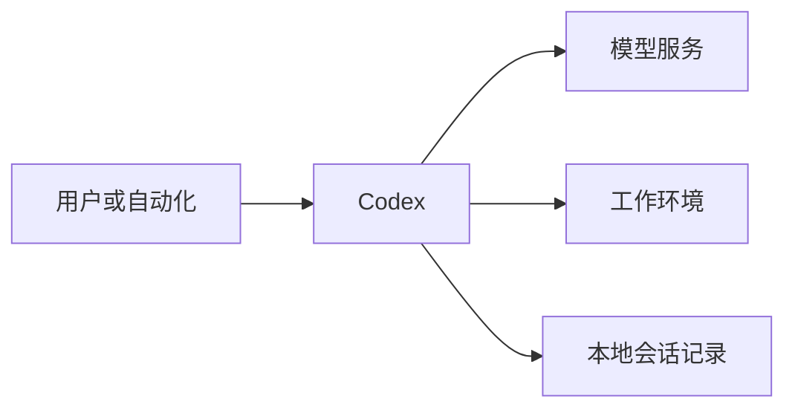
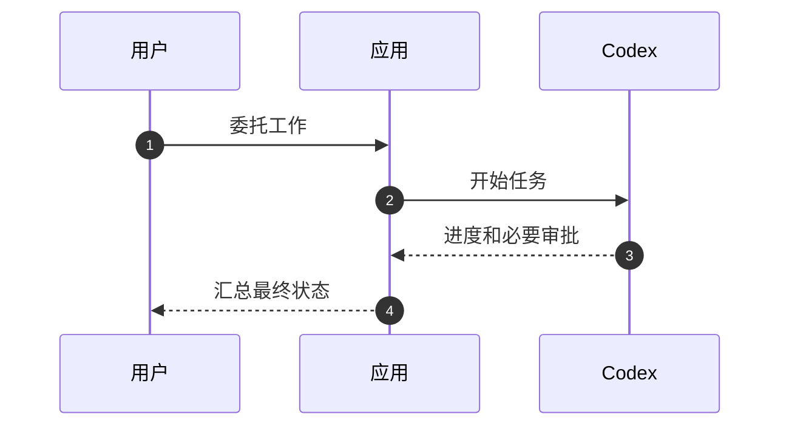
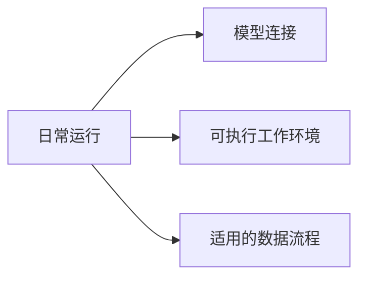

# 工程管理者指南

Codex CLI 可以围绕一个仓库接受用户委托，连接模型，调用工具并报告执行结果。终端、自动化和应用客户端可复用这一运行能力。运营责任主要落在运行环境、模型连接、执行权限和历史数据边界。 [README.md:1](https://github.com/GLBB/codex/blob/9f42c89c0112771dc29100a6f3fc904049b2655f/README.md#L1) [codex-rs/app-server/README.md:20-89](https://github.com/GLBB/codex/blob/9f42c89c0112771dc29100a6f3fc904049b2655f/codex-rs/app-server/README.md#L20-L89) [sdk/typescript/src/thread.ts:66-135](https://github.com/GLBB/codex/blob/9f42c89c0112771dc29100a6f3fc904049b2655f/sdk/typescript/src/thread.ts#L66-L135) [codex-rs/core/src/tools/orchestrator.rs:128-263](https://github.com/GLBB/codex/blob/9f42c89c0112771dc29100a6f3fc904049b2655f/codex-rs/core/src/tools/orchestrator.rs#L128-L263) [codex-rs/thread-store/src/store.rs:28-114](https://github.com/GLBB/codex/blob/9f42c89c0112771dc29100a6f3fc904049b2655f/codex-rs/thread-store/src/store.rs#L28-L114)

| 能力 | 该提交提供什么 | 运营时需要的证据 |
| --- | --- | --- |
| 终端与自动化 | 交互与非交互两条入口 | 目标运行环境上的安装、启动和完成行为。 [codex-rs/cli/src/main.rs:823-880](https://github.com/GLBB/codex/blob/9f42c89c0112771dc29100a6f3fc904049b2655f/codex-rs/cli/src/main.rs#L823-L880) [docs/install.md:20-62](https://github.com/GLBB/codex/blob/9f42c89c0112771dc29100a6f3fc904049b2655f/docs/install.md#L20-L62) [codex-rs/exec/src/lib.rs:564-602](https://github.com/GLBB/codex/blob/9f42c89c0112771dc29100a6f3fc904049b2655f/codex-rs/exec/src/lib.rs#L564-L602) |
| 接入应用 | 线程、回合、进度与工具审批 | 连接恢复和拒绝等情况下的用户体验。 [codex-rs/app-server/README.md:20-89](https://github.com/GLBB/codex/blob/9f42c89c0112771dc29100a6f3fc904049b2655f/codex-rs/app-server/README.md#L20-L89) [codex-rs/app-server/README.md:1211-1247](https://github.com/GLBB/codex/blob/9f42c89c0112771dc29100a6f3fc904049b2655f/codex-rs/app-server/README.md#L1211-L1247) [codex-rs/app-server/README.md:1300-1327](https://github.com/GLBB/codex/blob/9f42c89c0112771dc29100a6f3fc904049b2655f/codex-rs/app-server/README.md#L1300-L1327) |
| 恢复历史 | 从已保存记录加载线程 | 归档和恢复样本、环境的数据保留约定。 [codex-rs/thread-store/src/store.rs:28-114](https://github.com/GLBB/codex/blob/9f42c89c0112771dc29100a6f3fc904049b2655f/codex-rs/thread-store/src/store.rs#L28-L114) [codex-rs/core/src/thread_manager.rs:640-685](https://github.com/GLBB/codex/blob/9f42c89c0112771dc29100a6f3fc904049b2655f/codex-rs/core/src/thread_manager.rs#L640-L685) |
| 性能与追查 | 请求计时、首结果等待测量、按需打开的执行记录 | 同类任务的采样次数、耗时、工具等待和存储量。 [codex-rs/otel/src/events/session_telemetry.rs:196-234](https://github.com/GLBB/codex/blob/9f42c89c0112771dc29100a6f3fc904049b2655f/codex-rs/otel/src/events/session_telemetry.rs#L196-L234) [codex-rs/otel/src/events/session_telemetry.rs:511-570](https://github.com/GLBB/codex/blob/9f42c89c0112771dc29100a6f3fc904049b2655f/codex-rs/otel/src/events/session_telemetry.rs#L511-L570) [codex-rs/rollout-trace/README.md:1-38](https://github.com/GLBB/codex/blob/9f42c89c0112771dc29100a6f3fc904049b2655f/codex-rs/rollout-trace/README.md#L1-L38) |

## 投入与风险

| 问题 | 代码能提供什么 | 决策仍需哪些数据 |
| --- | --- | --- |
| 交付时长和请求成本 | 一轮可多次请求模型，容量消耗会随工具往返变化 | 典型任务的回合分布、服务实际用量、并发。 [codex-rs/core/src/session/turn.rs:207-326](https://github.com/GLBB/codex/blob/9f42c89c0112771dc29100a6f3fc904049b2655f/codex-rs/core/src/session/turn.rs#L207-L326) [codex-rs/otel/src/events/session_telemetry.rs:511-570](https://github.com/GLBB/codex/blob/9f42c89c0112771dc29100a6f3fc904049b2655f/codex-rs/otel/src/events/session_telemetry.rs#L511-L570) |
| 外部服务兼容 | 模型供应商边界、传输选择及部分重试 | 供给可用性、地区覆盖、集成契约。 [codex-rs/model-provider/src/provider.rs:81-155](https://github.com/GLBB/codex/blob/9f42c89c0112771dc29100a6f3fc904049b2655f/codex-rs/model-provider/src/provider.rs#L81-L155) [codex-rs/core/src/client.rs:1570-1642](https://github.com/GLBB/codex/blob/9f42c89c0112771dc29100a6f3fc904049b2655f/codex-rs/core/src/client.rs#L1570-L1642) [codex-rs/core/src/session/turn.rs:947-1021](https://github.com/GLBB/codex/blob/9f42c89c0112771dc29100a6f3fc904049b2655f/codex-rs/core/src/session/turn.rs#L947-L1021) |
| 数据治理 | 本地历史用于恢复，按需记录的诊断资料可能含提示、结果和路径 | 团队的数据留存、访问和删除策略。 [codex-rs/protocol/src/protocol.rs:2698-2728](https://github.com/GLBB/codex/blob/9f42c89c0112771dc29100a6f3fc904049b2655f/codex-rs/protocol/src/protocol.rs#L2698-L2728) [codex-rs/rollout/src/recorder.rs:749-827](https://github.com/GLBB/codex/blob/9f42c89c0112771dc29100a6f3fc904049b2655f/codex-rs/rollout/src/recorder.rs#L749-L827) [codex-rs/rollout-trace/README.md:1-38](https://github.com/GLBB/codex/blob/9f42c89c0112771dc29100a6f3fc904049b2655f/codex-rs/rollout-trace/README.md#L1-L38) |
| 操作控制 | 工具执行有审批与沙箱判断 | 支持的平台上用代表性操作验证限制和拒绝。 [codex-rs/core/src/tools/orchestrator.rs:128-263](https://github.com/GLBB/codex/blob/9f42c89c0112771dc29100a6f3fc904049b2655f/codex-rs/core/src/tools/orchestrator.rs#L128-L263) [codex-rs/app-server/README.md:1300-1327](https://github.com/GLBB/codex/blob/9f42c89c0112771dc29100a6f3fc904049b2655f/codex-rs/app-server/README.md#L1300-L1327) |

仓库源码提供上表的技术证据。上线范围、组织职责、成本和服务等级需依据团队实际环境评定。评审应用接入时可以先选可重复的成功、用户拒绝和中断场景，收集每轮的结果与运行证据。 [codex-rs/app-server/README.md:1211-1247](https://github.com/GLBB/codex/blob/9f42c89c0112771dc29100a6f3fc904049b2655f/codex-rs/app-server/README.md#L1211-L1247) [codex-rs/app-server/README.md:1300-1327](https://github.com/GLBB/codex/blob/9f42c89c0112771dc29100a6f3fc904049b2655f/codex-rs/app-server/README.md#L1300-L1327) [codex-rs/otel/src/events/session_telemetry.rs:511-570](https://github.com/GLBB/codex/blob/9f42c89c0112771dc29100a6f3fc904049b2655f/codex-rs/otel/src/events/session_telemetry.rs#L511-L570)

## 任务交付链

<!-- Sources: README.md:1, codex-rs/model-provider/src/provider.rs:81, codex-rs/core/src/tools/orchestrator.rs:128, codex-rs/rollout/src/recorder.rs:749 -->

## 服务交互

<!-- Sources: codex-rs/app-server/README.md:20, codex-rs/app-server/README.md:1211, codex-rs/app-server/README.md:1300 -->

## 运营依赖

<!-- Sources: codex-rs/model-provider/src/provider.rs:81, codex-rs/core/src/tools/orchestrator.rs:128, codex-rs/rollout-trace/README.md:1 -->

## 源码索引

- [README.md:1](https://github.com/GLBB/codex/blob/9f42c89c0112771dc29100a6f3fc904049b2655f/README.md#L1)
- [codex-rs/cli/src/main.rs:823-880](https://github.com/GLBB/codex/blob/9f42c89c0112771dc29100a6f3fc904049b2655f/codex-rs/cli/src/main.rs#L823-L880)
- [docs/install.md:20-62](https://github.com/GLBB/codex/blob/9f42c89c0112771dc29100a6f3fc904049b2655f/docs/install.md#L20-L62)
- [codex-rs/exec/src/lib.rs:564-602](https://github.com/GLBB/codex/blob/9f42c89c0112771dc29100a6f3fc904049b2655f/codex-rs/exec/src/lib.rs#L564-L602)
- [codex-rs/app-server/README.md:20-89](https://github.com/GLBB/codex/blob/9f42c89c0112771dc29100a6f3fc904049b2655f/codex-rs/app-server/README.md#L20-L89)
- [sdk/typescript/src/thread.ts:66-135](https://github.com/GLBB/codex/blob/9f42c89c0112771dc29100a6f3fc904049b2655f/sdk/typescript/src/thread.ts#L66-L135)
- [codex-rs/core/src/tools/orchestrator.rs:128-263](https://github.com/GLBB/codex/blob/9f42c89c0112771dc29100a6f3fc904049b2655f/codex-rs/core/src/tools/orchestrator.rs#L128-L263)
- [codex-rs/thread-store/src/store.rs:28-114](https://github.com/GLBB/codex/blob/9f42c89c0112771dc29100a6f3fc904049b2655f/codex-rs/thread-store/src/store.rs#L28-L114)
- [codex-rs/core/src/thread_manager.rs:640-685](https://github.com/GLBB/codex/blob/9f42c89c0112771dc29100a6f3fc904049b2655f/codex-rs/core/src/thread_manager.rs#L640-L685)
- [codex-rs/app-server/README.md:1211-1247](https://github.com/GLBB/codex/blob/9f42c89c0112771dc29100a6f3fc904049b2655f/codex-rs/app-server/README.md#L1211-L1247)
- [codex-rs/app-server/README.md:1300-1327](https://github.com/GLBB/codex/blob/9f42c89c0112771dc29100a6f3fc904049b2655f/codex-rs/app-server/README.md#L1300-L1327)
- [codex-rs/otel/src/events/session_telemetry.rs:196-234](https://github.com/GLBB/codex/blob/9f42c89c0112771dc29100a6f3fc904049b2655f/codex-rs/otel/src/events/session_telemetry.rs#L196-L234)
- [codex-rs/otel/src/events/session_telemetry.rs:511-570](https://github.com/GLBB/codex/blob/9f42c89c0112771dc29100a6f3fc904049b2655f/codex-rs/otel/src/events/session_telemetry.rs#L511-L570)
- [codex-rs/rollout-trace/README.md:1-38](https://github.com/GLBB/codex/blob/9f42c89c0112771dc29100a6f3fc904049b2655f/codex-rs/rollout-trace/README.md#L1-L38)
- [codex-rs/core/src/session/turn.rs:207-326](https://github.com/GLBB/codex/blob/9f42c89c0112771dc29100a6f3fc904049b2655f/codex-rs/core/src/session/turn.rs#L207-L326)
- [codex-rs/model-provider/src/provider.rs:81-155](https://github.com/GLBB/codex/blob/9f42c89c0112771dc29100a6f3fc904049b2655f/codex-rs/model-provider/src/provider.rs#L81-L155)
- [codex-rs/core/src/client.rs:1570-1642](https://github.com/GLBB/codex/blob/9f42c89c0112771dc29100a6f3fc904049b2655f/codex-rs/core/src/client.rs#L1570-L1642)

## 继续阅读

- [产品经理指南](product-manager-guide.md)
- [可观测性](../deep-dive/observability.md)
