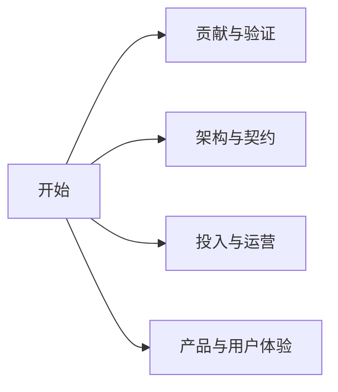
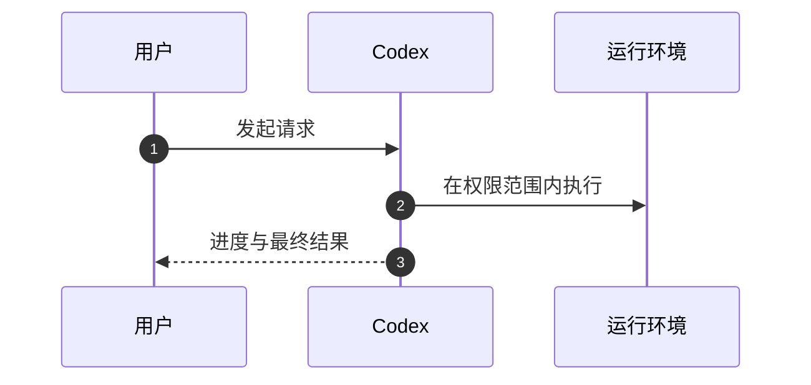
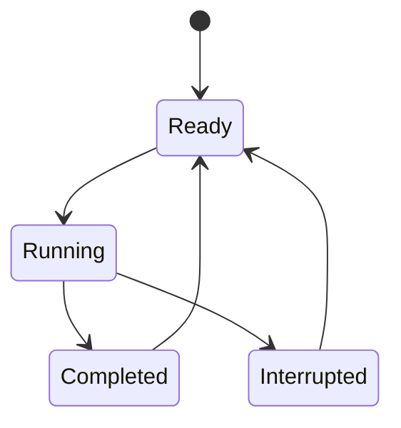

# 角色指南

Codex CLI 将用户输入转为由模型与工具协作完成的任务。这里按读者关心的问题组织同一个源码版本，细节从各指南进入相应架构页。 [README.md:1](https://github.com/GLBB/codex/blob/9f42c89c0112771dc29100a6f3fc904049b2655f/README.md#L1) [codex-rs/cli/src/main.rs:823-880](https://github.com/GLBB/codex/blob/9f42c89c0112771dc29100a6f3fc904049b2655f/codex-rs/cli/src/main.rs#L823-L880) [codex-rs/core/src/session/turn.rs:131-183](https://github.com/GLBB/codex/blob/9f42c89c0112771dc29100a6f3fc904049b2655f/codex-rs/core/src/session/turn.rs#L131-L183)

| 你想了解 | 阅读入口 |
| --- | --- |
| 从 Java、Python 或 TypeScript 进入 Rust，构建并定位一个小改动 | [贡献者指南](contributor-guide.md) |
| 判断协议、Core、工具和状态的边界，设计变更与验证点 | [架构工程师指南](staff-engineer-guide.md) |
| 评估集成边界、运营投入和风险证据 | [工程管理者指南](executive-guide.md) |
| 看清用户进度、审批、恢复等产品行为 | [产品经理指南](product-manager-guide.md) |

## 阅读路线

<!-- Sources: docs/install.md:20, justfile:28, codex-rs/app-server/README.md:20, codex-rs/app-server/README.md:1211 -->

## 一次任务如何产生可见结果

<!-- Sources: codex-rs/core/src/session/turn.rs:131, codex-rs/core/src/tools/orchestrator.rs:128, codex-rs/app-server/README.md:1211 -->

## 从启动到完成

<!-- Sources: codex-rs/app-server/README.md:20, codex-rs/app-server/README.md:1211 -->

## 源码索引

- [codex-rs/cli/src/main.rs:823-880](https://github.com/GLBB/codex/blob/9f42c89c0112771dc29100a6f3fc904049b2655f/codex-rs/cli/src/main.rs#L823-L880)
- [docs/install.md:20-62](https://github.com/GLBB/codex/blob/9f42c89c0112771dc29100a6f3fc904049b2655f/docs/install.md#L20-L62)
- [justfile:28-58](https://github.com/GLBB/codex/blob/9f42c89c0112771dc29100a6f3fc904049b2655f/justfile#L28-L58)
- [codex-rs/app-server/README.md:20-89](https://github.com/GLBB/codex/blob/9f42c89c0112771dc29100a6f3fc904049b2655f/codex-rs/app-server/README.md#L20-L89)
- [codex-rs/core/src/session/turn.rs:131-183](https://github.com/GLBB/codex/blob/9f42c89c0112771dc29100a6f3fc904049b2655f/codex-rs/core/src/session/turn.rs#L131-L183)
- [codex-rs/app-server/README.md:1211-1247](https://github.com/GLBB/codex/blob/9f42c89c0112771dc29100a6f3fc904049b2655f/codex-rs/app-server/README.md#L1211-L1247)

## 继续阅读

- [本地运行](../getting-started/run-locally.md)
- [Agent Loop](../architecture/agent-loop.md)
