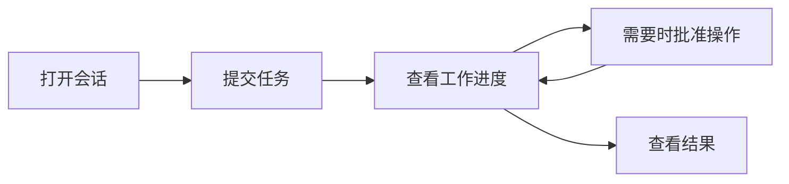
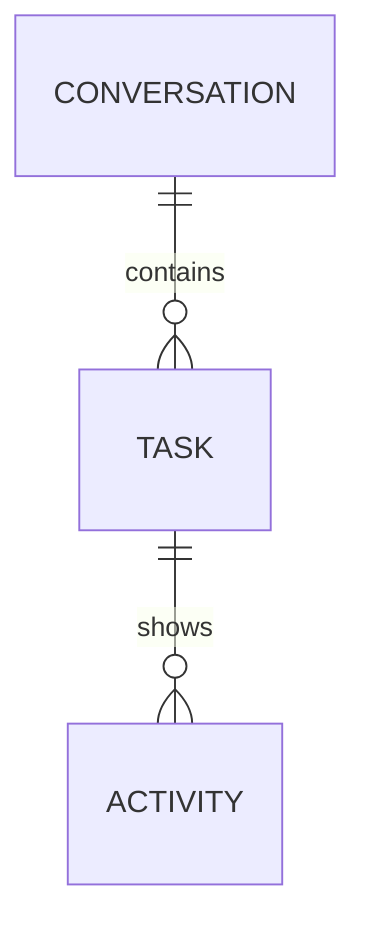
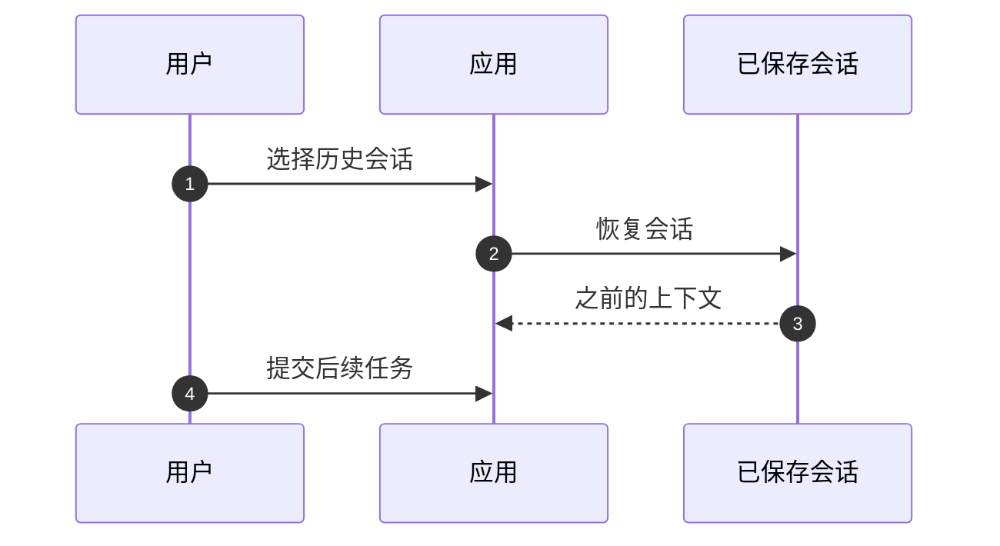

# 产品经理指南

用户可以在仓库中发起任务、观看进度、按需要批准操作，以及在保存的会话中继续。界面需要让人区分「任务已受理」「正在工作」「需要我决定」「已经结束」。 [README.md:1](https://github.com/GLBB/codex/blob/9f42c89c0112771dc29100a6f3fc904049b2655f/README.md#L1) [codex-rs/app-server/README.md:20-89](https://github.com/GLBB/codex/blob/9f42c89c0112771dc29100a6f3fc904049b2655f/codex-rs/app-server/README.md#L20-L89) [codex-rs/app-server/README.md:1211-1247](https://github.com/GLBB/codex/blob/9f42c89c0112771dc29100a6f3fc904049b2655f/codex-rs/app-server/README.md#L1211-L1247) [codex-rs/app-server/README.md:1300-1327](https://github.com/GLBB/codex/blob/9f42c89c0112771dc29100a6f3fc904049b2655f/codex-rs/app-server/README.md#L1300-L1327)

| 用户动作 | 用户看到什么 | 依据 |
| --- | --- | --- |
| 开始会话 | 新的会话标识与后续进度 | [codex-rs/app-server/README.md:20-89](https://github.com/GLBB/codex/blob/9f42c89c0112771dc29100a6f3fc904049b2655f/codex-rs/app-server/README.md#L20-L89) |
| 提交任务 | 先受理，再显示开始、活动和完成状态 | [codex-rs/app-server/README.md:1211-1247](https://github.com/GLBB/codex/blob/9f42c89c0112771dc29100a6f3fc904049b2655f/codex-rs/app-server/README.md#L1211-L1247) |
| 作出批准决定 | 带有具体动作说明的请求，决定进入当前任务 | [codex-rs/app-server/README.md:1300-1327](https://github.com/GLBB/codex/blob/9f42c89c0112771dc29100a6f3fc904049b2655f/codex-rs/app-server/README.md#L1300-L1327) |
| 打断工作 | 用户主动停止后看到结束状态 | [codex-rs/app-server/README.md:20-89](https://github.com/GLBB/codex/blob/9f42c89c0112771dc29100a6f3fc904049b2655f/codex-rs/app-server/README.md#L20-L89) [codex-rs/app-server/README.md:1211-1247](https://github.com/GLBB/codex/blob/9f42c89c0112771dc29100a6f3fc904049b2655f/codex-rs/app-server/README.md#L1211-L1247) |
| 继续历史 | 从保存的线程建立后续交互 | [codex-rs/core/src/thread_manager.rs:640-685](https://github.com/GLBB/codex/blob/9f42c89c0112771dc29100a6f3fc904049b2655f/codex-rs/core/src/thread_manager.rs#L640-L685) [codex-rs/thread-store/src/store.rs:28-114](https://github.com/GLBB/codex/blob/9f42c89c0112771dc29100a6f3fc904049b2655f/codex-rs/thread-store/src/store.rs#L28-L114) |
| 观察自动化任务 | 工作流可以读取途中活动与最终输出 | [codex-rs/exec/src/lib.rs:564-602](https://github.com/GLBB/codex/blob/9f42c89c0112771dc29100a6f3fc904049b2655f/codex-rs/exec/src/lib.rs#L564-L602) [sdk/typescript/src/thread.ts:66-135](https://github.com/GLBB/codex/blob/9f42c89c0112771dc29100a6f3fc904049b2655f/sdk/typescript/src/thread.ts#L66-L135) |

## 常见问题

| 问题 | 回答与依据 |
| --- | --- |
| 一段对话可做多次任务吗 | 可以。在同一会话中提交多轮。 [codex-rs/app-server/README.md:20-89](https://github.com/GLBB/codex/blob/9f42c89c0112771dc29100a6f3fc904049b2655f/codex-rs/app-server/README.md#L20-L89) [sdk/typescript/src/thread.ts:66-135](https://github.com/GLBB/codex/blob/9f42c89c0112771dc29100a6f3fc904049b2655f/sdk/typescript/src/thread.ts#L66-L135) |
| 怎样知道工作已经完成 | 看回合的最终状态，可区分完成、中断和失败。 [codex-rs/app-server/README.md:1211-1247](https://github.com/GLBB/codex/blob/9f42c89c0112771dc29100a6f3fc904049b2655f/codex-rs/app-server/README.md#L1211-L1247) |
| 工作过程中会有文字吗 | 项目可以有增量更新，进度由连接收到的事件驱动。 [codex-rs/app-server/README.md:1211-1247](https://github.com/GLBB/codex/blob/9f42c89c0112771dc29100a6f3fc904049b2655f/codex-rs/app-server/README.md#L1211-L1247) |
| 能随时开始新会话吗 | 客户端可以提出新建会话的请求。 [codex-rs/app-server/README.md:20-89](https://github.com/GLBB/codex/blob/9f42c89c0112771dc29100a6f3fc904049b2655f/codex-rs/app-server/README.md#L20-L89) |
| 如何回到已有会话 | 使用已保存会话的标识执行恢复。 [codex-rs/core/src/thread_manager.rs:640-685](https://github.com/GLBB/codex/blob/9f42c89c0112771dc29100a6f3fc904049b2655f/codex-rs/core/src/thread_manager.rs#L640-L685) [codex-rs/thread-store/src/store.rs:28-114](https://github.com/GLBB/codex/blob/9f42c89c0112771dc29100a6f3fc904049b2655f/codex-rs/thread-store/src/store.rs#L28-L114) |
| 系统为什么会询问用户 | 某些操作按配置需要用户确认，界面应展示具体请求。 [codex-rs/app-server/README.md:1300-1327](https://github.com/GLBB/codex/blob/9f42c89c0112771dc29100a6f3fc904049b2655f/codex-rs/app-server/README.md#L1300-L1327) |
| 更换项目目录有什么影响 | 项目设置和可信度参与决定有效配置。 [codex-rs/config/src/loader/mod.rs:111-245](https://github.com/GLBB/codex/blob/9f42c89c0112771dc29100a6f3fc904049b2655f/codex-rs/config/src/loader/mod.rs#L111-L245) [codex-rs/config/src/loader/mod.rs:864-914](https://github.com/GLBB/codex/blob/9f42c89c0112771dc29100a6f3fc904049b2655f/codex-rs/config/src/loader/mod.rs#L864-L914) |
| 模型为何可能花更多时间 | 一轮可以包含多次模型调用，并等待工具完成。 [codex-rs/core/src/session/turn.rs:207-326](https://github.com/GLBB/codex/blob/9f42c89c0112771dc29100a6f3fc904049b2655f/codex-rs/core/src/session/turn.rs#L207-L326) |
| 可以由流程自动运行吗 | 有非交互入口，TypeScript 也提供封装。 [codex-rs/exec/src/lib.rs:564-602](https://github.com/GLBB/codex/blob/9f42c89c0112771dc29100a6f3fc904049b2655f/codex-rs/exec/src/lib.rs#L564-L602) [sdk/typescript/src/thread.ts:66-135](https://github.com/GLBB/codex/blob/9f42c89c0112771dc29100a6f3fc904049b2655f/sdk/typescript/src/thread.ts#L66-L135) |
| 调试材料里有什么 | 可选的深度记录可能含输入、输出和路径。 [codex-rs/rollout-trace/README.md:1-38](https://github.com/GLBB/codex/blob/9f42c89c0112771dc29100a6f3fc904049b2655f/codex-rs/rollout-trace/README.md#L1-L38) |

源代码描述了能力和事件顺序。具体的可用性、延迟目标和保存周期，需要结合实际产品环境记录。 [codex-rs/app-server/README.md:1211-1247](https://github.com/GLBB/codex/blob/9f42c89c0112771dc29100a6f3fc904049b2655f/codex-rs/app-server/README.md#L1211-L1247) [codex-rs/otel/src/events/session_telemetry.rs:196-234](https://github.com/GLBB/codex/blob/9f42c89c0112771dc29100a6f3fc904049b2655f/codex-rs/otel/src/events/session_telemetry.rs#L196-L234) [codex-rs/thread-store/src/store.rs:28-114](https://github.com/GLBB/codex/blob/9f42c89c0112771dc29100a6f3fc904049b2655f/codex-rs/thread-store/src/store.rs#L28-L114)

## 用户体验

<!-- Sources: codex-rs/app-server/README.md:20, codex-rs/app-server/README.md:1211, codex-rs/app-server/README.md:1300 -->

## 用户看到的对象

<!-- Sources: codex-rs/app-server/README.md:20, codex-rs/app-server/README.md:1211 -->

## 继续已有工作

<!-- Sources: codex-rs/app-server/README.md:20, codex-rs/core/src/thread_manager.rs:640, codex-rs/thread-store/src/store.rs:28 -->

## 源码索引

- [README.md:1](https://github.com/GLBB/codex/blob/9f42c89c0112771dc29100a6f3fc904049b2655f/README.md#L1)
- [codex-rs/app-server/README.md:20-89](https://github.com/GLBB/codex/blob/9f42c89c0112771dc29100a6f3fc904049b2655f/codex-rs/app-server/README.md#L20-L89)
- [codex-rs/app-server/README.md:1211-1247](https://github.com/GLBB/codex/blob/9f42c89c0112771dc29100a6f3fc904049b2655f/codex-rs/app-server/README.md#L1211-L1247)
- [codex-rs/app-server/README.md:1300-1327](https://github.com/GLBB/codex/blob/9f42c89c0112771dc29100a6f3fc904049b2655f/codex-rs/app-server/README.md#L1300-L1327)
- [codex-rs/core/src/thread_manager.rs:640-685](https://github.com/GLBB/codex/blob/9f42c89c0112771dc29100a6f3fc904049b2655f/codex-rs/core/src/thread_manager.rs#L640-L685)
- [codex-rs/thread-store/src/store.rs:28-114](https://github.com/GLBB/codex/blob/9f42c89c0112771dc29100a6f3fc904049b2655f/codex-rs/thread-store/src/store.rs#L28-L114)
- [codex-rs/exec/src/lib.rs:564-602](https://github.com/GLBB/codex/blob/9f42c89c0112771dc29100a6f3fc904049b2655f/codex-rs/exec/src/lib.rs#L564-L602)
- [sdk/typescript/src/thread.ts:66-135](https://github.com/GLBB/codex/blob/9f42c89c0112771dc29100a6f3fc904049b2655f/sdk/typescript/src/thread.ts#L66-L135)
- [codex-rs/config/src/loader/mod.rs:111-245](https://github.com/GLBB/codex/blob/9f42c89c0112771dc29100a6f3fc904049b2655f/codex-rs/config/src/loader/mod.rs#L111-L245)
- [codex-rs/config/src/loader/mod.rs:864-914](https://github.com/GLBB/codex/blob/9f42c89c0112771dc29100a6f3fc904049b2655f/codex-rs/config/src/loader/mod.rs#L864-L914)
- [codex-rs/core/src/session/turn.rs:207-326](https://github.com/GLBB/codex/blob/9f42c89c0112771dc29100a6f3fc904049b2655f/codex-rs/core/src/session/turn.rs#L207-L326)
- [codex-rs/rollout-trace/README.md:1-38](https://github.com/GLBB/codex/blob/9f42c89c0112771dc29100a6f3fc904049b2655f/codex-rs/rollout-trace/README.md#L1-L38)
- [codex-rs/otel/src/events/session_telemetry.rs:196-234](https://github.com/GLBB/codex/blob/9f42c89c0112771dc29100a6f3fc904049b2655f/codex-rs/otel/src/events/session_telemetry.rs#L196-L234)

## 继续阅读

- [工程管理者指南](executive-guide.md)
- [app-server 与客户端协议](../architecture/app-server.md)
