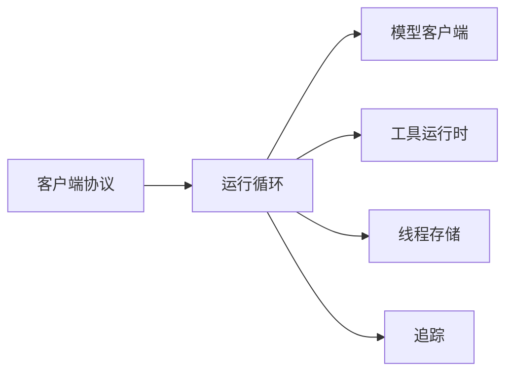
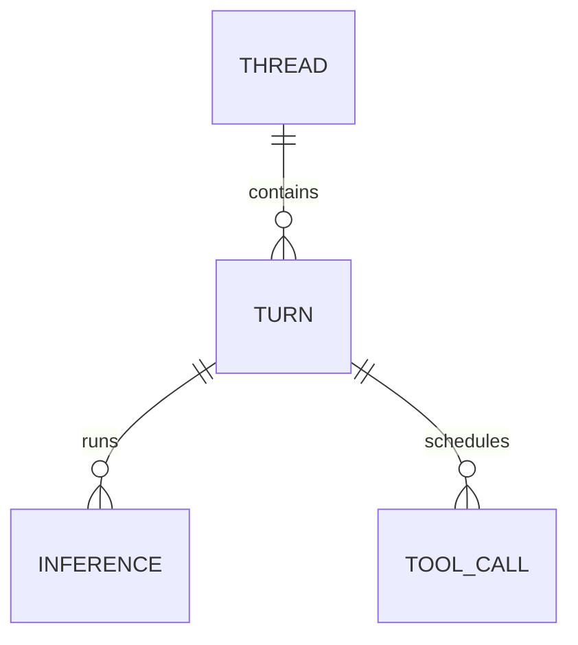
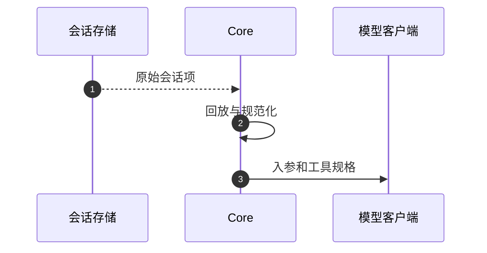
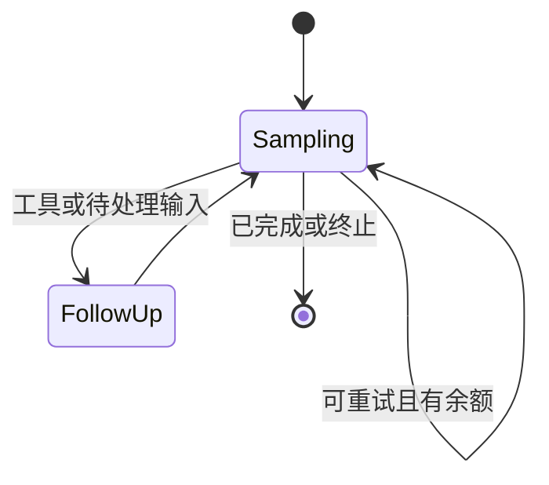
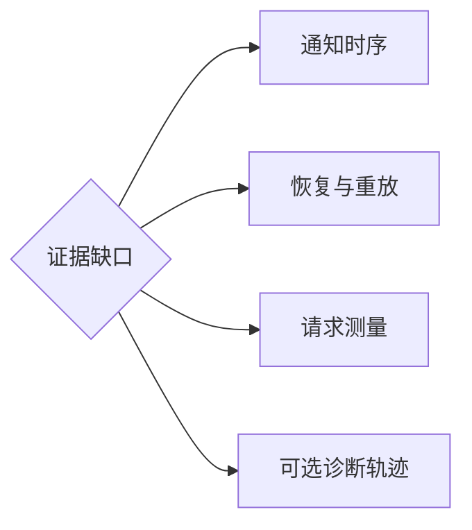

# 架构工程师指南

Core 保持回合和采样的运行状态。app-server 将客户端协议映射为操作和通知，工具层执行模型提出的能力请求，存储与观测层各自保存适合重建或诊断的数据。评估变更时，先定下哪个边界拥有状态以及哪个调用者需要兼容。 [codex-rs/app-server/src/request_processors/turn_processor.rs:355-433](https://github.com/GLBB/codex/blob/9f42c89c0112771dc29100a6f3fc904049b2655f/codex-rs/app-server/src/request_processors/turn_processor.rs#L355-L433) [codex-rs/core/src/session/turn.rs:131-183](https://github.com/GLBB/codex/blob/9f42c89c0112771dc29100a6f3fc904049b2655f/codex-rs/core/src/session/turn.rs#L131-L183) [codex-rs/core/src/tools/registry.rs:397-475](https://github.com/GLBB/codex/blob/9f42c89c0112771dc29100a6f3fc904049b2655f/codex-rs/core/src/tools/registry.rs#L397-L475) [codex-rs/thread-store/src/store.rs:28-114](https://github.com/GLBB/codex/blob/9f42c89c0112771dc29100a6f3fc904049b2655f/codex-rs/thread-store/src/store.rs#L28-L114) [codex-rs/rollout-trace/README.md:1-38](https://github.com/GLBB/codex/blob/9f42c89c0112771dc29100a6f3fc904049b2655f/codex-rs/rollout-trace/README.md#L1-L38)

| 变更点 | 应先确认的约束 | 源码 |
| --- | --- | --- |
| 公开事件 | 客户端按 thread、turn、item 关联。增量与最终状态有不同消费时点 | [codex-rs/app-server/README.md:1211-1247](https://github.com/GLBB/codex/blob/9f42c89c0112771dc29100a6f3fc904049b2655f/codex-rs/app-server/README.md#L1211-L1247) |
| 模型输入 | 规范化保持调用与输出匹配，并服从模态要求 | [codex-rs/core/src/context_manager/history.rs:362-390](https://github.com/GLBB/codex/blob/9f42c89c0112771dc29100a6f3fc904049b2655f/codex-rs/core/src/context_manager/history.rs#L362-L390) |
| 工具处理 | 工具规格、载荷种类和运行时路由必须对齐 | [codex-rs/core/src/session/turn.rs:863-947](https://github.com/GLBB/codex/blob/9f42c89c0112771dc29100a6f3fc904049b2655f/codex-rs/core/src/session/turn.rs#L863-L947) [codex-rs/core/src/tools/registry.rs:397-475](https://github.com/GLBB/codex/blob/9f42c89c0112771dc29100a6f3fc904049b2655f/codex-rs/core/src/tools/registry.rs#L397-L475) |
| 线程恢复 | 历史的引用上下文、压缩与回滚影响重建结果 | [codex-rs/core/src/session/rollout_reconstruction.rs:87-155](https://github.com/GLBB/codex/blob/9f42c89c0112771dc29100a6f3fc904049b2655f/codex-rs/core/src/session/rollout_reconstruction.rs#L87-L155) |
| 轨迹分析 | 原始 bundle 和派生图分开，可复算并回看载荷 | [codex-rs/rollout-trace/src/reducer/mod.rs:44-82](https://github.com/GLBB/codex/blob/9f42c89c0112771dc29100a6f3fc904049b2655f/codex-rs/rollout-trace/src/reducer/mod.rs#L44-L82) [codex-rs/rollout-trace/src/model/mod.rs:56-90](https://github.com/GLBB/codex/blob/9f42c89c0112771dc29100a6f3fc904049b2655f/codex-rs/rollout-trace/src/model/mod.rs#L56-L90) |

## 设计取舍与验证方法

下表是根据实现得出的架构取舍。收益和成本属于工程推断。每次变更以对应接口与已有测试作为验证依据。

| 结构 | 可得到的收益 | 变更时要验证 | 实现依据 |
| --- | --- | --- | --- |
| 应用服务与 Core 分层 | 多种客户端共享运行循环 | 请求提交、终态和反向审批配对 | [codex-rs/app-server/src/request_processors/turn_processor.rs:355-433](https://github.com/GLBB/codex/blob/9f42c89c0112771dc29100a6f3fc904049b2655f/codex-rs/app-server/src/request_processors/turn_processor.rs#L355-L433) [codex-rs/core/src/session/handlers.rs:708-766](https://github.com/GLBB/codex/blob/9f42c89c0112771dc29100a6f3fc904049b2655f/codex-rs/core/src/session/handlers.rs#L708-L766) [codex-rs/app-server/README.md:1300-1327](https://github.com/GLBB/codex/blob/9f42c89c0112771dc29100a6f3fc904049b2655f/codex-rs/app-server/README.md#L1300-L1327) |
| 内存与会话存档分别维护 | 模型请求可裁剪，线程可恢复 | 无文件、压缩、回滚及关闭后重读 | [codex-rs/core/src/context_manager/history.rs:98-125](https://github.com/GLBB/codex/blob/9f42c89c0112771dc29100a6f3fc904049b2655f/codex-rs/core/src/context_manager/history.rs#L98-L125) [codex-rs/rollout/src/recorder.rs:749-827](https://github.com/GLBB/codex/blob/9f42c89c0112771dc29100a6f3fc904049b2655f/codex-rs/rollout/src/recorder.rs#L749-L827) [codex-rs/core/src/session/rollout_reconstruction.rs:87-155](https://github.com/GLBB/codex/blob/9f42c89c0112771dc29100a6f3fc904049b2655f/codex-rs/core/src/session/rollout_reconstruction.rs#L87-L155) |
| 连接内增量发送 | 部分调用可减少重复输入传输 | 字段改变、前缀不符和 transport fallback | [codex-rs/core/src/client.rs:996-1074](https://github.com/GLBB/codex/blob/9f42c89c0112771dc29100a6f3fc904049b2655f/codex-rs/core/src/client.rs#L996-L1074) [codex-rs/core/src/client.rs:1570-1642](https://github.com/GLBB/codex/blob/9f42c89c0112771dc29100a6f3fc904049b2655f/codex-rs/core/src/client.rs#L1570-L1642) |
| 原始事件和图分离 | 诊断图可重放，运行时避免维护全图 | 序号、载荷引用及原始场景重放 | [codex-rs/rollout-trace/src/writer.rs:32-72](https://github.com/GLBB/codex/blob/9f42c89c0112771dc29100a6f3fc904049b2655f/codex-rs/rollout-trace/src/writer.rs#L32-L72) [codex-rs/rollout-trace/src/reducer/mod.rs:44-82](https://github.com/GLBB/codex/blob/9f42c89c0112771dc29100a6f3fc904049b2655f/codex-rs/rollout-trace/src/reducer/mod.rs#L44-L82) |

用 Java 风格的伪代码表达同一条输入的不同观察点。写入队列、读者可见和模型请求构造的时刻由各自接口决定。 [codex-rs/core/src/session/mod.rs:2527-2547](https://github.com/GLBB/codex/blob/9f42c89c0112771dc29100a6f3fc904049b2655f/codex-rs/core/src/session/mod.rs#L2527-L2547) [codex-rs/rollout/src/recorder.rs:749-827](https://github.com/GLBB/codex/blob/9f42c89c0112771dc29100a6f3fc904049b2655f/codex-rs/rollout/src/recorder.rs#L749-L827) [codex-rs/core/src/context_manager/history.rs:362-390](https://github.com/GLBB/codex/blob/9f42c89c0112771dc29100a6f3fc904049b2655f/codex-rs/core/src/context_manager/history.rs#L362-L390)

```java
history.record(items, truncationPolicy);
rollout.enqueue(items);
clientEvents.publish(items);

List<ResponseItem> input = history.copy().forModel(model.inputModalities());
```

## 可靠性与定位顺序

监测运行速度可以从请求耗时、首 token、工具等待分段。该提交提供测量点。容量规划还需要代表性工作负载提供的数据。观察工具执行策略时，同时核对工具审批要求与实际沙箱选择。测试边界变更时先读对应 crate 的定向用例，再看仓库的格式化、schema 和测试流程。 [codex-rs/otel/src/events/session_telemetry.rs:196-234](https://github.com/GLBB/codex/blob/9f42c89c0112771dc29100a6f3fc904049b2655f/codex-rs/otel/src/events/session_telemetry.rs#L196-L234) [codex-rs/otel/src/events/session_telemetry.rs:511-570](https://github.com/GLBB/codex/blob/9f42c89c0112771dc29100a6f3fc904049b2655f/codex-rs/otel/src/events/session_telemetry.rs#L511-L570) [codex-rs/core/src/tools/orchestrator.rs:128-263](https://github.com/GLBB/codex/blob/9f42c89c0112771dc29100a6f3fc904049b2655f/codex-rs/core/src/tools/orchestrator.rs#L128-L263) [AGENTS.md:54-69](https://github.com/GLBB/codex/blob/9f42c89c0112771dc29100a6f3fc904049b2655f/AGENTS.md#L54-L69) [justfile:28-58](https://github.com/GLBB/codex/blob/9f42c89c0112771dc29100a6f3fc904049b2655f/justfile#L28-L58)

## 职责边界


<!-- Sources: codex-rs/app-server/src/request_processors/turn_processor.rs:355, codex-rs/core/src/session/turn.rs:131, codex-rs/core/src/tools/registry.rs:397, codex-rs/thread-store/src/store.rs:28, codex-rs/rollout-trace/README.md:1 -->

## 运行对象


<!-- Sources: codex-rs/app-server/README.md:1211, codex-rs/rollout-trace/src/model/mod.rs:56 -->

## 重建线程与当前请求


<!-- Sources: codex-rs/thread-store/src/store.rs:28, codex-rs/core/src/thread_manager.rs:640, codex-rs/core/src/session/rollout_reconstruction.rs:87, codex-rs/core/src/context_manager/history.rs:362, codex-rs/core/src/session/turn.rs:863 -->

## 采样退出分支


<!-- Sources: codex-rs/core/src/session/turn.rs:207, codex-rs/core/src/session/turn.rs:947 -->

## 定位观察层


<!-- Sources: codex-rs/app-server/README.md:1211, codex-rs/core/src/session/rollout_reconstruction.rs:87, codex-rs/otel/src/events/session_telemetry.rs:511, codex-rs/rollout-trace/README.md:1 -->

## 源码索引

- [codex-rs/app-server/src/request_processors/turn_processor.rs:355-433](https://github.com/GLBB/codex/blob/9f42c89c0112771dc29100a6f3fc904049b2655f/codex-rs/app-server/src/request_processors/turn_processor.rs#L355-L433)
- [codex-rs/core/src/session/handlers.rs:708-766](https://github.com/GLBB/codex/blob/9f42c89c0112771dc29100a6f3fc904049b2655f/codex-rs/core/src/session/handlers.rs#L708-L766)
- [codex-rs/app-server/README.md:1211-1247](https://github.com/GLBB/codex/blob/9f42c89c0112771dc29100a6f3fc904049b2655f/codex-rs/app-server/README.md#L1211-L1247)
- [codex-rs/app-server/README.md:1300-1327](https://github.com/GLBB/codex/blob/9f42c89c0112771dc29100a6f3fc904049b2655f/codex-rs/app-server/README.md#L1300-L1327)
- [codex-rs/core/src/session/turn.rs:131-183](https://github.com/GLBB/codex/blob/9f42c89c0112771dc29100a6f3fc904049b2655f/codex-rs/core/src/session/turn.rs#L131-L183)
- [codex-rs/core/src/tools/registry.rs:397-475](https://github.com/GLBB/codex/blob/9f42c89c0112771dc29100a6f3fc904049b2655f/codex-rs/core/src/tools/registry.rs#L397-L475)
- [codex-rs/core/src/session/turn.rs:863-947](https://github.com/GLBB/codex/blob/9f42c89c0112771dc29100a6f3fc904049b2655f/codex-rs/core/src/session/turn.rs#L863-L947)
- [codex-rs/core/src/context_manager/history.rs:362-390](https://github.com/GLBB/codex/blob/9f42c89c0112771dc29100a6f3fc904049b2655f/codex-rs/core/src/context_manager/history.rs#L362-L390)
- [codex-rs/thread-store/src/store.rs:28-114](https://github.com/GLBB/codex/blob/9f42c89c0112771dc29100a6f3fc904049b2655f/codex-rs/thread-store/src/store.rs#L28-L114)
- [codex-rs/core/src/session/rollout_reconstruction.rs:87-155](https://github.com/GLBB/codex/blob/9f42c89c0112771dc29100a6f3fc904049b2655f/codex-rs/core/src/session/rollout_reconstruction.rs#L87-L155)
- [codex-rs/rollout/src/recorder.rs:749-827](https://github.com/GLBB/codex/blob/9f42c89c0112771dc29100a6f3fc904049b2655f/codex-rs/rollout/src/recorder.rs#L749-L827)
- [codex-rs/core/src/client.rs:996-1074](https://github.com/GLBB/codex/blob/9f42c89c0112771dc29100a6f3fc904049b2655f/codex-rs/core/src/client.rs#L996-L1074)
- [codex-rs/core/src/client.rs:1570-1642](https://github.com/GLBB/codex/blob/9f42c89c0112771dc29100a6f3fc904049b2655f/codex-rs/core/src/client.rs#L1570-L1642)
- [codex-rs/rollout-trace/src/writer.rs:32-72](https://github.com/GLBB/codex/blob/9f42c89c0112771dc29100a6f3fc904049b2655f/codex-rs/rollout-trace/src/writer.rs#L32-L72)
- [codex-rs/rollout-trace/src/reducer/mod.rs:44-82](https://github.com/GLBB/codex/blob/9f42c89c0112771dc29100a6f3fc904049b2655f/codex-rs/rollout-trace/src/reducer/mod.rs#L44-L82)
- [codex-rs/rollout-trace/src/model/mod.rs:56-90](https://github.com/GLBB/codex/blob/9f42c89c0112771dc29100a6f3fc904049b2655f/codex-rs/rollout-trace/src/model/mod.rs#L56-L90)
- [codex-rs/otel/src/events/session_telemetry.rs:196-234](https://github.com/GLBB/codex/blob/9f42c89c0112771dc29100a6f3fc904049b2655f/codex-rs/otel/src/events/session_telemetry.rs#L196-L234)
- [codex-rs/otel/src/events/session_telemetry.rs:511-570](https://github.com/GLBB/codex/blob/9f42c89c0112771dc29100a6f3fc904049b2655f/codex-rs/otel/src/events/session_telemetry.rs#L511-L570)
- [codex-rs/core/src/tools/orchestrator.rs:128-263](https://github.com/GLBB/codex/blob/9f42c89c0112771dc29100a6f3fc904049b2655f/codex-rs/core/src/tools/orchestrator.rs#L128-L263)
- [AGENTS.md:54-69](https://github.com/GLBB/codex/blob/9f42c89c0112771dc29100a6f3fc904049b2655f/AGENTS.md#L54-L69)
- [justfile:28-58](https://github.com/GLBB/codex/blob/9f42c89c0112771dc29100a6f3fc904049b2655f/justfile#L28-L58)

## 继续阅读

- [Agent Loop](../architecture/agent-loop.md)
- [工具调度与权限](../architecture/tools-permissions.md)
- [可观测性](../deep-dive/observability.md)
