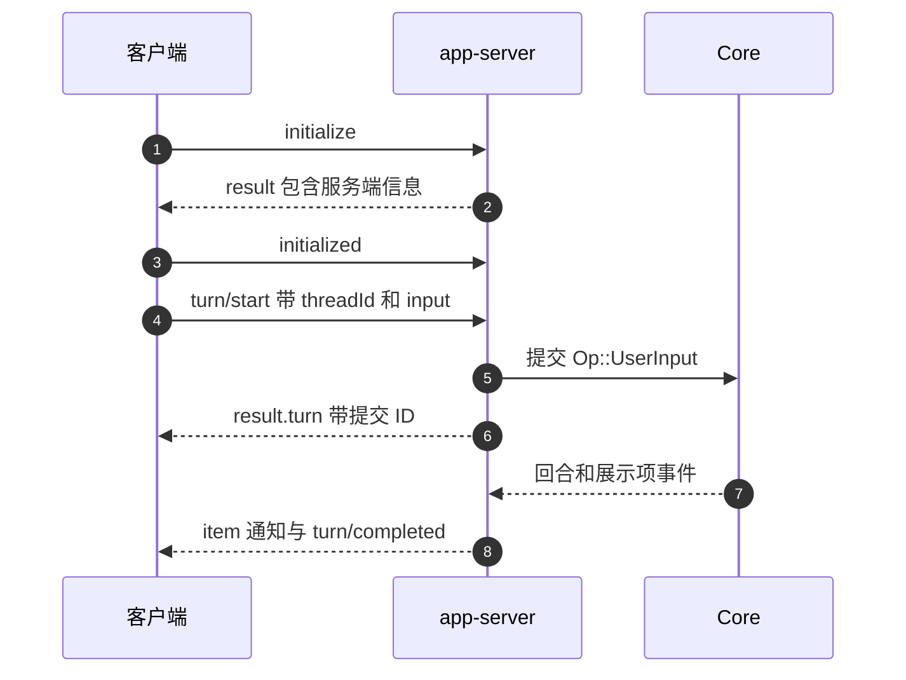

# app-server JSON-RPC

客户端通过 stdio、WebSocket 或 Unix socket 交换 RPC 消息。stdio 每行承载一个 JSON 对象。Rust in-process 客户端直接提交类型化的 `ClientRequest`，和线协议入口共用请求处理器。Python SDK 启动 app-server 子进程；TypeScript SDK 的 [CLI JSONL](cli-jsonl.md) 是另一套接口。 [README.md:20-89](https://github.com/GLBB/codex/blob/9f42c89c0112771dc29100a6f3fc904049b2655f/codex-rs/app-server/README.md#L20-L89) [lib.rs:488-515](https://github.com/GLBB/codex/blob/9f42c89c0112771dc29100a6f3fc904049b2655f/codex-rs/app-server-client/src/lib.rs#L488-L515) [message_processor.rs:516-629](https://github.com/GLBB/codex/blob/9f42c89c0112771dc29100a6f3fc904049b2655f/codex-rs/app-server/src/message_processor.rs#L516-L629) [client.py:225-276](https://github.com/GLBB/codex/blob/9f42c89c0112771dc29100a6f3fc904049b2655f/sdk/python/src/openai_codex/client.py#L225-L276)

## 消息外壳

线协议是 JSON-RPC 的轻量变体，省略 `jsonrpc` 版本字段。请求可双向发送，回包使用发起方提供的 `id`。服务器内部把连接 ID 与请求 ID 配对。 [jsonrpc_lite.rs:1-85](https://github.com/GLBB/codex/blob/9f42c89c0112771dc29100a6f3fc904049b2655f/codex-rs/app-server-protocol/src/jsonrpc_lite.rs#L1-L85) [message_processor.rs:516-629](https://github.com/GLBB/codex/blob/9f42c89c0112771dc29100a6f3fc904049b2655f/codex-rs/app-server/src/message_processor.rs#L516-L629)

| 字段 | JSON 类型与出现条件 | 含义 |
| --- | --- | --- |
| `id` | string 或整数；请求、成功或错误响应必有 | 关联一次 RPC。客户端与服务器各自处理自己发起的请求。 |
| `method` | string；请求和通知必有 | 路由名，例如 `turn/start` 或 `turn/completed`。 |
| `params` | JSON 值，可省略；请求或通知 | 方法定义的载荷。 |
| `trace` | object，可省略；请求 | 可传播的 W3C Trace Context，含各自可省略的 `traceparent` 与 `tracestate`。 |
| `result` | JSON 值；成功响应必有 | 方法返回值，例如 `{"turn":{…}}`。 |
| `error.code` | 整数；错误响应必有 | 机器可读的 RPC 错误码。 |
| `error.message` | string；错误响应必有 | 可显示或记录的错误摘要。 |
| `error.data` | JSON 值，可省略；错误响应 | 附加的结构化错误数据。 |

[protocol.rs:136-144](https://github.com/GLBB/codex/blob/9f42c89c0112771dc29100a6f3fc904049b2655f/codex-rs/protocol/src/protocol.rs#L136-L144)

## initialize 握手

每条连接先发 `initialize`，收到成功响应后发 `initialized` 通知，随后使用业务方法。初始化前的业务请求以及重复初始化会返回错误。能力开关保存在连接状态中。 [README.md:68-89](https://github.com/GLBB/codex/blob/9f42c89c0112771dc29100a6f3fc904049b2655f/codex-rs/app-server/README.md#L68-L89) [v1.rs:27-71](https://github.com/GLBB/codex/blob/9f42c89c0112771dc29100a6f3fc904049b2655f/codex-rs/app-server-protocol/src/protocol/v1.rs#L27-L71) [initialize_processor.rs:44-108](https://github.com/GLBB/codex/blob/9f42c89c0112771dc29100a6f3fc904049b2655f/codex-rs/app-server/src/request_processors/initialize_processor.rs#L44-L108) [message_processor.rs:789-849](https://github.com/GLBB/codex/blob/9f42c89c0112771dc29100a6f3fc904049b2655f/codex-rs/app-server/src/message_processor.rs#L789-L849)

| 字段 | JSON 类型与出现条件 | 含义 |
| --- | --- | --- |
| `params.clientInfo.name` | string；必填 | 客户端程序名，服务端按合法 HTTP header 值检查。 |
| `params.clientInfo.title` | string 或 null，可省略 | 面向人的客户端标题。 |
| `params.clientInfo.version` | string；必填 | 客户端版本，参与 User-Agent 后缀构造。 |
| `params.capabilities` | object，可省略 | 该连接声明的能力。 |
| `capabilities.experimentalApi` | boolean；默认 false | 允许此连接使用实验方法或字段，详见 [兼容规则](config-schema.md)。 |
| `capabilities.requestAttestation` | boolean；默认 false | 声明可处理 `attestation/generate` 服务端请求。 |
| `capabilities.optOutNotificationMethods` | string[] 或 null，可省略 | 按完整方法名屏蔽此连接收到的通知。 |
| `result.userAgent` | string | 服务端构造的 User-Agent。 |
| `result.codexHome` | string | 服务端 Codex 主目录的绝对路径。 |
| `result.platformFamily` | string | 平台族，例如 `unix`。 |
| `result.platformOs` | string | 服务端操作系统，例如 `linux`。 |

## 线程请求

`thread/start` 创建线程，常见请求字段如下。响应的 `thread` 提供线程对象，其他字段给出实际选中的模型、工作目录和权限等生效设置。`thread/read` 使用 `threadId` 读取线程，`includeTurns` 默认 false，设为 true 时返回历史 turn，临时线程不支持该选项。 [thread.rs:95-175](https://github.com/GLBB/codex/blob/9f42c89c0112771dc29100a6f3fc904049b2655f/codex-rs/app-server-protocol/src/protocol/v2/thread.rs#L95-L175) [thread.rs:195-224](https://github.com/GLBB/codex/blob/9f42c89c0112771dc29100a6f3fc904049b2655f/codex-rs/app-server-protocol/src/protocol/v2/thread.rs#L195-L224) [thread.rs:1130-1144](https://github.com/GLBB/codex/blob/9f42c89c0112771dc29100a6f3fc904049b2655f/codex-rs/app-server-protocol/src/protocol/v2/thread.rs#L1130-L1144) [thread_processor.rs:822-921](https://github.com/GLBB/codex/blob/9f42c89c0112771dc29100a6f3fc904049b2655f/codex-rs/app-server/src/request_processors/thread_processor.rs#L822-L921) [mod.rs:3137-3149](https://github.com/GLBB/codex/blob/9f42c89c0112771dc29100a6f3fc904049b2655f/codex-rs/core/src/config/mod.rs#L3137-L3149) [thread_processor.rs:2169-2194](https://github.com/GLBB/codex/blob/9f42c89c0112771dc29100a6f3fc904049b2655f/codex-rs/app-server/src/request_processors/thread_processor.rs#L2169-L2194)

| 字段 | JSON 类型与出现条件 | 含义 |
| --- | --- | --- |
| `model`、`modelProvider` | string，各自可选 | 线程模型名、供应商配置名。 |
| `cwd` | string，可选 | 线程的工作目录。 |
| `serviceTier` | string、null 或缺省 | 字符串设置层级，null 请求默认层级，省略沿用配置。 |
| `approvalPolicy`、`approvalsReviewer` | 枚举值，各自可选 | 审批触发策略、审批路由目标。 |
| `sandbox`、`permissions` | 枚举 / string，各自可选，互斥 | 沙箱模式或实验性的命名权限配置。 |
| `config` | object，可选 | 创建线程时使用的配置覆盖。 |
| `baseInstructions`、`developerInstructions` | string，各自可选 | 基础指令、开发者指令。 |
| `personality` | 枚举，可选 | 对话风格设置。 |
| `ephemeral` | boolean，可选 | 创建临时线程，跳过会话文件落盘。 |
| `runtimeWorkspaceRoots` | string[]，实验字段 | 替换运行时工作区根，相对路径按线程工作目录解析。 |
| `serviceName` | string，可选 | 线程的服务名称设置。 |
| `sessionStartSource` | 枚举，可选 | 传给会话启动流程的来源。 |
| `threadSource` | ThreadSource，可选 | 客户端声明的统计来源。 |
| `environments` | object[]，实验字段 | 持续使用的环境选择。省略走默认规则，空数组关闭默认环境访问。 |
| `experimentalRawEvents` | boolean，实验字段，默认 false | 允许输出原始 Responses 观察事件。 |
| `persistExtendedHistory` | boolean，实验旧字段，默认 false | 保留给旧客户端，当前仍使用有限的历史持久化策略。 |
| `mockExperimentalField` | string，实验测试字段 | 用于验证 schema 过滤及实验门槛。 |
| `dynamicTools` | DynamicToolSpec[]，实验字段 | 客户端提供的工具定义。 |

| `Thread` 字段 | JSON 类型 | 含义 |
| --- | --- | --- |
| `id` | string | 该线程的业务 ID，用在后续请求的 `threadId`。 |
| `sessionId` | string | 会话树共享 ID。 |
| `forkedFromId` | string 或 null | fork 的来源线程。 |
| `preview`、`name` | string / string 或 null | 预览文字与可选的显示标题。 |
| `ephemeral`、`path` | boolean / string 或 null | 临时标记与可能存在的落盘路径，路径字段不稳定。 |
| `createdAt`、`updatedAt` | 整数 | 创建和更新时间，Unix 秒。 |
| `status` | tagged object | `type` 取 `notLoaded`、`idle`、`systemError` 或 `active`。活动状态的 `activeFlags` 可记录等待审批或用户输入。 |
| `cwd`、`modelProvider`、`cliVersion` | string | 工作目录、供应商及创建线程的 CLI 版本。 |
| `source`、`threadSource` | SessionSource / ThreadSource 或 null | 创建来源与可选的统计分类。 |
| `agentNickname`、`agentRole` | string 或 null | 子代理昵称和角色。 |
| `gitInfo` | GitInfo 或 null | 建立线程时记录的 `sha`、`branch` 和 `originUrl`。 |
| `turns` | Turn[] | 仅在支持带回历史的响应中填充，其余通常为空。 |

字段定义见 [Thread 与 GitInfo](https://github.com/GLBB/codex/blob/9f42c89c0112771dc29100a6f3fc904049b2655f/codex-rs/app-server-protocol/src/protocol/v2/thread_data.rs#L94-L148) 与 [ThreadStatus](https://github.com/GLBB/codex/blob/9f42c89c0112771dc29100a6f3fc904049b2655f/codex-rs/app-server-protocol/src/protocol/v2/thread.rs#L1106-L1127)。

### 读取、续接与 fork

| 方法 | 关键字段 | 含义 |
| --- | --- | --- |
| `thread/read` | `threadId: string`、`includeTurns: boolean` | 查询线程，默认只取元数据。 |
| `thread/resume` | `threadId: string` | 续接已有线程。实验字段 `path` 可以指定历史文件，运行中线程要求路径一致。内部实验字段 `history` 可提供替代历史。 |
| `thread/fork` | `threadId: string`、可选实验字段 `path: string` | 从历史派生新线程。响应的 `thread.id` 为新 ID。 |
| `thread/resume`、`thread/fork` | `excludeTurns: boolean`，实验字段，默认 false | 跳过返回历史回合，后续可调用 `thread/turns/list`。 |
| `thread/list` | `cursor: string`、`limit: integer`、可选筛选项 | 分页列出线程。返回 `data`、`nextCursor`，有内容时还可返回用于反向分页的 `backwardsCursor`。 |

[thread.rs:321-412](https://github.com/GLBB/codex/blob/9f42c89c0112771dc29100a6f3fc904049b2655f/codex-rs/app-server-protocol/src/protocol/v2/thread.rs#L321-L412) [thread.rs:447-530](https://github.com/GLBB/codex/blob/9f42c89c0112771dc29100a6f3fc904049b2655f/codex-rs/app-server-protocol/src/protocol/v2/thread.rs#L447-L530) [thread.rs:934-974](https://github.com/GLBB/codex/blob/9f42c89c0112771dc29100a6f3fc904049b2655f/codex-rs/app-server-protocol/src/protocol/v2/thread.rs#L934-L974) [thread.rs:1045-1058](https://github.com/GLBB/codex/blob/9f42c89c0112771dc29100a6f3fc904049b2655f/codex-rs/app-server-protocol/src/protocol/v2/thread.rs#L1045-L1058)

## 回合请求和响应

`turn/start` 将 `input` 转成 Core 输入并提交 `Op::UserInput`，拿提交 ID 生成 `result.turn.id`。最终状态由 `turn/completed` 通知送达。 [turn.rs:39-167](https://github.com/GLBB/codex/blob/9f42c89c0112771dc29100a6f3fc904049b2655f/codex-rs/app-server-protocol/src/protocol/v2/turn.rs#L39-L167) [turn_processor.rs:355-456](https://github.com/GLBB/codex/blob/9f42c89c0112771dc29100a6f3fc904049b2655f/codex-rs/app-server/src/request_processors/turn_processor.rs#L355-L456) [README.md:1211-1247](https://github.com/GLBB/codex/blob/9f42c89c0112771dc29100a6f3fc904049b2655f/codex-rs/app-server/README.md#L1211-L1247)

| `turn/start.params` 字段 | JSON 类型与出现条件 | 含义 |
| --- | --- | --- |
| `threadId` | string；必填 | 目标线程。 |
| `input` | UserInput[]；必填 | 按 `type` 区分输入。文本含 `text` 与默认空数组的 `text_elements`，图像含 `url` 或本地 `path` 及可选 `detail`，技能与引用含 `name` 和 `path`。 |
| `cwd`、`runtimeWorkspaceRoots` | string / string[]，可选 | 工作目录与运行时工作区根，后者为实验字段。 |
| `approvalPolicy`、`approvalsReviewer`、`sandboxPolicy`、`permissions` | 枚举或对象 / 枚举 / 对象 / string，各自可选 | 回合审批、审查与权限覆盖。实验字段 `permissions` 和 `sandboxPolicy` 互斥。 |
| `model`、`serviceTier` | string，各自可选；`serviceTier` 支持显式 null | 覆盖模型和服务层级，后者可通过 null 清除。 |
| `effort`、`summary`、`personality` | 枚举，各自可选 | 推理强度、推理摘要、回复风格。 |
| `outputSchema` | JSON Schema，可选 | 约束该回合最终助手输出。 |
| `environments` | object[]，实验字段 | 省略沿用线程设置，空数组关闭本回合环境访问，非空取首项的 `environmentId` 与 `cwd` 作为当前环境。 |
| `responsesapiClientMetadata` | string → string 映射，实验字段 | 该回合的 Responses API 客户端元数据。 |
| `collaborationMode` | object，实验字段 | 选择协作预设，可覆盖模型、推理强度与开发者指令。 |

文本输入的 `text_elements[].byteRange` 使用 UTF-8 字节位置，`placeholder` 用于显示。请求联合类型和转换规则见 [UserInput 与 TextElement](https://github.com/GLBB/codex/blob/9f42c89c0112771dc29100a6f3fc904049b2655f/codex-rs/app-server-protocol/src/protocol/v2/turn.rs#L171-L325)。

| `Turn` 字段 | JSON 类型 | 含义 |
| --- | --- | --- |
| `id` | string | 回合 ID，通过通知的 `turnId` 或 `turn.id` 关联。 |
| `items` | ThreadItem[] | 本次返回载荷附带的展示项。 |
| `itemsView` | `notLoaded` / `summary` / `full` | 该载荷的展示项完整度。 |
| `status` | `inProgress` / `completed` / `interrupted` / `failed` | 回合状态。 |
| `error` | TurnError 或 null | 失败信息，包括 `message`、`codexErrorInfo` 与 `additionalDetails`。 |
| `startedAt`、`completedAt` | 整数或 null | 起止时间，Unix 秒。 |
| `durationMs` | 整数或 null | 已知时给出经过的毫秒数。 |

`turn/steer` 使用 `threadId`、`input` 和 `expectedTurnId`，服务端验证它确实是当前活动回合。响应 `turnId` 为接到输入的回合。 `turn/interrupt` 通过 `threadId` 和 `turnId` 取消指定回合，终态看通知。 [thread_data.rs:150-195](https://github.com/GLBB/codex/blob/9f42c89c0112771dc29100a6f3fc904049b2655f/codex-rs/app-server-protocol/src/protocol/v2/thread_data.rs#L150-L195) [turn.rs:25-32](https://github.com/GLBB/codex/blob/9f42c89c0112771dc29100a6f3fc904049b2655f/codex-rs/app-server-protocol/src/protocol/v2/turn.rs#L25-L32) [turn.rs:132-167](https://github.com/GLBB/codex/blob/9f42c89c0112771dc29100a6f3fc904049b2655f/codex-rs/app-server-protocol/src/protocol/v2/turn.rs#L132-L167) [README.md:1211-1247](https://github.com/GLBB/codex/blob/9f42c89c0112771dc29100a6f3fc904049b2655f/codex-rs/app-server/README.md#L1211-L1247)

最小文本请求只需线程 ID 和输入数组。这里的整数 `id` 关联 RPC 成功或错误回包。拿到 `result.turn.id` 后，用它关联回合通知。 [jsonrpc_lite.rs:41-85](https://github.com/GLBB/codex/blob/9f42c89c0112771dc29100a6f3fc904049b2655f/codex-rs/app-server-protocol/src/jsonrpc_lite.rs#L41-L85) [turn.rs:49-56](https://github.com/GLBB/codex/blob/9f42c89c0112771dc29100a6f3fc904049b2655f/codex-rs/app-server-protocol/src/protocol/v2/turn.rs#L49-L56) [turn_processor.rs:416-456](https://github.com/GLBB/codex/blob/9f42c89c0112771dc29100a6f3fc904049b2655f/codex-rs/app-server/src/request_processors/turn_processor.rs#L416-L456)

```json
{"id":3,"method":"turn/start","params":{"threadId":"019acdd8-78b8-76b4-a5c8-afd24481cd6f","input":[{"type":"text","text":"概括本次变更。"}]}}
```

## 通知与客户端状态

| 方法 | `params` 字段 | 客户端如何消费 |
| --- | --- | --- |
| `turn/started`、`turn/completed` | `threadId`、`turn` | 更新该线程回合状态，终态读取 `turn.status`。 |
| `item/started`、`item/completed` | `threadId`、`turnId`、`item`，以及 `startedAtMs` 或 `completedAtMs` | 按 `item.id` 保存快照，时间戳是 Unix 毫秒。 |
| `item/agentMessage/delta` | `threadId`、`turnId`、`itemId`、`delta` | 按展示项 ID 累积文本。 |
| `serverRequest/resolved` | `threadId`、`requestId` | 清理对应的挂起服务端请求，例如审批对话框。 |

[common.rs:1480-1513](https://github.com/GLBB/codex/blob/9f42c89c0112771dc29100a6f3fc904049b2655f/codex-rs/app-server-protocol/src/protocol/common.rs#L1480-L1513) [turn.rs:325-350](https://github.com/GLBB/codex/blob/9f42c89c0112771dc29100a6f3fc904049b2655f/codex-rs/app-server-protocol/src/protocol/v2/turn.rs#L325-L350) [item.rs:1058-1068](https://github.com/GLBB/codex/blob/9f42c89c0112771dc29100a6f3fc904049b2655f/codex-rs/app-server-protocol/src/protocol/v2/item.rs#L1058-L1068) [item.rs:1132-1162](https://github.com/GLBB/codex/blob/9f42c89c0112771dc29100a6f3fc904049b2655f/codex-rs/app-server-protocol/src/protocol/v2/item.rs#L1132-L1162) [notification.rs:49-56](https://github.com/GLBB/codex/blob/9f42c89c0112771dc29100a6f3fc904049b2655f/codex-rs/app-server-protocol/src/protocol/v2/notification.rs#L49-L56)

### 展示项 ThreadItem

`item/started` 和 `item/completed` 的 `item` 以及 `Turn.items[]` 都使用 `ThreadItem`。每个展示项有 `id: string` 和 `type: string`，附加字段随类型变化。 [thread_data.rs:153-172](https://github.com/GLBB/codex/blob/9f42c89c0112771dc29100a6f3fc904049b2655f/codex-rs/app-server-protocol/src/protocol/v2/thread_data.rs#L153-L172) [item.rs:208-332](https://github.com/GLBB/codex/blob/9f42c89c0112771dc29100a6f3fc904049b2655f/codex-rs/app-server-protocol/src/protocol/v2/item.rs#L208-L332)

| `item.type` | 字段 | 含义 |
| --- | --- | --- |
| `userMessage` | `content: UserInput[]` | 用户提交的输入项。 |
| `agentMessage` | `text: string`、`phase: MessagePhase 或 null`、`memoryCitation: object 或 null` | 助手文本、消息阶段及引用的记忆信息。 |
| `reasoning` | `summary: string[]`、`content: string[]` | 推理摘要与已提供的内容，缺省为空数组。 |
| `commandExecution` | `command: string`、`cwd: string`、`processId: string 或 null`、`source: enum`、`status: enum`、`commandActions: CommandAction[]` | 命令、执行目录、可用的终端进程标识、执行来源和状态，以及尽力解析出的命令动作。 |
| 同上 | `aggregatedOutput: string 或 null`、`exitCode: integer 或 null`、`durationMs: integer 或 null` | 汇总输出、退出码和耗时。 |
| `fileChange` | `changes: FileUpdateChange[]`、`status: enum` | 文件变更及应用状态。 |
| `mcpToolCall` | `server: string`、`tool: string`、`arguments: JSON`、`status: enum`、可空 `result`、`error` | MCP 调用的目标、参数、状态以及结果或错误。 |
| `dynamicToolCall` | `namespace`、`tool`、`arguments`、`status`、可空 `contentItems`、`success`、`durationMs` | 动态工具的身份、参数、状态、内容、成功标记与耗时。 |


<!-- Sources: codex-rs/app-server/README.md:68-89, codex-rs/app-server/src/request_processors/turn_processor.rs:355-456, codex-rs/app-server/README.md:1211-1247 -->

全量方法和嵌套枚举可从 [协议注册表](https://github.com/GLBB/codex/blob/9f42c89c0112771dc29100a6f3fc904049b2655f/codex-rs/app-server-protocol/src/protocol/common.rs#L430-L800) 与 [生成的 v2 类型](https://github.com/GLBB/codex/blob/9f42c89c0112771dc29100a6f3fc904049b2655f/codex-rs/app-server-protocol/schema/typescript/v2/TurnStartParams.ts#L1-L45) 查阅。服务端反向请求见 [工具调用与审批](tools-approval.md)。
