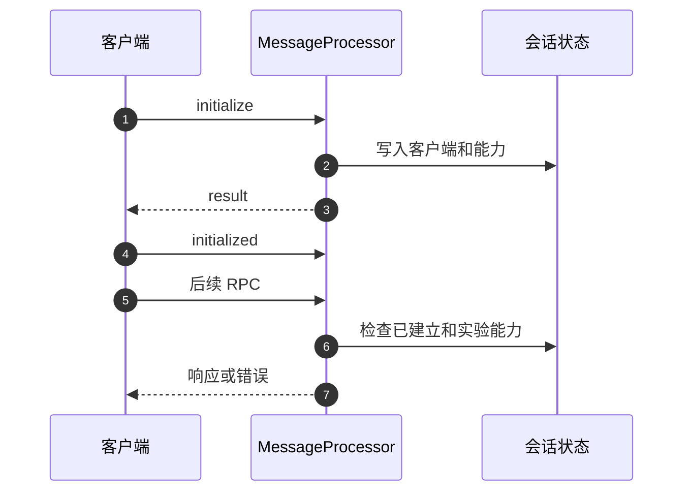
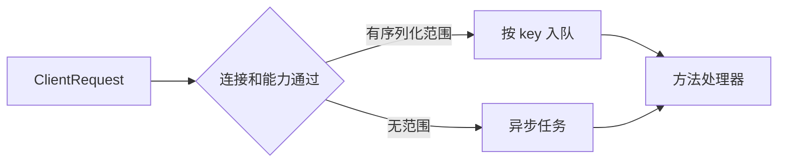
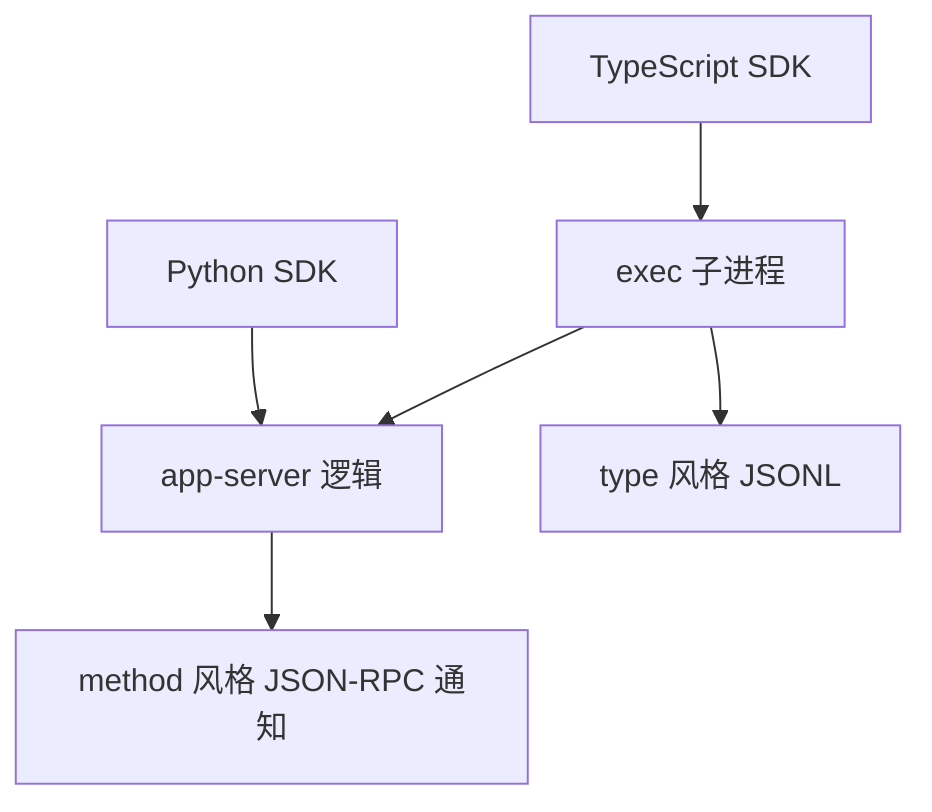

# app-server、CLI 与 SDK 的线协议

app-server 用一份类型化的请求/响应声明连接多种宿主。物理运输、连接状态、请求序列化和 turn 生命周期各有自己的边界。掌握它们能解释同样是 JSON 每行，为什么 Python SDK、TypeScript SDK 和 TUI 读取的对象不同。 [codex-rs/app-server-protocol/src/jsonrpc_lite.rs:17-84](https://github.com/GLBB/codex/blob/9f42c89c0112771dc29100a6f3fc904049b2655f/codex-rs/app-server-protocol/src/jsonrpc_lite.rs#L17-L84) [codex-rs/app-server-protocol/src/protocol/common.rs:157-215](https://github.com/GLBB/codex/blob/9f42c89c0112771dc29100a6f3fc904049b2655f/codex-rs/app-server-protocol/src/protocol/common.rs#L157-L215) [codex-rs/app-server/src/message_processor.rs:516-629](https://github.com/GLBB/codex/blob/9f42c89c0112771dc29100a6f3fc904049b2655f/codex-rs/app-server/src/message_processor.rs#L516-L629) [codex-rs/exec/src/event_processor_with_jsonl_output.rs:590-625](https://github.com/GLBB/codex/blob/9f42c89c0112771dc29100a6f3fc904049b2655f/codex-rs/exec/src/event_processor_with_jsonl_output.rs#L590-L625) [sdk/python/src/openai_codex/client.py:186-296](https://github.com/GLBB/codex/blob/9f42c89c0112771dc29100a6f3fc904049b2655f/sdk/python/src/openai_codex/client.py#L186-L296)

| 接入方式 | 实际传输与类型 | 关联策略 |
| --- | --- | --- |
| app-server 标准启动 | stdio 逐行 RPC。WS 与 Unix socket 载有 RPC 消息 | 请求 ID 与连接 ID 配对，通知按方法订阅。 [codex-rs/app-server/README.md:20-89](https://github.com/GLBB/codex/blob/9f42c89c0112771dc29100a6f3fc904049b2655f/codex-rs/app-server/README.md#L20-L89) [codex-rs/app-server-transport/src/transport/stdio.rs:24-99](https://github.com/GLBB/codex/blob/9f42c89c0112771dc29100a6f3fc904049b2655f/codex-rs/app-server-transport/src/transport/stdio.rs#L24-L99) [codex-rs/app-server/src/message_processor.rs:516-629](https://github.com/GLBB/codex/blob/9f42c89c0112771dc29100a6f3fc904049b2655f/codex-rs/app-server/src/message_processor.rs#L516-L629) |
| Rust in-process client | 直接提交 `ClientRequest` | 类型化入口绕过 JSON 解码，进入共享 `handle_client_request`。 [codex-rs/app-server-client/src/lib.rs:488-515](https://github.com/GLBB/codex/blob/9f42c89c0112771dc29100a6f3fc904049b2655f/codex-rs/app-server-client/src/lib.rs#L488-L515) [codex-rs/app-server/src/message_processor.rs:516-629](https://github.com/GLBB/codex/blob/9f42c89c0112771dc29100a6f3fc904049b2655f/codex-rs/app-server/src/message_processor.rs#L516-L629) |
| Python SDK | 启动 app-server 并发送 stdio RPC | 单个 stdout 读取器处理反向请求，分发响应与通知。 [sdk/python/src/openai_codex/client.py:186-296](https://github.com/GLBB/codex/blob/9f42c89c0112771dc29100a6f3fc904049b2655f/sdk/python/src/openai_codex/client.py#L186-L296) [sdk/python/src/openai_codex/client.py:619-670](https://github.com/GLBB/codex/blob/9f42c89c0112771dc29100a6f3fc904049b2655f/sdk/python/src/openai_codex/client.py#L619-L670) [sdk/python/src/openai_codex/_message_router.py:16-103](https://github.com/GLBB/codex/blob/9f42c89c0112771dc29100a6f3fc904049b2655f/sdk/python/src/openai_codex/_message_router.py#L16-L103) |
| TypeScript SDK | 执行 `codex exec --json` 子进程 | 逐行读取 exec 事件，SDK 可流式消费或汇总。 [sdk/typescript/src/thread.ts:66-135](https://github.com/GLBB/codex/blob/9f42c89c0112771dc29100a6f3fc904049b2655f/sdk/typescript/src/thread.ts#L66-L135) [sdk/typescript/src/exec.ts:165-215](https://github.com/GLBB/codex/blob/9f42c89c0112771dc29100a6f3fc904049b2655f/sdk/typescript/src/exec.ts#L165-L215) [codex-rs/exec/src/event_processor_with_jsonl_output.rs:590-625](https://github.com/GLBB/codex/blob/9f42c89c0112771dc29100a6f3fc904049b2655f/codex-rs/exec/src/event_processor_with_jsonl_output.rs#L590-L625) |

### 信封与连接门槛

`JSONRPCMessage` 用无外部 tag 的结构区分 request、notification、response 和 error。`RequestId` 可为字符串或整数。请求可附带 `trace`，通知没有等待回复的 ID。初次连接先 `initialize`，官方本仓库客户端顺序在响应后发 `initialized`。服务端的处理门槛检查连接状态，实验方法或字段再受 `experimentalApi` 控制。反向请求也需要正确回答 `id`，详见 [工具与审批](tools-approval.md)。 [codex-rs/app-server-protocol/src/jsonrpc_lite.rs:17-84](https://github.com/GLBB/codex/blob/9f42c89c0112771dc29100a6f3fc904049b2655f/codex-rs/app-server-protocol/src/jsonrpc_lite.rs#L17-L84) [codex-rs/app-server/README.md:20-89](https://github.com/GLBB/codex/blob/9f42c89c0112771dc29100a6f3fc904049b2655f/codex-rs/app-server/README.md#L20-L89) [codex-rs/app-server/src/request_processors/initialize_processor.rs:44-92](https://github.com/GLBB/codex/blob/9f42c89c0112771dc29100a6f3fc904049b2655f/codex-rs/app-server/src/request_processors/initialize_processor.rs#L44-L92) [codex-rs/app-server/src/message_processor.rs:789-849](https://github.com/GLBB/codex/blob/9f42c89c0112771dc29100a6f3fc904049b2655f/codex-rs/app-server/src/message_processor.rs#L789-L849) [codex-rs/app-server/README.md:1300-1327](https://github.com/GLBB/codex/blob/9f42c89c0112771dc29100a6f3fc904049b2655f/codex-rs/app-server/README.md#L1300-L1327)

<!-- Sources: codex-rs/app-server/README.md:20, codex-rs/app-server/src/request_processors/initialize_processor.rs:44, codex-rs/app-server/src/message_processor.rs:789, codex-rs/app-server-protocol/src/jsonrpc_lite.rs:17 -->

### 顺序与并发

方法注册可以声明序列化范围。`dispatch_initialized_client_request` 读取范围，再将工作放进按全局、thread、过程或客户端对象计算的队列。队列支持共享读和排它工作。有些方法没有范围，直接另起任务。客户端只能依据相关方法的协议和最终通知判断顺序。[codex-rs/app-server/src/message_processor.rs:789-849](https://github.com/GLBB/codex/blob/9f42c89c0112771dc29100a6f3fc904049b2655f/codex-rs/app-server/src/message_processor.rs#L789-L849) [codex-rs/app-server/src/request_serialization.rs:34-104](https://github.com/GLBB/codex/blob/9f42c89c0112771dc29100a6f3fc904049b2655f/codex-rs/app-server/src/request_serialization.rs#L34-L104) [codex-rs/app-server/src/request_serialization.rs:134-209](https://github.com/GLBB/codex/blob/9f42c89c0112771dc29100a6f3fc904049b2655f/codex-rs/app-server/src/request_serialization.rs#L134-L209)

<!-- Sources: codex-rs/app-server/src/message_processor.rs:789, codex-rs/app-server/src/request_serialization.rs:34, codex-rs/app-server/src/request_serialization.rs:134 -->

### stdio JSONL 与终态投影

`codex exec` 选择 JSON event processor 后，将 server notification 通过投影输出成 `type` 风格事件。TypeScript SDK 读取这种结果。Python SDK 使用 app-server 客户端，响应按请求 ID 路由，通知按方法分流。集成调试时确认启动的子命令，能快速定位读错协议的问题。 [codex-rs/exec/src/lib.rs:564-602](https://github.com/GLBB/codex/blob/9f42c89c0112771dc29100a6f3fc904049b2655f/codex-rs/exec/src/lib.rs#L564-L602) [codex-rs/exec/src/lib.rs:749-807](https://github.com/GLBB/codex/blob/9f42c89c0112771dc29100a6f3fc904049b2655f/codex-rs/exec/src/lib.rs#L749-L807) [codex-rs/exec/src/event_processor_with_jsonl_output.rs:590-625](https://github.com/GLBB/codex/blob/9f42c89c0112771dc29100a6f3fc904049b2655f/codex-rs/exec/src/event_processor_with_jsonl_output.rs#L590-L625) [sdk/typescript/src/exec.ts:165-215](https://github.com/GLBB/codex/blob/9f42c89c0112771dc29100a6f3fc904049b2655f/sdk/typescript/src/exec.ts#L165-L215) [sdk/python/src/openai_codex/client.py:619-670](https://github.com/GLBB/codex/blob/9f42c89c0112771dc29100a6f3fc904049b2655f/sdk/python/src/openai_codex/client.py#L619-L670) [sdk/python/src/openai_codex/_message_router.py:16-103](https://github.com/GLBB/codex/blob/9f42c89c0112771dc29100a6f3fc904049b2655f/sdk/python/src/openai_codex/_message_router.py#L16-L103)

<!-- Sources: sdk/typescript/src/exec.ts:165, codex-rs/exec/src/lib.rs:749, codex-rs/exec/src/event_processor_with_jsonl_output.rs:590, sdk/python/src/openai_codex/client.py:186, sdk/python/src/openai_codex/client.py:619 -->

继续阅读 [协议总览](index.md)、[app-server 架构](../architecture/app-server.md) 和 [配置、能力与 schema 演进](config-schema.md)。
