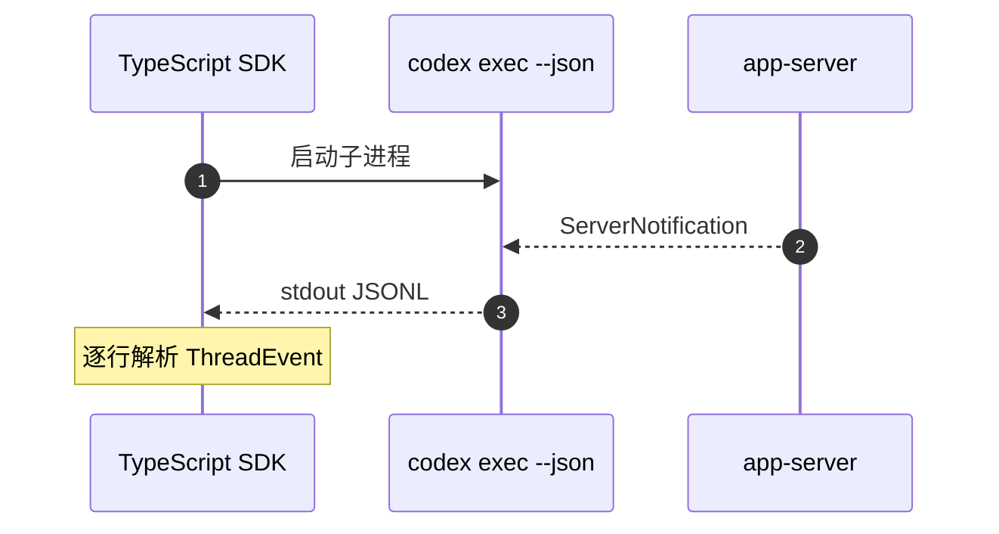

# CLI JSONL 与 SDK

`codex exec --json` 把 app-server 的部分通知转换成 stdout 上逐行输出的事件。TypeScript SDK 启动该命令并逐行解析，Python SDK 则直接接入 [app-server JSON-RPC](app-server-wire.md)。同一个回合可以同时涉及这两种消息形状。 [event_processor_with_jsonl_output.rs:591-607](https://github.com/GLBB/codex/blob/9f42c89c0112771dc29100a6f3fc904049b2655f/codex-rs/exec/src/event_processor_with_jsonl_output.rs#L591-L607) [exec.ts:165-215](https://github.com/GLBB/codex/blob/9f42c89c0112771dc29100a6f3fc904049b2655f/sdk/typescript/src/exec.ts#L165-L215) [thread.ts:66-135](https://github.com/GLBB/codex/blob/9f42c89c0112771dc29100a6f3fc904049b2655f/sdk/typescript/src/thread.ts#L66-L135) [client.py:225-276](https://github.com/GLBB/codex/blob/9f42c89c0112771dc29100a6f3fc904049b2655f/sdk/python/src/openai_codex/client.py#L225-L276)

## 顶层事件

每行 JSON 的 `type` 是分发键。表内路径从当前行的根对象开始。 [exec_events.rs:8-99](https://github.com/GLBB/codex/blob/9f42c89c0112771dc29100a6f3fc904049b2655f/codex-rs/exec/src/exec_events.rs#L8-L99)

| `type` | 字段 | 含义 |
| --- | --- | --- |
| `thread.started` | `thread_id: string` | 当前运行关联的线程，SDK 保存此 ID 以供续接。 |
| `turn.started` | 只有 `type` | 回合开始。 |
| `item.started` | `item: ThreadItem` | 某个展示项进入生命周期。 |
| `item.updated` | `item: ThreadItem` | 更新同一 ID 的展示项，例如任务清单。 |
| `item.completed` | `item: ThreadItem` | 展示项达到终态，具体结果看该项自己的字段。 |
| `turn.completed` | `usage: Usage` | 回合成功结束。 |
| `turn.failed` | `error.message: string` | 回合失败。 |
| `error` | `message: string` | 流级错误事件。 |

| `usage` 字段 | JSON 类型 | 含义 |
| --- | --- | --- |
| `input_tokens` | 整数 | 映射来的输入 token 数。 |
| `cached_input_tokens` | 整数 | 输入中命中缓存的 token 数。 |
| `output_tokens` | 整数 | 映射来的输出 token 数。 |
| `reasoning_output_tokens` | 整数 | 输出中的推理 token 数。 |

事件转换器使用最近记录的 `thread/tokenUsage/updated` 的 `total`，未收到时用零值。对已续接线程做成本归因时，需要考虑累计用量。回合被中断时，当前转换器直接进入关闭流程，少一条 `turn.completed` 或 `turn.failed` 是合法的。 [event_processor_with_jsonl_output.rs:465-552](https://github.com/GLBB/codex/blob/9f42c89c0112771dc29100a6f3fc904049b2655f/codex-rs/exec/src/event_processor_with_jsonl_output.rs#L465-L552)

## item 对象

展示项的 `item.id` 是 CLI 转换器的关联键，`item.type` 决定同层的其余字段。以下列出常用形状。 [exec_events.rs:93-195](https://github.com/GLBB/codex/blob/9f42c89c0112771dc29100a6f3fc904049b2655f/codex-rs/exec/src/exec_events.rs#L93-L195) [exec_events.rs:258-317](https://github.com/GLBB/codex/blob/9f42c89c0112771dc29100a6f3fc904049b2655f/codex-rs/exec/src/exec_events.rs#L258-L317) [event_processor_with_jsonl_output.rs:89-113](https://github.com/GLBB/codex/blob/9f42c89c0112771dc29100a6f3fc904049b2655f/codex-rs/exec/src/event_processor_with_jsonl_output.rs#L89-L113)

| `item.type` | 字段 | 含义 |
| --- | --- | --- |
| `agent_message` | `text: string` | 助手文本，结构化输出时可以是一段 JSON 字符串。 |
| `reasoning` | `text: string` | 已公开的推理摘要。 |
| `command_execution` | `command: string`、`aggregated_output: string`、`exit_code: integer 或 null`、`status: enum` | 命令、汇总输出、退出码和状态。状态为 `in_progress`、`completed`、`failed` 或 `declined`。 |
| `file_change` | `changes: object[]`、`status: enum` | 变更项带路径和变更种类，状态描述补丁应用结果。 |
| `mcp_tool_call` | `server`、`tool`、`arguments`、`result`、`error`、`status` | 调用目标、JSON 参数、结果或错误及状态。结果可含 `content`、`structured_content` 和 `_meta`。 |
| `todo_list` | `items: {text, completed}[]` | 任务清单及每项完成标记。 |
| `error` | `message: string` | 嵌在展示项内的非致命错误。 |

例如，SDK 会把这行解析成一个已经完成的助手展示项。

```json
{"type":"item.completed","item":{"id":"item_0","type":"agent_message","text":"已整理字段表。"}}
```

## 消费顺序


<!-- Sources: sdk/typescript/src/exec.ts:165-215, sdk/typescript/src/thread.ts:66-135, codex-rs/exec/src/event_processor_with_jsonl_output.rs:591-607 -->

`runStreamed()` 产出解析后的事件，`run()` 收集完成项、最终助手文本与用量，遇到 `turn.failed` 时抛错。完整展示项变体见 [CLI 事件定义](https://github.com/GLBB/codex/blob/9f42c89c0112771dc29100a6f3fc904049b2655f/codex-rs/exec/src/exec_events.rs#L93-L317)。 [thread.ts:66-149](https://github.com/GLBB/codex/blob/9f42c89c0112771dc29100a6f3fc904049b2655f/sdk/typescript/src/thread.ts#L66-L149)
