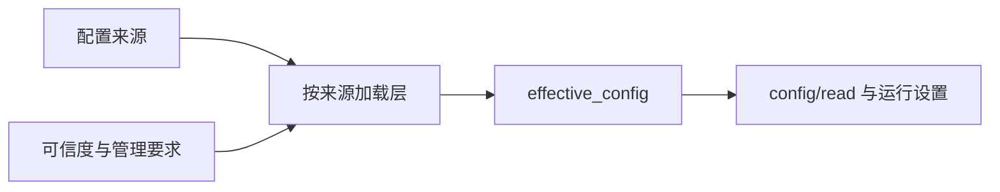
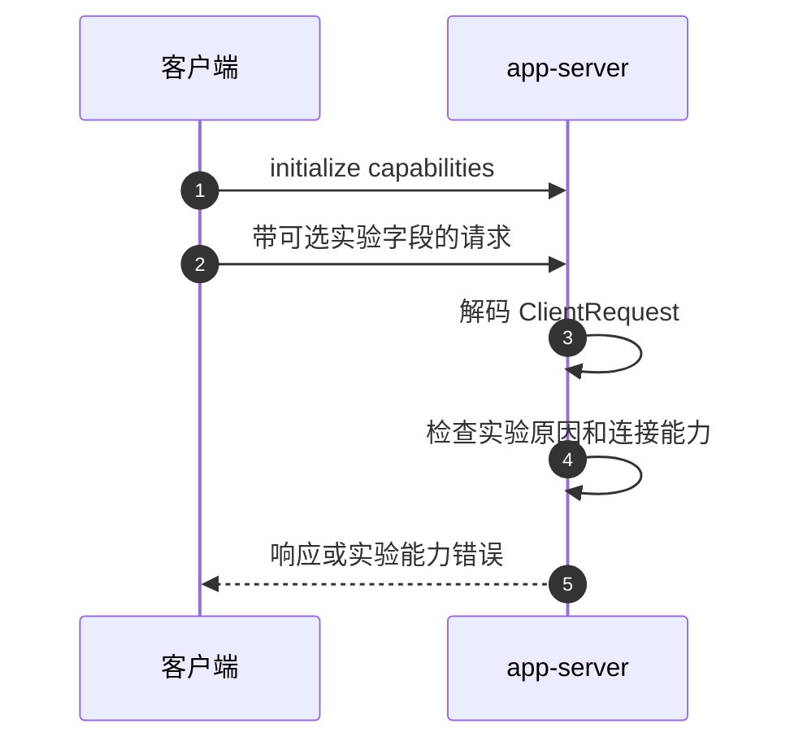
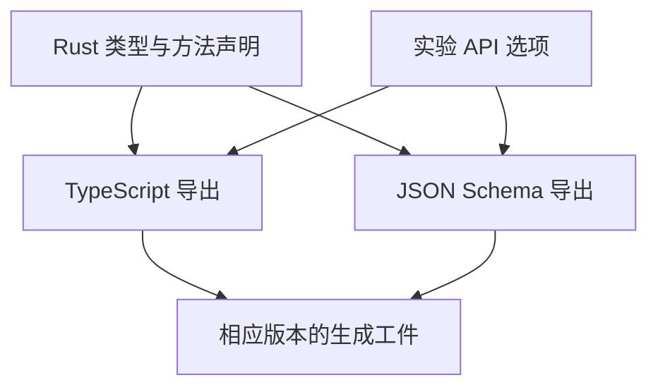

# 配置、能力与 schema 演进

配置和协议都存在「结构合法」与「当前运行允许」两步。TOML 可解码后还需检查层、要求与 cwd。RPC 可以成功反序列化，再因连接尚未启用实验能力而被拒绝。追踪跨版本失败时这两步要分别确认。 [codex-rs/config/src/loader/mod.rs:111-245](https://github.com/GLBB/codex/blob/9f42c89c0112771dc29100a6f3fc904049b2655f/codex-rs/config/src/loader/mod.rs#L111-L245) [codex-rs/config/src/loader/mod.rs:864-896](https://github.com/GLBB/codex/blob/9f42c89c0112771dc29100a6f3fc904049b2655f/codex-rs/config/src/loader/mod.rs#L864-L896) [codex-rs/config/src/state.rs:449-475](https://github.com/GLBB/codex/blob/9f42c89c0112771dc29100a6f3fc904049b2655f/codex-rs/config/src/state.rs#L449-L475) [codex-rs/app-server-protocol/src/jsonrpc_lite.rs:17-84](https://github.com/GLBB/codex/blob/9f42c89c0112771dc29100a6f3fc904049b2655f/codex-rs/app-server-protocol/src/jsonrpc_lite.rs#L17-L84) [codex-rs/app-server/src/message_processor.rs:789-849](https://github.com/GLBB/codex/blob/9f42c89c0112771dc29100a6f3fc904049b2655f/codex-rs/app-server/src/message_processor.rs#L789-L849)

| 契约 | 定义源 | 验证点 |
| --- | --- | --- |
| 有效配置 | 系统、用户、项目、覆盖配置以及单独加载的组织要求 | `load_config_layers_state` 和 `ConfigLayerStack::effective_config`。 [codex-rs/config/src/loader/mod.rs:111-245](https://github.com/GLBB/codex/blob/9f42c89c0112771dc29100a6f3fc904049b2655f/codex-rs/config/src/loader/mod.rs#L111-L245) [codex-rs/config/src/loader/mod.rs:241-368](https://github.com/GLBB/codex/blob/9f42c89c0112771dc29100a6f3fc904049b2655f/codex-rs/config/src/loader/mod.rs#L241-L368) [codex-rs/config/src/state.rs:449-475](https://github.com/GLBB/codex/blob/9f42c89c0112771dc29100a6f3fc904049b2655f/codex-rs/config/src/state.rs#L449-L475) |
| 项目可信与键筛选 | `project_layer_entry` 和 `sanitize_project_config` | 看层是否启用，哪些键允许由工作目录提供。 [codex-rs/config/src/loader/mod.rs:864-896](https://github.com/GLBB/codex/blob/9f42c89c0112771dc29100a6f3fc904049b2655f/codex-rs/config/src/loader/mod.rs#L864-L896) |
| 配置读取接口 | `ConfigReadParams`、`ConfigReadResponse`，requirements 有独立结果 | 请求可要求返回 layers。使用 cwd 与 origins 定位有效值。 [codex-rs/app-server-protocol/src/protocol/v2/config.rs:264-356](https://github.com/GLBB/codex/blob/9f42c89c0112771dc29100a6f3fc904049b2655f/codex-rs/app-server-protocol/src/protocol/v2/config.rs#L264-L356) [codex-rs/app-server/src/request_processors/config_processor.rs:87-143](https://github.com/GLBB/codex/blob/9f42c89c0112771dc29100a6f3fc904049b2655f/codex-rs/app-server/src/request_processors/config_processor.rs#L87-L143) |
| 实验能力 | schema 中的标签与初始化时的 capability | 生成稳定 schema 与服务器请求门槛都使用实验标记。 [codex-rs/app-server-protocol/src/protocol/common.rs:157-215](https://github.com/GLBB/codex/blob/9f42c89c0112771dc29100a6f3fc904049b2655f/codex-rs/app-server-protocol/src/protocol/common.rs#L157-L215) [codex-rs/app-server-protocol/src/export.rs:182-243](https://github.com/GLBB/codex/blob/9f42c89c0112771dc29100a6f3fc904049b2655f/codex-rs/app-server-protocol/src/export.rs#L182-L243) [codex-rs/app-server/src/message_processor.rs:789-849](https://github.com/GLBB/codex/blob/9f42c89c0112771dc29100a6f3fc904049b2655f/codex-rs/app-server/src/message_processor.rs#L789-L849) |
| 生成契约 | Rust 声明 → TypeScript、JSON Schema 树 | 生成模式可影响是否包含实验 API。变更时更新对应 fixture。 [codex-rs/app-server-protocol/src/export.rs:76-121](https://github.com/GLBB/codex/blob/9f42c89c0112771dc29100a6f3fc904049b2655f/codex-rs/app-server-protocol/src/export.rs#L76-L121) [codex-rs/app-server-protocol/src/export.rs:182-243](https://github.com/GLBB/codex/blob/9f42c89c0112771dc29100a6f3fc904049b2655f/codex-rs/app-server-protocol/src/export.rs#L182-L243) [AGENTS.md:54-69](https://github.com/GLBB/codex/blob/9f42c89c0112771dc29100a6f3fc904049b2655f/AGENTS.md#L54-L69) |

<!-- Sources: codex-rs/config/src/loader/mod.rs:111, codex-rs/config/src/loader/mod.rs:241, codex-rs/config/src/loader/mod.rs:864, codex-rs/config/src/state.rs:449, codex-rs/app-server/src/request_processors/config_processor.rs:87 -->

### 区分配置开关与协议协商

`multi_agent_v2` 等特性配置控制运行能力。app-server `initialize` 中的 `experimentalApi` 描述该连接是否允许实验接口。请求处理器会检查调用方法或字段的实验标记。排查能发现一个能力但调用失败时，则要看部署的接口版本、调用方 schema、连接 capability 和实际 feature 生效值。 [codex-rs/features/src/lib.rs:916-936](https://github.com/GLBB/codex/blob/9f42c89c0112771dc29100a6f3fc904049b2655f/codex-rs/features/src/lib.rs#L916-L936) [codex-rs/app-server/src/message_processor.rs:789-849](https://github.com/GLBB/codex/blob/9f42c89c0112771dc29100a6f3fc904049b2655f/codex-rs/app-server/src/message_processor.rs#L789-L849) [codex-rs/app-server-protocol/src/protocol/v2/config.rs:264-356](https://github.com/GLBB/codex/blob/9f42c89c0112771dc29100a6f3fc904049b2655f/codex-rs/app-server-protocol/src/protocol/v2/config.rs#L264-L356) [codex-rs/app-server/src/request_processors/config_processor.rs:87-143](https://github.com/GLBB/codex/blob/9f42c89c0112771dc29100a6f3fc904049b2655f/codex-rs/app-server/src/request_processors/config_processor.rs#L87-L143)

<!-- Sources: codex-rs/app-server/README.md:20, codex-rs/app-server/src/request_processors/initialize_processor.rs:44, codex-rs/app-server/src/message_processor.rs:516, codex-rs/app-server/src/message_processor.rs:789 -->

### 消费者怎样跟进变化

以 Rust 的 serde 和 TS 注解为结构来源。`generate_ts_with_options` 和 JSON Schema exporter 生成目标类型，并按实验模式过滤方法或字段。在 API 修改后，仓库通过 `just write-app-server-schema` 更新已提交的 fixture，再运行匹配的协议测试。Python SDK 持有自己的生成类型与运行时适配路径，两个 SDK 的兼容策略需要分别对照。 [codex-rs/app-server-protocol/src/protocol/common.rs:157-215](https://github.com/GLBB/codex/blob/9f42c89c0112771dc29100a6f3fc904049b2655f/codex-rs/app-server-protocol/src/protocol/common.rs#L157-L215) [codex-rs/app-server-protocol/src/export.rs:76-121](https://github.com/GLBB/codex/blob/9f42c89c0112771dc29100a6f3fc904049b2655f/codex-rs/app-server-protocol/src/export.rs#L76-L121) [codex-rs/app-server-protocol/src/export.rs:182-243](https://github.com/GLBB/codex/blob/9f42c89c0112771dc29100a6f3fc904049b2655f/codex-rs/app-server-protocol/src/export.rs#L182-L243) [justfile:28-58](https://github.com/GLBB/codex/blob/9f42c89c0112771dc29100a6f3fc904049b2655f/justfile#L28-L58) [sdk/python/src/openai_codex/client.py:186-296](https://github.com/GLBB/codex/blob/9f42c89c0112771dc29100a6f3fc904049b2655f/sdk/python/src/openai_codex/client.py#L186-L296) [sdk/python/src/openai_codex/_message_router.py:16-103](https://github.com/GLBB/codex/blob/9f42c89c0112771dc29100a6f3fc904049b2655f/sdk/python/src/openai_codex/_message_router.py#L16-L103) [sdk/typescript/src/exec.ts:165-215](https://github.com/GLBB/codex/blob/9f42c89c0112771dc29100a6f3fc904049b2655f/sdk/typescript/src/exec.ts#L165-L215)

<!-- Sources: codex-rs/app-server-protocol/src/protocol/common.rs:157, codex-rs/app-server-protocol/src/export.rs:76, codex-rs/app-server-protocol/src/export.rs:182 -->

继续阅读 [协议总览](index.md)、[客户端线协议](app-server-wire.md) 和 [配置、技能与 MCP](../deep-dive/config-extensions.md)。
