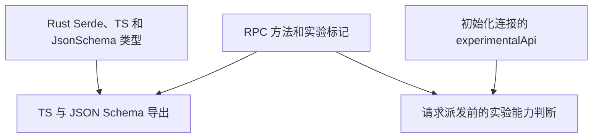

# 配置 RPC 与 schema 兼容

`config/read` 返回合并后的配置值和来源，`configRequirements/read` 返回选值约束。RPC 外层和读取、写入参数采用 camelCase，`result.config` 内级的配置键跟随 TOML 名称，例如 `model_provider`。 [config.rs:221-259](https://github.com/GLBB/codex/blob/9f42c89c0112771dc29100a6f3fc904049b2655f/codex-rs/app-server-protocol/src/protocol/v2/config.rs#L221-L259) [config.rs:328-372](https://github.com/GLBB/codex/blob/9f42c89c0112771dc29100a6f3fc904049b2655f/codex-rs/app-server-protocol/src/protocol/v2/config.rs#L328-L372) [config_manager_service.rs:109-161](https://github.com/GLBB/codex/blob/9f42c89c0112771dc29100a6f3fc904049b2655f/codex-rs/app-server/src/config_manager_service.rs#L109-L161)

## config/read

服务端从指定 `cwd` 解析项目层。有效值按优先级从低到高合并已启用的层，`origins` 记录对应字段来源。若请求层明细，返回按高优先级到低优先级排列的层，包含禁用层。 [config_manager_service.rs:109-150](https://github.com/GLBB/codex/blob/9f42c89c0112771dc29100a6f3fc904049b2655f/codex-rs/app-server/src/config_manager_service.rs#L109-L150) [state.rs:449-511](https://github.com/GLBB/codex/blob/9f42c89c0112771dc29100a6f3fc904049b2655f/codex-rs/config/src/state.rs#L449-L511) [mod.rs:864-896](https://github.com/GLBB/codex/blob/9f42c89c0112771dc29100a6f3fc904049b2655f/codex-rs/config/src/loader/mod.rs#L864-L896)

| 字段 | JSON 类型与出现条件 | 含义 |
| --- | --- | --- |
| `params.cwd` | string，可省略 | 按此绝对工作目录解析项目配置，省略走不依赖线程的配置加载。 |
| `params.includeLayers` | boolean；默认 false | 设为 true 时返回各层明细。 |
| `result.config` | object | 合并后的配置视图。 |
| `result.origins` | string → ConfigLayerMetadata 映射 | 配置键路径映射到生效来源，例如 `model` 的来源层元数据。 |
| `result.layers` | ConfigLayer[]，可省略 | 设置 `includeLayers` 时返回。 |
| `origins[*].name`、`layers[].name` | tagged object | 层来源，`type` 如 `system`、`user`、`project`、`sessionFlags`。用户层还可带 `file`、`profile`，项目层带 `dotCodexFolder`。 |
| `origins[*].version`、`layers[].version` | string | 对应层的版本标识。 |
| `layers[].config` | JSON | 该层独自提供的配置。 |
| `layers[].disabledReason` | string，可省略 | 该层未参与合并的原因。 |

来源变体和层优先级见 [ConfigLayerSource](https://github.com/GLBB/codex/blob/9f42c89c0112771dc29100a6f3fc904049b2655f/codex-rs/app-server-protocol/src/protocol/v2/config.rs#L23-L112)，对象字段见 [ConfigReadResponse](https://github.com/GLBB/codex/blob/9f42c89c0112771dc29100a6f3fc904049b2655f/codex-rs/app-server-protocol/src/protocol/v2/config.rs#L261-L350)。

## config/value/write 与 config/batchWrite

服务端只接受写入允许的用户配置路径。提供 `expectedVersion` 时，用当前活动用户层的版本比对，版本冲突会返回 RPC 错误。选择版本时读取用户层的 `version`，可用上一笔成功写入返回的版本继续编辑。 [config.rs:658-694](https://github.com/GLBB/codex/blob/9f42c89c0112771dc29100a6f3fc904049b2655f/codex-rs/app-server-protocol/src/protocol/v2/config.rs#L658-L694) [config_manager_service.rs:164-229](https://github.com/GLBB/codex/blob/9f42c89c0112771dc29100a6f3fc904049b2655f/codex-rs/app-server/src/config_manager_service.rs#L164-L229) [config_manager_service.rs:324-351](https://github.com/GLBB/codex/blob/9f42c89c0112771dc29100a6f3fc904049b2655f/codex-rs/app-server/src/config_manager_service.rs#L324-L351)

| 位置 | 字段 | 含义 |
| --- | --- | --- |
| 单条 `params` 或批量 `edits[]` | `keyPath: string` | 配置键路径。 |
| 同上 | `value: JSON` | 要写入的值，null 用于删除。 |
| 同上 | `mergeStrategy: "replace" / "upsert"` | 替换该值或按合并规则更新。 |
| 批量 `params` | `edits: ConfigEdit[]` | 要处理的编辑列表。 |
| 两种请求 `params` | `filePath: string`、`expectedVersion: string`，各自可省略 | 写入路径与版本前置条件。省略路径使用用户配置。 |
| 批量 `params` | `reloadUserConfig: boolean`；默认 false | 写入后将用户配置热加载到已加载的线程。 |
| `result` | `status: "ok" / "okOverridden"` | 写入成功，后者表示有更高优先级的层覆盖至少一个编辑。 |
| `result` | `version: string`、`filePath: string` | 写入后用户层版本和实际文件绝对路径。 |
| `result` | `overriddenMetadata: object 或 null` | 发生覆盖时提供 `message`、`overridingLayer` 和 `effectiveValue`。 |

[config.rs:280-325](https://github.com/GLBB/codex/blob/9f42c89c0112771dc29100a6f3fc904049b2655f/codex-rs/app-server-protocol/src/protocol/v2/config.rs#L280-L325) [config_manager_service.rs:232-351](https://github.com/GLBB/codex/blob/9f42c89c0112771dc29100a6f3fc904049b2655f/codex-rs/app-server/src/config_manager_service.rs#L232-L351) [config_processor.rs:286-312](https://github.com/GLBB/codex/blob/9f42c89c0112771dc29100a6f3fc904049b2655f/codex-rs/app-server/src/request_processors/config_processor.rs#L286-L312)

## configRequirements/read

响应中的 `requirements` 没有配置时为 null。有配置时，下面的字段各自可以为 null。约束由独立加载路径提供。 [config.rs:352-372](https://github.com/GLBB/codex/blob/9f42c89c0112771dc29100a6f3fc904049b2655f/codex-rs/app-server-protocol/src/protocol/v2/config.rs#L352-L372) [config.rs:499-510](https://github.com/GLBB/codex/blob/9f42c89c0112771dc29100a6f3fc904049b2655f/codex-rs/app-server-protocol/src/protocol/v2/config.rs#L499-L510) [config_manager_service.rs:153-162](https://github.com/GLBB/codex/blob/9f42c89c0112771dc29100a6f3fc904049b2655f/codex-rs/app-server/src/config_manager_service.rs#L153-L162) [state.rs:451-469](https://github.com/GLBB/codex/blob/9f42c89c0112771dc29100a6f3fc904049b2655f/codex-rs/config/src/state.rs#L451-L469)

| `requirements` 字段 | 类型 | 含义 |
| --- | --- | --- |
| `allowedApprovalPolicies`、`allowedApprovalsReviewers` | 枚举数组 | 允许的审批策略和审查方。审查方为实验字段。 |
| `allowedSandboxModes`、`allowedPermissions` | 枚举数组 / string[] | 允许的沙箱模式和权限配置名。 |
| `allowedWebSearchModes` | 枚举数组 | 允许的联网搜索模式。 |
| `allowManagedHooksOnly`、`allowAppshots` | boolean | Hook 管理来源限制及是否允许 appshots。 |
| `computerUse` | object | 计算机使用能力约束。 |
| `featureRequirements` | string → boolean 映射 | 功能标志应满足的要求。 |
| `hooks`、`network` | object，实验字段 | 托管 Hook 与网络要求。 |
| `enforceResidency` | 枚举 | 数据驻留要求。 |

## 类型生成与连接协商

| 位置 | 字段或标记 | 作用 |
| --- | --- | --- |
| Rust 数据类型 | `serde` rename、tag、default | 决定实际 JSON 名称、分发标签和缺省行为。 |
| RPC 方法注册表 | `experimental`、`inspect_params` | 标记实验方法或检查请求参数里使用的实验字段。 |
| 客户端初始化 | `capabilities.experimentalApi: boolean` | 该连接选择使用实验接口。服务端在派发前校验实验原因。 |
| 导出命令 | `--experimental` | 让导出物包含实验接口。默认生成会过滤注册的实验方法和字段。 |

[common.rs:157-215](https://github.com/GLBB/codex/blob/9f42c89c0112771dc29100a6f3fc904049b2655f/codex-rs/app-server-protocol/src/protocol/common.rs#L157-L215) [export.rs:76-125](https://github.com/GLBB/codex/blob/9f42c89c0112771dc29100a6f3fc904049b2655f/codex-rs/app-server-protocol/src/export.rs#L76-L125) [export.rs:182-240](https://github.com/GLBB/codex/blob/9f42c89c0112771dc29100a6f3fc904049b2655f/codex-rs/app-server-protocol/src/export.rs#L182-L240) [initialize_processor.rs:69-104](https://github.com/GLBB/codex/blob/9f42c89c0112771dc29100a6f3fc904049b2655f/codex-rs/app-server/src/request_processors/initialize_processor.rs#L69-L104) [message_processor.rs:789-804](https://github.com/GLBB/codex/blob/9f42c89c0112771dc29100a6f3fc904049b2655f/codex-rs/app-server/src/message_processor.rs#L789-L804)

<!-- Sources: codex-rs/app-server-protocol/src/export.rs:76-125, codex-rs/app-server-protocol/src/export.rs:182-240, codex-rs/app-server/src/request_processors/initialize_processor.rs:69-104, codex-rs/app-server/src/message_processor.rs:789-804 -->

客户端可以用部署的同版本二进制执行 `codex app-server generate-ts --out DIR` 或 `codex app-server generate-json-schema --out DIR` 获得完整类型。连接是否接受实验请求，以该连接的协商结果为准。 [README.md:1848-1863](https://github.com/GLBB/codex/blob/9f42c89c0112771dc29100a6f3fc904049b2655f/codex-rs/app-server/README.md#L1848-L1863)
