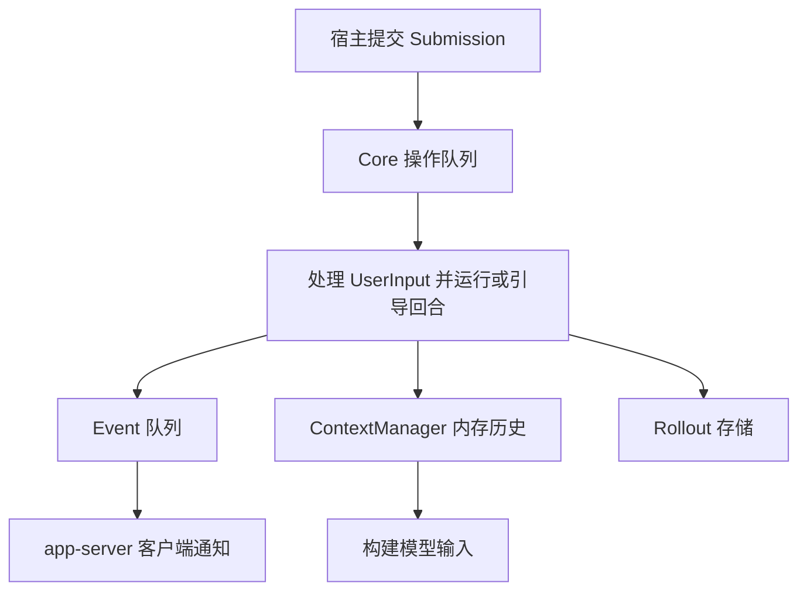

# Core 操作、事件与内存历史

宿主把操作放入 Core 提交队列，Core 经事件队列汇报进度。模型会话的内容由内存历史中的 `ResponseItem` 承载。下文使用 Rust 类型名称和它们的 Serde 字段名。磁盘形状见 [Rollout 会话 JSONL](rollout-wire.md)，客户端形状见 [app-server JSON-RPC](app-server-wire.md)。 [mod.rs:679-708](https://github.com/GLBB/codex/blob/9f42c89c0112771dc29100a6f3fc904049b2655f/codex-rs/core/src/session/mod.rs#L679-L708) [mod.rs:1758-1775](https://github.com/GLBB/codex/blob/9f42c89c0112771dc29100a6f3fc904049b2655f/codex-rs/core/src/session/mod.rs#L1758-L1775) [mod.rs:2527-2547](https://github.com/GLBB/codex/blob/9f42c89c0112771dc29100a6f3fc904049b2655f/codex-rs/core/src/session/mod.rs#L2527-L2547)

## Submission 与 Op

| 字段 | 类型与出现条件 | 含义 |
| --- | --- | --- |
| `Submission.id` | String | 本次操作的关联 ID。常规 `submit_with_trace` 生成 UUIDv7，回合上下文可使用它作为 `sub_id`。 |
| `Submission.op` | Op | 操作体。序列化后由 `op.type` 选择操作变体。 |
| `Submission.trace` | W3cTraceContext，可省略 | 跨异步队列传递的追踪上下文。未提供时提交路径尝试从当前 span 提取。 |
| `trace.traceparent` | String，可省略 | W3C 父级追踪信息，包含 trace ID 等。 |
| `trace.tracestate` | String，可省略 | 服务商扩展的追踪状态。 |

[protocol.rs:124-144](https://github.com/GLBB/codex/blob/9f42c89c0112771dc29100a6f3fc904049b2655f/codex-rs/protocol/src/protocol.rs#L124-L144) [protocol.rs:474-535](https://github.com/GLBB/codex/blob/9f42c89c0112771dc29100a6f3fc904049b2655f/codex-rs/protocol/src/protocol.rs#L474-L535) [mod.rs:679-708](https://github.com/GLBB/codex/blob/9f42c89c0112771dc29100a6f3fc904049b2655f/codex-rs/core/src/session/mod.rs#L679-L708)

| `op.type` | 字段 | 消费行为 |
| --- | --- | --- |
| `user_input` | `items: UserInput[]` | 用户输入。处理器尝试追加到正在运行的回合，若无活动回合则启动常规任务。 |
| `user_input` | `environments: TurnEnvironmentSelection[]`，可省略 | 本回合环境选择。 |
| `user_input` | `final_output_json_schema: JSON`，可省略 | 本回合最终输出约束。 |
| `user_input` | `responsesapi_client_metadata: Map<String,String>`，可省略 | 模型请求使用的回合元数据。 |
| `user_input`、`thread_settings` | 展平的 `ThreadSettingsOverrides` | 持久到后续回合的设置更新，`thread_settings` 操作本身只更新设置。 |
| `interrupt` | 只有 `type` | 中断当前任务。 |
| `inter_agent_communication` | `communication: InterAgentCommunication` | 向目标线程递交代理消息，进入目标线程提交生命周期。 |

[protocol.rs:474-536](https://github.com/GLBB/codex/blob/9f42c89c0112771dc29100a6f3fc904049b2655f/codex-rs/protocol/src/protocol.rs#L474-L536) [handlers.rs:188-269](https://github.com/GLBB/codex/blob/9f42c89c0112771dc29100a6f3fc904049b2655f/codex-rs/core/src/session/handlers.rs#L188-L269) [handlers.rs:708-787](https://github.com/GLBB/codex/blob/9f42c89c0112771dc29100a6f3fc904049b2655f/codex-rs/core/src/session/handlers.rs#L708-L787) [control.rs:721-735](https://github.com/GLBB/codex/blob/9f42c89c0112771dc29100a6f3fc904049b2655f/codex-rs/core/src/agent/control.rs#L721-L735) [input_queue.rs:42-81](https://github.com/GLBB/codex/blob/9f42c89c0112771dc29100a6f3fc904049b2655f/codex-rs/core/src/session/input_queue.rs#L42-L81)

## Event 与 EventMsg

`Event.id: String` 关联提交，`Event.msg: EventMsg` 携带带标签的事件体。常规回合事件用 `TurnContext.sub_id` 构造外壳。Core 向会话存储交付的是 `msg`，磁盘的 `event_msg` 行由此只包含事件体。 [protocol.rs:1121-1188](https://github.com/GLBB/codex/blob/9f42c89c0112771dc29100a6f3fc904049b2655f/codex-rs/protocol/src/protocol.rs#L1121-L1188) [mod.rs:1610-1624](https://github.com/GLBB/codex/blob/9f42c89c0112771dc29100a6f3fc904049b2655f/codex-rs/core/src/session/mod.rs#L1610-L1624) [mod.rs:1758-1775](https://github.com/GLBB/codex/blob/9f42c89c0112771dc29100a6f3fc904049b2655f/codex-rs/core/src/session/mod.rs#L1758-L1775)

| `msg.type` 写入值 | 字段 | 含义 |
| --- | --- | --- |
| `task_started` | `turn_id: String` | 开始事件的业务回合 ID。读取时也接受 `turn_started`。 |
| `task_started` | `started_at: i64?`、`trace_id: String?` | Unix 秒与可选追踪 ID。 |
| `task_started` | `model_context_window: i64?`、`collaboration_mode_kind: ModeKind` | 上下文容量与当前协作模式。 |
| `task_complete` | `turn_id: String`、`last_agent_message: String?` | 完成的回合与可用的最终助手文本。读取时也接受 `turn_complete`。 |
| `task_complete` | `completed_at: i64?`、`duration_ms: i64?`、`time_to_first_token_ms: i64?` | Unix 秒、运行耗时与首 token 耗时。后两项以毫秒计。 |
| `token_count` | `info: TokenUsageInfo?`、`rate_limits: RateLimitSnapshot?` | 用量统计和可用的限额快照。 |

[protocol.rs:1172-1188](https://github.com/GLBB/codex/blob/9f42c89c0112771dc29100a6f3fc904049b2655f/codex-rs/protocol/src/protocol.rs#L1172-L1188) [protocol.rs:1832-1865](https://github.com/GLBB/codex/blob/9f42c89c0112771dc29100a6f3fc904049b2655f/codex-rs/protocol/src/protocol.rs#L1832-L1865) [protocol.rs:1909-1920](https://github.com/GLBB/codex/blob/9f42c89c0112771dc29100a6f3fc904049b2655f/codex-rs/protocol/src/protocol.rs#L1909-L1920) [protocol.rs:1975-1988](https://github.com/GLBB/codex/blob/9f42c89c0112771dc29100a6f3fc904049b2655f/codex-rs/protocol/src/protocol.rs#L1975-L1988)

## 内存历史如何进入模型

`record_conversation_items` 先按截断策略写入内存，再交给存储并发出 raw response item 事件。构建模型输入时，`ContextManager::for_prompt` 归一化调用与结果的配对，并按模型输入模态处理内容。工具调用可通过 `call_id` 对回结果，具体结构见 [模型请求与响应](model-wire.md)。 [mod.rs:2527-2547](https://github.com/GLBB/codex/blob/9f42c89c0112771dc29100a6f3fc904049b2655f/codex-rs/core/src/session/mod.rs#L2527-L2547) [history.rs:98-125](https://github.com/GLBB/codex/blob/9f42c89c0112771dc29100a6f3fc904049b2655f/codex-rs/core/src/context_manager/history.rs#L98-L125) [history.rs:362-390](https://github.com/GLBB/codex/blob/9f42c89c0112771dc29100a6f3fc904049b2655f/codex-rs/core/src/context_manager/history.rs#L362-L390) [models.rs:787-847](https://github.com/GLBB/codex/blob/9f42c89c0112771dc29100a6f3fc904049b2655f/codex-rs/protocol/src/models.rs#L787-L847)

| 对象 | 关联字段 | 去向 |
| --- | --- | --- |
| `Submission` | `id` | Core 接收用户操作或设置变更。 |
| `Event` | `id`，回合类事件另有 `msg.turn_id` | 宿主接收 Core 事件，并为客户端映射通知。 |
| `ResponseItem` | `type`，工具项用 `call_id` | 内存历史、会话回放、模型输入。 |
| `RolloutItem::EventMsg` | 事件变体自己的字段 | 会话事件持久化及后续客户端历史投影。 |

<!-- Sources: codex-rs/core/src/session/mod.rs:679-708, codex-rs/core/src/session/handlers.rs:188-269, codex-rs/core/src/session/mod.rs:1758-1775, codex-rs/core/src/session/mod.rs:2527-2547, codex-rs/app-server/README.md:1211-1247 -->

跨代理调度与目标线程的唤醒规则见 [子代理与线程关系](../deep-dive/multi-agent.md)。
