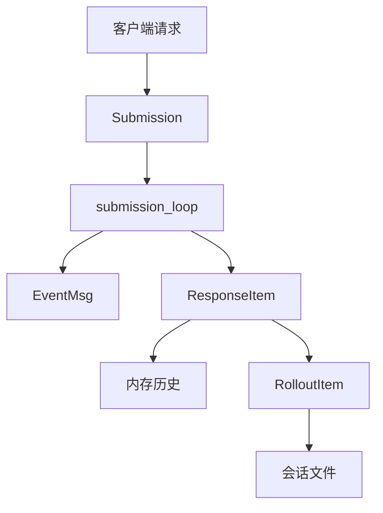
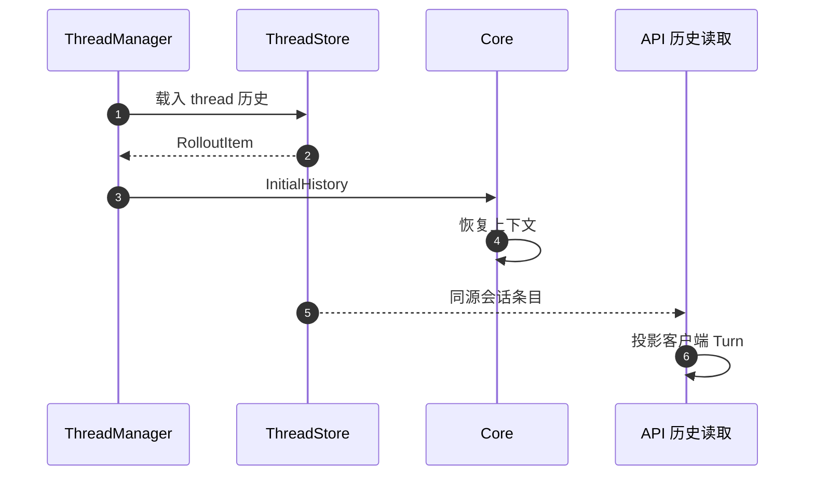
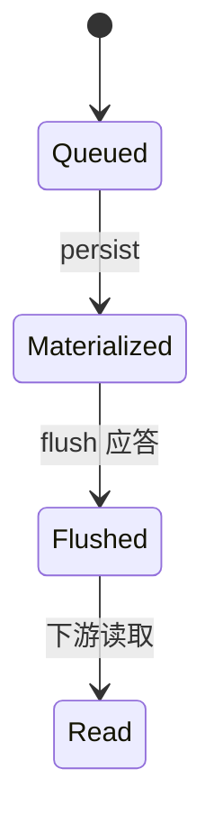

# Core 操作、事件与会话文件

Core 边界围绕 `Submission` 和 `Event`。客户端协议转换成 Core 操作后，操作循环分发工作。送出的事件与持久化条目可以重用同一些类型，分发、持久化和读回仍有各自入口。 [codex-rs/protocol/src/protocol.rs:121-155](https://github.com/GLBB/codex/blob/9f42c89c0112771dc29100a6f3fc904049b2655f/codex-rs/protocol/src/protocol.rs#L121-L155) [codex-rs/protocol/src/protocol.rs:1121-1186](https://github.com/GLBB/codex/blob/9f42c89c0112771dc29100a6f3fc904049b2655f/codex-rs/protocol/src/protocol.rs#L1121-L1186) [codex-rs/core/src/session/handlers.rs:708-766](https://github.com/GLBB/codex/blob/9f42c89c0112771dc29100a6f3fc904049b2655f/codex-rs/core/src/session/handlers.rs#L708-L766) [codex-rs/core/src/session/mod.rs:2527-2547](https://github.com/GLBB/codex/blob/9f42c89c0112771dc29100a6f3fc904049b2655f/codex-rs/core/src/session/mod.rs#L2527-L2547) [codex-rs/rollout/src/recorder.rs:755-811](https://github.com/GLBB/codex/blob/9f42c89c0112771dc29100a6f3fc904049b2655f/codex-rs/rollout/src/recorder.rs#L755-L811)

| 合约 | 生产与消费 | 带来的约束 |
| --- | --- | --- |
| `Submission { id, op, trace }` | app-server 建 `Op::UserInput`，提交循环按枚举分发 | 请求 ID 到 turn 标识的转换在 server 层。trace context 可随操作传递。 [codex-rs/protocol/src/protocol.rs:121-155](https://github.com/GLBB/codex/blob/9f42c89c0112771dc29100a6f3fc904049b2655f/codex-rs/protocol/src/protocol.rs#L121-L155) [codex-rs/app-server/src/request_processors/turn_processor.rs:355-433](https://github.com/GLBB/codex/blob/9f42c89c0112771dc29100a6f3fc904049b2655f/codex-rs/app-server/src/request_processors/turn_processor.rs#L355-L433) [codex-rs/app-server/src/request_processors/turn_processor.rs:317-339](https://github.com/GLBB/codex/blob/9f42c89c0112771dc29100a6f3fc904049b2655f/codex-rs/app-server/src/request_processors/turn_processor.rs#L317-L339) [codex-rs/core/src/session/handlers.rs:708-766](https://github.com/GLBB/codex/blob/9f42c89c0112771dc29100a6f3fc904049b2655f/codex-rs/core/src/session/handlers.rs#L708-L766) |
| `Event { id, msg }` | Core 发 `EventMsg`，adapter 选择如何映射通知 | 业务状态由具体变体表达。调用侧结合所属 thread/turn 消费。 [codex-rs/protocol/src/protocol.rs:1121-1186](https://github.com/GLBB/codex/blob/9f42c89c0112771dc29100a6f3fc904049b2655f/codex-rs/protocol/src/protocol.rs#L1121-L1186) [codex-rs/app-server/README.md:1211-1247](https://github.com/GLBB/codex/blob/9f42c89c0112771dc29100a6f3fc904049b2655f/codex-rs/app-server/README.md#L1211-L1247) |
| `ResponseItem` | 模型输出、工具结果、用户上下文进入内存历史 | 发送之前按输入模态与配对规则处理。 [codex-rs/protocol/src/models.rs:752-847](https://github.com/GLBB/codex/blob/9f42c89c0112771dc29100a6f3fc904049b2655f/codex-rs/protocol/src/models.rs#L752-L847) [codex-rs/core/src/session/mod.rs:2527-2547](https://github.com/GLBB/codex/blob/9f42c89c0112771dc29100a6f3fc904049b2655f/codex-rs/core/src/session/mod.rs#L2527-L2547) [codex-rs/core/src/context_manager/history.rs:362-390](https://github.com/GLBB/codex/blob/9f42c89c0112771dc29100a6f3fc904049b2655f/codex-rs/core/src/context_manager/history.rs#L362-L390) |
| `RolloutItem` | 会话元数据、事件、上下文和响应项交给 recorder | 入队与完成写入相隔一个 writer 层。 [codex-rs/protocol/src/protocol.rs:2698-2728](https://github.com/GLBB/codex/blob/9f42c89c0112771dc29100a6f3fc904049b2655f/codex-rs/protocol/src/protocol.rs#L2698-L2728) [codex-rs/rollout/src/recorder.rs:755-811](https://github.com/GLBB/codex/blob/9f42c89c0112771dc29100a6f3fc904049b2655f/codex-rs/rollout/src/recorder.rs#L755-L811) |
| `ThreadStore` | 读取线程、归档与 history | 持久化入口和 Core 复原规则可独立追踪。 [codex-rs/thread-store/src/store.rs:28-114](https://github.com/GLBB/codex/blob/9f42c89c0112771dc29100a6f3fc904049b2655f/codex-rs/thread-store/src/store.rs#L28-L114) [codex-rs/thread-store/src/local/read_thread.rs:28-97](https://github.com/GLBB/codex/blob/9f42c89c0112771dc29100a6f3fc904049b2655f/codex-rs/thread-store/src/local/read_thread.rs#L28-L97) [codex-rs/core/src/session/rollout_reconstruction.rs:87-176](https://github.com/GLBB/codex/blob/9f42c89c0112771dc29100a6f3fc904049b2655f/codex-rs/core/src/session/rollout_reconstruction.rs#L87-L176) |

<!-- Sources: codex-rs/app-server/src/request_processors/turn_processor.rs:355, codex-rs/protocol/src/protocol.rs:121, codex-rs/core/src/session/handlers.rs:708, codex-rs/protocol/src/protocol.rs:1121, codex-rs/core/src/session/mod.rs:2527, codex-rs/rollout/src/recorder.rs:755 -->

### 恢复与历史显示是两个消费者

从存储恢复时，`ThreadManager` 读出历史，Core 处理 `InitialHistory` 与 rollout 条目，重建上下文引用和压缩/回滚语义。客户端读历史时，app-server 使用 `build_turns_from_rollout_items` 构造 UI 所需的 turn 列表。模型所见历史还会经过 `for_prompt` 规范化。以同一个 JSONL 文件为源时，这两个读者的输出并不要求一致。 [codex-rs/core/src/thread_manager.rs:640-685](https://github.com/GLBB/codex/blob/9f42c89c0112771dc29100a6f3fc904049b2655f/codex-rs/core/src/thread_manager.rs#L640-L685) [codex-rs/core/src/session/rollout_reconstruction.rs:87-176](https://github.com/GLBB/codex/blob/9f42c89c0112771dc29100a6f3fc904049b2655f/codex-rs/core/src/session/rollout_reconstruction.rs#L87-L176) [codex-rs/app-server-protocol/src/protocol/thread_history.rs:74-104](https://github.com/GLBB/codex/blob/9f42c89c0112771dc29100a6f3fc904049b2655f/codex-rs/app-server-protocol/src/protocol/thread_history.rs#L74-L104) [codex-rs/core/src/context_manager/history.rs:98-125](https://github.com/GLBB/codex/blob/9f42c89c0112771dc29100a6f3fc904049b2655f/codex-rs/core/src/context_manager/history.rs#L98-L125) [codex-rs/core/src/context_manager/history.rs:362-390](https://github.com/GLBB/codex/blob/9f42c89c0112771dc29100a6f3fc904049b2655f/codex-rs/core/src/context_manager/history.rs#L362-L390)

<!-- Sources: codex-rs/core/src/thread_manager.rs:640, codex-rs/thread-store/src/store.rs:28, codex-rs/core/src/session/rollout_reconstruction.rs:87, codex-rs/app-server-protocol/src/protocol/thread_history.rs:74 -->

### 状态交接的检查方法

看历史何时可读时，区分 recorder 收到 `AddItems`、调用 `persist` 创建文件、`flush` 完成排队写入的三个状态。SQLite 可提供额外索引或摘要字段。对旧数据查本地实现的回退链与相应行为测试。 [codex-rs/rollout/src/recorder.rs:755-811](https://github.com/GLBB/codex/blob/9f42c89c0112771dc29100a6f3fc904049b2655f/codex-rs/rollout/src/recorder.rs#L755-L811) [codex-rs/thread-store/src/local/read_thread.rs:28-97](https://github.com/GLBB/codex/blob/9f42c89c0112771dc29100a6f3fc904049b2655f/codex-rs/thread-store/src/local/read_thread.rs#L28-L97) [codex-rs/state/src/lib.rs:70-90](https://github.com/GLBB/codex/blob/9f42c89c0112771dc29100a6f3fc904049b2655f/codex-rs/state/src/lib.rs#L70-L90)

<!-- Sources: codex-rs/rollout/src/recorder.rs:755, codex-rs/thread-store/src/local/read_thread.rs:28 -->

### 跨代理消息如何进入回合

跨代理递送可通过 `Op::InterAgentCommunication` 提交到目标线程。目标输入队列维护 mailbox，区分排队和唤醒条件。被取出的消息随后可能进入目标推理输入。发送方提交、目标线程接收项与最终模型可见输入须分别核对。[codex-rs/core/src/agent/control.rs:721-735](https://github.com/GLBB/codex/blob/9f42c89c0112771dc29100a6f3fc904049b2655f/codex-rs/core/src/agent/control.rs#L721-L735) [codex-rs/core/src/session/input_queue.rs:42-81](https://github.com/GLBB/codex/blob/9f42c89c0112771dc29100a6f3fc904049b2655f/codex-rs/core/src/session/input_queue.rs#L42-L81) [codex-rs/rollout-trace/src/reducer/tool/agents.rs:373-475](https://github.com/GLBB/codex/blob/9f42c89c0112771dc29100a6f3fc904049b2655f/codex-rs/rollout-trace/src/reducer/tool/agents.rs#L373-L475) [codex-rs/rollout-trace/src/reducer/conversation.rs:34-129](https://github.com/GLBB/codex/blob/9f42c89c0112771dc29100a6f3fc904049b2655f/codex-rs/rollout-trace/src/reducer/conversation.rs#L34-L129)

继续阅读 [协议总览](index.md)、[上下文与会话](../architecture/session-state.md) 和 [Trajectory](../deep-dive/trajectory.md)。
