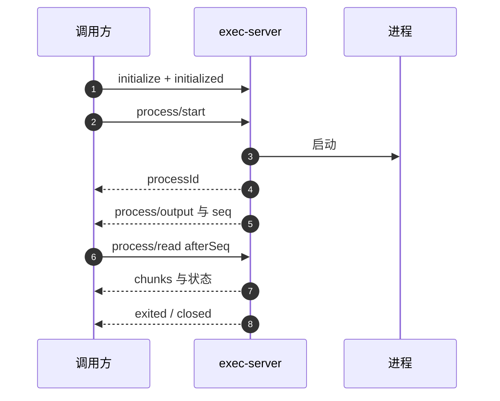
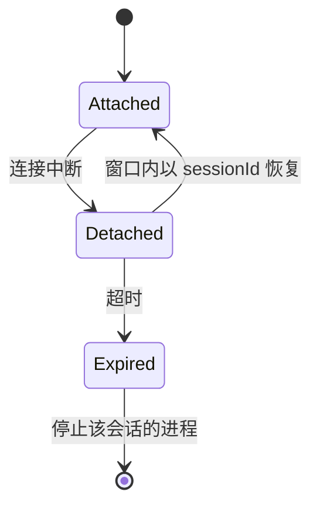

# 进程、文件系统与远端执行协议

exec-server 为操作系统进程与文件系统提供执行 RPC。它复用 app-server 的 JSON-RPC 信封，方法、连接状态和资源 ID 则属于 exec-server。客户端如需管理一个进程的输出与生命周期，要按这个接口的事件和游标读取。 [codex-rs/exec-server/README.md:17-95](https://github.com/GLBB/codex/blob/9f42c89c0112771dc29100a6f3fc904049b2655f/codex-rs/exec-server/README.md#L17-L95) [codex-rs/app-server-protocol/src/jsonrpc_lite.rs:17-84](https://github.com/GLBB/codex/blob/9f42c89c0112771dc29100a6f3fc904049b2655f/codex-rs/app-server-protocol/src/jsonrpc_lite.rs#L17-L84) [codex-rs/exec-server/src/protocol.rs:36-158](https://github.com/GLBB/codex/blob/9f42c89c0112771dc29100a6f3fc904049b2655f/codex-rs/exec-server/src/protocol.rs#L36-L158) [codex-rs/exec-server/README.md:186-250](https://github.com/GLBB/codex/blob/9f42c89c0112771dc29100a6f3fc904049b2655f/codex-rs/exec-server/README.md#L186-L250) [codex-rs/exec-server/README.md:278-346](https://github.com/GLBB/codex/blob/9f42c89c0112771dc29100a6f3fc904049b2655f/codex-rs/exec-server/README.md#L278-L346)

| 边界 | 请求与结果 | 操作含义 |
| --- | --- | --- |
| 握手 | `initialize` → `sessionId` → `initialized` | 首次创建或用 `resumeSessionId` 尝试重新附着。 [codex-rs/exec-server/src/server/handler.rs:80-156](https://github.com/GLBB/codex/blob/9f42c89c0112771dc29100a6f3fc904049b2655f/codex-rs/exec-server/src/server/handler.rs#L80-L156) [codex-rs/exec-server/src/server/session_registry.rs:58-137](https://github.com/GLBB/codex/blob/9f42c89c0112771dc29100a6f3fc904049b2655f/codex-rs/exec-server/src/server/session_registry.rs#L58-L137) |
| 启动 | `process/start` → `processId` | 进程归属 exec 会话。进程输出后续投送。 [codex-rs/exec-server/src/protocol.rs:36-158](https://github.com/GLBB/codex/blob/9f42c89c0112771dc29100a6f3fc904049b2655f/codex-rs/exec-server/src/protocol.rs#L36-L158) [codex-rs/exec-server/src/server/process_handler.rs:19-58](https://github.com/GLBB/codex/blob/9f42c89c0112771dc29100a6f3fc904049b2655f/codex-rs/exec-server/src/server/process_handler.rs#L19-L58) [codex-rs/exec-server/README.md:278-346](https://github.com/GLBB/codex/blob/9f42c89c0112771dc29100a6f3fc904049b2655f/codex-rs/exec-server/README.md#L278-L346) |
| 读取与写入 | `process/read` 可以带 `afterSeq`、字节上限与等待。`process/write` 使用 base64 字节 | 读取的是受边界约束的缓冲区。stdin 能否写由启动方式决定。 [codex-rs/exec-server/README.md:186-250](https://github.com/GLBB/codex/blob/9f42c89c0112771dc29100a6f3fc904049b2655f/codex-rs/exec-server/README.md#L186-L250) [codex-rs/exec-server/src/protocol.rs:36-158](https://github.com/GLBB/codex/blob/9f42c89c0112771dc29100a6f3fc904049b2655f/codex-rs/exec-server/src/protocol.rs#L36-L158) |
| 结束 | `process/exited` 带退出结果。`process/closed` 表示输出关闭且 handle 移除 | 退出不保证剩余输出已经读完。 [codex-rs/exec-server/README.md:278-346](https://github.com/GLBB/codex/blob/9f42c89c0112771dc29100a6f3fc904049b2655f/codex-rs/exec-server/README.md#L278-L346) |
| 文件系统 | `fs/*` 使用绝对路径，可带 sandbox 对象 | 路径处理与执行约束由服务器和辅助执行路径实现。 [codex-rs/exec-server/README.md:278-346](https://github.com/GLBB/codex/blob/9f42c89c0112771dc29100a6f3fc904049b2655f/codex-rs/exec-server/README.md#L278-L346) [codex-rs/exec-server/src/server/file_system_handler.rs:1-96](https://github.com/GLBB/codex/blob/9f42c89c0112771dc29100a6f3fc904049b2655f/codex-rs/exec-server/src/server/file_system_handler.rs#L1-L96) |

<!-- Sources: codex-rs/exec-server/src/server/handler.rs:80, codex-rs/exec-server/README.md:97, codex-rs/exec-server/README.md:186, codex-rs/exec-server/README.md:278 -->

### 断开、重新附着与关闭

README 给出进程关闭语义，代码里的实际连接处理还有一个已核对的 detach 窗口。生产常量为 10 秒，测试常量更短。`ConnectionHandler::initialize` 可传已有会话 ID，registry 在会话符合条件时重新附着。窗口超时且仍脱离才清理该会话的进程。集成依赖重连时以版本匹配的实现和测试为准。 [codex-rs/exec-server/src/server/handler.rs:80-156](https://github.com/GLBB/codex/blob/9f42c89c0112771dc29100a6f3fc904049b2655f/codex-rs/exec-server/src/server/handler.rs#L80-L156) [codex-rs/exec-server/src/server/session_registry.rs:12-18](https://github.com/GLBB/codex/blob/9f42c89c0112771dc29100a6f3fc904049b2655f/codex-rs/exec-server/src/server/session_registry.rs#L12-L18) [codex-rs/exec-server/src/server/session_registry.rs:58-137](https://github.com/GLBB/codex/blob/9f42c89c0112771dc29100a6f3fc904049b2655f/codex-rs/exec-server/src/server/session_registry.rs#L58-L137) [codex-rs/exec-server/src/server/session_registry.rs:239-257](https://github.com/GLBB/codex/blob/9f42c89c0112771dc29100a6f3fc904049b2655f/codex-rs/exec-server/src/server/session_registry.rs#L239-L257)

<!-- Sources: codex-rs/exec-server/src/server/session_registry.rs:58, codex-rs/exec-server/src/server/session_registry.rs:239, codex-rs/exec-server/src/server/session_registry.rs:12 -->

### HTTP 执行扩展

同一运行时还有 `http/request`。选择流式响应时，调用者提供专用 request ID。处理器先发 RPC response，随后按专用 ID 发 `http/request/bodyDelta`。这套 ID 用于 HTTP body 流，与进程输出游标分别管理。 [codex-rs/exec-server/src/protocol.rs:278-340](https://github.com/GLBB/codex/blob/9f42c89c0112771dc29100a6f3fc904049b2655f/codex-rs/exec-server/src/protocol.rs#L278-L340) [codex-rs/exec-server/src/server/handler.rs:170-211](https://github.com/GLBB/codex/blob/9f42c89c0112771dc29100a6f3fc904049b2655f/codex-rs/exec-server/src/server/handler.rs#L170-L211)

### 两种传输与两种序号

| 传输层 | 帧 | 序号管理 |
| --- | --- | --- |
| 本地 WebSocket | 每帧一个 JSON-RPC 消息 | 进程输出有每进程 `seq`。 [codex-rs/exec-server/README.md:17-95](https://github.com/GLBB/codex/blob/9f42c89c0112771dc29100a6f3fc904049b2655f/codex-rs/exec-server/README.md#L17-L95) [codex-rs/exec-server/README.md:278-346](https://github.com/GLBB/codex/blob/9f42c89c0112771dc29100a6f3fc904049b2655f/codex-rs/exec-server/README.md#L278-L346) |
| 远端 exec relay | 二进制 `RelayMessageFrame`，携带 JSON-RPC 分片 | `stream_id` 区分虚拟连接，ACK 和分片 `seq` 属于 relay。 [codex-rs/exec-server/README.md:17-95](https://github.com/GLBB/codex/blob/9f42c89c0112771dc29100a6f3fc904049b2655f/codex-rs/exec-server/README.md#L17-L95) [codex-rs/exec-server/src/proto/codex.exec_server.relay.v1.proto:1-37](https://github.com/GLBB/codex/blob/9f42c89c0112771dc29100a6f3fc904049b2655f/codex-rs/exec-server/src/proto/codex.exec_server.relay.v1.proto#L1-L37) |
| app-server remote control | 另外定义 `ServerEnvelope` 与客户端会话字段 | 它有自己的 `client_id`、`stream_id` 和 `seq_id` 定义。 [codex-rs/app-server-transport/src/transport/remote_control/protocol.rs:50-132](https://github.com/GLBB/codex/blob/9f42c89c0112771dc29100a6f3fc904049b2655f/codex-rs/app-server-transport/src/transport/remote_control/protocol.rs#L50-L132) |

exec relay 的 ACK 表达分片到达情况。仓库文档把重传、去重与重组归给通信端点。它不能充当 `process/exited` 或 RPC result 的完成证据。 [codex-rs/exec-server/README.md:17-95](https://github.com/GLBB/codex/blob/9f42c89c0112771dc29100a6f3fc904049b2655f/codex-rs/exec-server/README.md#L17-L95) [codex-rs/exec-server/src/proto/codex.exec_server.relay.v1.proto:1-37](https://github.com/GLBB/codex/blob/9f42c89c0112771dc29100a6f3fc904049b2655f/codex-rs/exec-server/src/proto/codex.exec_server.relay.v1.proto#L1-L37) [codex-rs/exec-server/README.md:278-346](https://github.com/GLBB/codex/blob/9f42c89c0112771dc29100a6f3fc904049b2655f/codex-rs/exec-server/README.md#L278-L346)

<!-- Sources: codex-rs/exec-server/README.md:17, codex-rs/exec-server/src/proto/codex.exec_server.relay.v1.proto:1, codex-rs/exec-server/src/server/process_handler.rs:19, codex-rs/exec-server/src/server/file_system_handler.rs:1 -->

继续阅读 [协议总览](index.md)、[app-server、CLI 与 SDK](app-server-wire.md) 和 [工具调用、审批与动态工具](tools-approval.md)。
