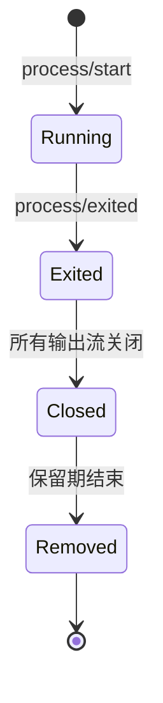

# exec-server 进程、文件与远端传输

exec-server 复用 app-server 的 JSON-RPC 外壳，用自己的方法管理进程、远端文件和执行端 HTTP 请求。本地 WebSocket 每帧承载一个 JSON-RPC 消息。远端 rendezvous 使用二进制 protobuf 帧承载 RPC。 [README.md:17-44](https://github.com/GLBB/codex/blob/9f42c89c0112771dc29100a6f3fc904049b2655f/codex-rs/exec-server/README.md#L17-L44) [protocol.rs:13-36](https://github.com/GLBB/codex/blob/9f42c89c0112771dc29100a6f3fc904049b2655f/codex-rs/exec-server/src/protocol.rs#L13-L36)

## 握手与会话

发 `initialize`，读到 `result.sessionId`，再发 `initialized`。进程归属于 exec 会话。断线后服务器会暂存会话，正常构建的暂存窗口为 10 秒，窗口内可通过新连接重新附着。 [handler.rs:81-151](https://github.com/GLBB/codex/blob/9f42c89c0112771dc29100a6f3fc904049b2655f/codex-rs/exec-server/src/server/handler.rs#L81-L151) [session_registry.rs:14-32](https://github.com/GLBB/codex/blob/9f42c89c0112771dc29100a6f3fc904049b2655f/codex-rs/exec-server/src/server/session_registry.rs#L14-L32) [session_registry.rs:58-137](https://github.com/GLBB/codex/blob/9f42c89c0112771dc29100a6f3fc904049b2655f/codex-rs/exec-server/src/server/session_registry.rs#L58-L137) [session_registry.rs:170-182](https://github.com/GLBB/codex/blob/9f42c89c0112771dc29100a6f3fc904049b2655f/codex-rs/exec-server/src/server/session_registry.rs#L170-L182)

| 位置 | 字段 | 含义 |
| --- | --- | --- |
| `initialize.params` | `clientName: string` | 调用方报告的名称。 |
| `initialize.params` | `resumeSessionId: string`，可省略 | 重新附着目标。已被附着或已过期的会话会收到 RPC 错误。 |
| `initialize.result` | `sessionId: string` | 当前 exec 会话的标识。 |
| `initialized` | 通知 | 完成客户端就绪握手。 |

## 进程方法

`processId` 是调用者选择的逻辑句柄，作用域为 exec 会话。进程方法共用此键。结果、通知和模型的展示项各有自己的关联字段。 [protocol.rs:50-158](https://github.com/GLBB/codex/blob/9f42c89c0112771dc29100a6f3fc904049b2655f/codex-rs/exec-server/src/protocol.rs#L50-L158) [local_process.rs:145-183](https://github.com/GLBB/codex/blob/9f42c89c0112771dc29100a6f3fc904049b2655f/codex-rs/exec-server/src/local_process.rs#L145-L183)

| `process/start.params` 字段 | JSON 类型与出现条件 | 含义 |
| --- | --- | --- |
| `processId` | string；必填 | 创建的进程句柄，响应原样返回。 |
| `argv` | string[]；非空 | 可执行程序和参数。 |
| `cwd` | string | 子进程工作目录。 |
| `envPolicy` | object 或 null，可省略 | 环境变量派生策略。 `inherit` 选继承模式，`ignoreDefaultExcludes` 控制默认排除，`exclude`、`includeOnly` 和 `set` 指定排除、保留和覆盖内容。 |
| `env` | string → string 映射 | 传给子进程的环境变量。 |
| `tty` | boolean | 启用 PTY。 |
| `pipeStdin` | boolean，默认 false | 让非 PTY 进程可通过 `process/write` 写入 stdin。 |
| `arg0` | string 或 null，可省略 | 覆盖子进程 argv[0]。 |

| 位置 | 字段 | 含义 |
| --- | --- | --- |
| `process/read.params` | `processId: string` | 目标句柄。 |
| `process/read.params` | `afterSeq: integer`，默认 0 | 只读序号大于此值的保留输出。 |
| `process/read.params` | `maxBytes: integer`，可省略 | 响应字节预算。首个可用块可超过预算。 |
| `process/read.params` | `waitMs: integer`，默认 0 | 等待输出或状态变化的毫秒数。 |
| `process/read.result` | `chunks: object[]` | 批量输出，每块含 `seq`、`stream`、base64 字符串 `chunk`。 |
| `process/read.result` | `nextSeq: integer` | 有输出时为最后返回的块序号加一，否则是进程的下一个事件序号。 |
| `process/read.result` | `exited: boolean`、`exitCode: integer 或 null`、`closed: boolean`、`failure: string 或 null` | 退出、退出码、输出关闭和失败信息。 |
| `process/write.params` | `processId: string`、`chunk: string` | 目标句柄及要写入的 base64 字节。 |
| `process/write.result` | `status: enum` | `accepted`、`unknownProcess`、`stdinClosed` 或 `starting`。 |
| `process/terminate` | 入参 `processId: string`，结果 `running: boolean` | 请求终止，返回是否有可终止的运行进程。 |

[protocol.rs:98-158](https://github.com/GLBB/codex/blob/9f42c89c0112771dc29100a6f3fc904049b2655f/codex-rs/exec-server/src/protocol.rs#L98-L158) [local_process.rs:271-339](https://github.com/GLBB/codex/blob/9f42c89c0112771dc29100a6f3fc904049b2655f/codex-rs/exec-server/src/local_process.rs#L271-L339) [README.md:222-274](https://github.com/GLBB/codex/blob/9f42c89c0112771dc29100a6f3fc904049b2655f/codex-rs/exec-server/README.md#L222-L274)

## 输出、退出、关闭

| 通知 | `params` 字段 | 含义 |
| --- | --- | --- |
| `process/output` | `processId`、`seq: integer`、`stream: "stdout" / "stderr" / "pty"`、`chunk: base64 string` | 输出的一块字节。 |
| `process/exited` | `processId`、`seq: integer`、`exitCode: integer` | 进程已退出，仍可能有待排空的输出。 |
| `process/closed` | `processId`、`seq: integer` | 输出关闭且退出状态已知。句柄还可在保留期内读取，之后清理。 |

`seq` 在进程内部递增。按当前结构，`process/closed` 也带 `seq`。 [protocol.rs:342-372](https://github.com/GLBB/codex/blob/9f42c89c0112771dc29100a6f3fc904049b2655f/codex-rs/exec-server/src/protocol.rs#L342-L372) [local_process.rs:550-632](https://github.com/GLBB/codex/blob/9f42c89c0112771dc29100a6f3fc904049b2655f/codex-rs/exec-server/src/local_process.rs#L550-L632) [local_process.rs:650-688](https://github.com/GLBB/codex/blob/9f42c89c0112771dc29100a6f3fc904049b2655f/codex-rs/exec-server/src/local_process.rs#L650-L688)

<!-- Sources: codex-rs/exec-server/src/local_process.rs:145-184, codex-rs/exec-server/src/local_process.rs:550-632, codex-rs/exec-server/src/local_process.rs:650-688 -->

## 文件系统与 HTTP

所有文件系统路径字段均为绝对路径。可选的 `sandbox` 对象携带 `permissions`、可选 `cwd`、`windowsSandboxLevel`，以及默认 false 的 `windowsSandboxPrivateDesktop` 和 `useLegacyLandlock`。 [protocol.rs:160-259](https://github.com/GLBB/codex/blob/9f42c89c0112771dc29100a6f3fc904049b2655f/codex-rs/exec-server/src/protocol.rs#L160-L259) [lib.rs:47-58](https://github.com/GLBB/codex/blob/9f42c89c0112771dc29100a6f3fc904049b2655f/codex-rs/file-system/src/lib.rs#L47-L58)

| 方法 | 请求字段 | 响应字段与含义 |
| --- | --- | --- |
| `fs/readFile` | `path` | `dataBase64: string`，文件字节。 |
| `fs/writeFile` | `path`、`dataBase64: string` | 空对象，写入指定字节成功。 |
| `fs/createDirectory` | `path`、可选 `recursive: boolean` | 空对象，目录创建成功。 |
| `fs/getMetadata` | `path` | `isDirectory`、`isFile`、`isSymlink` 是布尔值。 `createdAtMs`、`modifiedAtMs` 是毫秒时间戳。 |
| `fs/readDirectory` | `path` | `entries` 含 `fileName`、`isDirectory`、`isFile`。 |
| `fs/remove` | `path`、可选 `recursive: boolean`、可选 `force: boolean` | 空对象，按选项删除。 |
| `fs/copy` | `sourcePath`、`destinationPath`、`recursive: boolean` | 空对象，复制路径成功。 |

| HTTP 消息 | 字段 | 含义 |
| --- | --- | --- |
| `http/request.params` | `method: string`、`url: string`、`headers: {name,value}[]` | HTTP 方法、绝对 URL 和保序请求头。 |
| `http/request.params` | 可选 `bodyBase64: string`、`timeoutMs: integer` | 请求体字节与超时毫秒。 |
| `http/request.params` | `requestId: string`、`streamResponse: boolean`（默认 false） | HTTP body 流键与是否流式返回。 |
| `http/request.result` | `status: integer`、`headers: {name,value}[]`、`bodyBase64: string` | 状态码、响应头和响应体。流式时响应体字段为空字节串。 |
| `http/request/bodyDelta.params` | `requestId: string`、`seq: integer`、`deltaBase64: string`、`done: boolean`、可选 `error: string` | 从 1 开始递增的响应体帧，`done` 表示结束，终态帧可带错误。 |

[protocol.rs:261-340](https://github.com/GLBB/codex/blob/9f42c89c0112771dc29100a6f3fc904049b2655f/codex-rs/exec-server/src/protocol.rs#L261-L340) [handler.rs:170-211](https://github.com/GLBB/codex/blob/9f42c89c0112771dc29100a6f3fc904049b2655f/codex-rs/exec-server/src/server/handler.rs#L170-L211)

## 远端 relay 帧

| protobuf 字段 | 类型 | 含义 |
| --- | --- | --- |
| `version`、`stream_id` | uint32 / string | 帧版本与 rendezvous 用于分流的虚拟连接 ID。 |
| `ack`、`ack_bits` | uint32 | 设计定义的连续确认序号和后续位图。 |
| `body` | oneof | `data`、`ack_frame`、`resume`、`reset` 或 `heartbeat`。 |
| `data.seq` | uint32 | relay 数据序号，作用域为虚拟连接的发送方向。 |
| `data.segment_index`、`data.segment_count` | uint32 | 单条消息中的分片位置与分片总数。 |
| `data.payload` | bytes | JSON-RPC 消息字节或 schema 可描述的分片字节。 |
| `resume.next_seq` | uint32 | resume 的发送序号字段。 |
| `reset.reason` | string | 重置原因。 |

当前 `relay.rs` 只构造并接受单段 data 帧，接收端要求 `segment_index = 0`、`segment_count = 1`，发送侧在构造的 data 和 resume 帧里把 ACK 字段设为 0。读到 `seq` 时先确认来自 relay 帧、进程通知还是 HTTP body 帧，再使用对应游标。 [codex.exec_server.relay.v1.proto:1-37](https://github.com/GLBB/codex/blob/9f42c89c0112771dc29100a6f3fc904049b2655f/codex-rs/exec-server/src/proto/codex.exec_server.relay.v1.proto#L1-L37) [relay.rs:41-103](https://github.com/GLBB/codex/blob/9f42c89c0112771dc29100a6f3fc904049b2655f/codex-rs/exec-server/src/relay.rs#L41-L103) [README.md:45-95](https://github.com/GLBB/codex/blob/9f42c89c0112771dc29100a6f3fc904049b2655f/codex-rs/exec-server/README.md#L45-L95)

app-server 的远程控制另有 JSON 外壳。排查跨进程流量时可从以下字段识别它。 [protocol.rs:45-132](https://github.com/GLBB/codex/blob/9f42c89c0112771dc29100a6f3fc904049b2655f/codex-rs/app-server-transport/src/transport/remote_control/protocol.rs#L45-L132)

| 远程控制字段 | 类型 | 含义 |
| --- | --- | --- |
| `client_id`、`stream_id` | string | 客户端标识与该客户端的逻辑流。客户端外壳可省略 `stream_id`。 |
| `seq_id` | 整数 | 服务端流内序号，在客户端 ACK 中用作确认游标。 |
| `type` | string | 分发事件，如 `client_message`、`server_message`、分片或 ACK。 |
| `message` | object | 直接承载 JSON-RPC 消息时的内层对象。 |
| `segment_id`、`segment_count`、`message_size_bytes`、`message_chunk_base64` | 整数 / base64 string | 分片编号、总数、原消息字节数与本段字节。分片 ACK 可附 `segment_id`。 |
