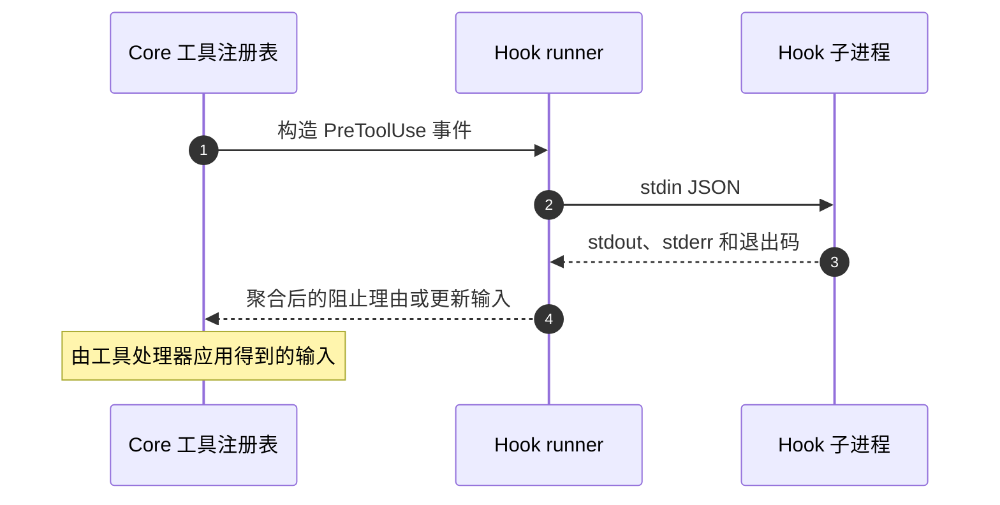

# Hook 命令协议

Core 构造事件数据，Hook runner 把它作为 JSON 送入子进程 stdin，然后收集 stdout、stderr 和退出状态。每种事件由自己的解析器解释结果。 [hook_runtime.rs:160-220](https://github.com/GLBB/codex/blob/9f42c89c0112771dc29100a6f3fc904049b2655f/codex-rs/core/src/hook_runtime.rs#L160-L220) [dispatcher.rs:89-116](https://github.com/GLBB/codex/blob/9f42c89c0112771dc29100a6f3fc904049b2655f/codex-rs/hooks/src/engine/dispatcher.rs#L89-L116) [command_runner.rs:24-101](https://github.com/GLBB/codex/blob/9f42c89c0112771dc29100a6f3fc904049b2655f/codex-rs/hooks/src/engine/command_runner.rs#L24-L101)

## stdin 字段

输入字段用 snake_case。下表覆盖各事件共有字段与主要差异。 [schema.rs:267-374](https://github.com/GLBB/codex/blob/9f42c89c0112771dc29100a6f3fc904049b2655f/codex-rs/hooks/src/schema.rs#L267-L374) [schema.rs:468-580](https://github.com/GLBB/codex/blob/9f42c89c0112771dc29100a6f3fc904049b2655f/codex-rs/hooks/src/schema.rs#L468-L580)

| 字段 | JSON 类型与出现条件 | 含义 |
| --- | --- | --- |
| `hook_event_name` | string | 事件名称，例如 `PreToolUse`。 |
| `session_id` | string | Hook 所关联的会话标识，子代理事件应结合 `agent_id` 使用。 |
| `turn_id` | string，回合内事件 | 当前回合标识。SessionStart 的输入只有 `session_id`。 |
| `transcript_path` | string 或 null | 对应会话 transcript 路径。 |
| `cwd`、`model` | string | 工作目录与当前模型。 |
| `permission_mode` | string，带权限上下文的事件 | Hook 可见的权限模式，压缩事件使用另一组字段。 |
| `agent_id`、`agent_type` | string，子代理事件必有，其他事件依 schema | 子代理标识和类型。 |

| 事件 | 独有或特定字段 | 含义 |
| --- | --- | --- |
| `SessionStart` | `source: string` | 会话启动来源。 |
| `SubagentStart` | `agent_id`、`agent_type` | 启动的子代理。 |
| `UserPromptSubmit` | `prompt: string` | 用户提交的文字。 |
| `PreToolUse` | `tool_name: string`、`tool_input: JSON`、`tool_use_id: string` | 工具名、执行前输入、该 Hook 契约提供的工具关联键。 |
| `PermissionRequest` | `tool_name: string`、`tool_input: JSON` | 触发权限请求的工具与输入。 |
| `PostToolUse` | `tool_name`、`tool_input`、`tool_use_id`、`tool_response: JSON` | 调用信息和工具返回内容。 |
| `PreCompact`、`PostCompact` | `trigger: string` | 发生压缩的触发类型。 |
| `Stop`、`SubagentStop` | `stop_hook_active: boolean`、`last_assistant_message: string 或 null` | 停止 Hook 是否已处于继续运行的流程，以及最近助手文本。子代理停止还带 `agent_transcript_path: string 或 null`。 |

工具处理器可以决定其 Hook 输入、输出和关联键的具体投影。 [registry.rs:67-130](https://github.com/GLBB/codex/blob/9f42c89c0112771dc29100a6f3fc904049b2655f/codex-rs/core/src/tools/registry.rs#L67-L130) [registry.rs:487-531](https://github.com/GLBB/codex/blob/9f42c89c0112771dc29100a6f3fc904049b2655f/codex-rs/core/src/tools/registry.rs#L487-L531) [registry.rs:567-605](https://github.com/GLBB/codex/blob/9f42c89c0112771dc29100a6f3fc904049b2655f/codex-rs/core/src/tools/registry.rs#L567-L605)

## stdout JSON 字段

stdout JSON 采用 camelCase。通用结构提供以下字段，事件解析器决定支持哪些组合。 [schema.rs:80-149](https://github.com/GLBB/codex/blob/9f42c89c0112771dc29100a6f3fc904049b2655f/codex-rs/hooks/src/schema.rs#L80-L149) [output_parser.rs:120-230](https://github.com/GLBB/codex/blob/9f42c89c0112771dc29100a6f3fc904049b2655f/codex-rs/hooks/src/engine/output_parser.rs#L120-L230)

| 字段 | JSON 类型与出现条件 | 含义 |
| --- | --- | --- |
| `continue` | boolean，可省略 | 请求是否继续处理。各事件对 false 的支持由解析器确定。 |
| `stopReason` | string，可省略 | 与停止处理一起提供的理由。 |
| `suppressOutput` | boolean，可省略 | 控制支持该选项的事件的输出展示。 |
| `systemMessage` | string，可省略 | 可显示的系统提示。 |
| `hookSpecificOutput` | object，可省略 | 事件特定输出，其中 `hookEventName` 为事件名。 |
| `decision`、`reason` | string，可省略，由事件定义 | 例如 Stop 用 `decision: "block"` 和非空理由阻止当次停止。 |

| 事件 | `hookSpecificOutput` 字段 | 运行语义 |
| --- | --- | --- |
| `SessionStart`、`SubagentStart`、`UserPromptSubmit` | `additionalContext: string` | 追加到模型上下文。 |
| `PreToolUse` | `permissionDecision: string`、`permissionDecisionReason: string`、`updatedInput: JSON`、`additionalContext: string` | `deny` 配非空理由可阻止。当前 `allow` 用于携带 `updatedInput`，能否应用由工具处理器决定。 |
| `PermissionRequest` | `decision.behavior: "allow" 或 "deny"`、可选 `decision.message: string` | 审批裁决与拒绝消息。多个 Hook 的结果遇拒绝优先。 |
| `PostToolUse` | `additionalContext: string` | 注入工具执行后的补充上下文。 |

`PreToolUse` 的 `ask` 在当前解析器中是无效输出。 `PermissionRequest` 的 `updatedInput`、`updatedPermissions` 与 `interrupt: true` 是保留能力，会被当前解析器拒绝。 `PostToolUse` 的 `updatedMCPToolOutput` 也会被标为不支持。 [schema.rs:181-257](https://github.com/GLBB/codex/blob/9f42c89c0112771dc29100a6f3fc904049b2655f/codex-rs/hooks/src/schema.rs#L181-L257) [schema.rs:376-444](https://github.com/GLBB/codex/blob/9f42c89c0112771dc29100a6f3fc904049b2655f/codex-rs/hooks/src/schema.rs#L376-L444) [output_parser.rs:120-230](https://github.com/GLBB/codex/blob/9f42c89c0112771dc29100a6f3fc904049b2655f/codex-rs/hooks/src/engine/output_parser.rs#L120-L230) [output_parser.rs:400-571](https://github.com/GLBB/codex/blob/9f42c89c0112771dc29100a6f3fc904049b2655f/codex-rs/hooks/src/engine/output_parser.rs#L400-L571) [permission_request.rs:154-171](https://github.com/GLBB/codex/blob/9f42c89c0112771dc29100a6f3fc904049b2655f/codex-rs/hooks/src/events/permission_request.rs#L154-L171)

## 退出码与执行路径

| 进程结果 | 读取位置 | 示例 |
| --- | --- | --- |
| 退出 0 | stdout | `PreToolUse` 可返回空输出或 JSON 决策。SessionStart 可将普通文本输出作为额外上下文。 |
| 退出 2 | 各事件的 stderr 分支 | `PreToolUse` 使用非空 stderr 作为阻止理由，缺少理由时记录 Hook 失败。 |
| 其他退出码、启动失败或超时 | runner 结果与事件失败分支 | 调度器记录失败，是否阻断由事件逻辑决定。 |

[pre_tool_use.rs:192-277](https://github.com/GLBB/codex/blob/9f42c89c0112771dc29100a6f3fc904049b2655f/codex-rs/hooks/src/events/pre_tool_use.rs#L192-L277) [session_start.rs:226-315](https://github.com/GLBB/codex/blob/9f42c89c0112771dc29100a6f3fc904049b2655f/codex-rs/hooks/src/events/session_start.rs#L226-L315) [command_runner.rs:24-101](https://github.com/GLBB/codex/blob/9f42c89c0112771dc29100a6f3fc904049b2655f/codex-rs/hooks/src/engine/command_runner.rs#L24-L101)

<!-- Sources: codex-rs/core/src/tools/registry.rs:487-531, codex-rs/hooks/src/engine/command_runner.rs:24-101, codex-rs/hooks/src/events/pre_tool_use.rs:192-277 -->
