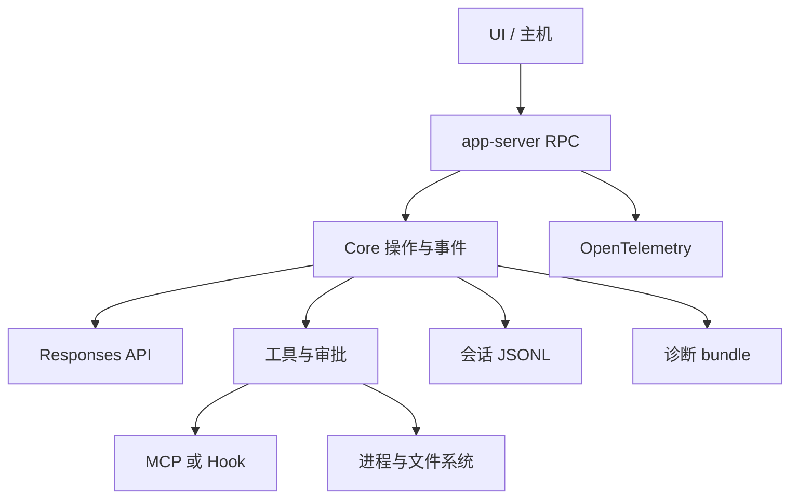
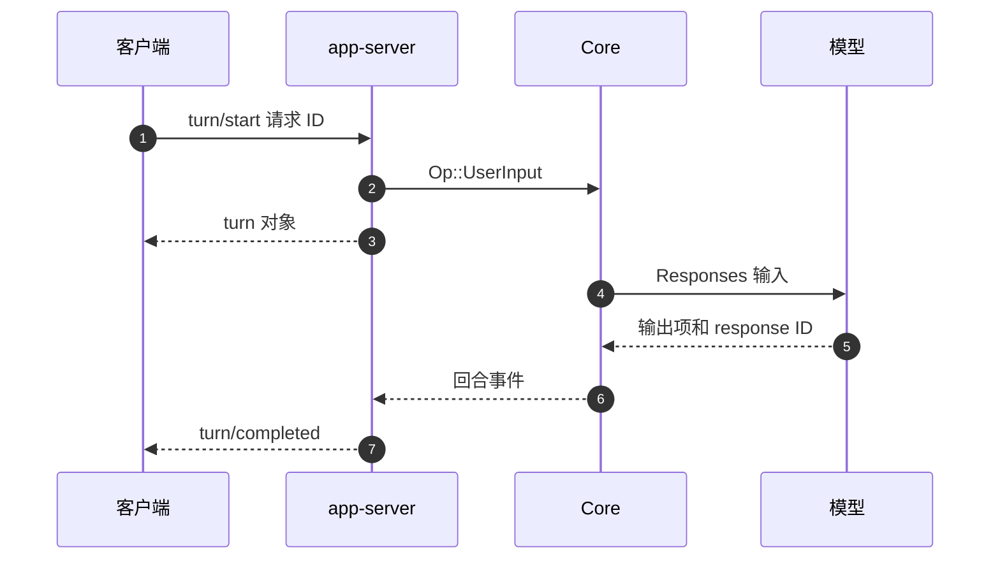
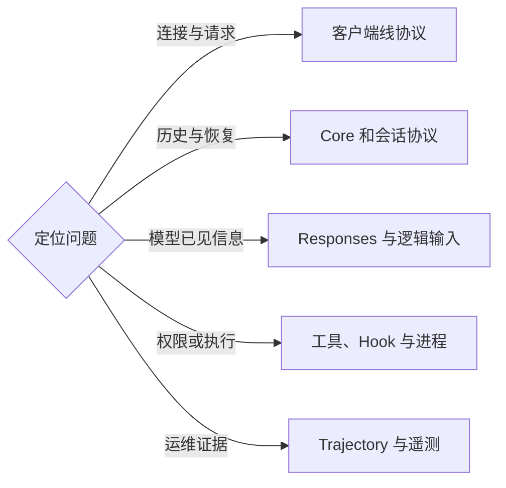

# 协议设计总览

Codex 的「协议」覆盖运行时进程间通信、模型流、外部扩展与可恢复记录。这里按发送方和接收方划分边界。一次正常 turn 会跨越多个协议，但每一层的完成条件和 ID 作用域都由该层代码决定。 [codex-rs/app-server-protocol/src/jsonrpc_lite.rs:17-84](https://github.com/GLBB/codex/blob/9f42c89c0112771dc29100a6f3fc904049b2655f/codex-rs/app-server-protocol/src/jsonrpc_lite.rs#L17-L84) [codex-rs/protocol/src/protocol.rs:121-155](https://github.com/GLBB/codex/blob/9f42c89c0112771dc29100a6f3fc904049b2655f/codex-rs/protocol/src/protocol.rs#L121-L155) [codex-rs/codex-api/src/common.rs:72-150](https://github.com/GLBB/codex/blob/9f42c89c0112771dc29100a6f3fc904049b2655f/codex-rs/codex-api/src/common.rs#L72-L150) [codex-rs/exec-server/src/protocol.rs:36-158](https://github.com/GLBB/codex/blob/9f42c89c0112771dc29100a6f3fc904049b2655f/codex-rs/exec-server/src/protocol.rs#L36-L158) [codex-rs/protocol/src/protocol.rs:2698-2728](https://github.com/GLBB/codex/blob/9f42c89c0112771dc29100a6f3fc904049b2655f/codex-rs/protocol/src/protocol.rs#L2698-L2728) [codex-rs/rollout-trace/src/raw_event.rs:29-162](https://github.com/GLBB/codex/blob/9f42c89c0112771dc29100a6f3fc904049b2655f/codex-rs/rollout-trace/src/raw_event.rs#L29-L162)

| 专题 | 边界 | 权威定义或实现 |
| --- | --- | --- |
| [app-server、TUI 与 SDK](app-server-wire.md) | UI 或主机进程 ↔ app-server。包括 JSON-RPC、事件和 exec JSONL 的客户端表面 | [codex-rs/app-server-protocol/src/jsonrpc_lite.rs:17-84](https://github.com/GLBB/codex/blob/9f42c89c0112771dc29100a6f3fc904049b2655f/codex-rs/app-server-protocol/src/jsonrpc_lite.rs#L17-L84) [codex-rs/app-server-protocol/src/protocol/common.rs:157-215](https://github.com/GLBB/codex/blob/9f42c89c0112771dc29100a6f3fc904049b2655f/codex-rs/app-server-protocol/src/protocol/common.rs#L157-L215) [codex-rs/exec/src/event_processor_with_jsonl_output.rs:590-625](https://github.com/GLBB/codex/blob/9f42c89c0112771dc29100a6f3fc904049b2655f/codex-rs/exec/src/event_processor_with_jsonl_output.rs#L590-L625) [sdk/python/src/openai_codex/client.py:186-296](https://github.com/GLBB/codex/blob/9f42c89c0112771dc29100a6f3fc904049b2655f/sdk/python/src/openai_codex/client.py#L186-L296) |
| [Core 操作、事件与会话文件](core-history.md) | Core 与宿主、内存历史与长期存储 | [codex-rs/protocol/src/protocol.rs:121-155](https://github.com/GLBB/codex/blob/9f42c89c0112771dc29100a6f3fc904049b2655f/codex-rs/protocol/src/protocol.rs#L121-L155) [codex-rs/protocol/src/protocol.rs:1121-1186](https://github.com/GLBB/codex/blob/9f42c89c0112771dc29100a6f3fc904049b2655f/codex-rs/protocol/src/protocol.rs#L1121-L1186) [codex-rs/protocol/src/protocol.rs:2698-2728](https://github.com/GLBB/codex/blob/9f42c89c0112771dc29100a6f3fc904049b2655f/codex-rs/protocol/src/protocol.rs#L2698-L2728) [codex-rs/rollout/src/recorder.rs:755-811](https://github.com/GLBB/codex/blob/9f42c89c0112771dc29100a6f3fc904049b2655f/codex-rs/rollout/src/recorder.rs#L755-L811) |
| [模型请求与响应协议](model-wire.md) | Core ↔ 模型供应商。Responses、SSE 与 WebSocket | [codex-rs/core/src/client.rs:717-805](https://github.com/GLBB/codex/blob/9f42c89c0112771dc29100a6f3fc904049b2655f/codex-rs/core/src/client.rs#L717-L805) [codex-rs/core/src/client.rs:1570-1642](https://github.com/GLBB/codex/blob/9f42c89c0112771dc29100a6f3fc904049b2655f/codex-rs/core/src/client.rs#L1570-L1642) [codex-rs/codex-api/src/sse/responses.rs:263-321](https://github.com/GLBB/codex/blob/9f42c89c0112771dc29100a6f3fc904049b2655f/codex-rs/codex-api/src/sse/responses.rs#L263-L321) |
| [工具与审批协议](tools-approval.md) | 模型工具调用、运行时 dispatch 与 app-server 反向请求 | [codex-rs/core/src/tools/router.rs:89-137](https://github.com/GLBB/codex/blob/9f42c89c0112771dc29100a6f3fc904049b2655f/codex-rs/core/src/tools/router.rs#L89-L137) [codex-rs/core/src/tools/registry.rs:397-475](https://github.com/GLBB/codex/blob/9f42c89c0112771dc29100a6f3fc904049b2655f/codex-rs/core/src/tools/registry.rs#L397-L475) [codex-rs/app-server/README.md:1300-1327](https://github.com/GLBB/codex/blob/9f42c89c0112771dc29100a6f3fc904049b2655f/codex-rs/app-server/README.md#L1300-L1327) [codex-rs/app-server/README.md:1400-1442](https://github.com/GLBB/codex/blob/9f42c89c0112771dc29100a6f3fc904049b2655f/codex-rs/app-server/README.md#L1400-L1442) |
| [MCP 与 Hook](mcp-hooks.md) | Codex ↔ MCP 服务，Codex 工具服务 ↔ MCP 宿主，Core ↔ 本地 Hook 进程 | [codex-rs/codex-mcp/src/connection_manager.rs:590-641](https://github.com/GLBB/codex/blob/9f42c89c0112771dc29100a6f3fc904049b2655f/codex-rs/codex-mcp/src/connection_manager.rs#L590-L641) [codex-rs/mcp-server/src/message_processor.rs:317-386](https://github.com/GLBB/codex/blob/9f42c89c0112771dc29100a6f3fc904049b2655f/codex-rs/mcp-server/src/message_processor.rs#L317-L386) [codex-rs/hooks/src/engine/command_runner.rs:24-101](https://github.com/GLBB/codex/blob/9f42c89c0112771dc29100a6f3fc904049b2655f/codex-rs/hooks/src/engine/command_runner.rs#L24-L101) |
| [执行与文件系统 RPC](execution.md) | 调用方 ↔ exec-server，含本地连接及远端 relay framing | [codex-rs/exec-server/README.md:17-95](https://github.com/GLBB/codex/blob/9f42c89c0112771dc29100a6f3fc904049b2655f/codex-rs/exec-server/README.md#L17-L95) [codex-rs/exec-server/src/protocol.rs:36-158](https://github.com/GLBB/codex/blob/9f42c89c0112771dc29100a6f3fc904049b2655f/codex-rs/exec-server/src/protocol.rs#L36-L158) [codex-rs/exec-server/README.md:278-346](https://github.com/GLBB/codex/blob/9f42c89c0112771dc29100a6f3fc904049b2655f/codex-rs/exec-server/README.md#L278-L346) [codex-rs/exec-server/src/proto/codex.exec_server.relay.v1.proto:1-37](https://github.com/GLBB/codex/blob/9f42c89c0112771dc29100a6f3fc904049b2655f/codex-rs/exec-server/src/proto/codex.exec_server.relay.v1.proto#L1-L37) |
| [配置、能力与 schema 演进](config-schema.md) | 配置来源 → 有效配置，Rust 类型 → TS/JSON Schema 与客户端协商 | [codex-rs/config/src/loader/mod.rs:111-245](https://github.com/GLBB/codex/blob/9f42c89c0112771dc29100a6f3fc904049b2655f/codex-rs/config/src/loader/mod.rs#L111-L245) [codex-rs/config/src/state.rs:449-475](https://github.com/GLBB/codex/blob/9f42c89c0112771dc29100a6f3fc904049b2655f/codex-rs/config/src/state.rs#L449-L475) [codex-rs/app-server-protocol/src/export.rs:76-121](https://github.com/GLBB/codex/blob/9f42c89c0112771dc29100a6f3fc904049b2655f/codex-rs/app-server-protocol/src/export.rs#L76-L121) [codex-rs/app-server-protocol/src/export.rs:182-243](https://github.com/GLBB/codex/blob/9f42c89c0112771dc29100a6f3fc904049b2655f/codex-rs/app-server-protocol/src/export.rs#L182-L243) [codex-rs/app-server/src/message_processor.rs:789-849](https://github.com/GLBB/codex/blob/9f42c89c0112771dc29100a6f3fc904049b2655f/codex-rs/app-server/src/message_processor.rs#L789-L849) |
| [诊断轨迹](../deep-dive/trajectory.md) 和 [遥测](../deep-dive/observability.md) | 运行对象 → bundle/reducer 与进程 → OTLP 接收端 | [codex-rs/rollout-trace/src/raw_event.rs:29-162](https://github.com/GLBB/codex/blob/9f42c89c0112771dc29100a6f3fc904049b2655f/codex-rs/rollout-trace/src/raw_event.rs#L29-L162) [codex-rs/rollout-trace/src/reducer/mod.rs:44-82](https://github.com/GLBB/codex/blob/9f42c89c0112771dc29100a6f3fc904049b2655f/codex-rs/rollout-trace/src/reducer/mod.rs#L44-L82) [codex-rs/otel/src/trace_context.rs:29-129](https://github.com/GLBB/codex/blob/9f42c89c0112771dc29100a6f3fc904049b2655f/codex-rs/otel/src/trace_context.rs#L29-L129) [codex-rs/otel/src/provider.rs:77-153](https://github.com/GLBB/codex/blob/9f42c89c0112771dc29100a6f3fc904049b2655f/codex-rs/otel/src/provider.rs#L77-L153) |

<!-- Sources: codex-rs/app-server-protocol/src/jsonrpc_lite.rs:17, codex-rs/app-server/src/request_processors/turn_processor.rs:355, codex-rs/protocol/src/protocol.rs:121, codex-rs/core/src/client.rs:1570, codex-rs/core/src/tools/orchestrator.rs:128, codex-rs/codex-mcp/src/connection_manager.rs:590, codex-rs/hooks/src/engine/command_runner.rs:24, codex-rs/exec-server/README.md:17, codex-rs/protocol/src/protocol.rs:2698, codex-rs/rollout-trace/src/raw_event.rs:29, codex-rs/app-server/src/app_server_tracing.rs:24 -->

## 同一条命令中的标识与终态

| 对象 | ID 从哪里来 | 何时算完成 |
| --- | --- | --- |
| App-server RPC | 客户端 request ID 加服务器 connection ID | 返回同 ID 的 result 或 error。 [codex-rs/app-server-protocol/src/jsonrpc_lite.rs:17-84](https://github.com/GLBB/codex/blob/9f42c89c0112771dc29100a6f3fc904049b2655f/codex-rs/app-server-protocol/src/jsonrpc_lite.rs#L17-L84) [codex-rs/app-server/src/message_processor.rs:516-629](https://github.com/GLBB/codex/blob/9f42c89c0112771dc29100a6f3fc904049b2655f/codex-rs/app-server/src/message_processor.rs#L516-L629) |
| Turn | `turn_start_inner` 提交 `Op::UserInput` 后使用提交 ID | 通知 `turn/completed`。 [codex-rs/app-server/src/request_processors/turn_processor.rs:355-433](https://github.com/GLBB/codex/blob/9f42c89c0112771dc29100a6f3fc904049b2655f/codex-rs/app-server/src/request_processors/turn_processor.rs#L355-L433) [codex-rs/app-server/README.md:1211-1247](https://github.com/GLBB/codex/blob/9f42c89c0112771dc29100a6f3fc904049b2655f/codex-rs/app-server/README.md#L1211-L1247) |
| 模型 attempt | trace 分配 `inference_call_id`，供应商另外有 response ID 和可选 request ID | 完成、错误或停止消费由产出和 trace 记录的分支表达。 [codex-rs/rollout-trace/src/inference.rs:121-196](https://github.com/GLBB/codex/blob/9f42c89c0112771dc29100a6f3fc904049b2655f/codex-rs/rollout-trace/src/inference.rs#L121-L196) [codex-rs/rollout-trace/src/raw_event.rs:29-162](https://github.com/GLBB/codex/blob/9f42c89c0112771dc29100a6f3fc904049b2655f/codex-rs/rollout-trace/src/raw_event.rs#L29-L162) [codex-rs/core/src/client.rs:1777-1899](https://github.com/GLBB/codex/blob/9f42c89c0112771dc29100a6f3fc904049b2655f/codex-rs/core/src/client.rs#L1777-L1899) |
| Tool | 模型 `call_id` 与运行时 `tool_call_id` 通过 reducer 关联 | 调用、结果、模型回看都有证据落点。 [codex-rs/core/src/tools/router.rs:89-137](https://github.com/GLBB/codex/blob/9f42c89c0112771dc29100a6f3fc904049b2655f/codex-rs/core/src/tools/router.rs#L89-L137) [codex-rs/rollout-trace/src/reducer/tool.rs:411-510](https://github.com/GLBB/codex/blob/9f42c89c0112771dc29100a6f3fc904049b2655f/codex-rs/rollout-trace/src/reducer/tool.rs#L411-L510) |
| Exec 进程 | `processId` 与每进程 `seq` | `exited` 表示退出，`closed` 表示输出关闭并移除 handle。 [codex-rs/exec-server/README.md:186-250](https://github.com/GLBB/codex/blob/9f42c89c0112771dc29100a6f3fc904049b2655f/codex-rs/exec-server/README.md#L186-L250) [codex-rs/exec-server/README.md:278-346](https://github.com/GLBB/codex/blob/9f42c89c0112771dc29100a6f3fc904049b2655f/codex-rs/exec-server/README.md#L278-L346) |

<!-- Sources: codex-rs/app-server/src/request_processors/turn_processor.rs:355, codex-rs/core/src/client.rs:1777, codex-rs/app-server/README.md:1211, codex-rs/protocol/src/protocol.rs:1121 -->

## 怎么使用这张图

把问题先归到拥有该数据的边界。界面显示旧 turn 时，从历史投影和实时通知重叠点找原因。工具输出有了但模型没用时，从模型可见的下一次输入验证。可部署或跨版本接入时，优先验证稳定 schema 与实验能力开关。这个分类按本提交中已追踪的公共或持久化边界组织，托管服务端内部处理与完整 RPC 方法字典由实际服务和生成 schema 提供。 [codex-rs/app-server-protocol/src/protocol/thread_history.rs:74-104](https://github.com/GLBB/codex/blob/9f42c89c0112771dc29100a6f3fc904049b2655f/codex-rs/app-server-protocol/src/protocol/thread_history.rs#L74-L104) [codex-rs/app-server/README.md:1211-1247](https://github.com/GLBB/codex/blob/9f42c89c0112771dc29100a6f3fc904049b2655f/codex-rs/app-server/README.md#L1211-L1247) [codex-rs/rollout-trace/src/reducer/conversation.rs:34-129](https://github.com/GLBB/codex/blob/9f42c89c0112771dc29100a6f3fc904049b2655f/codex-rs/rollout-trace/src/reducer/conversation.rs#L34-L129) [codex-rs/app-server-protocol/src/export.rs:182-243](https://github.com/GLBB/codex/blob/9f42c89c0112771dc29100a6f3fc904049b2655f/codex-rs/app-server-protocol/src/export.rs#L182-L243) [codex-rs/app-server/src/message_processor.rs:789-849](https://github.com/GLBB/codex/blob/9f42c89c0112771dc29100a6f3fc904049b2655f/codex-rs/app-server/src/message_processor.rs#L789-L849)

<!-- Sources: codex-rs/app-server-protocol/src/jsonrpc_lite.rs:17, codex-rs/core/src/session/rollout_reconstruction.rs:87, codex-rs/rollout-trace/src/reducer/conversation.rs:34, codex-rs/core/src/tools/orchestrator.rs:128, codex-rs/exec-server/README.md:186, codex-rs/rollout-trace/src/reducer/mod.rs:44, codex-rs/otel/src/provider.rs:77 -->
