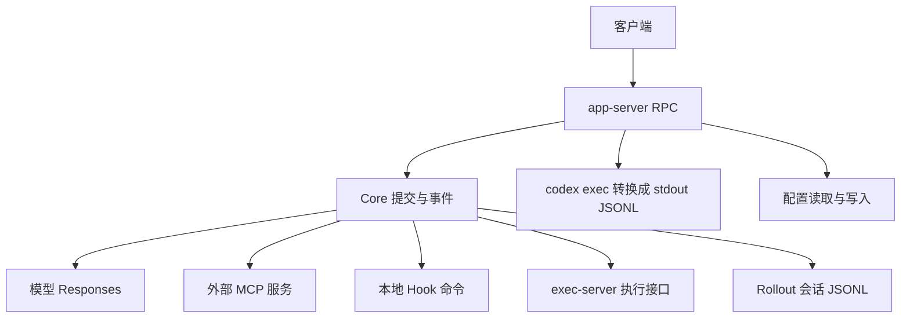

# 协议设计总览

从手头的数据选专题。客户端 RPC 看 `method`，CLI 和会话 JSONL 看各自记录的 `type`，模型流看 `response.*`，远端执行帧看 `stream_id`。同一回合会经过多个边界，每个边界都定义自己的载荷和完成条件。 [jsonrpc_lite.rs:41-85](https://github.com/GLBB/codex/blob/9f42c89c0112771dc29100a6f3fc904049b2655f/codex-rs/app-server-protocol/src/jsonrpc_lite.rs#L41-L85) [exec_events.rs:8-43](https://github.com/GLBB/codex/blob/9f42c89c0112771dc29100a6f3fc904049b2655f/codex-rs/exec/src/exec_events.rs#L8-L43) [protocol.rs:2697-2713](https://github.com/GLBB/codex/blob/9f42c89c0112771dc29100a6f3fc904049b2655f/codex-rs/protocol/src/protocol.rs#L2697-L2713) [responses.rs:263-396](https://github.com/GLBB/codex/blob/9f42c89c0112771dc29100a6f3fc904049b2655f/codex-rs/codex-api/src/sse/responses.rs#L263-L396) [codex.exec_server.relay.v1.proto:1-37](https://github.com/GLBB/codex/blob/9f42c89c0112771dc29100a6f3fc904049b2655f/codex-rs/exec-server/src/proto/codex.exec_server.relay.v1.proto#L1-L37)

## 主题与查阅顺序

| 专题 | 发送方 → 接收方 | 从哪些字段开始 |
| --- | --- | --- |
| [app-server JSON-RPC](app-server-wire.md) | UI 或 SDK ↔ app-server | `id`、`method`、`threadId`、`turnId`、`itemId` |
| [CLI JSONL 与 SDK](cli-jsonl.md) | `codex exec --json` → 脚本或 TypeScript SDK | `type`、`thread_id`、`item.id`、`usage` |
| [Core 操作、事件与内存历史](core-history.md) | 宿主 ↔ Core | `Submission.id`、`op.type`、`msg.type`、`sub_id` |
| [模型请求与响应协议](model-wire.md) | Core ↔ 模型供应商 | `input`、`tools`、`response.id`、`previous_response_id` |
| [工具调用、审批与动态工具](tools-approval.md) | 模型 ↔ Core，app-server ↔ 客户端 | `call_id`、`approvalId`、`decision`、`contentItems` |
| [MCP 工具协议](mcp-hooks.md) | Codex ↔ 外部 MCP 服务或宿主 | `arguments`、`_meta`、`structuredContent` |
| [Hook 命令协议](hook-wire.md) | Core ↔ 本地 Hook 进程 | `hook_event_name`、`tool_use_id`、`hookSpecificOutput` |
| [exec-server 进程、文件与远端传输](execution.md) | 执行调用方 ↔ exec-server | `processId`、`afterSeq`、`requestId`、`stream_id` |
| [Rollout 会话 JSONL](rollout-wire.md) | Core → 会话文件 → 恢复器或历史构建器 | `type`、`payload`、`metadata`、`token_usage_record`、`world_state` |
| [配置 RPC 与 schema 兼容](config-schema.md) | 配置加载器和 app-server ↔ 客户端 | `origins`、`expectedVersion`、`experimentalApi` |

字段表使用当前源码中的序列化名称。“可省略”表示允许缺键，“可为 null”表示支持 JSON null。表格覆盖常用消息和容易混淆的字段。全量 v2 方法和嵌套类型可从 [app-server 注册表](https://github.com/GLBB/codex/blob/9f42c89c0112771dc29100a6f3fc904049b2655f/codex-rs/app-server-protocol/src/protocol/common.rs#L430-L800) 及 [同版本类型导出](https://github.com/GLBB/codex/blob/9f42c89c0112771dc29100a6f3fc904049b2655f/codex-rs/app-server/README.md#L1848-L1863) 查阅。模型协议覆盖 Codex 本地构造和解析的字段，服务端内部行为超出这一章的源码取证范围。

<!-- Sources: codex-rs/app-server/src/request_processors/turn_processor.rs:355-456, codex-rs/core/src/session/mod.rs:1758-1775, codex-rs/exec/src/event_processor_with_jsonl_output.rs:591-607, codex-rs/core/src/client.rs:1570-1642, codex-rs/core/src/mcp_tool_call.rs:547-591, codex-rs/core/src/tools/registry.rs:487-531, codex-rs/exec-server/README.md:17-44, codex-rs/core/src/session/mod.rs:2527-2547, codex-rs/app-server/src/config_manager_service.rs:109-150 -->

## 同一回合里怎么对 ID

| 要关联的对象 | 字段及作用域 | 查找完成或生效的位置 |
| --- | --- | --- |
| 一次客户端 RPC | 外层 `id`，服务端结合连接 ID 路由 | 同 ID 的 `result` 或 `error`。 [jsonrpc_lite.rs:41-85](https://github.com/GLBB/codex/blob/9f42c89c0112771dc29100a6f3fc904049b2655f/codex-rs/app-server-protocol/src/jsonrpc_lite.rs#L41-L85) [message_processor.rs:516-629](https://github.com/GLBB/codex/blob/9f42c89c0112771dc29100a6f3fc904049b2655f/codex-rs/app-server/src/message_processor.rs#L516-L629) |
| 一次客户端回合 | `threadId`、`turn.id` 或 `turnId` | `turn/completed.params.turn.status`。 [turn_processor.rs:416-456](https://github.com/GLBB/codex/blob/9f42c89c0112771dc29100a6f3fc904049b2655f/codex-rs/app-server/src/request_processors/turn_processor.rs#L416-L456) [README.md:1211-1247](https://github.com/GLBB/codex/blob/9f42c89c0112771dc29100a6f3fc904049b2655f/codex-rs/app-server/README.md#L1211-L1247) |
| 一次模型响应 | `response.id` 由供应商返回，WS 可用 `previous_response_id` 引用 | `response.completed` 或模型流错误。 [responses.rs:312-373](https://github.com/GLBB/codex/blob/9f42c89c0112771dc29100a6f3fc904049b2655f/codex-rs/codex-api/src/sse/responses.rs#L312-L373) [client.rs:1045-1075](https://github.com/GLBB/codex/blob/9f42c89c0112771dc29100a6f3fc904049b2655f/codex-rs/core/src/client.rs#L1045-L1075) |
| 一次模型工具调用 | 模型的 `call_id`，映射到动态工具反向请求的 `params.callId` | 下一次模型输入中的输出项带原 `call_id`。 [models.rs:787-847](https://github.com/GLBB/codex/blob/9f42c89c0112771dc29100a6f3fc904049b2655f/codex-rs/protocol/src/models.rs#L787-L847) [dynamic_tools.rs:14-49](https://github.com/GLBB/codex/blob/9f42c89c0112771dc29100a6f3fc904049b2655f/codex-rs/app-server/src/dynamic_tools.rs#L14-L49) |
| 一次审批交互 | 反向 RPC `id`、展示项 `itemId`，可选单次回调 `approvalId` | 客户端回包及服务器 `serverRequest/resolved` 通知。 [item.rs:1255-1329](https://github.com/GLBB/codex/blob/9f42c89c0112771dc29100a6f3fc904049b2655f/codex-rs/app-server-protocol/src/protocol/v2/item.rs#L1255-L1329) [notification.rs:49-56](https://github.com/GLBB/codex/blob/9f42c89c0112771dc29100a6f3fc904049b2655f/codex-rs/app-server-protocol/src/protocol/v2/notification.rs#L49-L56) |
| 一次执行及其输出 | exec `sessionId`、`processId` 及每进程 `seq` | `process/exited` 发退出码，`process/closed` 发输出关闭。 [protocol.rs:50-80](https://github.com/GLBB/codex/blob/9f42c89c0112771dc29100a6f3fc904049b2655f/codex-rs/exec-server/src/protocol.rs#L50-L80) [protocol.rs:342-372](https://github.com/GLBB/codex/blob/9f42c89c0112771dc29100a6f3fc904049b2655f/codex-rs/exec-server/src/protocol.rs#L342-L372) |
| 一条会话记录 | 外层 `type` 和内层字段，例如 `payload.turn_id` | 取决于恢复器或客户端历史投影读到的记录组合。 [protocol.rs:2697-2713](https://github.com/GLBB/codex/blob/9f42c89c0112771dc29100a6f3fc904049b2655f/codex-rs/protocol/src/protocol.rs#L2697-L2713) [rollout_reconstruction.rs:112-210](https://github.com/GLBB/codex/blob/9f42c89c0112771dc29100a6f3fc904049b2655f/codex-rs/core/src/session/rollout_reconstruction.rs#L112-L210) |

## 按问题定位

| 现象 | 先核对什么 | 相关页面 |
| --- | --- | --- |
| 已收到 `turn/start` 成功回包，但界面还在运行 | 用回包的 `turn.id` 查对应完成通知，从 `turn.status` 看终态。 | [app-server JSON-RPC](app-server-wire.md) |
| 客户端展示了工具结果，要确认模型是否读到 | 查下一次模型输入中该 `call_id` 的输出项。WS 有引用时，连同前次响应还原输入。 | [模型请求与响应协议](model-wire.md) |
| 进程已退出，仍需要收集输出 | 按 `processId` 和 `seq` 读取保留数据，并观察 `process/closed`。 | [exec-server](execution.md) |
| 重启后回合或历史内容不同 | 用 `turn_id` 定位落盘记录，检查压缩基线及读取方使用的投影。 | [Rollout 会话 JSONL](rollout-wire.md) |
| 写入配置成功，但读到的有效值不同 | 查写入的 `status`、`overriddenMetadata` 和读取的 `origins`。 | [配置 RPC](config-schema.md) |

[Rollout Trace](../deep-dive/trajectory.md) 记录推理、工具与跨线程运行事实。[可观测性](../deep-dive/observability.md) 解释用于跨进程定位的日志、跨度和指标。
