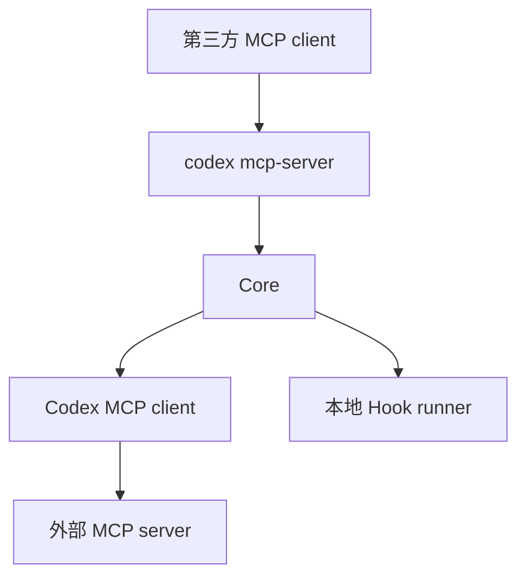
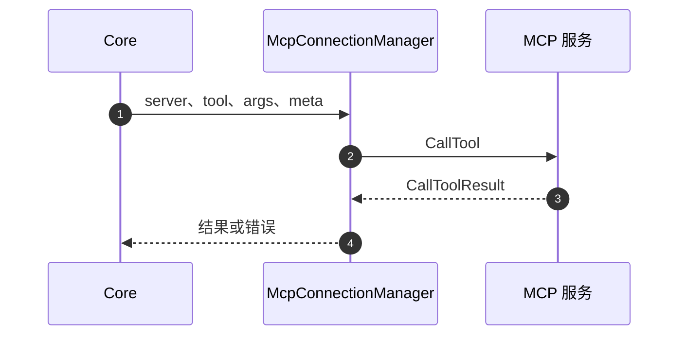
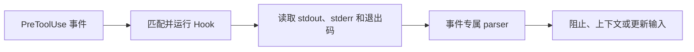

# MCP 与 Hook 扩展协议

外部能力进入 Codex 的路径至少有三种。Codex 作为 MCP client 调用外部工具，也能用独立子命令把 Codex 自身提供为 MCP 工具。本地 Hook 则通过命令子进程参与 Core 生命周期。连接角色、输入形状和错误处理分别有定义。 [codex-rs/codex-mcp/src/connection_manager.rs:171-248](https://github.com/GLBB/codex/blob/9f42c89c0112771dc29100a6f3fc904049b2655f/codex-rs/codex-mcp/src/connection_manager.rs#L171-L248) [codex-rs/codex-mcp/src/connection_manager.rs:590-641](https://github.com/GLBB/codex/blob/9f42c89c0112771dc29100a6f3fc904049b2655f/codex-rs/codex-mcp/src/connection_manager.rs#L590-L641) [codex-rs/mcp-server/src/message_processor.rs:317-386](https://github.com/GLBB/codex/blob/9f42c89c0112771dc29100a6f3fc904049b2655f/codex-rs/mcp-server/src/message_processor.rs#L317-L386) [codex-rs/mcp-server/src/codex_tool_runner.rs:32-67](https://github.com/GLBB/codex/blob/9f42c89c0112771dc29100a6f3fc904049b2655f/codex-rs/mcp-server/src/codex_tool_runner.rs#L32-L67) [codex-rs/core/src/hook_runtime.rs:160-220](https://github.com/GLBB/codex/blob/9f42c89c0112771dc29100a6f3fc904049b2655f/codex-rs/core/src/hook_runtime.rs#L160-L220) [codex-rs/hooks/src/engine/command_runner.rs:24-101](https://github.com/GLBB/codex/blob/9f42c89c0112771dc29100a6f3fc904049b2655f/codex-rs/hooks/src/engine/command_runner.rs#L24-L101)

| 接口 | 入口与返回 | 关联键 |
| --- | --- | --- |
| Codex 调外部 MCP | 连接管理器发现工具，将已批准请求发给实际 backend | server/tool 名，调用时可携带独立 `mcp_call_id`。 [codex-rs/codex-mcp/src/connection_manager.rs:171-248](https://github.com/GLBB/codex/blob/9f42c89c0112771dc29100a6f3fc904049b2655f/codex-rs/codex-mcp/src/connection_manager.rs#L171-L248) [codex-rs/codex-mcp/src/connection_manager.rs:368-403](https://github.com/GLBB/codex/blob/9f42c89c0112771dc29100a6f3fc904049b2655f/codex-rs/codex-mcp/src/connection_manager.rs#L368-L403) [codex-rs/codex-mcp/src/connection_manager.rs:590-641](https://github.com/GLBB/codex/blob/9f42c89c0112771dc29100a6f3fc904049b2655f/codex-rs/codex-mcp/src/connection_manager.rs#L590-L641) [codex-rs/core/src/mcp_tool_call.rs:547-591](https://github.com/GLBB/codex/blob/9f42c89c0112771dc29100a6f3fc904049b2655f/codex-rs/core/src/mcp_tool_call.rs#L547-L591) [codex-rs/rollout-trace/src/thread.rs:401-417](https://github.com/GLBB/codex/blob/9f42c89c0112771dc29100a6f3fc904049b2655f/codex-rs/rollout-trace/src/thread.rs#L401-L417) |
| 外部宿主调 Codex | `tools/list` 给出 Codex 工具，`tools/call` 运行或续接会话 | MCP request ID 与结果中的线程标识各有用途。 [codex-rs/mcp-server/src/message_processor.rs:317-386](https://github.com/GLBB/codex/blob/9f42c89c0112771dc29100a6f3fc904049b2655f/codex-rs/mcp-server/src/message_processor.rs#L317-L386) [codex-rs/mcp-server/src/codex_tool_runner.rs:32-67](https://github.com/GLBB/codex/blob/9f42c89c0112771dc29100a6f3fc904049b2655f/codex-rs/mcp-server/src/codex_tool_runner.rs#L32-L67) |
| Hook | Core 建事件数据，runner 写 JSON 到 stdin，收 stdout/stderr 与退出码 | 事件类型、工具调用 ID 和 Hook 运行记录。 [codex-rs/core/src/hook_runtime.rs:160-220](https://github.com/GLBB/codex/blob/9f42c89c0112771dc29100a6f3fc904049b2655f/codex-rs/core/src/hook_runtime.rs#L160-L220) [codex-rs/hooks/src/engine/dispatcher.rs:89-116](https://github.com/GLBB/codex/blob/9f42c89c0112771dc29100a6f3fc904049b2655f/codex-rs/hooks/src/engine/dispatcher.rs#L89-L116) [codex-rs/hooks/src/engine/command_runner.rs:24-101](https://github.com/GLBB/codex/blob/9f42c89c0112771dc29100a6f3fc904049b2655f/codex-rs/hooks/src/engine/command_runner.rs#L24-L101) [codex-rs/hooks/src/events/pre_tool_use.rs:148-249](https://github.com/GLBB/codex/blob/9f42c89c0112771dc29100a6f3fc904049b2655f/codex-rs/hooks/src/events/pre_tool_use.rs#L148-L249) |

<!-- Sources: codex-rs/codex-mcp/src/connection_manager.rs:590, codex-rs/mcp-server/src/message_processor.rs:317, codex-rs/mcp-server/src/codex_tool_runner.rs:32, codex-rs/core/src/hook_runtime.rs:160, codex-rs/hooks/src/engine/command_runner.rs:24 -->

### MCP 变换和诊断位置

调用工具前后，Core 可记录进度，调用路径还可以将用于关联的 UUID 加到请求 metadata。读取完整执行结果时应查实际 backend 回包与模型可见转化，客户端 item 是单独投影。反向 MCP 服务把自己的 Core 线程结果包装成 MCP 格式，线程标识用于后续对话。 [codex-rs/core/src/mcp_tool_call.rs:547-591](https://github.com/GLBB/codex/blob/9f42c89c0112771dc29100a6f3fc904049b2655f/codex-rs/core/src/mcp_tool_call.rs#L547-L591) [codex-rs/rollout-trace/src/mcp.rs:1-67](https://github.com/GLBB/codex/blob/9f42c89c0112771dc29100a6f3fc904049b2655f/codex-rs/rollout-trace/src/mcp.rs#L1-L67) [codex-rs/codex-mcp/src/connection_manager.rs:590-641](https://github.com/GLBB/codex/blob/9f42c89c0112771dc29100a6f3fc904049b2655f/codex-rs/codex-mcp/src/connection_manager.rs#L590-L641) [codex-rs/mcp-server/src/codex_tool_runner.rs:32-67](https://github.com/GLBB/codex/blob/9f42c89c0112771dc29100a6f3fc904049b2655f/codex-rs/mcp-server/src/codex_tool_runner.rs#L32-L67) [codex-rs/app-server/src/bespoke_event_handling.rs:785-829](https://github.com/GLBB/codex/blob/9f42c89c0112771dc29100a6f3fc904049b2655f/codex-rs/app-server/src/bespoke_event_handling.rs#L785-L829)

<!-- Sources: codex-rs/core/src/mcp_tool_call.rs:547, codex-rs/codex-mcp/src/connection_manager.rs:590 -->

### Hook 以事件为单位解释输出

以 `PreToolUse` 为例，Core 组织事件后查匹配处理器，runner 负责进程、stdin 和超时，事件实现解释 stdout、stderr、JSON 和退出状态。退出码 0 可读取结构化更新，合法响应可以阻止执行或更新输入。退出码 2 有阻止语义。无效 JSON 会报告 Hook 失败。其它事件的输出契约应查各自实现。 [codex-rs/core/src/hook_runtime.rs:160-220](https://github.com/GLBB/codex/blob/9f42c89c0112771dc29100a6f3fc904049b2655f/codex-rs/core/src/hook_runtime.rs#L160-L220) [codex-rs/hooks/src/engine/dispatcher.rs:89-116](https://github.com/GLBB/codex/blob/9f42c89c0112771dc29100a6f3fc904049b2655f/codex-rs/hooks/src/engine/dispatcher.rs#L89-L116) [codex-rs/hooks/src/engine/command_runner.rs:24-101](https://github.com/GLBB/codex/blob/9f42c89c0112771dc29100a6f3fc904049b2655f/codex-rs/hooks/src/engine/command_runner.rs#L24-L101) [codex-rs/hooks/src/events/pre_tool_use.rs:148-249](https://github.com/GLBB/codex/blob/9f42c89c0112771dc29100a6f3fc904049b2655f/codex-rs/hooks/src/events/pre_tool_use.rs#L148-L249) [codex-rs/hooks/src/events/pre_tool_use.rs:254-304](https://github.com/GLBB/codex/blob/9f42c89c0112771dc29100a6f3fc904049b2655f/codex-rs/hooks/src/events/pre_tool_use.rs#L254-L304)

<!-- Sources: codex-rs/core/src/hook_runtime.rs:160, codex-rs/hooks/src/engine/dispatcher.rs:89, codex-rs/hooks/src/engine/command_runner.rs:24, codex-rs/hooks/src/events/pre_tool_use.rs:148, codex-rs/hooks/src/events/pre_tool_use.rs:254 -->

继续阅读 [协议总览](index.md)、[配置、技能与 MCP](../deep-dive/config-extensions.md) 和 [工具调用、审批与动态工具](tools-approval.md)。
