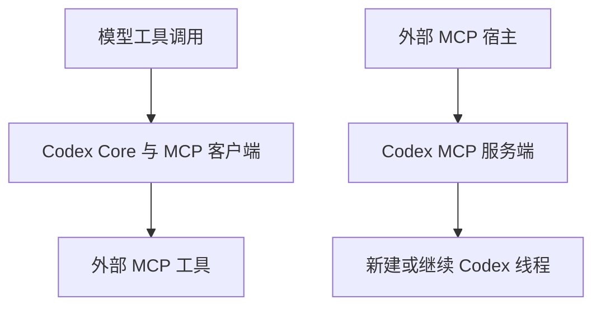

# MCP 工具协议

Codex 可以通过 MCP 连接管理器调用外部服务，也可以通过 `codex mcp-server` 向外部宿主提供 `codex` 和 `codex-reply` 两个工具。围绕单次模型工具调用执行的本地进程接口另见 [Hook 命令协议](hook-wire.md)。 [connection_manager.rs:370-385](https://github.com/GLBB/codex/blob/9f42c89c0112771dc29100a6f3fc904049b2655f/codex-rs/codex-mcp/src/connection_manager.rs#L370-L385) [connection_manager.rs:590-625](https://github.com/GLBB/codex/blob/9f42c89c0112771dc29100a6f3fc904049b2655f/codex-rs/codex-mcp/src/connection_manager.rs#L590-L625) [message_processor.rs:317-356](https://github.com/GLBB/codex/blob/9f42c89c0112771dc29100a6f3fc904049b2655f/codex-rs/mcp-server/src/message_processor.rs#L317-L356)

## Codex 调用外部 MCP

连接管理器按服务器收集可用工具，再规范化模型可见名称。调用时管理器先用内部服务器名选连接，并检查工具是否允许，再把原始工具名传给 rmcp。 [tools.rs:29-65](https://github.com/GLBB/codex/blob/9f42c89c0112771dc29100a6f3fc904049b2655f/codex-rs/codex-mcp/src/tools.rs#L29-L65) [connection_manager.rs:370-385](https://github.com/GLBB/codex/blob/9f42c89c0112771dc29100a6f3fc904049b2655f/codex-rs/codex-mcp/src/connection_manager.rs#L370-L385) [connection_manager.rs:590-625](https://github.com/GLBB/codex/blob/9f42c89c0112771dc29100a6f3fc904049b2655f/codex-rs/codex-mcp/src/connection_manager.rs#L590-L625)

| 方法 | 字段 | 类型与含义 |
| --- | --- | --- |
| `tools/list` | `params.cursor` | 可选 string，继续工具列表分页。 |
| `tools/list` | `result.tools` | 工具定义数组，包含 `name`、可选 `description` 及 `inputSchema` 等。 |
| `tools/list` | `result.nextCursor` | 可选 string，服务端提供的下一页游标。 |
| `tools/call` | `params.name` | string，目标服务器公布的工具名。 |
| `tools/call` | `params.arguments` | 可选 JSON object，按工具 schema 提供。Codex 在 rmcp 客户端适配处检查对象形状。 |
| `tools/call` | `params._meta` | 可选 JSON object，请求元数据，通过 rmcp 的请求选项附带。 |
| `tools/call` | `result.content` | 内容块数组，包含文本、图像等结果。 |
| `tools/call` | `result.structuredContent` | 可选结构化结果。 |
| `tools/call` | `result.isError` | 可选 boolean，工具报告的失败。RPC 仍可正常返回 `result`。 |
| `tools/call` | `result._meta` | 可选结果元数据。 |

[rmcp_client.rs:446-495](https://github.com/GLBB/codex/blob/9f42c89c0112771dc29100a6f3fc904049b2655f/codex-rs/rmcp-client/src/rmcp_client.rs#L446-L495) [rmcp_client.rs:545-598](https://github.com/GLBB/codex/blob/9f42c89c0112771dc29100a6f3fc904049b2655f/codex-rs/rmcp-client/src/rmcp_client.rs#L545-L598) [mcp.rs:137-151](https://github.com/GLBB/codex/blob/9f42c89c0112771dc29100a6f3fc904049b2655f/codex-rs/protocol/src/mcp.rs#L137-L151) [message_processor.rs:317-356](https://github.com/GLBB/codex/blob/9f42c89c0112771dc29100a6f3fc904049b2655f/codex-rs/mcp-server/src/message_processor.rs#L317-L356)

Core 可以给请求附带用于定位的 `_meta.threadId` 和 trace 元数据。 [mcp_tool_call.rs:985](https://github.com/GLBB/codex/blob/9f42c89c0112771dc29100a6f3fc904049b2655f/codex-rs/core/src/mcp_tool_call.rs#L985) [mcp_tool_call.rs:1080-1102](https://github.com/GLBB/codex/blob/9f42c89c0112771dc29100a6f3fc904049b2655f/codex-rs/core/src/mcp_tool_call.rs#L1080-L1102)启用 Rollout Trace 时，`_meta.codex_bridge_mcp_call_id` 可关联一笔外部 MCP 调用。同一操作还可能有模型的 `call_id` 与 MCP RPC 外层 `id`。结果通过连接管理器转换为 Core 的 `CallToolResult`，之后处理模型可见内容，例如按模型模态清理图像。 [mcp_tool_call.rs:985](https://github.com/GLBB/codex/blob/9f42c89c0112771dc29100a6f3fc904049b2655f/codex-rs/core/src/mcp_tool_call.rs#L985) [mcp_tool_call.rs:1080-1102](https://github.com/GLBB/codex/blob/9f42c89c0112771dc29100a6f3fc904049b2655f/codex-rs/core/src/mcp_tool_call.rs#L1080-L1102) [mcp_tool_call.rs:547-591](https://github.com/GLBB/codex/blob/9f42c89c0112771dc29100a6f3fc904049b2655f/codex-rs/core/src/mcp_tool_call.rs#L547-L591) [thread.rs:401-417](https://github.com/GLBB/codex/blob/9f42c89c0112771dc29100a6f3fc904049b2655f/codex-rs/rollout-trace/src/thread.rs#L401-L417) [mcp.rs:10-55](https://github.com/GLBB/codex/blob/9f42c89c0112771dc29100a6f3fc904049b2655f/codex-rs/rollout-trace/src/mcp.rs#L10-L55) [connection_manager.rs:604-624](https://github.com/GLBB/codex/blob/9f42c89c0112771dc29100a6f3fc904049b2655f/codex-rs/codex-mcp/src/connection_manager.rs#L604-L624)

## 外部宿主通过 MCP 调用 Codex

`tools/list` 返回两个工具。宿主用 `tools/call.params.name` 选择新建会话或续接会话。参数类型由 Codex 服务端生成并发布。 [message_processor.rs:317-386](https://github.com/GLBB/codex/blob/9f42c89c0112771dc29100a6f3fc904049b2655f/codex-rs/mcp-server/src/message_processor.rs#L317-L386) [codex_tool_config.rs:21-63](https://github.com/GLBB/codex/blob/9f42c89c0112771dc29100a6f3fc904049b2655f/codex-rs/mcp-server/src/codex_tool_config.rs#L21-L63) [codex_tool_config.rs:200-241](https://github.com/GLBB/codex/blob/9f42c89c0112771dc29100a6f3fc904049b2655f/codex-rs/mcp-server/src/codex_tool_config.rs#L200-L241)

| 工具 | `arguments` 字段 | 类型与含义 |
| --- | --- | --- |
| `codex` | `prompt` | string，必填，首次用户输入。 |
| `codex` | `model`、`cwd` | 各自可选 string。覆盖模型与工作目录，服务端解析相对目录。 |
| `codex` | `approval-policy`、`sandbox` | 各自可选枚举，分别控制审批策略与沙箱模式。 |
| `codex` | `config` | 可选 object，覆盖配置。 |
| `codex` | `base-instructions`、`developer-instructions`、`compact-prompt` | 各自可选 string。基础、开发者与压缩提示。 |
| `codex-reply` | `threadId` 或 `conversationId` | string，提供至少一个。优先使用 `threadId`，`conversationId` 是旧字段。 |
| `codex-reply` | `prompt` | string，必填，续接线程的下一条用户输入。 |

完成结果的 `structuredContent.threadId` 可保存给下一次 `codex-reply`。`structuredContent.content` 与 `content` 中的文本块都带回复文本。 [codex_tool_runner.rs:32-58](https://github.com/GLBB/codex/blob/9f42c89c0112771dc29100a6f3fc904049b2655f/codex-rs/mcp-server/src/codex_tool_runner.rs#L32-L58)

<!-- Sources: codex-rs/core/src/mcp_tool_call.rs:547-591, codex-rs/codex-mcp/src/connection_manager.rs:590-625, codex-rs/mcp-server/src/message_processor.rs:317-356, codex-rs/mcp-server/src/codex_tool_runner.rs:55-90 -->
