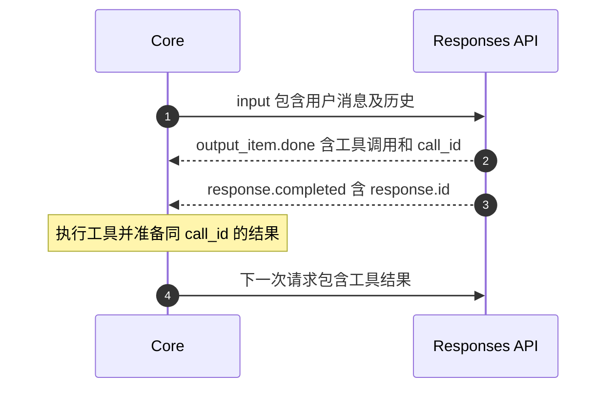

# 模型请求与响应协议

Core 从 `Prompt` 构造 Responses 请求。HTTP 发送请求并读取 SSE，WebSocket 发送 `response.create` 并读取同类响应事件。解析器把事件转换成 Core 的 `ResponseEvent`。供应商选择和重试流程见 [模型传输详解](../deep-dive/model-transport.md)。 [client.rs:717-772](https://github.com/GLBB/codex/blob/9f42c89c0112771dc29100a6f3fc904049b2655f/codex-rs/core/src/client.rs#L717-L772) [client.rs:1570-1642](https://github.com/GLBB/codex/blob/9f42c89c0112771dc29100a6f3fc904049b2655f/codex-rs/core/src/client.rs#L1570-L1642) [common.rs:269-277](https://github.com/GLBB/codex/blob/9f42c89c0112771dc29100a6f3fc904049b2655f/codex-rs/codex-api/src/common.rs#L269-L277) [responses.rs:263-396](https://github.com/GLBB/codex/blob/9f42c89c0112771dc29100a6f3fc904049b2655f/codex-rs/codex-api/src/sse/responses.rs#L263-L396)

## Responses 请求体

以下为 Codex 当前请求构造器的赋值规则。WS 版继承同组字段，另外带 `type` 及可选的增量字段。 [common.rs:169-240](https://github.com/GLBB/codex/blob/9f42c89c0112771dc29100a6f3fc904049b2655f/codex-rs/codex-api/src/common.rs#L169-L240) [client.rs:717-772](https://github.com/GLBB/codex/blob/9f42c89c0112771dc29100a6f3fc904049b2655f/codex-rs/core/src/client.rs#L717-L772) [client.rs:1366-1388](https://github.com/GLBB/codex/blob/9f42c89c0112771dc29100a6f3fc904049b2655f/codex-rs/core/src/client.rs#L1366-L1388)

| 字段 | JSON 类型与出现条件 | 含义 |
| --- | --- | --- |
| `model` | string | 选中模型的 slug。 |
| `instructions` | string，空串省略 | Prompt 的基础指令。 |
| `input` | ResponseItem[] | 已格式化的历史与当次输入。WS 增量时只含输入后缀。 |
| `tools` | object[] | 本次对模型声明的工具定义。 |
| `tool_choice` | string | Codex 构造时写 `auto`，由模型选择是否调用工具。 |
| `parallel_tool_calls` | boolean | Prompt 是否允许同一轮推理发多个工具调用。 |
| `reasoning` | object 或 null | 推理参数。可选子字段 `effort` 是强度，`summary` 是摘要设置。 |
| `store` | boolean | 当前构造器对 Azure Responses endpoint 设 true，其余设 false。 |
| `stream` | boolean | 当前构造器设 true，使用事件流。 |
| `include` | string[] | 当有 `reasoning` 时请求 `reasoning.encrypted_content`，其余发空数组。 |
| `service_tier` | string，可省略 | 经模型配置计算后发出的服务层级。 |
| `prompt_cache_key` | string，可省略 | 构造器使用线程 ID 作为提示缓存键。 |
| `text` | object，可省略 | 输出控制，含可选 `verbosity` 与 `format`。 |
| `client_metadata` | string → string 映射，可省略 | 客户端元数据。HTTP 请求体含安装 ID，WS 构造路径还处理线程、回合和 trace 元数据。 |

`text.format` 的字段是 `type: "json_schema"`、`schema: JSON`、`strict: boolean`、`name: string`。Codex 以 `codex_output_schema` 作为格式名。 `text.verbosity` 取 `low`、`medium` 或 `high`，按模型能力填入。 [common.rs:113-157](https://github.com/GLBB/codex/blob/9f42c89c0112771dc29100a6f3fc904049b2655f/codex-rs/codex-api/src/common.rs#L113-L157) [common.rs:279-297](https://github.com/GLBB/codex/blob/9f42c89c0112771dc29100a6f3fc904049b2655f/codex-rs/codex-api/src/common.rs#L279-L297) [client.rs:634-664](https://github.com/GLBB/codex/blob/9f42c89c0112771dc29100a6f3fc904049b2655f/codex-rs/core/src/client.rs#L634-L664) [client.rs:735-750](https://github.com/GLBB/codex/blob/9f42c89c0112771dc29100a6f3fc904049b2655f/codex-rs/core/src/client.rs#L735-L750)

## input 与 output item

常见项按 `type` 解码。这里的 `call_id` 贯穿某一次工具调用及其回填，输出项 `id` 可供流处理定位。部分变体读取 `id`，但在 Codex 再序列化时省略。 [models.rs:750-847](https://github.com/GLBB/codex/blob/9f42c89c0112771dc29100a6f3fc904049b2655f/codex-rs/protocol/src/models.rs#L750-L847)

| `type` | 字段 | 含义 |
| --- | --- | --- |
| `message` | `role: string`、`content: ContentItem[]`、可选 `phase: string` | 消息角色与内容。助手阶段可为 `commentary` 或 `final_answer`。 |
| `reasoning` | `summary: array`、可选 `content`、`encrypted_content: string 或 null` | 推理摘要、可用的推理内容、服务端提供的加密内容。 |
| `function_call` | `call_id: string`、`name: string`、可选 `namespace: string`、`arguments: string` | 结构化工具调用，`arguments` 是编码为字符串的 JSON。 |
| `function_call_output` | `call_id: string`、`output: string 或 array` | 使用原调用 ID 回填工具结果。 |
| `custom_tool_call` | `call_id: string`、`name: string`、`input: string`、可选 `status: string` | 自由格式工具调用，输入为原始文本。 |
| `custom_tool_call_output` | `call_id: string`、可选 `name: string`、`output: string 或 array` | 自由格式工具的结果。 |

| 内容位置 | `type` 与附带字段 | 含义 |
| --- | --- | --- |
| `message.content[]` | `input_text`、`output_text` 均带 `text: string` | 输入文字或模型文字。 |
| `message.content[]`、工具 `output[]` | `input_image` 带 `image_url: string` 和可选 `detail: "high" / "original"` | 图像输入与细节级别。 |
| 工具 `output[]` | `input_text` 带 `text: string`，`encrypted_content` 带 `encrypted_content: string` | 工具返回的文字或加密内容。 |

工具处理器可同时提供内部 `success` 标记，模型线协议的 `output` 字段直接承载字符串或内容数组。 [models.rs:708-732](https://github.com/GLBB/codex/blob/9f42c89c0112771dc29100a6f3fc904049b2655f/codex-rs/protocol/src/models.rs#L708-L732) [models.rs:1301-1320](https://github.com/GLBB/codex/blob/9f42c89c0112771dc29100a6f3fc904049b2655f/codex-rs/protocol/src/models.rs#L1301-L1320) [models.rs:1373-1388](https://github.com/GLBB/codex/blob/9f42c89c0112771dc29100a6f3fc904049b2655f/codex-rs/protocol/src/models.rs#L1373-L1388)

## SSE 和 WebSocket 的响应事件

解析器读取 JSON 的 `type`，然后按分支读取下列字段。完成的模型响应可包含工具调用，Core 因此仍可发起下一次推理。 [responses.rs:98-158](https://github.com/GLBB/codex/blob/9f42c89c0112771dc29100a6f3fc904049b2655f/codex-rs/codex-api/src/sse/responses.rs#L98-L158) [responses.rs:263-396](https://github.com/GLBB/codex/blob/9f42c89c0112771dc29100a6f3fc904049b2655f/codex-rs/codex-api/src/sse/responses.rs#L263-L396) [turn.rs:1788-1878](https://github.com/GLBB/codex/blob/9f42c89c0112771dc29100a6f3fc904049b2655f/codex-rs/core/src/session/turn.rs#L1788-L1878) [turn.rs:1990-2021](https://github.com/GLBB/codex/blob/9f42c89c0112771dc29100a6f3fc904049b2655f/codex-rs/core/src/session/turn.rs#L1990-L2021)

| `type` | 读取的字段 | 含义 |
| --- | --- | --- |
| `response.created` | 可用的 `response` | Core 发出已创建事件。 |
| `response.output_item.added`、`response.output_item.done` | `item: object` | 可解码时产出开始项或完整项。工具执行从完整项进入路由。 |
| `response.output_text.delta` | `delta: string` | 新增的输出文本。 |
| `response.custom_tool_call_input.delta` | `delta: string`、`item_id: string`，可用 `call_id` 回退 | 自由格式工具的输入增量。 |
| `response.reasoning_summary_text.delta` | `delta: string`、`summary_index: integer` | 某个推理摘要部分的文本增量。 |
| `response.reasoning_text.delta` | `delta: string`、`content_index: integer` | 某个推理内容部分的文本增量。 |
| `response.reasoning_summary_part.added` | `summary_index: integer` | 新增摘要部分。 |
| `response.completed` | `response.id: string`、可选 `response.usage`、可选 `response.end_turn: boolean` | 本次模型响应完成。Core 可根据 `end_turn: false` 继续推理。 |
| `response.failed` | 可选 `response.error` | 解析为 API 错误；按错误信息区分上下文超限、配额和其他失败。 |
| `response.incomplete` | 可选 `response.incomplete_details.reason` | 以未完成错误结束流。 |

用量字段包括 `input_tokens`、`output_tokens`、`total_tokens`，均为整数。`input_tokens_details.cached_tokens` 和 `output_tokens_details.reasoning_tokens` 分别是缓存与推理细分，详情缺失时映射为零。SSE 在完成事件之前关闭会报告流错误。 [responses.rs:98-143](https://github.com/GLBB/codex/blob/9f42c89c0112771dc29100a6f3fc904049b2655f/codex-rs/codex-api/src/sse/responses.rs#L98-L143) [responses.rs:399-443](https://github.com/GLBB/codex/blob/9f42c89c0112771dc29100a6f3fc904049b2655f/codex-rs/codex-api/src/sse/responses.rs#L399-L443)

## WebSocket 增量与标识符

| 消息 | 字段 | 含义 |
| --- | --- | --- |
| `response.create` | `previous_response_id: string`，可省略 | 引用上一模型响应，用来让服务端补全当前输入的公共前缀。 |
| `response.create` | `input: ResponseItem[]` | 发送全量输入，或在有引用时发送后缀。 |
| `response.create` | `generate: boolean`，可省略 | 预热路径写 false，普通请求省略该值。 |
| `response.processed` | `response_id: string` | Core 向有活跃 WS 连接的服务端确认对应响应已处理。 |

`get_incremental_items` 先比较去掉 `input` 后的请求对象，再比较本次输入是否以前次请求输入加前次新增输出项为前缀。前缀和上一非空响应 ID 可用时才引用，当前路径允许空后缀。重建实际模型输入时，可结合 [Rollout Trace 的推理归约](../deep-dive/trajectory.md) 对查。 [common.rs:215-277](https://github.com/GLBB/codex/blob/9f42c89c0112771dc29100a6f3fc904049b2655f/codex-rs/codex-api/src/common.rs#L215-L277) [client.rs:950-959](https://github.com/GLBB/codex/blob/9f42c89c0112771dc29100a6f3fc904049b2655f/codex-rs/core/src/client.rs#L950-L959) [client.rs:996-1075](https://github.com/GLBB/codex/blob/9f42c89c0112771dc29100a6f3fc904049b2655f/codex-rs/core/src/client.rs#L996-L1075) [client.rs:1366-1388](https://github.com/GLBB/codex/blob/9f42c89c0112771dc29100a6f3fc904049b2655f/codex-rs/core/src/client.rs#L1366-L1388) [turn.rs:2128-2141](https://github.com/GLBB/codex/blob/9f42c89c0112771dc29100a6f3fc904049b2655f/codex-rs/core/src/session/turn.rs#L2128-L2141)

<!-- Sources: codex-rs/core/src/client.rs:717-772, codex-rs/codex-api/src/sse/responses.rs:263-396, codex-rs/core/src/stream_events_utils.rs:342-385, codex-rs/core/src/session/turn.rs:1655-1675 -->

## 实验接口 thread/realtime

app-server 另有线程级实时会话方法。它们提交专用的 Core RealtimeConversation 操作，客户端通过 `thread/realtime/*` 通知同步音频、文本和连接状态。以下字段描述 app-server 接入面。 [common.rs:762-791](https://github.com/GLBB/codex/blob/9f42c89c0112771dc29100a6f3fc904049b2655f/codex-rs/app-server-protocol/src/protocol/common.rs#L762-L791) [common.rs:1535-1550](https://github.com/GLBB/codex/blob/9f42c89c0112771dc29100a6f3fc904049b2655f/codex-rs/app-server-protocol/src/protocol/common.rs#L1535-L1550) [turn_processor.rs:852-954](https://github.com/GLBB/codex/blob/9f42c89c0112771dc29100a6f3fc904049b2655f/codex-rs/app-server/src/request_processors/turn_processor.rs#L852-L954)

| 消息 | 字段 | 含义 |
| --- | --- | --- |
| `thread/realtime/start` | `threadId: string`、`outputModality: "text" / "audio"` | 目标线程与模型输出模态。 |
| 同上 | 可选 `prompt`、`realtimeSessionId`、`voice`、`transport` | 提示、实时会话标识、音色与传输。传输按 `type` 选择 `websocket` 或携带 `sdp` 的 `webrtc`。 |
| `thread/realtime/appendText` | `threadId`、`text: string` | 追加的文本。 |
| `thread/realtime/appendAudio`、`thread/realtime/outputAudio/delta` | `threadId`、`audio` | 音频块含 `data: string`、`sampleRate: integer`、`numChannels: integer`、可为 null 的 `samplesPerChannel: integer` 和 `itemId: string`。 |
| `thread/realtime/started` | `threadId`、`realtimeSessionId`、`version` | 启动后公布会话标识和实时协议版本。 |
| `thread/realtime/transcript/delta`、`thread/realtime/transcript/done` | `threadId`、`role`、`delta` 或 `text` | 对应角色的转写增量和当前片段完成文本。 |
| `thread/realtime/sdp`、`thread/realtime/error`、`thread/realtime/closed` | `threadId`，以及 `sdp`、`message` 或可空的 `reason` | WebRTC SDP、错误与连接关闭。 |

[realtime.rs:12-22](https://github.com/GLBB/codex/blob/9f42c89c0112771dc29100a6f3fc904049b2655f/codex-rs/app-server-protocol/src/protocol/v2/realtime.rs#L12-L22) [realtime.rs:62-148](https://github.com/GLBB/codex/blob/9f42c89c0112771dc29100a6f3fc904049b2655f/codex-rs/app-server-protocol/src/protocol/v2/realtime.rs#L62-L148) [realtime.rs:164-241](https://github.com/GLBB/codex/blob/9f42c89c0112771dc29100a6f3fc904049b2655f/codex-rs/app-server-protocol/src/protocol/v2/realtime.rs#L164-L241)
