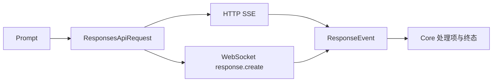
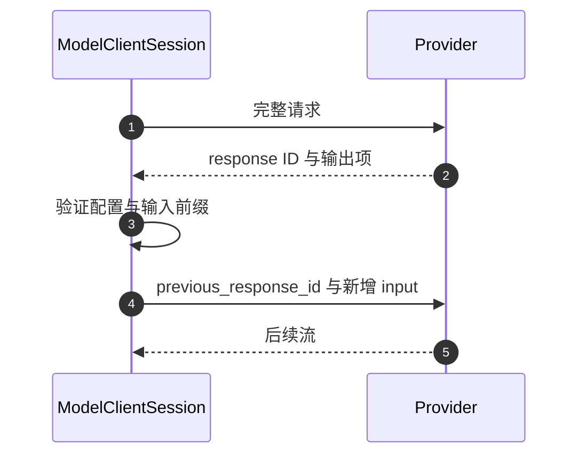
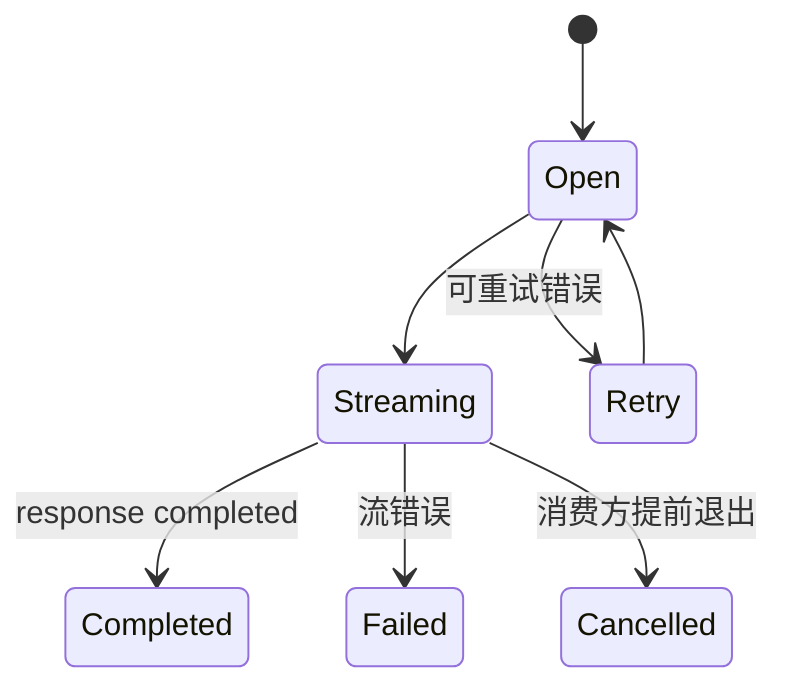

# 模型请求与响应协议

`Prompt` 是 Core 的组装结果，`ResponsesApiRequest` 包含经过转换的指令、输入、工具、推理选项和输出格式。模型传输实现会把 SSE 或 WebSocket 帧转换为 `ResponseEvent`，同一轮 Agent Loop 可消费多次这样的流。 [codex-rs/core/src/client_common.rs:25-62](https://github.com/GLBB/codex/blob/9f42c89c0112771dc29100a6f3fc904049b2655f/codex-rs/core/src/client_common.rs#L25-L62) [codex-rs/core/src/client.rs:717-805](https://github.com/GLBB/codex/blob/9f42c89c0112771dc29100a6f3fc904049b2655f/codex-rs/core/src/client.rs#L717-L805) [codex-rs/model-provider-info/src/lib.rs:45-109](https://github.com/GLBB/codex/blob/9f42c89c0112771dc29100a6f3fc904049b2655f/codex-rs/model-provider-info/src/lib.rs#L45-L109) [codex-rs/core/src/client.rs:1570-1642](https://github.com/GLBB/codex/blob/9f42c89c0112771dc29100a6f3fc904049b2655f/codex-rs/core/src/client.rs#L1570-L1642) [codex-rs/codex-api/src/common.rs:72-150](https://github.com/GLBB/codex/blob/9f42c89c0112771dc29100a6f3fc904049b2655f/codex-rs/codex-api/src/common.rs#L72-L150) [codex-rs/codex-api/src/sse/responses.rs:399-486](https://github.com/GLBB/codex/blob/9f42c89c0112771dc29100a6f3fc904049b2655f/codex-rs/codex-api/src/sse/responses.rs#L399-L486)

| 层次 | 定义或适配 | 查阅重点 |
| --- | --- | --- |
| 供应商配置 | `WireApi`、认证和 endpoint | 当前 `stream` 的业务分支是 Responses。 [codex-rs/model-provider-info/src/lib.rs:45-109](https://github.com/GLBB/codex/blob/9f42c89c0112771dc29100a6f3fc904049b2655f/codex-rs/model-provider-info/src/lib.rs#L45-L109) [codex-rs/model-provider/src/provider.rs:81-155](https://github.com/GLBB/codex/blob/9f42c89c0112771dc29100a6f3fc904049b2655f/codex-rs/model-provider/src/provider.rs#L81-L155) [codex-rs/core/src/client.rs:1570-1642](https://github.com/GLBB/codex/blob/9f42c89c0112771dc29100a6f3fc904049b2655f/codex-rs/core/src/client.rs#L1570-L1642) |
| 请求体 | `build_responses_request` | 包含 `instructions`、`input`、工具约束、模型的推理设置及可选输出 schema。 [codex-rs/core/src/client.rs:717-805](https://github.com/GLBB/codex/blob/9f42c89c0112771dc29100a6f3fc904049b2655f/codex-rs/core/src/client.rs#L717-L805) |
| 流解析 | `process_sse` 和 `process_responses_event` | 将完整输出项、增量、失败与 completed 归一化。 [codex-rs/codex-api/src/sse/responses.rs:263-321](https://github.com/GLBB/codex/blob/9f42c89c0112771dc29100a6f3fc904049b2655f/codex-rs/codex-api/src/sse/responses.rs#L263-L321) [codex-rs/codex-api/src/sse/responses.rs:347-394](https://github.com/GLBB/codex/blob/9f42c89c0112771dc29100a6f3fc904049b2655f/codex-rs/codex-api/src/sse/responses.rs#L347-L394) [codex-rs/codex-api/src/sse/responses.rs:399-486](https://github.com/GLBB/codex/blob/9f42c89c0112771dc29100a6f3fc904049b2655f/codex-rs/codex-api/src/sse/responses.rs#L399-L486) |
| WebSocket | `prepare_websocket_request` 及 fallback | 可发送 `previous_response_id` 和输入后缀。传输状态参与能否增量。 [codex-rs/core/src/client.rs:996-1074](https://github.com/GLBB/codex/blob/9f42c89c0112771dc29100a6f3fc904049b2655f/codex-rs/core/src/client.rs#L996-L1074) [codex-rs/core/src/client.rs:1423-1467](https://github.com/GLBB/codex/blob/9f42c89c0112771dc29100a6f3fc904049b2655f/codex-rs/core/src/client.rs#L1423-L1467) [codex-rs/core/src/client.rs:1570-1642](https://github.com/GLBB/codex/blob/9f42c89c0112771dc29100a6f3fc904049b2655f/codex-rs/core/src/client.rs#L1570-L1642) |
| Core 消费 | 工具从完整输出项进入路由，完成事件报告响应 ID 和用量 | 追踪模型与工具谁先完成应看各自记录。 [codex-rs/core/src/stream_events_utils.rs:342-385](https://github.com/GLBB/codex/blob/9f42c89c0112771dc29100a6f3fc904049b2655f/codex-rs/core/src/stream_events_utils.rs#L342-L385) [codex-rs/core/src/session/turn.rs:1788-1878](https://github.com/GLBB/codex/blob/9f42c89c0112771dc29100a6f3fc904049b2655f/codex-rs/core/src/session/turn.rs#L1788-L1878) [codex-rs/core/src/client.rs:1777-1899](https://github.com/GLBB/codex/blob/9f42c89c0112771dc29100a6f3fc904049b2655f/codex-rs/core/src/client.rs#L1777-L1899) |

<!-- Sources: codex-rs/core/src/client.rs:717, codex-rs/core/src/client.rs:1570, codex-rs/core/src/client.rs:1423, codex-rs/codex-api/src/common.rs:72, codex-rs/codex-api/src/sse/responses.rs:399, codex-rs/core/src/session/turn.rs:1788 -->

### 增量是内容引用

`get_incremental_items` 比较去掉输入后的请求设置，然后确认当前输入以前次请求加完整输出为前缀。已有上一响应 ID 时可以引用并截取后缀。用户追踪语义时应保留三件事：参考 ID、实际后缀、内容重建。预热复用的 trace 特判解释见 [Trajectory](../deep-dive/trajectory.md)。 [codex-rs/core/src/client.rs:996-1074](https://github.com/GLBB/codex/blob/9f42c89c0112771dc29100a6f3fc904049b2655f/codex-rs/core/src/client.rs#L996-L1074) [codex-rs/core/src/client.rs:1423-1467](https://github.com/GLBB/codex/blob/9f42c89c0112771dc29100a6f3fc904049b2655f/codex-rs/core/src/client.rs#L1423-L1467) [codex-rs/rollout-trace/src/reducer/conversation.rs:34-129](https://github.com/GLBB/codex/blob/9f42c89c0112771dc29100a6f3fc904049b2655f/codex-rs/rollout-trace/src/reducer/conversation.rs#L34-L129)

<!-- Sources: codex-rs/core/src/client.rs:996, codex-rs/core/src/client.rs:1423, codex-rs/core/src/client.rs:1777 -->

### 错误由哪一层报告

传输可能有连接错误、流内错误或没有正常结束。SSE 解析将已识别错误转换，Core 采样层据错误类型和预算决定重试或失败。WebSocket 支持降级到 HTTP。HTTP 请求成功只是 transport 层证据，具体输出按响应流和 turn 终态判断。 [codex-rs/codex-api/src/sse/responses.rs:347-394](https://github.com/GLBB/codex/blob/9f42c89c0112771dc29100a6f3fc904049b2655f/codex-rs/codex-api/src/sse/responses.rs#L347-L394) [codex-rs/codex-api/src/sse/responses.rs:399-486](https://github.com/GLBB/codex/blob/9f42c89c0112771dc29100a6f3fc904049b2655f/codex-rs/codex-api/src/sse/responses.rs#L399-L486) [codex-rs/core/src/session/turn.rs:947-1021](https://github.com/GLBB/codex/blob/9f42c89c0112771dc29100a6f3fc904049b2655f/codex-rs/core/src/session/turn.rs#L947-L1021) [codex-rs/core/src/client.rs:1570-1642](https://github.com/GLBB/codex/blob/9f42c89c0112771dc29100a6f3fc904049b2655f/codex-rs/core/src/client.rs#L1570-L1642) [codex-rs/core/src/client.rs:1777-1899](https://github.com/GLBB/codex/blob/9f42c89c0112771dc29100a6f3fc904049b2655f/codex-rs/core/src/client.rs#L1777-L1899) [codex-rs/app-server/README.md:1211-1247](https://github.com/GLBB/codex/blob/9f42c89c0112771dc29100a6f3fc904049b2655f/codex-rs/app-server/README.md#L1211-L1247)

<!-- Sources: codex-rs/core/src/session/turn.rs:947, codex-rs/core/src/client.rs:1570, codex-rs/codex-api/src/sse/responses.rs:399, codex-rs/core/src/client.rs:1777 -->

### 实时音频与文本的接口

实验性的 `thread/realtime/start` 针对线程创建实时会话，并可指定文本或音频输出。默认走 WebSocket，也可以提交浏览器生成的 WebRTC SDP offer，服务端用单独通知返回 answer。`thread/realtime/started` 带上游的 `realtimeSessionId`，后续音频、转写与状态从 realtime 通知取得。调试时按 thread ID 找本地归属，再用 realtime session ID 找上游连接。普通 Responses 推理使用上一节的响应与请求标识。 [codex-rs/app-server/README.md:761-809](https://github.com/GLBB/codex/blob/9f42c89c0112771dc29100a6f3fc904049b2655f/codex-rs/app-server/README.md#L761-L809) [codex-rs/app-server/README.md:1189-1202](https://github.com/GLBB/codex/blob/9f42c89c0112771dc29100a6f3fc904049b2655f/codex-rs/app-server/README.md#L1189-L1202) [codex-rs/core/src/realtime_conversation.rs:278-370](https://github.com/GLBB/codex/blob/9f42c89c0112771dc29100a6f3fc904049b2655f/codex-rs/core/src/realtime_conversation.rs#L278-L370) [codex-rs/rollout-trace/src/raw_event.rs:29-162](https://github.com/GLBB/codex/blob/9f42c89c0112771dc29100a6f3fc904049b2655f/codex-rs/rollout-trace/src/raw_event.rs#L29-L162)

继续阅读 [协议总览](index.md)、[模型请求与响应流](../deep-dive/model-transport.md) 和 [可观测性](../deep-dive/observability.md)。
