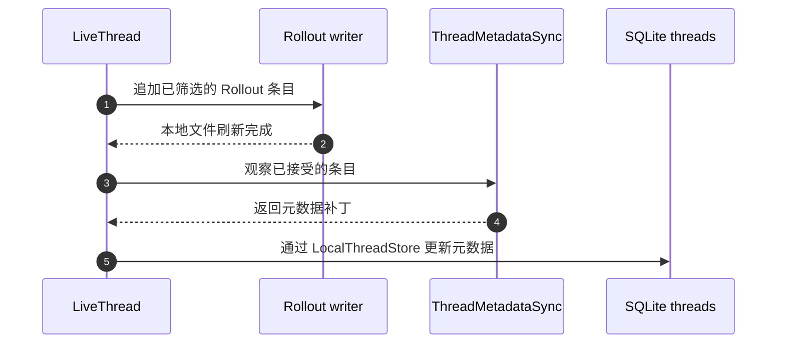
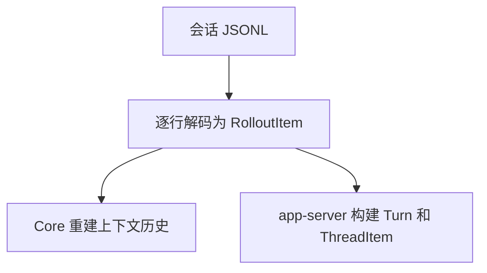

# Rollout 会话 JSONL

Rollout 的每行记录一个对象。`timestamp` 是写行时间，`type` 决定 `payload` 的结构。文件读取器把逐行对象还原为 `RolloutItem`，后续用于恢复模型历史、构建客户端回合和更新线程元数据。运行诊断和跨线程归因见 [Rollout Trace](../deep-dive/trajectory.md)。 [protocol.rs:2697-2713](https://github.com/GLBB/codex/blob/9f42c89c0112771dc29100a6f3fc904049b2655f/codex-rs/protocol/src/protocol.rs#L2697-L2713) [protocol.rs:2849-2854](https://github.com/GLBB/codex/blob/9f42c89c0112771dc29100a6f3fc904049b2655f/codex-rs/protocol/src/protocol.rs#L2849-L2854) [recorder.rs:812-857](https://github.com/GLBB/codex/blob/9f42c89c0112771dc29100a6f3fc904049b2655f/codex-rs/rollout/src/recorder.rs#L812-L857) [recorder.rs:1634-1656](https://github.com/GLBB/codex/blob/9f42c89c0112771dc29100a6f3fc904049b2655f/codex-rs/rollout/src/recorder.rs#L1634-L1656)

## 行外壳与记录类型

| 字段 | JSON 类型 | 含义 |
| --- | --- | --- |
| `timestamp` | string | 当前记录写入时的 UTC 时间，写入器精确到毫秒。 |
| `type` | string | 下表中的记录类型。 |
| `payload` | object | 该类型的内容。事件和模型项内部还可以有自己的 `type`。 |

| `type` | `payload` 类型 | 用途 |
| --- | --- | --- |
| `session_meta` | SessionMetaLine | 线程身份、会话来源、初始化元数据。 |
| `response_item` | ResponseItem | 输入、助手消息、工具调用和工具输出等模型历史。模型项字段见 [模型请求与响应](model-wire.md)。 |
| `compacted` | CompactedItem | 用 `message: string` 记录摘要，若有 `replacement_history: ResponseItem[]` 则提供压缩后的历史基线。 |
| `turn_context` | TurnContextItem | 持久的回合上下文基线，恢复时可用于计算后续上下文变化。 |
| `event_msg` | EventMsg | 保存允许落盘的 Core 事件体。例如 `payload.type = "task_started"` 及 `payload.turn_id`。 |

[protocol.rs:2697-2720](https://github.com/GLBB/codex/blob/9f42c89c0112771dc29100a6f3fc904049b2655f/codex-rs/protocol/src/protocol.rs#L2697-L2720) [protocol.rs:2741-2776](https://github.com/GLBB/codex/blob/9f42c89c0112771dc29100a6f3fc904049b2655f/codex-rs/protocol/src/protocol.rs#L2741-L2776) [protocol.rs:2849-2854](https://github.com/GLBB/codex/blob/9f42c89c0112771dc29100a6f3fc904049b2655f/codex-rs/protocol/src/protocol.rs#L2849-L2854) [mod.rs:1758-1766](https://github.com/GLBB/codex/blob/9f42c89c0112771dc29100a6f3fc904049b2655f/codex-rs/core/src/session/mod.rs#L1758-L1766) [recorder.rs:749-771](https://github.com/GLBB/codex/blob/9f42c89c0112771dc29100a6f3fc904049b2655f/codex-rs/rollout/src/recorder.rs#L749-L771)

## 会话元数据 session_meta.payload

新线程首次落盘时，`RolloutRecorder` 先写 `session_meta`，再写待持久化的条目。创建参数提供身份、配置和来源，writer 写入时还会尝试从工作目录采集 Git 信息。`SessionMetaLine` 把会话字段直接展开到 `payload`，因此磁盘上的线程 ID 路径是 `payload.id`。 [recorder.rs:660-706](https://github.com/GLBB/codex/blob/9f42c89c0112771dc29100a6f3fc904049b2655f/codex-rs/rollout/src/recorder.rs#L660-L706) [recorder.rs:1497-1515](https://github.com/GLBB/codex/blob/9f42c89c0112771dc29100a6f3fc904049b2655f/codex-rs/rollout/src/recorder.rs#L1497-L1515) [recorder.rs:1579-1602](https://github.com/GLBB/codex/blob/9f42c89c0112771dc29100a6f3fc904049b2655f/codex-rs/rollout/src/recorder.rs#L1579-L1602) [protocol.rs:2641-2703](https://github.com/GLBB/codex/blob/9f42c89c0112771dc29100a6f3fc904049b2655f/codex-rs/protocol/src/protocol.rs#L2641-L2703)

| 字段 | JSON 类型与出现条件 | 含义 |
| --- | --- | --- |
| `id` | UUID 字符串 | 线程 ID。全量加载器取文件中遇到的第一条 `session_meta` 的 ID。 |
| `forked_from_id` | UUID 字符串，可省略 | fork 的来源线程。子代理派生关系见 `source.subagent.thread_spawn.parent_thread_id`。 |
| `timestamp` | string | 会话创建时间。创建时写为带毫秒的 UTC 字符串，追加元数据时仍使用原会话时间。外层 `timestamp` 记录本次写行时间。 |
| `cwd` | string | 创建线程时的工作目录。每轮目录见 `turn_context.payload.cwd`。 |
| `originator` | string | 写入端的 originator 标识，由进程中的 originator 配置取得。 |
| `cli_version` | string | 创建线程的 CLI 版本，取构建时的包版本。 |
| `source` | string 或 tagged object | 会话的实际来源。旧数据省略时使用 `"vscode"`。 |
| `thread_source` | enum，可省略 | 分析统计分类，取 `user`、`subagent` 或 `memory_consolidation`。 |
| `agent_nickname` | string，可省略 | 子代理昵称。 |
| `agent_role` | string，可省略 | 子代理角色，兼容读取旧字段 `agent_type`。 |
| `agent_path` | string，可省略 | 子代理的规范路径。 |
| `model_provider` | string 或 null | 会话使用的供应商配置 ID。模型名见 `turn_context.payload.model`。 |
| `base_instructions` | object 或 null | `text: string` 是线程的基础模型指令，旧数据可缺失。 |
| `dynamic_tools` | object[]，可省略 | 线程注册的动态工具定义，新线程没有动态工具时省略。 |
| `memory_mode` | string，可省略 | 显式线程记忆模式，值为 `enabled` 或 `disabled`。创建路径在禁止生成记忆时写 `disabled`，全量修复时缺省按 `enabled` 处理。 |
| `git` | object，可省略 | Git 元数据，子字段见下表。 |

[protocol.rs:2438-2517](https://github.com/GLBB/codex/blob/9f42c89c0112771dc29100a6f3fc904049b2655f/codex-rs/protocol/src/protocol.rs#L2438-L2517) [protocol.rs:2641-2703](https://github.com/GLBB/codex/blob/9f42c89c0112771dc29100a6f3fc904049b2655f/codex-rs/protocol/src/protocol.rs#L2641-L2703) [recorder.rs:841-850](https://github.com/GLBB/codex/blob/9f42c89c0112771dc29100a6f3fc904049b2655f/codex-rs/rollout/src/recorder.rs#L841-L850) [models.rs:907-912](https://github.com/GLBB/codex/blob/9f42c89c0112771dc29100a6f3fc904049b2655f/codex-rs/protocol/src/models.rs#L907-L912) [state_db.rs:528-544](https://github.com/GLBB/codex/blob/9f42c89c0112771dc29100a6f3fc904049b2655f/codex-rs/rollout/src/state_db.rs#L528-L544) [update_thread_metadata.rs:554-558](https://github.com/GLBB/codex/blob/9f42c89c0112771dc29100a6f3fc904049b2655f/codex-rs/thread-store/src/local/update_thread_metadata.rs#L554-L558)

### 嵌套字段

| 路径 | JSON 类型与出现条件 | 含义 |
| --- | --- | --- |
| `source` | enum string | `cli`、`vscode`、`exec`、`mcp` 或 `unknown`。 |
| `source.custom` | string | 自定义来源标签。 |
| `source.internal` | enum string | 内部会话种类，目前为 `memory_consolidation`。 |
| `source.subagent` | enum string 或 tagged object | `review`、`compact`、`memory_consolidation`，或带 `thread_spawn` / `other` 键的对象。 |
| `source.subagent.thread_spawn.parent_thread_id` | UUID 字符串 | 启动该子代理的父线程。 |
| `source.subagent.thread_spawn.depth` | integer | 子代理派生深度。 |
| `source.subagent.thread_spawn.agent_path`、`agent_nickname`、`agent_role` | string 或 null，可省略 | 派生时记录的子代理路径、昵称和角色。 |
| `source.subagent.other` | string | 其他子代理来源标签。 |
| `git.commit_hash` | string，可省略 | Git 提交 SHA。 |
| `git.branch` | string，可省略 | 分支名称。 |
| `git.repository_url` | string，可省略 | 记录的仓库远端 URL。 |
| `dynamic_tools[].namespace` | string，可省略 | 工具命名空间。 |
| `dynamic_tools[].name`、`description` | string | 工具名和描述。 |
| `dynamic_tools[].inputSchema` | JSON | 工具参数 schema。 |
| `dynamic_tools[].deferLoading` | boolean，读取时默认 false | 工具是否延迟暴露。兼容读取旧字段 `exposeToContext` 的反值，显式 `deferLoading` 优先。 |

`source` 带载荷的变体使用外部标签，例如 `{"subagent":{"thread_spawn":{"parent_thread_id":"019acdd8-78b8-76b4-a5c8-afd24481cd6f","depth":1}}}`。动态工具子对象沿用 camelCase。 [protocol.rs:2438-2517](https://github.com/GLBB/codex/blob/9f42c89c0112771dc29100a6f3fc904049b2655f/codex-rs/protocol/src/protocol.rs#L2438-L2517) [protocol.rs:2856-2867](https://github.com/GLBB/codex/blob/9f42c89c0112771dc29100a6f3fc904049b2655f/codex-rs/protocol/src/protocol.rs#L2856-L2867) [dynamic_tools.rs:8-18](https://github.com/GLBB/codex/blob/9f42c89c0112771dc29100a6f3fc904049b2655f/codex-rs/protocol/src/dynamic_tools.rs#L8-L18) [dynamic_tools.rs:50-82](https://github.com/GLBB/codex/blob/9f42c89c0112771dc29100a6f3fc904049b2655f/codex-rs/protocol/src/dynamic_tools.rs#L50-L82)

### 文件头与后续元数据

| 读取或更新方式 | 对应的记录行为 |
| --- | --- |
| `read_session_meta_line` | 从文件头摘要取首项并解码为 `SessionMetaLine`，用于读取创建时的字段。 |
| 全量 `load_rollout_items` | 保留全部元数据行，使用遇到的第一条 `session_meta` 的 ID 作为线程 ID。重建常规字段时跳过 ID 不匹配的元数据，例如 fork 带入的来源线程记录。 |
| 显式 Git 更新 | 读取文件头、核对线程 ID，再追加一条带 `git` 的 `session_meta`。单个 Git 子字段被清空时，该字段可以从 `git` 对象中省略。 |
| 显式记忆模式更新 | 追加一条带 `memory_mode` 的 `session_meta`，省略整个 `git` 对象，重建 Git 时沿用此前记录。全文件元数据提取从后往前取第一个有值的 `memory_mode`。 |

查当前 Git 或记忆模式时，首条记录只能提供创建时的值。Git 重建按条目顺序应用带 `git` 的本线程元数据，写回 SQLite 时还会保留库里已有的非空 Git 字段。 [list.rs:1163-1201](https://github.com/GLBB/codex/blob/9f42c89c0112771dc29100a6f3fc904049b2655f/codex-rs/rollout/src/list.rs#L1163-L1201) [list.rs:1235-1250](https://github.com/GLBB/codex/blob/9f42c89c0112771dc29100a6f3fc904049b2655f/codex-rs/rollout/src/list.rs#L1235-L1250) [recorder.rs:841-850](https://github.com/GLBB/codex/blob/9f42c89c0112771dc29100a6f3fc904049b2655f/codex-rs/rollout/src/recorder.rs#L841-L850) [update_thread_metadata.rs:461-552](https://github.com/GLBB/codex/blob/9f42c89c0112771dc29100a6f3fc904049b2655f/codex-rs/thread-store/src/local/update_thread_metadata.rs#L461-L552) [extract.rs:45-71](https://github.com/GLBB/codex/blob/9f42c89c0112771dc29100a6f3fc904049b2655f/codex-rs/state/src/extract.rs#L45-L71) [metadata.rs:97-133](https://github.com/GLBB/codex/blob/9f42c89c0112771dc29100a6f3fc904049b2655f/codex-rs/rollout/src/metadata.rs#L97-L133) [state_db.rs:528-544](https://github.com/GLBB/codex/blob/9f42c89c0112771dc29100a6f3fc904049b2655f/codex-rs/rollout/src/state_db.rs#L528-L544) [threads.rs:757-769](https://github.com/GLBB/codex/blob/9f42c89c0112771dc29100a6f3fc904049b2655f/codex-rs/state/src/runtime/threads.rs#L757-L769)

## SQLite 线程元数据与名称索引

`state_5.sqlite` 的 `threads` 行用于查找、排序和展示线程摘要。活跃线程先写 Rollout，再由 `LiveThread` 观察已接受的条目并更新索引。修复路径可扫描整个 Rollout 重建元数据。创建时间优先取首条会话元数据，可回退到文件名。全量提取可用文件修改时间补 `updated_at`，活跃写入使用观测时间。 [lib.rs:72-77](https://github.com/GLBB/codex/blob/9f42c89c0112771dc29100a6f3fc904049b2655f/codex-rs/state/src/lib.rs#L72-L77) [live_thread.rs:139-168](https://github.com/GLBB/codex/blob/9f42c89c0112771dc29100a6f3fc904049b2655f/codex-rs/thread-store/src/live_thread.rs#L139-L168) [live_writer.rs:76-88](https://github.com/GLBB/codex/blob/9f42c89c0112771dc29100a6f3fc904049b2655f/codex-rs/thread-store/src/local/live_writer.rs#L76-L88) [thread_metadata_sync.rs:180-187](https://github.com/GLBB/codex/blob/9f42c89c0112771dc29100a6f3fc904049b2655f/codex-rs/thread-store/src/thread_metadata_sync.rs#L180-L187) [metadata.rs:39-133](https://github.com/GLBB/codex/blob/9f42c89c0112771dc29100a6f3fc904049b2655f/codex-rs/rollout/src/metadata.rs#L39-L133) [state_db.rs:528-562](https://github.com/GLBB/codex/blob/9f42c89c0112771dc29100a6f3fc904049b2655f/codex-rs/rollout/src/state_db.rs#L528-L562)

| SQLite 字段 | 存储类型 | 来源与含义 |
| --- | --- | --- |
| `id`、`rollout_path` | TEXT | 线程 ID 和所指向的会话文件路径。 |
| `created_at`、`updated_at` | INTEGER | 创建和更新时间，Unix 秒。也写入对应的 `created_at_ms` 和 `updated_at_ms`，单位为 Unix 毫秒。 |
| `source`、`thread_source`、`agent_nickname`、`agent_role`、`agent_path` | TEXT，后四项可空 | 从会话元数据投影的来源及子代理身份。复杂 `source` 在 SQLite 中以 JSON 文本存储。 |
| `cwd`、`cli_version`、`model_provider` | TEXT | 会话目录、创建版本和供应商。目录尚未取得时可从回合上下文补齐，未记录供应商时可用默认值。 |
| `model`、`reasoning_effort` | TEXT，可空 | 最近观察到的 `turn_context.payload.model` 和 `effort`。 |
| `sandbox_policy`、`approval_mode` | TEXT | 最近观察到的 `turn_context` 沙箱策略与审批模式序列化值。 |
| `tokens_used` | INTEGER | 最近观察到的 `event_msg` 中 `token_count.info.total_token_usage.total_tokens`，最小为零。 |
| `first_user_message` | TEXT | 从首个可生成预览的 `user_message` 事件提取。纯图像输入可得到 `[Image]`，缺失存空串。 |
| `preview` | TEXT | 列表预览。提取器从用户消息或非空线程目标中选取首个可用值。 |
| `title` | TEXT | 初始可从首条非空用户消息文字派生。用户显式改名会更新标题并追加名称索引。 |
| `archived`、`archived_at` | INTEGER，`archived_at` 可空 | 是否归档及归档时间，后者为 Unix 秒。修复时可从所在归档目录补出归档状态。 |
| `git_sha`、`git_branch`、`git_origin_url` | TEXT，可空 | 对应 `git.commit_hash`、`git.branch`、`git.repository_url`，显式元数据修改也会更新这些列。 |
| `memory_mode` | TEXT | 线程的记忆模式。默认 `enabled`。 |
| `has_user_event` | INTEGER，旧列 | 旧版用于标记用户事件。迁移用它填充 `first_user_message`，当前写入路径直接维护后者。 |
| `thread_dynamic_tools` 表 | `thread_id: TEXT`、`position: INTEGER` 为组合主键 | `name`、`description`、`input_schema` 是非空 TEXT，`namespace` 是可空 TEXT，`defer_loading` 是整数布尔值。 |

[thread_metadata.rs:59-110](https://github.com/GLBB/codex/blob/9f42c89c0112771dc29100a6f3fc904049b2655f/codex-rs/state/src/model/thread_metadata.rs#L59-L110) [threads.rs:713-742](https://github.com/GLBB/codex/blob/9f42c89c0112771dc29100a6f3fc904049b2655f/codex-rs/state/src/runtime/threads.rs#L713-L742) [threads.rs:772-807](https://github.com/GLBB/codex/blob/9f42c89c0112771dc29100a6f3fc904049b2655f/codex-rs/state/src/runtime/threads.rs#L772-L807) [threads.rs:824-855](https://github.com/GLBB/codex/blob/9f42c89c0112771dc29100a6f3fc904049b2655f/codex-rs/state/src/runtime/threads.rs#L824-L855) [0001_threads.sql:1-19](https://github.com/GLBB/codex/blob/9f42c89c0112771dc29100a6f3fc904049b2655f/codex-rs/state/migrations/0001_threads.sql#L1-L19) [0007_threads_first_user_message.sql:1-5](https://github.com/GLBB/codex/blob/9f42c89c0112771dc29100a6f3fc904049b2655f/codex-rs/state/migrations/0007_threads_first_user_message.sql#L1-L5) [0004_thread_dynamic_tools.sql:1-9](https://github.com/GLBB/codex/blob/9f42c89c0112771dc29100a6f3fc904049b2655f/codex-rs/state/migrations/0004_thread_dynamic_tools.sql#L1-L9) [0019_thread_dynamic_tools_defer_loading.sql:1-2](https://github.com/GLBB/codex/blob/9f42c89c0112771dc29100a6f3fc904049b2655f/codex-rs/state/migrations/0019_thread_dynamic_tools_defer_loading.sql#L1-L2) [0026_thread_dynamic_tools_namespace.sql:1](https://github.com/GLBB/codex/blob/9f42c89c0112771dc29100a6f3fc904049b2655f/codex-rs/state/migrations/0026_thread_dynamic_tools_namespace.sql#L1) [extract.rs:14-149](https://github.com/GLBB/codex/blob/9f42c89c0112771dc29100a6f3fc904049b2655f/codex-rs/state/src/extract.rs#L14-L149) [0018_phase2_selection_snapshot.sql:1-3](https://github.com/GLBB/codex/blob/9f42c89c0112771dc29100a6f3fc904049b2655f/codex-rs/state/migrations/0018_phase2_selection_snapshot.sql#L1-L3) [state_db.rs:528-562](https://github.com/GLBB/codex/blob/9f42c89c0112771dc29100a6f3fc904049b2655f/codex-rs/rollout/src/state_db.rs#L528-L562) [update_thread_metadata.rs:298-319](https://github.com/GLBB/codex/blob/9f42c89c0112771dc29100a6f3fc904049b2655f/codex-rs/thread-store/src/local/update_thread_metadata.rs#L298-L319) [update_thread_metadata.rs:497-520](https://github.com/GLBB/codex/blob/9f42c89c0112771dc29100a6f3fc904049b2655f/codex-rs/thread-store/src/local/update_thread_metadata.rs#L497-L520)

名称还有一份追加索引 `${CODEX_HOME}/session_index.jsonl`。其记录用 `id` 关联 Rollout 的 `payload.id`。`read_thread` 优先采用 SQLite 中符合展示条件的标题，必要时再按 ID 查名称索引。 [session_index.rs:17-81](https://github.com/GLBB/codex/blob/9f42c89c0112771dc29100a6f3fc904049b2655f/codex-rs/rollout/src/session_index.rs#L17-L81) [session_index.rs:157-159](https://github.com/GLBB/codex/blob/9f42c89c0112771dc29100a6f3fc904049b2655f/codex-rs/rollout/src/session_index.rs#L157-L159) [read_thread.rs:267-288](https://github.com/GLBB/codex/blob/9f42c89c0112771dc29100a6f3fc904049b2655f/codex-rs/thread-store/src/local/read_thread.rs#L267-L288)

| 名称索引字段 | JSON 类型 | 含义 |
| --- | --- | --- |
| `id` | UUID 字符串 | 被命名的线程。 |
| `thread_name` | string | 这次写入的线程名。 |
| `updated_at` | string | 名称更新时的 UTC RFC3339 时间。按单个 ID 查找时，读取器从文件末尾查最新匹配。 |

<!-- Sources: codex-rs/thread-store/src/live_thread.rs:139-168, codex-rs/thread-store/src/local/live_writer.rs:76-88, codex-rs/thread-store/src/thread_metadata_sync.rs:151-177, codex-rs/thread-store/src/local/update_thread_metadata.rs:298-319 -->

## turn_context.payload

| 字段 | JSON 类型与出现条件 | 含义 |
| --- | --- | --- |
| `turn_id` | string，可省略 | 对应回合，恢复器兼容没有该 ID 的旧记录。 |
| `cwd` | string | 当时的工作目录。 |
| `current_date`、`timezone` | string，各自可省略 | 生成回合环境上下文所用的日期和时区。 |
| `approval_policy`、`sandbox_policy` | AskForApproval / SandboxPolicy | 当时的审批与沙箱策略。 |
| `permission_profile`、`file_system_sandbox_policy` | 各自可省略 | 权限配置与文件系统策略；旧数据可经 legacy policy 派生配置。 |
| `network` | object，可省略 | 记录 `allowed_domains`、`denied_domains`。 |
| `model` | string | 当时的模型。 |
| `personality`、`collaboration_mode` | 枚举 / 对象，各自可省略 | 对话风格和协作模式。 |
| `realtime_active` | boolean，可省略 | 当时实时会话是否活跃。 |
| `effort` | 枚举，可省略 | 推理强度。 |
| `summary` | ReasoningSummaryConfig | 旧版反序列化兼容字段。 |

[protocol.rs:2735-2797](https://github.com/GLBB/codex/blob/9f42c89c0112771dc29100a6f3fc904049b2655f/codex-rs/protocol/src/protocol.rs#L2735-L2797) [rollout_reconstruction.rs:38-41](https://github.com/GLBB/codex/blob/9f42c89c0112771dc29100a6f3fc904049b2655f/codex-rs/core/src/session/rollout_reconstruction.rs#L38-L41) [rollout_reconstruction.rs:112-210](https://github.com/GLBB/codex/blob/9f42c89c0112771dc29100a6f3fc904049b2655f/codex-rs/core/src/session/rollout_reconstruction.rs#L112-L210)

## 同一文件的两种读取结果

| 消费方 | 读取后产物 | 遇到压缩或回滚时 |
| --- | --- | --- |
| Core 恢复器 | 内存 ResponseItem 历史、上一回合设置、参考上下文 | 用 `replacement_history` 建基线并回放后续记录。兼容只含 `message` 的旧压缩项。回滚移除指定数量的用户回合。 |
| app-server 历史投影 | 客户端 `Turn[]` 及其展示项 | 历史构建器按事件与响应项识别回合和展示数据，按其自身分支处理压缩与回滚。 |

[rollout_reconstruction.rs:234-295](https://github.com/GLBB/codex/blob/9f42c89c0112771dc29100a6f3fc904049b2655f/codex-rs/core/src/session/rollout_reconstruction.rs#L234-L295) [thread_history.rs:74-104](https://github.com/GLBB/codex/blob/9f42c89c0112771dc29100a6f3fc904049b2655f/codex-rs/app-server-protocol/src/protocol/thread_history.rs#L74-L104) [thread_history.rs:163-265](https://github.com/GLBB/codex/blob/9f42c89c0112771dc29100a6f3fc904049b2655f/codex-rs/app-server-protocol/src/protocol/thread_history.rs#L163-L265)

<!-- Sources: codex-rs/rollout/src/recorder.rs:812-857, codex-rs/core/src/session/rollout_reconstruction.rs:234-295, codex-rs/app-server-protocol/src/protocol/thread_history.rs:74-104 -->

写入策略、文件生命周期及恢复入口见 [Rollout 会话日志详解](../deep-dive/rollout-session.md)。
