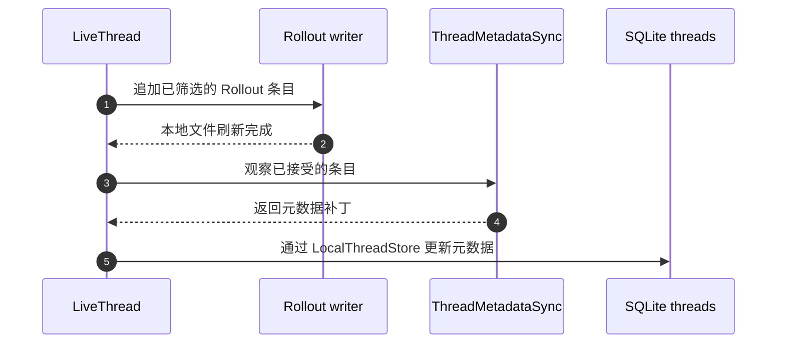
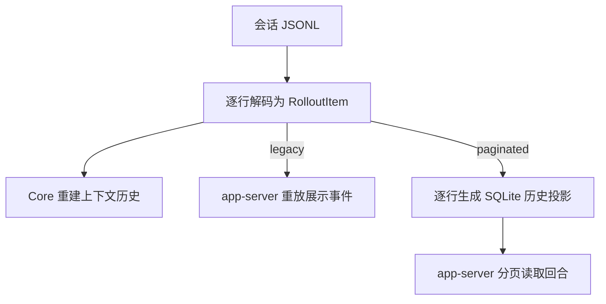

# Rollout 会话 JSONL

活跃会话通过追加 JSONL 落盘。每行是一个 `RolloutLine`，`type` 决定 `payload` 的结构。写入器首次真正落盘时先写 `session_meta`，之后按回合追加模型项、事件、上下文快照、世界状态和用量记录。读取方把行还原为 `RolloutItem`，再分别用于恢复模型历史、构建客户端回合和更新 SQLite 线程索引。

本页字段表以源码提交 `4b7a20f60c` 的 `RolloutItemWire` 为准，覆盖该枚举的全部 13 类记录。字段路径以 `payload` 为根；「是否必须」指正常写入时该键是否一定出现。文末另记一份 `0.171.0-alpha.13` 的 legacy 实测日志，便于区分样本观测和当前写入规则。 [rollout_payload.rs:36-82](https://github.com/GLBB/codex/blob/4b7a20f60cd186c0bfbb0aec2027b51b1c99efa9/codex-rs/history/src/rollout_payload.rs#L36-L82) [lib.rs:635-646](https://github.com/GLBB/codex/blob/4b7a20f60cd186c0bfbb0aec2027b51b1c99efa9/codex-rs/history/src/lib.rs#L635-L646)

## 记录类型与写入时机

同一个线程有几种需要持久化的信息。Core 恢复时要知道上一轮给模型看到了什么、应从哪份历史和上下文基线继续。app-server 要恢复回合的起止、状态和客户端条目。线程列表与索引还需要身份、来源和用量等可独立读取的字段。因此，Rollout 会为同一次操作保存不同用途的记录。以用户输入为例，Core 会把整理后的模型输入写为 `response_item`，并另外生成供客户端使用的用户条目，其中可以保留 `client_id`。 [mod.rs:6088-6098](https://github.com/GLBB/codex/blob/4b7a20f60cd186c0bfbb0aec2027b51b1c99efa9/codex-rs/core/src/session/mod.rs#L6088-L6098) [mod.rs:6112-6138](https://github.com/GLBB/codex/blob/4b7a20f60cd186c0bfbb0aec2027b51b1c99efa9/codex-rs/core/src/session/mod.rs#L6112-L6138) [mod.rs:6150-6162](https://github.com/GLBB/codex/blob/4b7a20f60cd186c0bfbb0aec2027b51b1c99efa9/codex-rs/core/src/session/mod.rs#L6150-L6162)

| `type` | `payload` | 写入时机 | 为什么单独记录 |
| --- | --- | --- | --- |
| `session_meta` | `SessionMetaLine` | 新会话首次落盘时写入。旧模式下，某些 Git 或记忆模式更新也会追加。 | 为整份文件提供身份与创建基线。读取器取第一条 `session_meta` 识别线程，索引用线程元数据建立列表记录。 [recorder.rs:1906-1925](https://github.com/GLBB/codex/blob/4b7a20f60cd186c0bfbb0aec2027b51b1c99efa9/codex-rs/rollout/src/recorder.rs#L1906-L1925) [recorder.rs:1194-1211](https://github.com/GLBB/codex/blob/4b7a20f60cd186c0bfbb0aec2027b51b1c99efa9/codex-rs/rollout/src/recorder.rs#L1194-L1211) [update_thread_metadata.rs:160-212](https://github.com/GLBB/codex/blob/4b7a20f60cd186c0bfbb0aec2027b51b1c99efa9/codex-rs/thread-store/src/local/update_thread_metadata.rs#L160-L212) [extract.rs:85-109](https://github.com/GLBB/codex/blob/4b7a20f60cd186c0bfbb0aec2027b51b1c99efa9/codex-rs/state/src/extract.rs#L85-L109) |
| `dynamic_tools_updated` | `{thread_id, tools}` | 持久化线程整体替换动态工具目录时，先追加完整目录，再更新内存配置。 | 工具目录可以在回合之外变化。恢复时取本线程最近的完整目录，空数组表示显式清空，因此不会回退到创建时的旧工具。 [thread_settings.rs:24-56](https://github.com/GLBB/codex/blob/4b7a20f60cd186c0bfbb0aec2027b51b1c99efa9/codex-rs/core/src/session/thread_settings.rs#L24-L56) [lib.rs:802-825](https://github.com/GLBB/codex/blob/4b7a20f60cd186c0bfbb0aec2027b51b1c99efa9/codex-rs/history/src/lib.rs#L802-L825) |
| `response_item` | `ResponseItem`，可带 `id_allocation` | 用户输入、模型输出、工具调用或结果等被接受进可持久化历史时。 | 保存 Core 能逐项重放的模型历史。比如工具结果仍以工具输出的结构和调用标识保存，恢复后可与对应调用配对。客户端回合的状态和展示条目主要从 `event_msg` 投影。 [mod.rs:4247-4287](https://github.com/GLBB/codex/blob/4b7a20f60cd186c0bfbb0aec2027b51b1c99efa9/codex-rs/core/src/session/mod.rs#L4247-L4287) [rollout_reconstruction.rs:588-597](https://github.com/GLBB/codex/blob/4b7a20f60cd186c0bfbb0aec2027b51b1c99efa9/codex-rs/core/src/session/rollout_reconstruction.rs#L588-L597) [thread_history.rs:471-555](https://github.com/GLBB/codex/blob/4b7a20f60cd186c0bfbb0aec2027b51b1c99efa9/codex-rs/app-server-protocol/src/protocol/thread_history.rs#L471-L555) |
| `inter_agent_communication` | `InterAgentCommunication` | 旧版写入完整的代理通信结构。当前常规路径分别追加元数据行与正文 `response_item`。 | 让旧文件里的代理消息继续可用。Core 将旧记录中的发送方、接收方和正文转换为模型输入，再恢复到历史。 [rollout_reconstruction.rs:591-598](https://github.com/GLBB/codex/blob/4b7a20f60cd186c0bfbb0aec2027b51b1c99efa9/codex-rs/core/src/session/rollout_reconstruction.rs#L591-L598) [代理消息落盘改动](https://github.com/GLBB/codex/commit/b4f0f3eff1303ea445a218afb039e0079df0afce) |
| `inter_agent_communication_metadata` | `{trigger_turn}` | 当前 Core 接受代理消息时，紧挨着写在正文 `response_item` 之前。 | 在正文使用模型历史格式的同时，单独保留触发标记与通信边界。回滚计划用该记录识别随后到来的 `agent_message` 属于一次代理通信。 [mod.rs:4836-4846](https://github.com/GLBB/codex/blob/4b7a20f60cd186c0bfbb0aec2027b51b1c99efa9/codex-rs/core/src/session/mod.rs#L4836-L4846) [rollback_plan.rs:152-161](https://github.com/GLBB/codex/blob/4b7a20f60cd186c0bfbb0aec2027b51b1c99efa9/codex-rs/thread-store/src/local/rollout_migration/rollback_plan.rs#L152-L161) [rollback_plan.rs:260-268](https://github.com/GLBB/codex/blob/4b7a20f60cd186c0bfbb0aec2027b51b1c99efa9/codex-rs/thread-store/src/local/rollout_migration/rollback_plan.rs#L260-L268) |
| `compacted` | `CompactedItem` | 安装压缩结果时。 | 标记从哪里换用压缩后的历史。恢复可以采用仍然有效的 `replacement_history`，再重放其后的记录，同时恢复窗口、累计用量与保留证据等检查点数据。 [mod.rs:5060-5100](https://github.com/GLBB/codex/blob/4b7a20f60cd186c0bfbb0aec2027b51b1c99efa9/codex-rs/core/src/session/mod.rs#L5060-L5100) [rollout_reconstruction.rs:257-280](https://github.com/GLBB/codex/blob/4b7a20f60cd186c0bfbb0aec2027b51b1c99efa9/codex-rs/core/src/session/rollout_reconstruction.rs#L257-L280) [rollout_reconstruction.rs:335-363](https://github.com/GLBB/codex/blob/4b7a20f60cd186c0bfbb0aec2027b51b1c99efa9/codex-rs/core/src/session/rollout_reconstruction.rs#L335-L363) |
| `turn_context` | `TurnContextItem` 加兼容字段 | 真实用户回合保存上下文基线时，压缩重建基线时也写入。 | 记录该回合实际使用的模型、目录、权限配置等设置。即使模型没有收到新的上下文差异，恢复也能找回上一轮的设置与比较基准。 [mod.rs:5761-5782](https://github.com/GLBB/codex/blob/4b7a20f60cd186c0bfbb0aec2027b51b1c99efa9/codex-rs/core/src/session/mod.rs#L5761-L5782) [rollout_reconstruction.rs:406-431](https://github.com/GLBB/codex/blob/4b7a20f60cd186c0bfbb0aec2027b51b1c99efa9/codex-rs/core/src/session/rollout_reconstruction.rs#L406-L431) |
| `token_usage_record` | `TokenUsageRecord` | 收到带 `response_id` 和用量的模型响应时，也包括报告了这两项的未完成响应。 | 用 `response_id` 关联单次用量，同时保存回合和线程累计。恢复可以从最近一条记录或压缩检查点续算。`event_msg` 里的 `token_count` 另供客户端显示上下文用量、限额等信息。 [mod.rs:2155-2174](https://github.com/GLBB/codex/blob/4b7a20f60cd186c0bfbb0aec2027b51b1c99efa9/codex-rs/core/src/session/mod.rs#L2155-L2174) [mod.rs:5785-5813](https://github.com/GLBB/codex/blob/4b7a20f60cd186c0bfbb0aec2027b51b1c99efa9/codex-rs/core/src/session/mod.rs#L5785-L5813) [mod.rs:5856-5877](https://github.com/GLBB/codex/blob/4b7a20f60cd186c0bfbb0aec2027b51b1c99efa9/codex-rs/core/src/session/mod.rs#L5856-L5877) [mod.rs:6036-6042](https://github.com/GLBB/codex/blob/4b7a20f60cd186c0bfbb0aec2027b51b1c99efa9/codex-rs/core/src/session/mod.rs#L6036-L6042) |
| `world_state` | `WorldStateItem` | 首次建立状态基线、某个状态分区变化或压缩重建时。 | 让恢复后的 Core 还能判断动态状态有哪些变化，例如模型可见的工具目录。它按顺序读取全量快照和增量补丁，得到下一次生成上下文差异所需的结构化基线。 [mod.rs:4303-4334](https://github.com/GLBB/codex/blob/4b7a20f60cd186c0bfbb0aec2027b51b1c99efa9/codex-rs/core/src/session/mod.rs#L4303-L4334) [mod.rs:5092-5100](https://github.com/GLBB/codex/blob/4b7a20f60cd186c0bfbb0aec2027b51b1c99efa9/codex-rs/core/src/session/mod.rs#L5092-L5100) [rollout_reconstruction.rs:645-661](https://github.com/GLBB/codex/blob/4b7a20f60cd186c0bfbb0aec2027b51b1c99efa9/codex-rs/core/src/session/rollout_reconstruction.rs#L645-L661) |
| `retained_context` | `RetainedContextEvent` | 宿主确认并保留一条证据时，例如收到交互式问题的答案。 | 压缩可能替换原来的模型历史，审阅仍需要宿主核验过的事实。恢复时先读取压缩检查点，再应用后续证据。已确认的助手消息投递有专门的兼容编码，落盘为带标记的 `response_item`。 [request_user_input.rs:128-150](https://github.com/GLBB/codex/blob/4b7a20f60cd186c0bfbb0aec2027b51b1c99efa9/codex-rs/core/src/tools/handlers/request_user_input.rs#L128-L150) [prompt.rs:118-124](https://github.com/GLBB/codex/blob/4b7a20f60cd186c0bfbb0aec2027b51b1c99efa9/codex-rs/core/src/guardian/prompt.rs#L118-L124) [rollout_reconstruction.rs:544-556](https://github.com/GLBB/codex/blob/4b7a20f60cd186c0bfbb0aec2027b51b1c99efa9/codex-rs/core/src/session/rollout_reconstruction.rs#L544-L556) [rollout_reconstruction.rs:583-593](https://github.com/GLBB/codex/blob/4b7a20f60cd186c0bfbb0aec2027b51b1c99efa9/codex-rs/core/src/session/rollout_reconstruction.rs#L583-L593) [rollout_payload.rs:218-269](https://github.com/GLBB/codex/blob/4b7a20f60cd186c0bfbb0aec2027b51b1c99efa9/codex-rs/history/src/rollout_payload.rs#L218-L269) |
| `security_risk_score` | `SecurityRiskScore` | Guardian V2 接受当次分类结果、启用了分值持久化且线程可落盘时。 | 给工具动作的风险判断留下可按 `call_id` 和采样时间核对的记录。该记录由分类器产生，Core 的模型历史回放和客户端条目投影都会跳过。 [classification.rs:410-453](https://github.com/GLBB/codex/blob/4b7a20f60cd186c0bfbb0aec2027b51b1c99efa9/codex-rs/ext/guardian-v2/src/async_scorer/classification.rs#L410-L453) [security_risk.rs:8-25](https://github.com/GLBB/codex/blob/4b7a20f60cd186c0bfbb0aec2027b51b1c99efa9/codex-rs/protocol/src/security_risk.rs#L8-L25) |
| `event_msg` | `EventMsg` | Core 发出符合当前历史模式持久化规则的事件时。 | 保存单看模型消息推不出的运行事实，例如回合完成、中断、回滚和客户端条目完成。Core 用其中的边界和回滚事件判断有效历史，app-server 用事件投影回合状态与展示项。 [policy.rs:130-161](https://github.com/GLBB/codex/blob/4b7a20f60cd186c0bfbb0aec2027b51b1c99efa9/codex-rs/rollout/src/policy.rs#L130-L161) [rollout_reconstruction.rs:365-405](https://github.com/GLBB/codex/blob/4b7a20f60cd186c0bfbb0aec2027b51b1c99efa9/codex-rs/core/src/session/rollout_reconstruction.rs#L365-L405) [thread_history_projection.rs:35-74](https://github.com/GLBB/codex/blob/4b7a20f60cd186c0bfbb0aec2027b51b1c99efa9/codex-rs/app-server-protocol/src/protocol/thread_history_projection.rs#L35-L74) |
| `realtime_item` | `RealtimeItem` | `paginated` 模式中，记录实时会话、转写帧或输入交接时。 | 实时交谈有自己的会话与事件顺序，部分转写随后才进入代理回合。独立记录支持按实时历史分页，并能通过交接回执关联输入与来源事件。 [realtime.rs:33-76](https://github.com/GLBB/codex/blob/4b7a20f60cd186c0bfbb0aec2027b51b1c99efa9/codex-rs/protocol/src/realtime.rs#L33-L76) [realtime_history.rs:94-119](https://github.com/GLBB/codex/blob/4b7a20f60cd186c0bfbb0aec2027b51b1c99efa9/codex-rs/core/src/session/realtime_history.rs#L94-L119) [realtime_stream.rs:99-115](https://github.com/GLBB/codex/blob/4b7a20f60cd186c0bfbb0aec2027b51b1c99efa9/codex-rs/thread-store/src/local/thread_history/realtime_stream.rs#L99-L115) |

`session_meta.payload.history_mode` 决定展示历史的落盘形态。两种模式都可保存模型历史 `response_item` 和回合事件 `event_msg`。`legacy` 保留旧版展示事件，省略行级 `ordinal`。`paginated` 主要用 `event_msg.payload.type = "item_completed"` 保存用于回放的已完成条目，并写入 `ordinal`，支持持久化 `realtime_item`。 [policy.rs:22-41](https://github.com/GLBB/codex/blob/4b7a20f60cd186c0bfbb0aec2027b51b1c99efa9/codex-rs/rollout/src/policy.rs#L22-L41) [policy.rs:130-161](https://github.com/GLBB/codex/blob/4b7a20f60cd186c0bfbb0aec2027b51b1c99efa9/codex-rs/rollout/src/policy.rs#L130-L161) [policy.rs:233-254](https://github.com/GLBB/codex/blob/4b7a20f60cd186c0bfbb0aec2027b51b1c99efa9/codex-rs/rollout/src/policy.rs#L233-L254) [ordinal.rs:23-43](https://github.com/GLBB/codex/blob/4b7a20f60cd186c0bfbb0aec2027b51b1c99efa9/codex-rs/rollout/src/ordinal.rs#L23-L43)

## 行外壳 `RolloutLine`

| 字段分类 | 字段 | 是否必须 | 类型 | 描述 |
| --- | --- | --- | --- | --- |
| 行外壳 | `timestamp` | 必须 | string | 写行时间，UTC RFC3339 毫秒。不是会话创建时间。 |
| 行外壳 | `ordinal` | 可选 | integer | 行级回放序号，仅 `paginated` 历史模式写入；`legacy` 省略。 |
| 行外壳 | `type` | 必须 | enum string | 上表的 13 类记录之一，由 `RolloutItemWire` 的 `snake_case` 标签给出。 |
| 行外壳 | `payload` | 必须 | object | 记录内容。多数记录把底层结构展平到这一层。 |
| 行外壳 | `metadata` | 可选 | object | 仅 `response_item` 有的宿主元数据，见下一节；与 `payload` 平级。 |

Rust 中使用 `parse_rollout_line` 或 `decode_rollout_line` 读取。启用 `serde_json/arbitrary_precision` 时，Serde 的通用缓冲层可能无法还原展平或内部标记结构里的嵌套浮点数。规范解码器先解析 JSON 对象，再分别处理行外壳和记录内容。 [lib.rs:44-84](https://github.com/GLBB/codex/blob/4b7a20f60cd186c0bfbb0aec2027b51b1c99efa9/codex-rs/rollout/src/lib.rs#L44-L84) [tests.rs:55-72](https://github.com/GLBB/codex/blob/4b7a20f60cd186c0bfbb0aec2027b51b1c99efa9/codex-rs/rollout/src/tests.rs#L55-L72)

## 行级元数据 `metadata`

`CodexHarnessMetadata` 只挂在 `response_item` 行上，记录模型不可见的历史信息：序号、保留策略、图片来源和投递证据。未知键会被静默忽略，因此不同构建写出的新键不会导致旧读端失败。 [lib.rs:72-192](https://github.com/GLBB/codex/blob/4b7a20f60cd186c0bfbb0aec2027b51b1c99efa9/codex-rs/history/src/lib.rs#L72-L195)

| 字段分类 | 字段 | 是否必须 | 类型 | 描述 |
| --- | --- | --- | --- | --- |
| 实时来源 | `realtime_handoff` | 可选 | object | 普通回合输入由实时会话交接时的来源，见下表。 |
| 实时来源 | `realtime_session_input` | 可选 | object | 保存到模型历史的实时转写片段来源。 |
| 实时来源 | `realtime_session_end_input` | 可选 | boolean | 记录的是通话结束时的上下文，不创建用户回合；`false` 时省略。 |
| 序列 | `history_sequence` | 可选 | integer | 线程内追加序号。压缩保留被保留输入的序号身份。 |
| 序列 | `sampled_through_sequence` | 可选 | integer | 已进入「记录了模型输出」的常规请求的最大输入序号；压缩只携带不推进。 |
| 图片 | `image_replay_sources` | 可选 | array\<object\> | 原始内联图片来源，resume 或 fork 时重新清洗用；空数组省略。 |
| 保留证据 | `guardian_sources` | 可选 | array\<object\> | 该 Guardian 消息实际投递的保留记录；仅宿主可见。 |
| 保留证据 | `guardian_review_ids` | 可选 | array\<string 或 object\> | 该完整 Guardian 消息投递的同步评审 ID。 |
| 保留证据 | `guardian_source_order_guidance` | 可选 | boolean | 该消息是否投递了保留来源顺序标签；`false` 时省略。 |
| 保留证据 | `guardian_retained_omissions` | 可选 | object | 分区省略投递证明；缺失表示未知，不代表完整。 |
| 保留证据 | `retained_source` | 可选 | object | 该历史项精确对应的原始保留证据。 |
| 上下文 | `additional_context_tool_output` | 可选 | boolean | 客户端提供的不可信附加上下文被渲染成独立工具输出的标记。 |
| 作者 | `client_authored` | 必须 | boolean | 历史字段：developer 消息是否由客户端提供；缺省写 `false`，仅用于解释旧 rollout。 |
| 保留策略 | `retain_across_windows` | 可选 | boolean | 逐项覆盖线程的跨上下文窗口保留策略，永不发给模型。 |
| 保留策略 | `retain_in_children` | 可选 | boolean | 覆盖 spawn 子代理时的继承行为。 |
| 预算 | `fallback_token_limit_override` | 可选 | integer | 原始历史预算（token，含工具专项额度），回放持久历史时复用。Rust 字段名是 `history_truncation_token_limit`。 |
| 预算 | `tool_audio_budget_applied` | 可选 | boolean | 核心在工具音频仍按内联成本计时已应用历史限额；`false` 时省略。 |
| 投递 | `delivered_assistant_message` | 可选 | string | 历史形态可携带宿主确认的有界助手文本。当前兼容编码也用此字段写投递标记，见下文。 |
| 投递 | `delivered_assistant_message_incomplete` | 可选 | boolean | 已确认投递但在保留限额内拿不到全文。 |
| 配置 | `harness_authored_configuration` | 可选 | boolean | 该 `configuration_update` 是否由 harness 自己创建。 |
| 压缩 | `compaction_without_file_error_sources` | 可选 | boolean | 该 opaque 压缩检查点的输入不含音频或文件型图片。 |
| 压缩 | `compaction_model_hash` | 可选 | string | 生成该检查点的生产者兼容哈希，不是当前模型。 |
| 顺序 | `user_input_order` | 可选 | integer | 用户接受或助手投递顺序，独立于排队输入的记录顺序。 |
| 压缩 | `compaction_output` | 可选 | boolean | 该输出由压缩生成，不是原始用户可见的助手消息。 |
| 多代理 | `inherited_user_message` | 可选 | boolean | 从父线程复制的用户或助手上下文，不得当作子线程的本地授权。 |
| 多代理 | `sender_user_messages` | 可选 | object | 任务消息被接受时宿主捕获的发送方证据。 |

`producer_bounded_tool_audio` 带 `#[serde(skip)]`，只用于写入前的预算计算，不会出现在文件里。

| 字段分类 | 字段 | 是否必须 | 类型 | 描述 |
| --- | --- | --- | --- | --- |
| `realtime_handoff` | `event_id` | 必须 | string | 实时事件 ID。 |
| `realtime_handoff` | `realtime_session_id` | 必须 | string | 实时会话 ID。 |
| `realtime_handoff` | `observed_at_ms` | 必须 | integer | 观测时间，Unix 毫秒。 |
| `realtime_handoff` | `handoff_id` | 必须 | string | 交接标识；`realtime_handoff_id()` 读取它。 |
| `realtime_handoff` | `mode` | 必须 | enum string | `start` 或 `steer`。 |
| `realtime_handoff` | `source_event_ids` | 必须 | array\<string\> | 组成该输入的原始实时事件。 |
| `realtime_session_input` | `event_id` | 必须 | string | 实时事件 ID。 |
| `realtime_session_input` | `realtime_session_id` | 必须 | string | 实时会话 ID。 |
| `realtime_session_input` | `observed_at_ms` | 必须 | integer | 观测时间，Unix 毫秒。 |
| `realtime_session_input` | `source_event_ids` | 必须 | array\<string\> | 该转写片段的来源事件。 |
| `image_replay_sources[]` | `prepared_url_digest` | 必须 | array\<integer\> | 已准备 URL 的摘要字节。 |
| `image_replay_sources[]` | `detail` | 必须（可为 null） | enum string 或 null | `auto`、`low`、`high`、`original`；无提示时写 `null`。 |
| `image_replay_sources[]` | `original_data_url` | 必须 | string | 原始 data URL。 |
| `retained_source` | `id` | 必须 | object | 原始消息身份，子字段见下一行组。 |
| `retained_source.id` | `message_id` | 必须 | string | 原始消息 ID。 |
| `retained_source.id` | `turn_id` | 必须 | string | 原始回合 ID。 |
| `retained_source.id` | `role` | 必须 | enum string | `user` 或 `assistant`。 |
| `retained_source` | `revision` | 必须 | string 或 object | 宿主观察到的不可复用版本；结构化形态带 `id_allocation`。 |
| `retained_source` | `complete` | 必须 | boolean | 证据是否完整；内容被截短时为 `false`。 |
| `guardian_retained_omissions` | `user_instructions` | 必须 | boolean | 用户指令区是否发生了省略投递。 |
| `guardian_retained_omissions` | `assistant_context` | 必须 | boolean | 助手上下文区是否发生了省略投递。 |
| `sender_user_messages` | `receiver_turn_id` | 必须 | string | 接收方回合 ID。 |
| `sender_user_messages` | `receiver_message_id` | 必须 | string | 接收方消息 ID。 |
| `sender_user_messages` | `text` | 必须 | string | 渲染后的发送方证据文本。 |

## 会话元数据 `session_meta.payload`

`payload` 是展平的 `SessionMetaLine`，所以线程 ID 的路径是 `payload.id`。首次落盘时写入器还会从 `cwd` 采集 Git 信息。在 `legacy` 模式下，后续的 Git 或记忆模式更新可重读文件头、打补丁后再追加一整条 `session_meta`。读取器以第一条识别线程与创建参数。`paginated` 模式下，这类元数据更新保存到 SQLite。 [update_thread_metadata.rs:146-176](https://github.com/GLBB/codex/blob/4b7a20f60cd186c0bfbb0aec2027b51b1c99efa9/codex-rs/thread-store/src/local/update_thread_metadata.rs#L146-L176) [protocol.rs:3568-3690](https://github.com/GLBB/codex/blob/4b7a20f60cd186c0bfbb0aec2027b51b1c99efa9/codex-rs/protocol/src/protocol.rs#L3568-L3690) [recorder.rs:2009-2034](https://github.com/GLBB/codex/blob/4b7a20f60cd186c0bfbb0aec2027b51b1c99efa9/codex-rs/rollout/src/recorder.rs#L2009-L2034) [capabilities.rs:57-84](https://github.com/GLBB/codex/blob/4b7a20f60cd186c0bfbb0aec2027b51b1c99efa9/codex-rs/protocol/src/capabilities.rs#L57-L84) [protocol.rs:3353-3365](https://github.com/GLBB/codex/blob/4b7a20f60cd186c0bfbb0aec2027b51b1c99efa9/codex-rs/protocol/src/protocol.rs#L3353-L3365)

| 字段分类 | 字段 | 是否必须 | 类型 | 描述 |
| --- | --- | --- | --- | --- |
| 身份 | `id` | 必须 | UUID 字符串 | 线程 ID。全量加载器取文件中第一条 `session_meta` 的 `id`。 |
| 身份 | `session_id` | 必须 | UUID 字符串 | 根会话 ID，等于根线程 ID；旧数据缺失时读取器用 `id` 补齐。 |
| 身份 | `timestamp` | 必须 | string | 会话创建时间，UTC 毫秒。追加元数据时仍写原值。 |
| 身份 | `cwd` | 必须 | string | 创建线程时的工作目录。每轮目录见 `turn_context.payload.cwd`。 |
| 身份 | `originator` | 必须 | string | 写入端标识，如 `codex_cli_rs`、`codex_vscode`。 |
| 身份 | `cli_version` | 必须 | string | 创建线程的 CLI 版本。 |
| 身份 | `account_scoped` | 可选 | boolean | 是否按创建者账号过滤；`false` 时省略，旧线程没有该字段。 |
| 身份 | `creator_user_id` | 可选 | string | 创建线程的 ChatGPT 用户 ID。 |
| 身份 | `creator_account_id` | 可选 | string | 创建时选择的 ChatGPT 账号 ID，恢复时不会更新。 |
| 身份 | `runtime_workspace_roots` | 可选 | array\<string\> | 创建时默认环境的工作区根；缺省表示未知，空数组表示没有根。 |
| 身份 | `selected_capability_roots` | 可选 | array\<object\> | 托管平台为该线程选择的能力根；空数组省略。 |
| 身份 | `memory_mode` | 可选 | enum string | `enabled` 或 `disabled`。缺省按 `enabled` 处理。 |
| 身份 | `history_mode` | 必须 | enum string | `legacy` 或 `paginated`，缺省 `legacy`。决定是否写 `ordinal` 和是否使用分页继承。 |
| 身份 | `history_base` | 可选 | object | 从另一条分页 rollout 继承的排他前缀，见下表。 |
| 身份 | `subagent_history_start_ordinal` | 可选 | integer | 子代理自身投影历史的首个序号；更早记录只作为继承上下文。 |
| 身份 | `multi_agent_version` | 可选 | enum string | `disabled`、`v1` 或 `v2`。恢复历史时优先取匹配本线程且带值的最近一条 `session_meta`。 |
| 身份 | `context_window` | 可选 | object | 初始上下文窗口身份，供只 tail 文件的消费者在首次压缩前定位窗口。 |
| 来源 | `source` | 必须 | enum string 或 tagged object | 会话来源，缺省 `vscode`。带载荷形态见下表。 |
| 来源 | `thread_source` | 可选 | enum string | 分析分类：`user`、`subagent`、`guardian_review`、`memory_consolidation`；未知值按自定义 feature 字符串保留。 |
| 来源 | `agent_nickname` | 可选 | string | 子代理昵称。 |
| 来源 | `agent_role` | 可选 | string | 子代理角色，兼容读取旧键 `agent_type`。 |
| 来源 | `agent_path` | 可选 | string | 子代理规范路径。 |
| 来源 | `model_provider` | 必须（可为 null） | string 或 null | 会话使用的供应商配置 ID；未知时写 `null`。 |
| Fork | `forked_from_id` | 可选 | UUID 字符串 | 逻辑父线程 ID。 |
| Fork | `attached_thread` | 可选 | boolean | 该 fork 是否附着到 `forked_from_id`；`false` 时省略。 |
| Fork | `forked_from_ordinal_exclusive` | 可选 | integer | 从逻辑父线程继承的排他序号，独立于 `history_base`。 |
| Fork | `parent_thread_id` | 可选 | UUID 字符串 | 直接父线程 ID。 |
| 指令 | `base_instructions` | 必须（可为 null） | object 或 null | 线程基础模型指令，见下表；旧数据可为 `null`，读取方回退到模型模板。 |
| 指令 | `dynamic_tools` | 可选 | array\<object\> | 线程注册的动态工具目录，见下表。 |
| Git | `git` | 可选 | object | 写入时从 `cwd` 采集的仓库信息，见下表。 |

| 字段分类 | 字段 | 是否必须 | 类型 | 描述 |
| --- | --- | --- | --- | --- |
| `source` | `source` | 必须 | enum string | 无载荷取值 `cli`、`vscode`、`exec`、`mcp`、`unknown`。 |
| `source` | `source.custom` | 可选 | string | 自定义来源标签。 |
| `source` | `source.internal` | 可选 | enum string | 内部会话：`memory_consolidation` 或 `guardian`。 |
| `source` | `source.subagent` | 可选 | enum string 或 tagged object | 无载荷取 `review`、`compact`、`memory_consolidation`；带载荷为 `{"thread_spawn":{...}}` 或 `{"other":"..."}`。 |
| `source.subagent.thread_spawn` | `parent_thread_id` | 必须 | UUID 字符串 | 启动该子代理的父线程。 |
| `source.subagent.thread_spawn` | `depth` | 必须 | integer | 派生深度。 |
| `source.subagent.thread_spawn` | `agent_path` | 必须（可为 null） | string 或 null | 派生时记录的规范路径。 |
| `source.subagent.thread_spawn` | `agent_nickname` | 必须（可为 null） | string 或 null | 派生时记录的昵称。 |
| `source.subagent.thread_spawn` | `agent_role` | 必须（可为 null） | string 或 null | 派生时记录的角色，兼容旧键 `agent_type`。 |
| `source.subagent` | `other` | 可选 | string | 其他子代理来源标签。 |
| `git` | `commit_hash` | 可选 | string | 当前提交 SHA，清空时该键省略。 |
| `git` | `branch` | 可选 | string | 分支名。 |
| `git` | `repository_url` | 可选 | string | 远端 URL，写入前已去除认证信息。 |
| `base_instructions` | `text` | 必须 | string | 基础指令正文。 |
| `base_instructions` | `provenance` | 可选 | tagged object | `{"type":"custom"}` 表示用户显式配置；`{"type":"model","model":"..."}` 表示由该模型模板生成。 |
| `dynamic_tools[]` | `type` | 必须 | enum string | `function` 或 `namespace`。 |
| `dynamic_tools[]` | `name` | 必须 | string | 工具或命名空间名称。 |
| `dynamic_tools[]` | `description` | 必须 | string | 展示给模型的描述。 |
| `dynamic_tools[]` | `inputSchema` | 必须（function） | 任意 JSON | 参数 JSON Schema，键名为 camelCase。 |
| `dynamic_tools[]` | `deferLoading` | 可选 | boolean | 是否延迟暴露；兼容读取旧键 `exposeToContext` 的反值，显式字段优先。 |
| `dynamic_tools[]` | `tools` | 必须（namespace） | array\<object\> | 命名空间成员，元素为 `function` 形态。 |
| `selected_capability_roots[]` | `id` | 必须 | string | 平台提供的稳定根标识。 |
| `selected_capability_roots[]` | `location.type` | 必须 | enum string | 目前只有 `environment`。 |
| `selected_capability_roots[]` | `location.environmentId` | 必须 | string | 根所属执行环境。 |
| `selected_capability_roots[]` | `location.path` | 必须 | string | 该环境中的 `PathUri` 字符串，例如 `file:///C:/plugins/demo`。当前读端也接受可转换的旧路径字符串。 |
| `history_base` | `thread_id` | 必须 | UUID 字符串 | 前缀文件的 rollout ID。普通线程等于线程 ID，revert 后则是不同的 rollout ID。 |
| `history_base` | `end_ordinal_exclusive` | 必须 | integer | 从该前缀文件继承到的排他序号。 |
| `history_base` | `end_byte_offset` | 必须 | integer | 前缀文件最后一条被包含记录之后的字节偏移。 |
| `context_window` | `window_id` | 必须 | string 或 object | 模型可见窗口身份，通常是 UUIDv7；也可能是带分配序号的窗口对象。 |

从 `legacy` 文件提取时，Git 按顺序应用本线程元数据中的更新，记忆模式从后往前取首个有值的记录。查询 `paginated` 线程的当前 Git 和记忆模式时，使用 SQLite 中的线程元数据。文件头提供创建时的记录。 [metadata.rs:111-186](https://github.com/GLBB/codex/blob/4b7a20f60cd186c0bfbb0aec2027b51b1c99efa9/codex-rs/rollout/src/metadata.rs#L111-L186) [metadata.rs:319-346](https://github.com/GLBB/codex/blob/4b7a20f60cd186c0bfbb0aec2027b51b1c99efa9/codex-rs/rollout/src/metadata.rs#L319-L346) [update_thread_metadata.rs:146-176](https://github.com/GLBB/codex/blob/4b7a20f60cd186c0bfbb0aec2027b51b1c99efa9/codex-rs/thread-store/src/local/update_thread_metadata.rs#L146-L176)

## 回合上下文 `turn_context.payload`

真实用户回合会保存 `turn_context` 比较基线，压缩重建基线时也可写入。当前写入器写 `permission_profile`，并为旧读端生成 `sandbox_policy` 及必要的 `file_system_sandbox_policy`。读取时优先取 `permission_profile`。旧记录缺少它或值为 `null` 时，读端用旧沙箱策略和可用的细分规则构造权限配置。 [mod.rs:5761-5782](https://github.com/GLBB/codex/blob/4b7a20f60cd186c0bfbb0aec2027b51b1c99efa9/codex-rs/core/src/session/mod.rs#L5761-L5782) [mod.rs:5092-5100](https://github.com/GLBB/codex/blob/4b7a20f60cd186c0bfbb0aec2027b51b1c99efa9/codex-rs/core/src/session/mod.rs#L5092-L5100) [rollout_payload.rs:84-136](https://github.com/GLBB/codex/blob/4b7a20f60cd186c0bfbb0aec2027b51b1c99efa9/codex-rs/history/src/rollout_payload.rs#L84-L136) [protocol.rs:3794-3843](https://github.com/GLBB/codex/blob/4b7a20f60cd186c0bfbb0aec2027b51b1c99efa9/codex-rs/protocol/src/protocol.rs#L3794-L3843)

| 字段分类 | 字段 | 是否必须 | 类型 | 描述 |
| --- | --- | --- | --- | --- |
| 回合 | `turn_id` | 可选 | string | 当前回合 ID；旧记录可能没有。 |
| 回合 | `root_turn_id` | 可选 | string | 本回合归属的根回合 ID。 |
| 回合 | `direct_only_tool_namespaces` | 可选 | array\<string\> | 本轮的直接工具命名空间路由；空数组表示清空。 |
| 插件 | `disabled_plugin_ids` | 可选 | array\<string\> | 本轮禁用的插件 ID；空数组表示没有禁用项。 |
| 上下文 | `cwd` | 必须 | string | 本轮工作目录，也是旧版沙箱策略反推的基准。 |
| 权限 | `approval_policy` | 必须 | enum string 或 tagged object | `untrusted`、`on-request`、`never`，或带五个布尔项的 `{"granular":{...}}`。 |
| 权限 | `approvals_reviewer` | 可选 | enum string | `user` 或 `auto_review`；兼容旧值 `guardian_subagent`。 |
| 权限 | `permission_profile` | 必须 | tagged object | 当前写入的运行时权限，见下表。兼容读取时可由旧字段构造。 |
| 权限 | `active_permission_profile` | 可选 | object | 产生该权限的命名或内置配置标识。 |
| 权限 | `sandbox_policy` | 必须 | tagged object | 由权限配置反推。读旧记录时，缺少 `permission_profile` 则要求该字段。 |
| 权限 | `file_system_sandbox_policy` | 可选 | object | 兼容的细分文件系统规则，写出时与旧策略推导结果一致可省略。读取旧权限时可用它恢复细分规则。 |
| 模型 | `model` | 必须 | string | 本轮模型 slug。SQLite 的最近模型与窗口计算取它。 |
| 模型 | `comp_hash` | 可选 | string | 压缩模板或模型配置哈希，用于判断压缩行为是否变化。 |
| 协作 | `collaboration_mode` | 可选 | object | 本轮协作模式与设置，见下表。 |
| 多代理 | `multi_agent_version` | 可选 | enum string | `disabled`、`v1` 或 `v2`。找不到匹配且带值的 `session_meta` 时，才从 `turn_context` 或压缩恢复元数据回退取值。 [lib.rs:855-868](https://github.com/GLBB/codex/blob/4b7a20f60cd186c0bfbb0aec2027b51b1c99efa9/codex-rs/history/src/lib.rs#L855-L868) [compaction_resume_metadata.rs:61-69](https://github.com/GLBB/codex/blob/4b7a20f60cd186c0bfbb0aec2027b51b1c99efa9/codex-rs/history/src/compaction_resume_metadata.rs#L61-L69) |
| 实时 | `realtime_active` | 可选 | boolean | 本轮是否启用实时通道。 |
| 安全 | `cyber_access_program` | 可选 | enum string | `standard`、`daybreak_blue` 或 `daybreak_red`；是否授权仍由服务端决定。 |
| 推理 | `effort` | 可选 | enum string | 推理强度：`none`、`minimal`、`low`、`medium`、`high`、`xhigh`、`max`、`ultra`、`persistent`，或模型自定义值。 |
| 推理 | `summary` | 可选 | enum string | `auto`、`concise`、`detailed`、`none`。当前写入路径固定写 `none` 作为旧读端占位。 |

| 字段分类 | 字段 | 是否必须 | 类型 | 描述 |
| --- | --- | --- | --- | --- |
| `permission_profile` | `type` | 必须 | enum string | `managed`（Codex 自建沙箱）、`disabled`（关闭外层沙箱）或 `external`（调用方负责隔离）。 |
| `permission_profile` | `file_system` | 必须（managed） | tagged object | `{"type":"restricted","entries":[...]}` 或 `{"type":"unrestricted"}`。 |
| `permission_profile.file_system` | `entries[]` | 必须（restricted；可为空） | array\<object\> | 文件系统条目，按顺序与具体度合并。 |
| `permission_profile.file_system.entries[]` | `path` | 必须 | tagged object | `{"type":"path","path":"..."}`、`{"type":"glob_pattern","pattern":"..."}` 或特殊位置对象，如 `{"type":"special","value":{"kind":"root"}}`。`value.kind` 还可取 `minimal`、`project_roots`、`tmpdir`、`slash_tmp`、`unknown`。`project_roots` 可带 `subpath`，`unknown` 含 `path` 及可选的 `subpath`。 [permissions.rs:149-176](https://github.com/GLBB/codex/blob/4b7a20f60cd186c0bfbb0aec2027b51b1c99efa9/codex-rs/protocol/src/permissions.rs#L149-L176) [permissions.rs:435-454](https://github.com/GLBB/codex/blob/4b7a20f60cd186c0bfbb0aec2027b51b1c99efa9/codex-rs/protocol/src/permissions.rs#L435-L454) |
| `permission_profile.file_system.entries[]` | `access` | 必须 | enum string | `read`、`write`、`deny`；冲突时 `deny` 优先于 `write`，`write` 优先于 `read`。 |
| `permission_profile.file_system.entries[]` | `missing_path_behavior` | 可选 | enum string | 目前只有 `skip`：路径不存在时跳过。 |
| `permission_profile.file_system` | `glob_scan_max_depth` | 可选 | integer | glob 扫描深度上限。 |
| `permission_profile` | `network` | 必须（managed、external） | enum string | `restricted` 或 `enabled`。 |
| `file_system_sandbox_policy` | `kind` | 必须 | enum string | `restricted`、`unrestricted`、`external-sandbox`。注意用的是 `kind` 而不是 `type`。 |
| `file_system_sandbox_policy` | `entries[]` | 可选 | array\<object\> | 条目形状与权限配置中的 `entries[]` 相同。 |
| `file_system_sandbox_policy` | `glob_scan_max_depth` | 可选 | integer | glob 扫描深度上限。 |
| `sandbox_policy` | `type` | 必须 | enum string | `danger-full-access`、`read-only`、`external-sandbox`、`workspace-write`。 |
| `sandbox_policy` | `network_access` | 必须或可选 | boolean 或 enum string | `workspace-write` 为 boolean；`read-only` 在 `false` 时省略；`external-sandbox` 为 `restricted` 或 `enabled`。 |
| `sandbox_policy` | `writable_roots` | 可选 | array\<string\> | `workspace-write` 下额外可写目录，不含 `cwd`。 |
| `sandbox_policy` | `exclude_tmpdir_env_var` | 必须（workspace-write） | boolean | 是否把 `TMPDIR` 排除在默认可写根之外。 |
| `sandbox_policy` | `exclude_slash_tmp` | 必须（workspace-write） | boolean | 是否把 `/tmp` 排除在默认可写根之外。 |
| `collaboration_mode` | `mode` | 必须 | enum string | `plan` 或 `default`；兼容旧别名 `code`、`pair_programming`、`execute`、`custom`。 |
| `collaboration_mode.settings` | `model` | 必须 | string | 该模式绑定的模型。 |
| `collaboration_mode.settings` | `reasoning_effort` | 必须（可为 null） | enum string 或 null | 该模式的推理强度。 |
| `collaboration_mode.settings` | `developer_instructions` | 必须（可为 null） | string 或 null | 该模式注入的 developer 指令全文。 |
| `active_permission_profile` | `id` | 必须 | string | 配置 ID，如 `:read-only`、`:workspace`、`:danger-full-access` 或 `permissions.<id>`。 |
| `active_permission_profile` | `extends` | 可选 | string | 父配置 ID。 |

## 用量记录 `token_usage_record.payload`

每次收到带 usage 的模型响应后写一条，同一回合会累积多条。写入时若上一条记录的 `turn_id` 相同则累加出 `turn_token_usage`，并累加出 `thread_token_usage`。恢复线程时用它重建计数，不必回扫全部历史。 [protocol.rs:2640-2651](https://github.com/GLBB/codex/blob/4b7a20f60cd186c0bfbb0aec2027b51b1c99efa9/codex-rs/protocol/src/protocol.rs#L2640-L2651)

| 字段分类 | 字段 | 是否必须 | 类型 | 描述 |
| --- | --- | --- | --- | --- |
| 身份 | `thread_id` | 必须 | UUID 字符串 | 所属线程。 |
| 身份 | `session_id` | 必须 | UUID 字符串 | 根会话 ID，等于根线程 ID。 |
| 回合 | `turn_id` | 必须 | string | 本次响应所属回合。 |
| 回合 | `root_turn_id` | 必须 | string | 归属的根回合；缺失时写入方回退到当前 `turn_id`。 |
| 响应 | `response_id` | 必须 | string | Responses API 响应 ID，用于与服务端计费日志对齐。 |
| 用量 | `usage` | 必须 | object | 本次响应自身的用量，见下表。 |
| 用量 | `turn_token_usage` | 必须 | object | 本回合截至当前的累计用量，结构同 `usage`。 |
| 用量 | `thread_token_usage` | 必须 | object | 本线程截至当前的累计用量，结构同 `usage`。 |

| 字段分类 | 字段 | 是否必须 | 类型 | 描述 |
| --- | --- | --- | --- | --- |
| 用量 | `input_tokens` | 必须 | integer | 输入 token 数，含缓存部分。 |
| 用量 | `cached_input_tokens` | 必须 | integer | 命中 prompt cache 的输入 token。 |
| 用量 | `cache_write_input_tokens` | 必须 | integer | 写入缓存的输入 token；旧数据缺省为 0。 |
| 用量 | `output_tokens` | 必须 | integer | 输出 token，含推理输出。 |
| 用量 | `reasoning_output_tokens` | 必须 | integer | 输出中的推理 token。 |
| 用量 | `total_tokens` | 必须 | integer | 供应商报告的合计，用作上下文占用基准。 |
| 用量 | `codex_rollout_budget_units` | 不写入 | — | 共享 rollout 预算的供应商单位，源码标记了 `skip_serializing`，只存在于内存。 |

## 世界状态 `world_state.payload`

`state` 的键是状态分区。`full: true` 建立全量基线，`full: false` 保存按 RFC 7386 应用的增量补丁。补丁中的对象成员为 `null` 时删除该成员。恢复遇到 `compacted` 时清空旧基线，随后由新的全量快照建立基线。遇到旧版回滚记录时，恢复器跳过被撤销的回合段，再按原顺序重放其余状态记录。 [rollout_reconstruction.rs:135-155](https://github.com/GLBB/codex/blob/4b7a20f60cd186c0bfbb0aec2027b51b1c99efa9/codex-rs/core/src/session/rollout_reconstruction.rs#L135-L155) [rollout_reconstruction.rs:645-661](https://github.com/GLBB/codex/blob/4b7a20f60cd186c0bfbb0aec2027b51b1c99efa9/codex-rs/core/src/session/rollout_reconstruction.rs#L645-L661) [mod.rs:535-553](https://github.com/GLBB/codex/blob/4b7a20f60cd186c0bfbb0aec2027b51b1c99efa9/codex-rs/core/src/context/world_state/mod.rs#L535-L553)

| 字段分类 | 字段 | 是否必须 | 类型 | 描述 |
| --- | --- | --- | --- | --- |
| 状态 | `full` | 必须 | boolean | `true` 为全量快照；`false` 为 merge patch。 |
| 状态 | `state` | 必须 | object | section ID 到比较值的映射。全量快照包含当次收集到的分区。补丁只含变化项与删除标记。 |

| 字段分类 | 字段 | 是否必须 | 类型 | 描述 |
| --- | --- | --- | --- | --- |
| 命令会话 | `state.command_sessions` | 可选 | object | 有界命令会话快照：`sessions`（`session_id`、`status`、`in_use`）、`omitted`、可选 `polling_unavailable`；仅在开启对应特性时收集。 |
| 工具 | `state.top_level_tools` | 可选 | object | 顶层工具声明比较值。扁平形态是名称到哈希；增量窗口形态带 `tools`、`exec`、`exec_helpers`。 |
| 指令 | `state.model` | 必须 | string 或 object | 模型身份。旧形态是模型字符串，增量工具窗口写 `{model, instructions:哈希}`。模型变化会触发指令刷新。 |
| 预算 | `state.context_window` | 可选 | string | 当前 agent 路径，用于按 agent 计算 token 预算。 |
| 预算 | `state.context_window_guidance` | 必须 | string | 上下文窗口将耗尽时的引导文本；无引导为空字符串。 |
| 实时 | `state.realtime` | 必须 | object | `{active: boolean}`。 |
| 指令 | `state.agents_md` | 必须 | object | `directory` 与 `text`；未加载时为 `{}`。 |
| 权限 | `state.permissions` | 可选 | object 或 string | 权限说明比较值，可能带 `environments`、`thread_defaults`、`instructions`、`approved_command_prefixes`。 |
| 权限 | `state.approved_command_prefixes` | 可选 | array\<array\<string\>\> | 已批准的命令前缀；与 `state.permissions` 二选一。 |
| 协作 | `state.collaboration_mode` | 可选 | object 或 string | `{mode, model, instructions?:哈希}`；旧形态是模式字符串。 |
| 模式 | `state.persistent_mode` | 可选 | object | `{instructions?:哈希}`；空对象表示未启用。 |
| 环境 | `state.environments` | 可选 | object | 环境与 shell 上下文比较值，含 `environments`、`current_date`、`timezone`、`network`、`filesystem` 等。 |
| 环境 | `state.environments_instructions` | 必须 | boolean | 是否已注入执行环境说明。 |
| 应用 | `state.apps_instructions` | 必须 | boolean 或 object | 旧形态布尔；catalog 形态为 `{instructions?:哈希, catalog:boolean}`。 |
| 插件 | `state.plugins_instructions` | 必须 | boolean 或 object | 插件说明比较值，形态同上。 |
| 插件 | `state.plugins_instructions_catalog_retired` | 可选 | object | catalog 退役检查点，保留旧读端可读的 `false` 快照。 |
| 工具 | `state.tools` | 可选 | object | 延迟工具命名空间到单行截断描述的映射。 |
| 多代理 | `state.multi_agent_usage_hint` | 可选 | string | 多代理使用提示的稳定哈希。 |
| 多代理 | `state.multi_agent_mode` | 必须 | object | `{mode, usage_hint_hash?}`，`mode` 取 `explicitRequestOnly`、`proactive` 或 `{"custom":"..."}`。 |
| 模型 | `state.model_catalog` | 必须 | string | `spawn_agent` 可用模型目录的哈希。 |
| 指令 | `state.managed_developer_instructions` | 可选 | object | 托管策略指令的哈希；无策略时为 `{}`。 |
| 扩展 | `state.skills` | 可选 | object | 执行环境技能目录：`body?`、`includeInstructions`、`enabled?`、`allocation?`。 |
| 扩展 | `state.cloud_skills` | 可选 | object | 云端技能目录，形状同 `skills`。 |
| 扩展 | `state.host_skills` | 可选 | object | 宿主技能目录，形状同 `skills`。 |
| 扩展 | `state.git_attribution` | 可选 | boolean | 工作区是否要求提交或 PR 的归属声明。 |

构造分区快照时，Core 递归去掉对象中的空值字段，数组保持原样。随后进行差分，生成的补丁仍可写入 `null` 来删除整个分区或嵌套字段。没有差异时，`merge_patch_from` 返回 `None`，该步骤省略补丁记录。 [mod.rs:186-209](https://github.com/GLBB/codex/blob/4b7a20f60cd186c0bfbb0aec2027b51b1c99efa9/codex-rs/core/src/context/world_state/mod.rs#L186-L209) [mod.rs:535-553](https://github.com/GLBB/codex/blob/4b7a20f60cd186c0bfbb0aec2027b51b1c99efa9/codex-rs/core/src/context/world_state/mod.rs#L535-L553) [mod.rs:739-766](https://github.com/GLBB/codex/blob/4b7a20f60cd186c0bfbb0aec2027b51b1c99efa9/codex-rs/core/src/context/world_state/mod.rs#L739-L766)

## 压缩检查点 `compacted.payload`

安装压缩结果时可以依次写入 `compacted`、全量 `world_state`、`turn_context` 和线程设置事件。恢复以选中的 `replacement_history` 为基线，再回放其后有效的记录。远程压缩可以把 `message` 写成空字符串。缺少 `replacement_history` 的旧检查点才会用 `message` 重建历史。 [mod.rs:5092-5100](https://github.com/GLBB/codex/blob/4b7a20f60cd186c0bfbb0aec2027b51b1c99efa9/codex-rs/core/src/session/mod.rs#L5092-L5100) [compact_remote_v2_installation.rs:256-272](https://github.com/GLBB/codex/blob/4b7a20f60cd186c0bfbb0aec2027b51b1c99efa9/codex-rs/core/src/compact_remote_v2_installation.rs#L256-L272) [rollout_reconstruction.rs:541-556](https://github.com/GLBB/codex/blob/4b7a20f60cd186c0bfbb0aec2027b51b1c99efa9/codex-rs/core/src/session/rollout_reconstruction.rs#L541-L556) [rollout_reconstruction.rs:599-618](https://github.com/GLBB/codex/blob/4b7a20f60cd186c0bfbb0aec2027b51b1c99efa9/codex-rs/core/src/session/rollout_reconstruction.rs#L599-L618)

| 字段分类 | 字段 | 是否必须 | 类型 | 描述 |
| --- | --- | --- | --- | --- |
| 摘要 | `message` | 必须 | string | 压缩摘要文本，可为空。旧检查点缺少替换历史时用于重建历史。 |
| 历史 | `replacement_history` | 可选 | array\<object\> | 压缩后的替换历史，元素与 `response_item.payload` 同形；旧压缩可能没有。 |
| 历史 | `replacement_history_metadata` | 可选 | array\<object\> | 与 `replacement_history` 等长对齐的宿主元数据。只在有条目携带元数据时写数组，缺失位写默认对象 `{"client_authored":false}`。长度不一致会解析失败。 [rollout_payload.rs:404-418](https://github.com/GLBB/codex/blob/4b7a20f60cd186c0bfbb0aec2027b51b1c99efa9/codex-rs/history/src/rollout_payload.rs#L404-L418) [lib.rs:121-126](https://github.com/GLBB/codex/blob/4b7a20f60cd186c0bfbb0aec2027b51b1c99efa9/codex-rs/history/src/lib.rs#L121-L126) |
| 历史 | `guardian_history` | 可选 | array\<object\> | Guardian 审阅证据检查点，条目为模型项加可选 `guardian_metadata`。 |
| 历史 | `retained_context` | 可选 | object | 保留上下文快照，见下表。 |
| 历史 | `mcp_resource_origins` | 可选 | object | MCP 应用资源来源检查点，跨压缩保留授权证据。 |
| 窗口 | `window_number` | 可选 | integer | 窗口序号；旧数据把数字写在 `window_id` 时解析会回填到这里。 |
| 窗口 | `first_window_id` | 可选 | string 或 object | 本线程首个窗口 ID，可写 UUIDv7 字符串或 `{"salt":"window","ordinal":...,"value":...}`。 |
| 窗口 | `previous_window_id` | 可选 | string 或 object | 上一个窗口 ID，形态同上。 |
| 窗口 | `window_id` | 可选 | string 或 object；兼容 integer | 当前窗口 ID。数字是旧格式的窗口序号，读端可用它回填 `window_number`。 [context_window_id.rs:10-15](https://github.com/GLBB/codex/blob/4b7a20f60cd186c0bfbb0aec2027b51b1c99efa9/codex-rs/protocol/src/context_window_id.rs#L10-L15) [rollout_payload.rs:387-395](https://github.com/GLBB/codex/blob/4b7a20f60cd186c0bfbb0aec2027b51b1c99efa9/codex-rs/history/src/rollout_payload.rs#L387-L395) [rollout_payload.rs:485-492](https://github.com/GLBB/codex/blob/4b7a20f60cd186c0bfbb0aec2027b51b1c99efa9/codex-rs/history/src/rollout_payload.rs#L485-L492) [tests.rs:1253-1285](https://github.com/GLBB/codex/blob/4b7a20f60cd186c0bfbb0aec2027b51b1c99efa9/codex-rs/history/src/tests.rs#L1253-L1285) |
| 压缩 | `compaction_response_id` | 必须（可为 null） | string 或 null | 模型压缩请求的响应 ID，便于与服务端日志对齐。 |
| 用量 | `latest_token_usage_record` | 必须（可为 null） | object 或 null | 写入压缩时最近一条用量记录的快照，结构与 `token_usage_record.payload` 相同。 |
| 恢复 | `resume_metadata` | 可选 | object | 无法由伴随记录表达的状态，见下表。存在即表示这些值被显式持久化。 |

| 字段分类 | 字段 | 是否必须 | 类型 | 描述 |
| --- | --- | --- | --- | --- |
| `resume_metadata` | `next_item_ordinal` | 可选 | integer | 检查点处 item ID 序列的下一个序号。 |
| `resume_metadata` | `rejected_audio_file_ids` | 可选 | array\<string\> | 检查点前已拒绝的不可变文件引用。 |
| `resume_metadata` | `dynamic_tools` | 可选 | object | 产生线程的动态工具目录：`thread_id` 与 `tools`，空目录表示清空。 |
| `resume_metadata` | `observation_clock_floor_ms` | 可选 | integer | 旧历史被省略时保留的线程时钟下限。 |
| `resume_metadata` | `multi_agent_version` | 必须（可为 null） | enum string 或 null | 选定的多代理运行时版本。 |
| `resume_metadata` | `last_started_turn_id` | 必须（可为 null） | string 或 null | 冷恢复后用于准入续接的回合 ID。 |
| `resume_metadata` | `turn_attribution` | 可选 | object | 最近一次普通回合的归因，字段同 `task_started.turn_attribution`。 |
| `resume_metadata` | `previous_turn_settings` | 必须（可为 null） | object 或 null | 上一用户回合的设置，见下表。 |
| `previous_turn_settings` | `model` | 必须 | string | 上一回合的模型。 |
| `previous_turn_settings` | `cyber_access_program` | 可选 | enum string | 上一回合的访问 program；缺失时不得继承下一回合的选择。 |
| `previous_turn_settings` | `comp_hash` | 必须（可为 null） | string 或 null | 上一回合的压缩配置哈希。 |
| `previous_turn_settings` | `realtime_active` | 必须（可为 null） | boolean 或 null | 上一回合是否启用实时通道。 |

| 字段分类 | 字段 | 是否必须 | 类型 | 描述 |
| --- | --- | --- | --- | --- |
| `mcp_resource_origins` | `origins[]` | 必须 | array\<object\> | 有界的资源来源条目，每条授权一次 widget 读取。 |
| `mcp_resource_origins.origins[]` | `call_id` | 必须 | string | 发起读取的工具调用 ID。 |
| `mcp_resource_origins.origins[]` | `turn_id` | 可选 | string | 该调用所属回合。 |
| `mcp_resource_origins.origins[]` | `tool` | 必须 | string | 工具名。 |
| `mcp_resource_origins.origins[]` | `connector_id` | 必须 | string | 应用连接器 ID。 |
| `mcp_resource_origins.origins[]` | `link_id` | 可选 | string | 账号链接 ID。 |
| `mcp_resource_origins.origins[]` | `uri` | 必须 | string | 被读取的资源 URI。 |
| `mcp_resource_origins.origins[]` | `ambiguous_account` | 可选 | boolean | 该记录是否对应无法唯一确定账号的读取。 |
| `mcp_resource_origins` | `turns` | 必须 | array\<string\> | 参与该检查点的回合 ID。 |
| `mcp_resource_origins` | `current_turn_id` | 可选 | string | 写入检查点时的当前回合。 |

`retained_context` 是压缩时保留的不可信上下文快照，字段较多，按族分组：

| 字段分类 | 字段 | 是否必须 | 类型 | 描述 |
| --- | --- | --- | --- | --- |
| 文件音频 | `retained_context.accepted_file_audio` | 可选 | object | `turn_id`、`model`、`provider`、`file_ids`。 |
| 已答问题 | `retained_context.verified_answers[]` | 必须 | array\<object\> | 已接受的 `request_user_input` 回答，含 `turn_id`、`call_id`、`questions[]`、`order`。 |
| 已答问题 | `retained_context.verified_answers[].revision` | 可选 | string | 宿主证据版本，防止跨重置或 fork 复用。 |
| 已答问题 | `retained_context.verified_answers[].inherited` | 可选 | boolean | 该条来自继承前缀而非本线程接受序。 |
| 已答问题 | `retained_context.incomplete` | 必须 | boolean | 回答族是否因预算或丢失而不完整。 |
| 用户消息 | `retained_context.user_messages[]` | 必须 | array\<object\> | 原始用户文本，含 `order`、`turn_id`、`text`、`complete`。 |
| 用户消息 | `retained_context.user_messages_incomplete` | 可选 | boolean | 用户消息族是否不完整；旧检查点按 `true` 处理。 |
| 助手消息 | `retained_context.assistant_messages[]` | 必须 | array\<object\> | 助手上下文，形状同用户消息，使用独立预算。 |
| 助手消息 | `retained_context.assistant_messages_incomplete` | 必须 | boolean | 助手消息族是否因存储省略而不完整。 |
| 策略 | `retained_context.message_retention` | 可选 | object | 产生该历史的记录器策略：`thread_id` 与两个记录字节上限。 |
| 顺序 | `retained_context.next_order` | 必须 | integer | 本线程下一个可用的本地接受序号。 |
| 投递 | `retained_context.sender_deliveries[]` | 可选 | array\<object\> | 已投递任务消息的发送方证据，含 `order`、`receiver_turn_id`、`text`。 |

## 其余记录

以下记录出现频率低，但同一个读取器都要能识别。 [rollout_payload.rs:50-82](https://github.com/GLBB/codex/blob/4b7a20f60cd186c0bfbb0aec2027b51b1c99efa9/codex-rs/history/src/rollout_payload.rs#L50-L82)

| 字段分类 | 字段 | 是否必须 | 类型 | 描述 |
| --- | --- | --- | --- | --- |
| `dynamic_tools_updated` | `thread_id` | 必须 | UUID 字符串 | 工具目录所属线程。 |
| `dynamic_tools_updated` | `tools` | 必须 | array\<object\> | 完整目录快照，元素为 `DynamicToolSpec`；空数组表示清空。 |
| `inter_agent_communication` | `id` | 可选 | string | 通信条目 ID。 |
| `inter_agent_communication` | `author` | 必须 | string | 发送方 agent 路径。 |
| `inter_agent_communication` | `recipient` | 必须 | string | 接收方 agent 路径。 |
| `inter_agent_communication` | `other_recipients` | 必须 | array\<string\> | 其他接收方；无时写空数组。 |
| `inter_agent_communication` | `content` | 必须 | string | 通信正文。 |
| `inter_agent_communication` | `encrypted_content` | 可选 | string | 加密正文。 |
| `inter_agent_communication` | `internal_chat_message_metadata_passthrough` | 可选 | object | 与模型项相同的透传元数据。 |
| `inter_agent_communication` | `trigger_turn` | 必须 | boolean | 该消息是否触发新回合。 |
| `inter_agent_communication` | `id_allocation` | 可选 | object | 与 `id` 配对的 ID 分配信息，回放时续接序列。 |
| `inter_agent_communication_metadata` | `trigger_turn` | 必须 | boolean | 仅记录触发标记的轻量条目。 |
| `security_risk_score` | `scores` | 必须 | object\<string, number\> | 分类器到分值的映射。 |
| `security_risk_score` | `call_id` | 可选 | string | 产生该分值的工具调用。 |
| `security_risk_score` | `action` | 可选 | 任意 JSON | 被检查的有界工具动作。 |
| `security_risk_score` | `sampled_at` | 可选 | string | 采样开始时间，UTC。 |

`realtime_item` 的 `type` 是 `RealtimeItemContent` 的判别标签，常见取值与字段：

| 字段分类 | 字段 | 是否必须 | 类型 | 描述 |
| --- | --- | --- | --- | --- |
| `realtime_item` | `id` | 必须 | string | 实时条目 ID。 |
| `realtime_item` | `realtime_session_id` | 必须 | string | 实时会话 ID。 |
| `realtime_item` | `observed_at_ms` | 可选 | integer | 首次观测时间，Unix 毫秒；旧历史缺失。 |
| `realtime_item` | `type` | 必须 | enum string | `realtime_session_started`、`frame`、`transcript_segment`、`bem_item_promoted`、`realtime_session_closed`、`turn_input_accepted`、`session_input_saved`。 |
| `frame` | `channels.voice_transcript.role` | 必须 | enum string | `user` 或 `assistant`。 |
| `frame` | `channels.voice_transcript.text` | 必须 | string | 该帧的语音转写文本。 |
| `transcript_segment` | `role` | 必须 | enum string | 旧拼写的转写角色。 |
| `transcript_segment` | `text` | 必须 | string | 转写文本。 |
| `bem_item_promoted` | `turn_id` | 必须 | string | 提升条目所属回合。 |
| `bem_item_promoted` | `item_id` | 必须 | string | 提升后的条目 ID。 |
| `bem_item_promoted` | `presentation` | 必须 | object | 该条目的展示信息。 |
| `realtime_session_closed` | `outcome` | 必须 | enum string | `ended` 或 `failed`。 |
| `realtime_session_closed` | `final_frame_sequence` | 可选 | integer | 最后一帧序号，静音通话为 0。 |
| `turn_input_accepted` | `handoff_id` | 必须 | string | 交接标识。 |
| `turn_input_accepted` | `turn_id` | 必须 | string | 接收该输入的回合。 |
| `turn_input_accepted` | `mode` | 必须 | enum string | `start` 或 `steer`。 |
| `turn_input_accepted` | `source_event_ids` | 必须 | array\<string\> | 组成该输入的实时事件。 |
| `turn_input_accepted` | `input_item_id` | 必须 | string | 输入模型项的 ID。 |
| `turn_input_accepted` | `input` | 必须 | string | agent 回合实际使用的有界输入。 |
| `session_input_saved` | `reason` | 必须 | enum string | `chunk` 或 `session_end`。 |
| `session_input_saved` | `source_event_ids` | 必须 | array\<string\> | 来源实时事件。 |
| `session_input_saved` | `input_item_id` | 必须 | string | 输入模型项的 ID。 |
| `session_input_saved` | `input` | 必须 | string | 保存的转写文本。 |

`retained_context` 行中的 `payload.type` 可记录 `accepted_file_audio` 和 `verified_answer`，分别携带文件音频证据和已核验回答。宿主确认助手消息已投递时，当前写入器把 `delivered_assistant_message` 编码成带 `metadata.delivered_assistant_message` 的 `response_item` 行。全文可用时，正文位于 `payload.content[0].text`，元数据填 `codex:code-mode-delivery:v1:complete`。正文不完整时，payload 使用占位文本，元数据以 `codex:code-mode-delivery:v1:incomplete:` 为前缀附带已保留的文本。当前读端将两种编码还原为保留上下文事件。 [rollout_payload.rs:218-269](https://github.com/GLBB/codex/blob/4b7a20f60cd186c0bfbb0aec2027b51b1c99efa9/codex-rs/history/src/rollout_payload.rs#L218-L269) [rollout_payload.rs:293-330](https://github.com/GLBB/codex/blob/4b7a20f60cd186c0bfbb0aec2027b51b1c99efa9/codex-rs/history/src/rollout_payload.rs#L293-L330) [retained_context.rs:171-193](https://github.com/GLBB/codex/blob/4b7a20f60cd186c0bfbb0aec2027b51b1c99efa9/codex-rs/history/src/retained_context.rs#L171-L193) [realtime.rs:8-103](https://github.com/GLBB/codex/blob/4b7a20f60cd186c0bfbb0aec2027b51b1c99efa9/codex-rs/protocol/src/realtime.rs#L8-L103) [security_risk.rs:13-25](https://github.com/GLBB/codex/blob/4b7a20f60cd186c0bfbb0aec2027b51b1c99efa9/codex-rs/protocol/src/security_risk.rs#L13-L25) [rollout_payload.rs:32-34](https://github.com/GLBB/codex/blob/4b7a20f60cd186c0bfbb0aec2027b51b1c99efa9/codex-rs/history/src/rollout_payload.rs#L32-L34)

## 持久化事件 `event_msg.payload`

`EventMsg` 是 internally tagged 的联合类型：`payload.type` 是事件名，事件结构体的字段全部展平到 `payload` 顶层。两个变体的 wire 名与 Rust 变体不同：`TurnStarted` 写 `task_started`（兼容读取 `turn_started`），`TurnComplete` 写 `task_complete`（兼容读取 `turn_complete`）。其余事件名是 Rust 变体名的 `snake_case`。 [protocol.rs:1571-1640](https://github.com/GLBB/codex/blob/4b7a20f60cd186c0bfbb0aec2027b51b1c99efa9/codex-rs/protocol/src/protocol.rs#L1571-L1640)

写入前先过持久化白名单，因此文件里只会出现下列事件：

| 条件 | 事件 `type` | 说明 |
| --- | --- | --- |
| 两种模式均保留 | `task_started`、`task_complete`、`token_count`、`thread_settings_applied`、`turn_aborted`、`thread_goal_updated` | 回合边界、用量和线程级设置。 |
| 兼容旧记录 | `thread_rolled_back` | 旧版回放标记。持久化筛选可保留该类型，当前不支持用旧操作生成新回滚标记。 |
| 按历史模式裁剪 | `item_completed` | `legacy` 只保留无法由原始模型项无损表达的 `FunctionCallOutput`、`Plan`、`Extension(Sleep)` 与 `SubAgentActivity(Completed)`；`paginated` 保留全部条目。 |
| 仅 `legacy` 写入 | `user_message`、`agent_message`、`agent_reasoning`、`agent_reasoning_raw_content`、`entered_review_mode`、`exited_review_mode`、`patch_apply_end`、`context_compacted`、`mcp_tool_call_end`、`web_search_end`、`image_generation_end` | 新线程改用 `item_completed` 承载这些内容。 |
| 仅 `legacy` 且非终态 | `sub_agent_activity` | `kind = completed` 的活动不写入。 |
| 从不写入 | `exec_command_end`、`item_started`、各类流式 delta、审批请求等 | 瞬时事件，只发给客户端。 |

`paginated` 的 `item_completed` 对命令聚合文本和序列化后的 MCP 结果应用 64 KiB 阈值。超限的命令文本会被截短，MCP 结果会转成受限文本预览，保留 `isError` 并省略 `structuredContent` 与 `_meta`。`legacy` 的 `mcp_tool_call_end` 沿用生产事件时按 1 MiB 处理的结果。上述阈值针对对应内容字段。 [policy.rs:129-161](https://github.com/GLBB/codex/blob/4b7a20f60cd186c0bfbb0aec2027b51b1c99efa9/codex-rs/rollout/src/policy.rs#L129-L161) [policy.rs:233-288](https://github.com/GLBB/codex/blob/4b7a20f60cd186c0bfbb0aec2027b51b1c99efa9/codex-rs/rollout/src/policy.rs#L233-L288) [mcp_tool_call.rs:139](https://github.com/GLBB/codex/blob/4b7a20f60cd186c0bfbb0aec2027b51b1c99efa9/codex-rs/core/src/mcp_tool_call.rs#L139) [mcp_tool_call.rs:1142-1155](https://github.com/GLBB/codex/blob/4b7a20f60cd186c0bfbb0aec2027b51b1c99efa9/codex-rs/core/src/mcp_tool_call.rs#L1142-L1155) [lib.rs:25](https://github.com/GLBB/codex/blob/4b7a20f60cd186c0bfbb0aec2027b51b1c99efa9/codex-rs/utils/pty/src/lib.rs#L25) [lib.rs:99-155](https://github.com/GLBB/codex/blob/4b7a20f60cd186c0bfbb0aec2027b51b1c99efa9/codex-rs/utils/output-truncation/src/lib.rs#L99-L155) [legacy_events.rs:541-567](https://github.com/GLBB/codex/blob/4b7a20f60cd186c0bfbb0aec2027b51b1c99efa9/codex-rs/protocol/src/legacy_events.rs#L541-L567)

### 回合开始 `task_started`

| 字段分类 | 字段 | 是否必须 | 类型 | 描述 |
| --- | --- | --- | --- | --- |
| 事件 | `type` | 必须 | string | 固定 `task_started`。 |
| 回合 | `turn_id` | 必须 | string | 本回合 ID，与 `turn_context`、`task_complete` 关联。 |
| 回合 | `root_turn_id` | 可选 | string | 根回合 ID；根回合时等于 `turn_id`。 |
| 回合 | `turn_attribution` | 可选 | object | 常规回合的来源，在启动工作可能被挂起前先落盘。 |
| 跟踪 | `trace_id` | 可选 | string | 供 rollout 消费方关联遥测 trace。 |
| 时间 | `started_at` | 可选 | integer | 回合开始时间，Unix 秒。 |
| 用量 | `model_context_window` | 必须（可为 null） | integer 或 null | 本轮模型上下文窗口；未知为 `null`。 |
| 模式 | `collaboration_mode_kind` | 必须 | enum string | `plan` 或 `default`；缺省按 `default`。 |

| 字段分类 | 字段 | 是否必须 | 类型 | 描述 |
| --- | --- | --- | --- | --- |
| `turn_attribution` | `turn_id` | 必须 | string | 本回合 ID。 |
| `turn_attribution` | `turn_trigger` | 必须（可为 null） | string 或 null | 触发来源，如 `composer`。 |
| `turn_attribution` | `parent_turn_id` | 必须（可为 null） | string 或 null | 父回合 ID，用于子代理或派生回合。 |
| `turn_attribution` | `initiating_agent_path` | 必须（可为 null） | string 或 null | 发起该回合的 agent 路径。 |
| `turn_attribution` | `root_turn_id` | 必须（可为 null） | string 或 null | 因果根回合 ID。 |

### 回合结束 `task_complete`

| 字段分类 | 字段 | 是否必须 | 类型 | 描述 |
| --- | --- | --- | --- | --- |
| 事件 | `type` | 必须 | string | 固定 `task_complete`。 |
| 回合 | `turn_id` | 必须 | string | 已完成的回合。 |
| 回合 | `root_turn_id` | 可选 | string | 解析后的因果根回合；旧记录或合成事件没有。 |
| 消息 | `last_agent_message` | 必须（可为 null） | string 或 null | 本回合最后一条助手可见文本；没有输出时为 `null`。 |
| 错误 | `error` | 可选 | object | 回合失败时的终止错误，见下表。 |
| 时间 | `started_at` | 可选 | integer | 回合开始时间，Unix 秒。 |
| 时间 | `completed_at` | 可选 | integer | 回合完成时间，Unix 秒。 |
| 时间 | `duration_ms` | 可选 | integer | 回合总耗时，毫秒。 |
| 时间 | `time_to_first_token_ms` | 可选 | integer | 从开始到首个模型 token 的耗时，毫秒。 |

| 字段分类 | 字段 | 是否必须 | 类型 | 描述 |
| --- | --- | --- | --- | --- |
| `error` | `message` | 必须 | string | 面向用户的错误消息。 |
| `error` | `codex_error_info` | 必须（可为 null） | string、object 或 null | 错误分类。单元变体写成字符串，结构变体写成以分类名为键的对象，例如 `{"response_stream_disconnected":{"http_status_code":null}}`。分页投影根据 `task_complete.error` 是否存在标记回合失败。 |
| `error` | `rejected_audio_file_ids` | 可选 | array\<string\> | 被拒绝的音频文件 ID，仅宿主可见。 |

`error.codex_error_info` 的主要取值包括 `context_window_exceeded`、`session_budget_exceeded`、`usage_limit_exceeded`、`rate_limit_exceeded`、`server_overloaded`、`model_not_found`、`unauthorized`、`bad_request`、`sandbox_error`、`response_stream_disconnected`、`thread_rollback_failed` 和 `other`。 [protocol.rs:2502-2529](https://github.com/GLBB/codex/blob/4b7a20f60cd186c0bfbb0aec2027b51b1c99efa9/codex-rs/protocol/src/protocol.rs#L2502-L2529) [codex_error_info.rs:13-60](https://github.com/GLBB/codex/blob/4b7a20f60cd186c0bfbb0aec2027b51b1c99efa9/codex-rs/protocol/src/codex_error_info.rs#L13-L60) [codex_error_info.rs:13-68](https://github.com/GLBB/codex/blob/4b7a20f60cd186c0bfbb0aec2027b51b1c99efa9/codex-rs/protocol/src/codex_error_info.rs#L13-L68) [thread_history_projection.rs:35-47](https://github.com/GLBB/codex/blob/4b7a20f60cd186c0bfbb0aec2027b51b1c99efa9/codex-rs/app-server-protocol/src/protocol/thread_history_projection.rs#L35-L47)

### 用量快照 `token_count`

| 字段分类 | 字段 | 是否必须 | 类型 | 描述 |
| --- | --- | --- | --- | --- |
| 事件 | `type` | 必须 | string | 固定 `token_count`。 |
| 用量 | `info` | 必须（可为 null） | object 或 null | 累计与最近一次用量；`null` 表示未知，UI 不应显示。 |
| 限额 | `rate_limits` | 必须（可为 null） | object 或 null | 最近一次供应商返回的限额快照。 |

| 字段分类 | 字段 | 是否必须 | 类型 | 描述 |
| --- | --- | --- | --- | --- |
| `info` | `total_token_usage` | 必须 | object | 会话累计用量，结构见 `token_usage_record` 的用量表。 |
| `info` | `last_token_usage` | 必须 | object | 最近一次模型调用用量，结构同上。 |
| `info` | `last_usage_includes_reasoning` | 可选 | boolean | 最近一次计数是否包含早前回合保留的推理。 |
| `info` | `model_context_window` | 必须（可为 null） | integer 或 null | 模型上下文窗口。 |

| 字段分类 | 字段 | 是否必须 | 类型 | 描述 |
| --- | --- | --- | --- | --- |
| `rate_limits` | `limit_id` | 必须（可为 null） | string 或 null | 限额 ID，如 `codex`。 |
| `rate_limits` | `limit_name` | 必须（可为 null） | string 或 null | 展示名。 |
| `rate_limits` | `normal_model_slug` | 可选 | string | quota alias 对应的正常模型 slug，不能替代请求模型。 |
| `rate_limits` | `primary` | 必须（可为 null） | object 或 null | 主窗口，见下表。 |
| `rate_limits` | `secondary` | 必须（可为 null） | object 或 null | 次窗口，结构同主窗口。 |
| `rate_limits` | `credits` | 必须（可为 null） | object 或 null | 额度余额，见下表。 |
| `rate_limits` | `individual_limit` | 必须（可为 null） | object 或 null | 个人消费控制限额，见下表。 |
| `rate_limits` | `spend_control_reached` | 必须（可为 null） | boolean 或 null | 后端上报的消费控制触达状态；`null` 表示不可用。 |
| `rate_limits` | `plan_type` | 必须（可为 null） | enum string 或 null | `free`、`go`、`plus`、`pro`、`team`、`business`、`enterprise`、`edu`、`sci` 等；无法识别的值落为 `unknown`。 |
| `rate_limits` | `rate_limit_reached_type` | 必须（可为 null） | enum string 或 null | 如 `rate_limit_reached`、`workspace_owner_credits_depleted`、`workspace_member_usage_limit_reached`。 |
| 主窗口 | `primary.used_percent` | 必须 | number | 窗口内已用百分比，可超过 100。 |
| 主窗口 | `primary.window_minutes` | 必须（可为 null） | integer 或 null | 滚动窗口长度。 |
| 主窗口 | `primary.resets_at` | 必须（可为 null） | integer 或 null | 重置时间，Unix 秒。 |
| 次窗口 | `secondary.used_percent` | 必须 | number | 窗口内已用百分比，可超过 100。 |
| 次窗口 | `secondary.window_minutes` | 必须（可为 null） | integer 或 null | 滚动窗口长度。 |
| 次窗口 | `secondary.resets_at` | 必须（可为 null） | integer 或 null | 重置时间，Unix 秒。 |
| `credits` | `has_credits` | 必须 | boolean | 是否有可用额度。 |
| `credits` | `unlimited` | 必须 | boolean | 是否无限额度。 |
| `credits` | `balance` | 必须（可为 null） | string 或 null | 余额字符串。 |
| `individual_limit` | `limit` | 必须 | string | 限额值，字符串化数值。 |
| `individual_limit` | `used` | 必须 | string | 已用值。 |
| `individual_limit` | `remaining_percent` | 必须 | integer | 剩余百分比。 |
| `individual_limit` | `resets_at` | 必须 | integer | 重置时间戳。 |

[protocol.rs:2653-2664](https://github.com/GLBB/codex/blob/4b7a20f60cd186c0bfbb0aec2027b51b1c99efa9/codex-rs/protocol/src/protocol.rs#L2653-L2664) [protocol.rs:2720-2793](https://github.com/GLBB/codex/blob/4b7a20f60cd186c0bfbb0aec2027b51b1c99efa9/codex-rs/protocol/src/protocol.rs#L2720-L2793)

### 线程设置 `thread_settings_applied`

线程设置更新后可追加生效配置快照。恢复会按字段与线程归属选择快照。`thread_id` 标明快照属于哪个逻辑线程，继承来的快照保留原归属。从设置快照恢复目录及工作区根时只取当前线程的快照，无此快照时可回退到创建元数据。审批与模型设置各有针对无归属旧记录的回退规则。 [protocol.rs:2558-2605](https://github.com/GLBB/codex/blob/4b7a20f60cd186c0bfbb0aec2027b51b1c99efa9/codex-rs/protocol/src/protocol.rs#L2558-L2605) [persisted_resume_settings.rs:19-71](https://github.com/GLBB/codex/blob/4b7a20f60cd186c0bfbb0aec2027b51b1c99efa9/codex-rs/app-server/src/request_processors/persisted_resume_settings.rs#L19-L71) [persisted_resume_settings.rs:134-154](https://github.com/GLBB/codex/blob/4b7a20f60cd186c0bfbb0aec2027b51b1c99efa9/codex-rs/app-server/src/request_processors/persisted_resume_settings.rs#L134-L154) [thread_processor.rs:4312-4349](https://github.com/GLBB/codex/blob/4b7a20f60cd186c0bfbb0aec2027b51b1c99efa9/codex-rs/app-server/src/request_processors/thread_processor.rs#L4312-L4349) [thread_processor.rs:4398-4423](https://github.com/GLBB/codex/blob/4b7a20f60cd186c0bfbb0aec2027b51b1c99efa9/codex-rs/app-server/src/request_processors/thread_processor.rs#L4398-L4423)

| 字段分类 | 字段 | 是否必须 | 类型 | 描述 |
| --- | --- | --- | --- | --- |
| 事件 | `type` | 必须 | string | 固定 `thread_settings_applied`。 |
| 归属 | `thread_id` | 可选 | UUID 字符串 | 拥有该快照的逻辑任务；旧历史没有。 |
| 设置 | `thread_settings` | 必须 | object | 生效的线程配置快照。 |

| 字段分类 | 字段 | 是否必须 | 类型 | 描述 |
| --- | --- | --- | --- | --- |
| 模型 | `model` | 必须 | string | 生效模型 slug。 |
| 模型 | `model_provider_id` | 必须 | string | 供应商 ID。 |
| 模型 | `service_tier` | 可选 | string | 服务层级。 |
| 审批 | `approval_policy` | 必须 | enum string 或 tagged object | 同 `turn_context.approval_policy`。 |
| 审批 | `approvals_reviewer` | 必须 | enum string | `user` 或 `auto_review`。 |
| 审批 | `requested_approvals_reviewer` | 可选 | enum string | 托管策略解析前的原始选择。 |
| 权限 | `permission_profile` | 必须 | tagged object | 结构同 `turn_context.permission_profile`。 |
| 权限 | `active_permission_profile` | 可选 | object | 结构同 `turn_context.active_permission_profile`。 |
| 路径 | `cwd` | 必须 | string | 生效工作目录。 |
| 路径 | `runtime_workspace_roots` | 可选 | array\<string\> | 默认环境的顶层工作区根。 |
| 推理 | `reasoning_effort` | 可选 | enum string | 推理强度，取值同 `turn_context.effort`。 |
| 推理 | `reasoning_summary` | 可选 | enum string | `auto`、`concise`、`detailed` 或 `none`。 |
| 人格 | `personality` | 可选 | enum string | `none`、`friendly` 或 `pragmatic`；已弃用，仅保留兼容。 |
| 模式 | `collaboration_mode` | 必须 | object | 结构同 `turn_context.collaboration_mode`。 |
| 插件 | `disabled_plugin_ids` | 必须 | array\<string\> | 线程级插件禁用列表；插件不可用时也保留。 |
| 守护 | `guardian_retention` | 可选 | object | Guardian 证据保留策略：`assistant_record_bytes` 与 `user_record_bytes`。 |

### 条目完成 `item_completed`

`paginated` 模式用这个事件承载已完成的展示条目。`legacy` 只保留筛选规则列出的几类，例如 `Plan` 和 `FunctionCallOutput`。 [protocol.rs:2256-2273](https://github.com/GLBB/codex/blob/4b7a20f60cd186c0bfbb0aec2027b51b1c99efa9/codex-rs/protocol/src/protocol.rs#L2256-L2273) [policy.rs:233-254](https://github.com/GLBB/codex/blob/4b7a20f60cd186c0bfbb0aec2027b51b1c99efa9/codex-rs/rollout/src/policy.rs#L233-L254)

| 字段分类 | 字段 | 是否必须 | 类型 | 描述 |
| --- | --- | --- | --- | --- |
| 事件 | `type` | 必须 | string | 固定 `item_completed`。 |
| 归属 | `thread_id` | 必须 | UUID 字符串 | 条目所属线程。 |
| 回合 | `turn_id` | 必须 | string | 条目所属回合。 |
| 条目 | `item` | 必须 | object | `TurnItem`，由 `item.type` 判别，见下表。 |
| 用量 | `content_token_count` | 可选 | integer | 完成助手消息的原生 token 数，含采样 footer；仅遥测。 |
| 时间 | `started_at_ms` | 可选 | integer | 条目开始时间，Unix 毫秒。 |
| 时间 | `completed_at_ms` | 必须 | integer | 条目完成时间；旧 rollout 的 Plan 条目缺省为 0。 |

`TurnItem` 的判别标签没有 `rename_all`，因此 `item.type` 是 PascalCase，与本文其他 `snake_case` 标签不同。条目内部字段与 app-server 的 `ThreadItem` 投影不同，后者见 [app-server JSON-RPC](app-server-wire.md#展示项-threaditem)。

| `item.type` | 关键字段 | 说明 |
| --- | --- | --- |
| `UserMessage` | `id`、`client_id?`、`content[]` | 用户输入条目，`content[]` 是 `UserInput`，见下表。 |
| `FunctionCallOutput` | `id`、`name`、`namespace?`、`output` | 工具输出条目。 |
| `HookPrompt` | `id`、`fragments[]` | hook 注入的提示片段。 |
| `AgentMessage` | `id`、`content[]`、`phase?`、`memory_citation?`、`delivery?`、`questions?`、`moderation?` | 助手消息条目。 |
| `Plan` | `id`、`text` | 计划文本，`legacy` 模式也会持久化。 |
| `Reasoning` | `id`、`summary_text[]`、`raw_content[]` | 推理摘要条目。 |
| `CommandExecution` | `id`、`command[]`、`cwd`、`parsed_cmd[]`、`source`、`status`、`aggregated_output?`、`exit_code?`、`duration?` | 命令执行条目。 |
| `DynamicToolCall` | `id`、`namespace?`、`tool`、`arguments`、`status`、`success?`、`error?` | 动态工具调用条目。 |
| `CollabAgentToolCall` | `id`、`tool`、`status`、`sender_thread_id`、`receiver_thread_ids[]`、`agents_states` | 多代理协作调用条目。 |
| `SubAgentActivity` | `model`、`reasoning_effort`、`id`、`kind`、`agent_thread_id`、`agent_path` | 子代理活动条目。 |
| `WebSearch` | `id`、`query`、`action`、`results?` | 托管网页搜索条目。 |
| `ImageView` | `id`、`path` | 查看图片条目。 |
| `Extension` | `kind` 加扩展字段 | `image_gen.generation`、`clock.sleep` 或 `web.search`。 |
| `ImageGeneration` | `id`、`status`、`revised_prompt?`、`result`、`saved_path?` | 托管图片生成条目。 |
| `EnteredReviewMode` | `id`、`target`、`user_facing_hint` | 进入审阅模式条目。 |
| `ExitedReviewMode` | `id`、`review_output` | 退出审阅模式条目。 |
| `FileChange` | `id`、`changes`、`status?`、`auto_approved?`、`stdout?`、`stderr?` | 文件变更条目。 |
| `McpToolCall` | `id`、`server`、`tool`、`arguments`、`status`、`result?`、`error?`、`duration?` | MCP 调用条目，字段为 camelCase。 |
| `ContextCompaction` | `id` | 上下文压缩条目。 |

`UserMessage` 条目的 `content[]` 是 `UserInput`，由 `type` 判别：`text` 带 `text` 与 `text_elements[]`；`image` 带 `image_url` 或 `file_id` 以及可选 `detail`；`local_image` 带 `path`；`audio` 带 `audio_url` 或 `file_id`；`local_audio` 带 `path`；`skill` 与 `mention` 都带 `name` 和 `path`。 [items.rs:59-91](https://github.com/GLBB/codex/blob/4b7a20f60cd186c0bfbb0aec2027b51b1c99efa9/codex-rs/protocol/src/items.rs#L59-L91) [items.rs:93-545](https://github.com/GLBB/codex/blob/4b7a20f60cd186c0bfbb0aec2027b51b1c99efa9/codex-rs/protocol/src/items.rs#L93-L545)

### 仅 legacy 写入的展示事件

#### 用户消息 `user_message`

| 字段分类 | 字段 | 是否必须 | 类型 | 描述 |
| --- | --- | --- | --- | --- |
| 事件 | `type` | 必须 | string | 固定 `user_message`。 |
| 归属 | `client_id` | 可选 | string | 客户端提交时的关联 ID。 |
| 消息 | `message` | 必须 | string | 拼接后的用户文本，附件以占位符表示。 |
| 图片 | `images` | 可选 | array\<string\> | 内联图片 URL；实测无图时为 `[]`。 |
| 图片 | `image_details` | 可选 | array\<enum 或 null\> | 与 `images` 按下标并行；缺失项表示默认细节级别。 |
| 图片 | `file_ids` | 可选 | array\<string\> | 文件型图片的 opaque ID。 |
| 图片 | `file_id_details` | 可选 | array\<enum 或 null\> | 与 `file_ids` 并行。 |
| 图片 | `image_order` | 可选 | array\<enum string\> | 内联与文件图片的原始顺序；缺失时消费者按先内联后文件处理。 |
| 图片 | `local_images` | 必须 | array\<string\> | 本地图片路径；无附件时为空数组。 |
| 图片 | `local_image_details` | 可选 | array\<enum 或 null\> | 与 `local_images` 并行。 |
| 音频 | `audio` | 可选 | array\<string\> | 内联音频 URL；实测无音频时为 `[]`。 |
| 音频 | `audio_references` | 可选 | array\<object\> | 文件型音频引用，形态为 `{"audio_url":...}` 或 `{"file_id":...}`。 |
| 音频 | `audio_order` | 可选 | array\<enum string\> | 内联与文件音频的原始顺序。 |
| 音频 | `local_audio` | 必须 | array\<string\> | 本地音频路径；无附件时为空数组。 |
| 标记 | `text_elements` | 必须 | array\<object\> | 文本内的特殊元素跨度。 |

| 字段分类 | 字段 | 是否必须 | 类型 | 描述 |
| --- | --- | --- | --- | --- |
| `text_elements[]` | `byte_range` | 必须 | object | `{start, end}`，父文本的 UTF-8 字节区间。 |
| `text_elements[]` | `placeholder` | 必须（可为 null） | string 或 null | UI 展示占位符。 |

#### 助手消息 `agent_message`

| 字段分类 | 字段 | 是否必须 | 类型 | 描述 |
| --- | --- | --- | --- | --- |
| 事件 | `type` | 必须 | string | 固定 `agent_message`。 |
| 消息 | `message` | 必须 | string | 助手输出文本。 |
| 消息 | `phase` | 必须（可为 null） | enum string 或 null | `commentary`、`partial_answer`、`final_answer`；`null` 表示未知。 |
| 引用 | `memory_citation` | 必须（可为 null） | object 或 null | 记忆引用；没有时为 `null`，键始终存在。 |
| 审核 | `moderation` | 可选 | object | 被审核的答案：`item_id`、`moderated`、`display?`。 |
| 投递 | `delivery` | 可选 | enum string | `async` 表示异步投递。 |
| 提问 | `questions` | 可选 | array\<object\> | 结构化异步提问：`title` 与 `options`（开放式问题为 `null`）。 |
| 引用 | `memory_citation.entries[]` | 必须 | array\<object\> | 引用条目：`path`、`lineStart`、`lineEnd`、`note`。 |
| 引用 | `memory_citation.rolloutIds` | 必须 | array\<string\> | 来源 rollout。 [memory_citation.rs:6-20](https://github.com/GLBB/codex/blob/4b7a20f60cd186c0bfbb0aec2027b51b1c99efa9/codex-rs/protocol/src/memory_citation.rs#L6-L20) |

#### 推理文本 `agent_reasoning` 与 `agent_reasoning_raw_content`

| 字段分类 | 字段 | 是否必须 | 类型 | 描述 |
| --- | --- | --- | --- | --- |
| 事件 | `type` | 必须 | string | `agent_reasoning` 是推理摘要，`agent_reasoning_raw_content` 是原始链式推理。 |
| 内容 | `text` | 必须 | string | 文本内容。 |

#### 补丁结束 `patch_apply_end`

| 字段分类 | 字段 | 是否必须 | 类型 | 描述 |
| --- | --- | --- | --- | --- |
| 事件 | `type` | 必须 | string | 固定 `patch_apply_end`。 |
| 工具 | `call_id` | 必须 | string | 与 `patch_apply_begin` 配对，实测形如 `exec-<uuid>`。 |
| 回合 | `turn_id` | 必须 | string | 所属回合；旧记录缺失时为空串。 |
| 输出 | `stdout` | 必须 | string | 补丁工具打印的摘要。 |
| 输出 | `stderr` | 必须 | string | 解析或 IO 错误输出。 |
| 结果 | `success` | 必须 | boolean | 补丁是否应用成功。 |
| 变更 | `changes` | 必须 | object | 绝对路径到 `FileChange` 的映射。 |
| 状态 | `status` | 必须 | enum string | `completed`、`failed` 或 `declined`。 |
| 变更 | `changes.<path>.type` | 必须 | enum string | `add`、`delete` 或 `update`。 |
| 变更 | `changes.<path>.content` | 必须（add、delete） | string | 新增或被删除的内容。 |
| 变更 | `changes.<path>.unified_diff` | 必须（update） | string | 统一 diff 文本。 |
| 变更 | `changes.<path>.move_path` | 必须（update） | string 或 null | 重命名目标；无重命名时为 `null`。 |

### 其余生命周期事件

`turn_aborted` 与 `thread_goal_updated` 可见于两种历史模式。独立的 `context_compacted` 和非终态 `sub_agent_activity` 是 legacy 展示事件。`thread_rolled_back` 用于回放旧历史。 [policy.rs:129-161](https://github.com/GLBB/codex/blob/4b7a20f60cd186c0bfbb0aec2027b51b1c99efa9/codex-rs/rollout/src/policy.rs#L129-L161) [protocol.rs:1616-1621](https://github.com/GLBB/codex/blob/4b7a20f60cd186c0bfbb0aec2027b51b1c99efa9/codex-rs/protocol/src/protocol.rs#L1616-L1621)

| 字段分类 | 字段 | 是否必须 | 类型 | 描述 |
| --- | --- | --- | --- | --- |
| `context_compacted` | `type` | 必须 | string | 唯一字段，空结构体只输出标签。 |
| `thread_rolled_back` | `type` | 必须 | string | 固定 `thread_rolled_back`。 |
| `thread_rolled_back` | `num_turns` | 必须 | integer | 从上下文移除的用户回合数；回放时据此裁剪。 |
| `turn_aborted` | `type` | 必须 | string | 固定 `turn_aborted`。 |
| `turn_aborted` | `turn_id` | 必须（可为 null） | string 或 null | 被中止的回合。 |
| `turn_aborted` | `root_turn_id` | 可选 | string | 因果根回合。 |
| `turn_aborted` | `reason` | 必须 | enum string | `interrupted`、`replaced`、`review_ended` 或 `budget_limited`。 |
| `turn_aborted` | `error` | 可选 | object | 导致中止的错误，结构同 `task_complete.error`。 |
| `turn_aborted` | `started_at` | 可选 | integer | 回合开始时间。 |
| `turn_aborted` | `completed_at` | 可选 | integer | 中止时间。 |
| `turn_aborted` | `duration_ms` | 可选 | integer | 从开始到中止的耗时。 |
| `sub_agent_activity` | `type` | 必须 | string | 固定 `sub_agent_activity`。 |
| `sub_agent_activity` | `model` | 必须（可为 null） | string 或 null | 子代理创建时的模型。 |
| `sub_agent_activity` | `reasoning_effort` | 必须（可为 null） | enum string 或 null | 子代理推理强度。 |
| `sub_agent_activity` | `event_id` | 必须 | string | 活动事件 ID。 |
| `sub_agent_activity` | `occurred_at_ms` | 必须 | integer | 发生时间，Unix 毫秒。 |
| `sub_agent_activity` | `agent_thread_id` | 必须 | UUID 字符串 | 子代理线程。 |
| `sub_agent_activity` | `agent_path` | 必须 | string | 子代理规范路径。 |
| `sub_agent_activity` | `kind` | 必须 | enum string | `started`、`interacted`、`interrupted`、`completed`；`completed` 不写入。 |

`thread_goal_updated` 使用 camelCase 字段；`goal` 是整份目标快照： [protocol.rs:4601-4626](https://github.com/GLBB/codex/blob/4b7a20f60cd186c0bfbb0aec2027b51b1c99efa9/codex-rs/protocol/src/protocol.rs#L4601-L4626)

| 字段分类 | 字段 | 是否必须 | 类型 | 描述 |
| --- | --- | --- | --- | --- |
| `thread_goal_updated` | `type` | 必须 | string | 固定 `thread_goal_updated`。 |
| `thread_goal_updated` | `threadId` | 必须 | UUID 字符串 | 目标所属线程。 |
| `thread_goal_updated` | `turnId` | 可选 | string | 触发更新的回合；异步更新没有。 |
| `thread_goal_updated` | `goal` | 必须 | object | 完整目标状态，见下表。 |
| `goal` | `threadId` | 必须 | UUID 字符串 | 目标所属线程。 |
| `goal` | `objective` | 必须 | string | 目标描述，最长 4000 字符。 |
| `goal` | `status` | 必须 | enum string | `active`、`paused`、`blocked`、`usageLimited`、`budgetLimited` 或 `complete`。 |
| `goal` | `tokenBudget` | 可选 | integer | token 预算。 |
| `goal` | `tokensUsed` | 必须 | integer | 已用 token。 |
| `goal` | `timeUsedSeconds` | 必须 | integer | 已用时间。 |
| `goal` | `createdAt` | 必须 | integer | 创建时间。 |
| `goal` | `updatedAt` | 必须 | integer | 更新时间。 |

### 工具结束事件

下列独立的 `*_end` 事件由 `legacy` 模式保留。 [policy.rs:143-157](https://github.com/GLBB/codex/blob/4b7a20f60cd186c0bfbb0aec2027b51b1c99efa9/codex-rs/rollout/src/policy.rs#L143-L157)

| 字段分类 | 字段 | 是否必须 | 类型 | 描述 |
| --- | --- | --- | --- | --- |
| `mcp_tool_call_end` | `call_id` | 必须 | string | 与 `mcp_tool_call_begin` 配对。 |
| `mcp_tool_call_end` | `turn_id` | 必须 | string | 所属回合；旧记录为空串。 |
| `mcp_tool_call_end` | `invocation` | 必须 | object | `server`、`environment_id?`、`tool`、`arguments`。 |
| `mcp_tool_call_end` | `connector_id` | 可选 | string | 连接器 ID。 |
| `mcp_tool_call_end` | `mcp_app_resource_uri` | 可选 | string | 旧兼容字段，优先使用 `mcp_app_ui`。 |
| `mcp_tool_call_end` | `mcp_app_ui` | 可选 | object | `resourceUri` 与 `preferredModelDisplayMode`。 [items.rs:458-465](https://github.com/GLBB/codex/blob/4b7a20f60cd186c0bfbb0aec2027b51b1c99efa9/codex-rs/protocol/src/items.rs#L458-L465) |
| `mcp_tool_call_end` | `link_id` | 可选 | string | 外部资源链接 ID。 |
| `mcp_tool_call_end` | `app_name` | 可选 | string | 应用展示名。 |
| `mcp_tool_call_end` | `action_name` | 可选 | string | 动作展示名。 |
| `mcp_tool_call_end` | `plugin_id` | 可选 | string | 插件 ID。 |
| `mcp_tool_call_end` | `read_only_hint` | 可选 | boolean | 工具声明的只读标注，不是执行结果。 |
| `mcp_tool_call_end` | `duration` | 必须 | object | `{"secs":n,"nanos":n}`。 |
| `mcp_tool_call_end` | `result` | 必须 | object | `{"Ok":{...}}` 或 `{"Err":"..."}`，`Ok` 载荷含 `content[]`、`structuredContent?`、`isError?`、`_meta?`。 [mcp.rs:273-287](https://github.com/GLBB/codex/blob/4b7a20f60cd186c0bfbb0aec2027b51b1c99efa9/codex-rs/protocol/src/mcp.rs#L273-L287) |
| `web_search_end` | `call_id` | 必须 | string | 与 `web_search_begin` 配对。 |
| `web_search_end` | `query` | 必须 | string | 搜索词。 |
| `web_search_end` | `action` | 必须 | object | 实际动作，见下表。 |
| `web_search_end` | `results` | 可选 | array\<任意 JSON\> | 独立搜索返回的带外结构化结果。 |
| `web_search_end.action` | `type` | 必须 | enum string | `search`、`open_page`、`find_in_page` 或 `other`。 |
| `web_search_end.action` | `query` | 可选 | string | 单条检索词。 |
| `web_search_end.action` | `queries` | 可选 | array\<string\> | 多条检索词。 |
| `web_search_end.action` | `url` | 可选 | string | 打开的页面或页内查找的 URL。 |
| `web_search_end.action` | `pattern` | 可选 | string | 页内查找的模式。 |
| `image_generation_end` | `call_id` | 必须 | string | 与 `image_generation_begin` 配对。 |
| `image_generation_end` | `status` | 必须 | string | 供应商返回的状态，如 `completed`。 |
| `image_generation_end` | `revised_prompt` | 可选 | string | 改写后的提示词。 |
| `image_generation_end` | `result` | 可选 | string | 内联生成图数据。 |
| `image_generation_end` | `fileId` | 可选 | string | attachment-store 文件引用。 |
| `image_generation_end` | `transparent_background` | 可选 | boolean | 是否透明背景。 |
| `image_generation_end` | `failure` | 可选 | object | `{"type":"usageLimitExceeded","limitId":...}` 等失败信息。 |
| `image_generation_end` | `saved_path` | 可选 | string | 本地保存路径。 |
| `image_generation_end` | `input_images` | 可选 | array\<object\> | 本次读取的本地输入图片：`path` 与 `sha256`。 |
| `image_generation_end` | `generation_id` | 可选 | string | 后端生成 ID。 |
| `image_generation_end` | `image_metadata` | 可选 | object | 每图元数据。 |

[protocol.rs:2896-2989](https://github.com/GLBB/codex/blob/4b7a20f60cd186c0bfbb0aec2027b51b1c99efa9/codex-rs/protocol/src/protocol.rs#L2896-L2989) [protocol.rs:3067-3074](https://github.com/GLBB/codex/blob/4b7a20f60cd186c0bfbb0aec2027b51b1c99efa9/codex-rs/protocol/src/protocol.rs#L3067-L3074) [protocol.rs:3135-3257](https://github.com/GLBB/codex/blob/4b7a20f60cd186c0bfbb0aec2027b51b1c99efa9/codex-rs/protocol/src/protocol.rs#L3135-L3257) [protocol.rs:4181-4244](https://github.com/GLBB/codex/blob/4b7a20f60cd186c0bfbb0aec2027b51b1c99efa9/codex-rs/protocol/src/protocol.rs#L4181-L4244) [protocol.rs:4620-4759](https://github.com/GLBB/codex/blob/4b7a20f60cd186c0bfbb0aec2027b51b1c99efa9/codex-rs/protocol/src/protocol.rs#L4620-L4759) [protocol.rs:4888-4901](https://github.com/GLBB/codex/blob/4b7a20f60cd186c0bfbb0aec2027b51b1c99efa9/codex-rs/protocol/src/protocol.rs#L4888-L4901)

## 模型项 `response_item.payload`

`payload` 是 `ItemPayload<ResponseItem>`：模型项字段被展平到 `payload`，如果 ID 是生成器分配的结构化 ID，会额外带 `id_allocation`。持久化时过滤掉请求控制项，因此文件里不会出现 `compaction_trigger` 和 `other`。 [rollout_payload.rs:144-160](https://github.com/GLBB/codex/blob/4b7a20f60cd186c0bfbb0aec2027b51b1c99efa9/codex-rs/history/src/rollout_payload.rs#L144-L160) [policy.rs:80-102](https://github.com/GLBB/codex/blob/4b7a20f60cd186c0bfbb0aec2027b51b1c99efa9/codex-rs/rollout/src/policy.rs#L80-L102)

| 字段分类 | 字段 | 是否必须 | 类型 | 描述 |
| --- | --- | --- | --- | --- |
| 外壳 | `type` | 必须 | enum string | 18 个变体之一，见下各小节。 |
| 外壳 | `id` | 可选 | string | Responses 条目 ID，如 `msg_`、`rs_`、`ctc_`。payload 内的 `id` 只会是字符串。 |
| 外壳 | `id_allocation` | 可选 | object | 与 `id` 配对的结构化分配：`prefix?`、`salt`、`ordinal`、`value`、`suffix?`；回放时续接 ID 序列。 |

`metadata` 字段不在 `payload` 里，而是与它平级，结构和语义见[行级元数据](#行级元数据-metadata)。

### `additional_tools`

| 字段分类 | 字段 | 是否必须 | 类型 | 描述 |
| --- | --- | --- | --- | --- |
| 判别 | `type` | 必须 | string | 固定 `additional_tools`。 |
| 标识 | `id` | 可选 | string | 条目 ID，前缀 `at`。 |
| 角色 | `role` | 必须 | string | 工具声明所属角色，通常为 `developer`。 |
| 工具 | `tools` | 必须 | array\<object\> | 这一批工具声明。首次建立基线时可发出初始声明，后续可只发新增或变更的工具与命名空间成员。移除通过另外的上下文通知表达。 [top_level_tools.rs:248-329](https://github.com/GLBB/codex/blob/4b7a20f60cd186c0bfbb0aec2027b51b1c99efa9/codex-rs/core/src/context/world_state/top_level_tools.rs#L248-L329) [top_level_tools.rs:332-377](https://github.com/GLBB/codex/blob/4b7a20f60cd186c0bfbb0aec2027b51b1c99efa9/codex-rs/core/src/context/world_state/top_level_tools.rs#L332-L377) [mod.rs:4303-4334](https://github.com/GLBB/codex/blob/4b7a20f60cd186c0bfbb0aec2027b51b1c99efa9/codex-rs/core/src/session/mod.rs#L4303-L4334) |

### `message`

| 字段分类 | 字段 | 是否必须 | 类型 | 描述 |
| --- | --- | --- | --- | --- |
| 判别 | `type` | 必须 | string | 固定 `message`。 |
| 标识 | `id` | 可选 | string | 条目 ID，前缀 `msg`。 |
| 角色 | `role` | 必须 | string | `user`、`assistant`、`developer` 等。 |
| 内容 | `content` | 必须 | array\<object\> | 内容段数组，见下表。 |
| 状态 | `status` | 可选 | string | 供应商输出状态，实测助手消息为 `completed`。 |
| 阶段 | `phase` | 可选 | enum string | `commentary`、`partial_answer`、`final_answer`；缺失表示未知。 |
| 加密 | `encrypted_content` | 可选 | string | 不可读内容的加密载荷。 |
| 透传 | `internal_chat_message_metadata_passthrough` | 可选 | object | 内部 Responses 元数据，见下表。 |

| 字段分类 | 字段 | 是否必须 | 类型 | 描述 |
| --- | --- | --- | --- | --- |
| `content[]` | `type` | 必须 | enum string | `input_text`、`input_image`、`input_audio` 或 `output_text`。 |
| `input_text` | `text` | 必须 | string | 输入文本。 |
| `input_image` | `image_url` | 二选一 | string | 使用内联或远程图片时出现。 |
| `input_image` | `file_id` | 二选一 | string | 使用已上传文件时出现。 |
| `input_image` | `detail` | 可选 | enum string | `auto`、`low`、`high`、`original`。 |
| `input_audio` | `audio_url` | 二选一 | string | 使用内联音频时出现。 |
| `input_audio` | `file_id` | 二选一 | string | 使用已上传音频文件时出现。 |
| `output_text` | `text` | 必须 | string | 模型输出文本。 |
| `output_text` | `annotations` | 可选 | array\<任意 JSON\> | 供应商标注；空数组也会保留。 |
| `output_text` | `logprobs` | 可选 | array\<任意 JSON\> | 供应商 logprob；空数组也会保留。 |

| 字段分类 | 字段 | 是否必须 | 类型 | 描述 |
| --- | --- | --- | --- | --- |
| `internal_chat_message_metadata_passthrough` | `turn_id` | 可选 | string | 条目所属回合。 |
| `internal_chat_message_metadata_passthrough` | `create_time` | 可选 | number | 创建时间，Unix 秒，带小数。 |
| `internal_chat_message_metadata_passthrough` | `content_item_kinds` | 可选 | array\<string\> | 与 `content` 按位置对齐的宿主分类，如 `user.text`、`model.base_instructions`。 |
| `internal_chat_message_metadata_passthrough` | `content_item_metadata` | 可选 | array\<object\> | 与 `content` 对齐的来源归因，元素含 `provenance`。 |
| `content_item_metadata[].provenance` | `type` | 必须 | enum string | `unknown`、`developer_instructions`、`skills`、`agents_md`、`harness`、`tool` 或 `user`。 |
| `content_item_metadata[].provenance` | `from_additional_requirements` | 必须（developer_instructions） | boolean | 是否来自附加要求层。 |
| `content_item_metadata[].provenance` | `hook` | 必须（harness） | boolean | 是否为命令 hook 输出。 |
| `content_item_metadata[].provenance` | `namespace` | 可选（tool） | string | 工具命名空间。 |
| `internal_chat_message_metadata_passthrough` | `cell_id` | 可选（仅写出） | string | 同一次 Code Mode cell 的 `exec` 与后续 `wait` 输出共享的标识。 |
| `internal_chat_message_metadata_passthrough` | `executed_tool_calls` | 可选（仅写出） | array\<object\> | 已执行调用清单，仅 warehouse 使用。 |
| `internal_chat_message_metadata_passthrough` | `tool_calls_complete` | 可选（仅写出） | boolean | 调用清单是否完整。 |

### `agent_message`

| 字段分类 | 字段 | 是否必须 | 类型 | 描述 |
| --- | --- | --- | --- | --- |
| 判别 | `type` | 必须 | string | 固定 `agent_message`。 |
| 标识 | `id` | 可选 | string | 条目 ID，前缀 `amsg`。 |
| 发送方 | `author` | 必须 | string | agent 消息作者。 |
| 接收方 | `recipient` | 必须 | string | agent 消息接收者。 |
| 内容 | `content` | 必须 | array\<object\> | `{"type":"input_text","text":...}` 或 `{"type":"encrypted_content","encrypted_content":...}`。 |
| 透传 | `internal_chat_message_metadata_passthrough` | 可选 | object | 内部元数据。 |

### `reasoning`

| 字段分类 | 字段 | 是否必须 | 类型 | 描述 |
| --- | --- | --- | --- | --- |
| 判别 | `type` | 必须 | string | 固定 `reasoning`。 |
| 标识 | `id` | 可选 | string | 条目 ID，前缀 `rs`。 |
| 摘要 | `summary` | 必须 | array\<object\> | 推理摘要段，元素为 `{"type":"summary_text","text":...}`；可为空数组。 |
| 内容 | `content` | 可选（可为 null） | array\<object\> 或 null | 推理内容，元素可为 `{"type":"reasoning_text","text":...}` 或 `{"type":"text","text":...}`。数组中含 `reasoning_text` 时写出整个数组。空数组或仅含 `text` 时省略字段，未提供内容时写 `null`。 [models.rs:1187-1199](https://github.com/GLBB/codex/blob/4b7a20f60cd186c0bfbb0aec2027b51b1c99efa9/codex-rs/protocol/src/models.rs#L1187-L1199) [models.rs:1902-1908](https://github.com/GLBB/codex/blob/4b7a20f60cd186c0bfbb0aec2027b51b1c99efa9/codex-rs/protocol/src/models.rs#L1902-L1908) |
| 加密 | `encrypted_content` | 必须（可为 null） | string 或 null | 加密推理内容，用于原样回放。 |
| 透传 | `internal_chat_message_metadata_passthrough` | 可选 | object | 内部元数据。 |

### `local_shell_call`

| 字段分类 | 字段 | 是否必须 | 类型 | 描述 |
| --- | --- | --- | --- | --- |
| 判别 | `type` | 必须 | string | 固定 `local_shell_call`。 |
| 加密 | `encrypted_content` | 可选 | string | 加密内容。 |
| 标识 | `id` | 可选 | string | 条目 ID，前缀 `lsh`。 |
| 调用 | `call_id` | 必须（可为 null） | string 或 null | Responses API 调用 ID。 |
| 状态 | `status` | 必须 | enum string | `completed`、`in_progress` 或 `incomplete`。 |
| 动作 | `action` | 必须 | object | `{"type":"exec","command":[...],"timeout_ms":...}`；`timeout_ms`、`working_directory`、`env`、`user` 的键在正常写出时保留，未设置时写 `null`。 [models.rs:1201-1216](https://github.com/GLBB/codex/blob/4b7a20f60cd186c0bfbb0aec2027b51b1c99efa9/codex-rs/protocol/src/models.rs#L1201-L1216) [models.rs:2182-2194](https://github.com/GLBB/codex/blob/4b7a20f60cd186c0bfbb0aec2027b51b1c99efa9/codex-rs/protocol/src/models.rs#L2182-L2194) |
| 透传 | `internal_chat_message_metadata_passthrough` | 可选 | object | 内部元数据。 |

### `function_call`

| 字段分类 | 字段 | 是否必须 | 类型 | 描述 |
| --- | --- | --- | --- | --- |
| 判别 | `type` | 必须 | string | 固定 `function_call`。 |
| 标识 | `id` | 可选 | string | 条目 ID，前缀 `fc`。 |
| 调用 | `call_id` | 必须 | string | 与输出条目配对。 |
| 名称 | `name` | 必须 | string | 工具名。 |
| 命名空间 | `namespace` | 可选 | string | 工具命名空间。 |
| 参数 | `arguments` | 必须 | string | 包含 JSON 的字符串，不是已解析对象。 |
| 加密参数 | `encrypted_function_args` | 可选 | array\<string\> | 加密参数分片。 |
| 状态 | `status` | 可选 | string | 输出状态。 |
| 加密 | `encrypted_content` | 可选 | string | 加密内容。 |
| 透传 | `internal_chat_message_metadata_passthrough` | 可选 | object | 内部元数据。 |

### `tool_search_call`

| 字段分类 | 字段 | 是否必须 | 类型 | 描述 |
| --- | --- | --- | --- | --- |
| 判别 | `type` | 必须 | string | 固定 `tool_search_call`。 |
| 加密 | `encrypted_content` | 可选 | string | 加密内容。 |
| 标识 | `id` | 可选 | string | 条目 ID，前缀 `tsc`。 |
| 调用 | `call_id` | 必须（可为 null） | string 或 null | 调用 ID。 |
| 状态 | `status` | 可选 | string | 输出状态。 |
| 执行 | `execution` | 必须 | string | 执行方式或位置标识。 |
| 参数 | `arguments` | 必须 | 任意 JSON | 检索参数，已是解析后的 JSON。 |
| 透传 | `internal_chat_message_metadata_passthrough` | 可选 | object | 内部元数据。 |

### `function_call_output` 与 `custom_tool_call_output`

两个变体的 `output` 编码相同：要么是纯文本字符串，要么是内容项数组。工具是否成功要从结果内容或其他记录判断，`FunctionCallOutputPayload` 的内部 `success` 字段不写入 JSON。 [models.rs:2353-2462](https://github.com/GLBB/codex/blob/4b7a20f60cd186c0bfbb0aec2027b51b1c99efa9/codex-rs/protocol/src/models.rs#L2353-L2462)

| 字段分类 | 字段 | 是否必须 | 类型 | 描述 |
| --- | --- | --- | --- | --- |
| `function_call_output` | `type` | 必须 | string | 固定 `function_call_output`。 |
| `function_call_output` | `id` | 可选 | string | 条目 ID，前缀 `fco`。 |
| `function_call_output` | `call_id` | 可选 | string | 配对的调用 ID；保留工具输出时可能没有。 |
| `function_call_output` | `name` | 可选 | string | 工具名。 |
| `function_call_output` | `namespace` | 可选 | string | 工具命名空间。 |
| `function_call_output` | `output` | 必须 | string 或 array\<object\> | 结果，见下表。 |
| `function_call_output` | `internal_chat_message_metadata_passthrough` | 可选 | object | 内部元数据。 |
| `custom_tool_call_output` | `type` | 必须 | string | 固定 `custom_tool_call_output`。 |
| `custom_tool_call_output` | `id` | 可选 | string | 条目 ID，前缀 `ctco`。 |
| `custom_tool_call_output` | `call_id` | 必须 | string | 配对的调用 ID。 |
| `custom_tool_call_output` | `name` | 可选 | string | 工具名。 |
| `custom_tool_call_output` | `output` | 必须 | string 或 array\<object\> | 结果，编码同上。 |
| `custom_tool_call_output` | `internal_chat_message_metadata_passthrough` | 可选 | object | 内部元数据。 |

| 字段分类 | 字段 | 是否必须 | 类型 | 描述 |
| --- | --- | --- | --- | --- |
| `output[]` | `type` | 必须 | enum string | `input_text`、`input_image`、`input_audio` 或 `encrypted_content`。 |
| `output[]` | `text` | 必须（input_text） | string | 文本结果。 |
| `output[]` | `image_url` | 二选一（input_image） | string | 使用图片 URL 时出现。 |
| `output[]` | `file_id` | 二选一（input_image） | string | 使用已上传文件时出现。 |
| `output[]` | `detail` | 可选（input_image） | enum string | 图片细节级别。 |
| `output[]` | `audio_url` | 二选一（input_audio） | string | 使用音频 URL 时出现。 |
| `output[]` | `file_id` | 二选一（input_audio） | string | 使用已上传音频文件时出现。 |
| `output[]` | `encrypted_content` | 必须（encrypted_content） | string | 加密结果段。 |

### `custom_tool_call`

| 字段分类 | 字段 | 是否必须 | 类型 | 描述 |
| --- | --- | --- | --- | --- |
| 判别 | `type` | 必须 | string | 固定 `custom_tool_call`。 |
| 标识 | `id` | 可选 | string | 条目 ID，前缀 `ctc`。 |
| 调用 | `call_id` | 必须 | string | 与输出条目配对。 |
| 名称 | `name` | 必须 | string | 自由格式工具名，如 `exec`。 |
| 命名空间 | `namespace` | 可选 | string | 工具命名空间。 |
| 输入 | `input` | 必须 | string | 自由格式输入，对 `exec` 是 JavaScript 源码。 |
| 状态 | `status` | 可选 | string | 实测为 `completed`。 |
| 加密 | `encrypted_content` | 可选 | string | 加密内容。 |
| 透传 | `internal_chat_message_metadata_passthrough` | 可选 | object | 内部元数据。 |

### `tool_search_output`

| 字段分类 | 字段 | 是否必须 | 类型 | 描述 |
| --- | --- | --- | --- | --- |
| 判别 | `type` | 必须 | string | 固定 `tool_search_output`。 |
| 标识 | `id` | 可选 | string | 条目 ID，前缀 `tso`。 |
| 调用 | `call_id` | 必须（可为 null） | string 或 null | 调用 ID。 |
| 状态 | `status` | 必须 | string | 检索状态。 |
| 执行 | `execution` | 必须 | string | 执行方式或位置标识。 |
| 结果 | `tools` | 必须 | array\<object\> | 检索到的工具声明。 |
| 透传 | `internal_chat_message_metadata_passthrough` | 可选 | object | 内部元数据。 |

### `web_search_call`

| 字段分类 | 字段 | 是否必须 | 类型 | 描述 |
| --- | --- | --- | --- | --- |
| 判别 | `type` | 必须 | string | 固定 `web_search_call`。 |
| 标识 | `id` | 可选 | string | 条目 ID，前缀 `ws`。 |
| 状态 | `status` | 可选 | string | 检索状态。 |
| 动作 | `action` | 可选 | object | 结构同 `web_search_end.action`：`type` 加 `query`、`queries` 或 `url`、`pattern`。 |
| 加密 | `encrypted_content` | 可选 | string | 加密内容。 |
| 透传 | `internal_chat_message_metadata_passthrough` | 可选 | object | 内部元数据。 |

### `image_generation_call`

| 字段分类 | 字段 | 是否必须 | 类型 | 描述 |
| --- | --- | --- | --- | --- |
| 判别 | `type` | 必须 | string | 固定 `image_generation_call`。 |
| 标识 | `id` | 可选 | string | 条目 ID，前缀 `ig`。 |
| 状态 | `status` | 必须 | string | 生成状态。 |
| 提示词 | `revised_prompt` | 可选 | string | 改写后的提示词。 |
| 结果 | `result` | 必须 | string | 生成图片数据。 |
| 加密 | `encrypted_content` | 可选 | string | 加密内容。 |
| 透传 | `internal_chat_message_metadata_passthrough` | 可选 | object | 内部元数据。 |

### 压缩与配置项

| 字段分类 | 字段 | 是否必须 | 类型 | 描述 |
| --- | --- | --- | --- | --- |
| `compaction` | `type` | 必须 | string | 固定 `compaction`；反序列化兼容旧值 `compaction_summary`。 |
| `compaction` | `id` | 可选 | string | 条目 ID，前缀 `cmp`。 |
| `compaction` | `encrypted_content` | 必须 | string | 不透明的模型压缩内容。部分检查点会在 `compacted.message` 提供文本摘要。 |
| `compaction` | `internal_chat_message_metadata_passthrough` | 可选 | object | 内部元数据。 |
| `configuration_update` | `type` | 必须 | string | 固定 `configuration_update`。 |
| `configuration_update` | `reasoning.effort` | 必须 | enum string | 后端按路由模型解释的推理强度。 |
| `context_compaction` | `type` | 必须 | string | 固定 `context_compaction`。 |
| `context_compaction` | `id` | 可选 | string | 条目 ID，前缀 `cmp`。 |
| `context_compaction` | `encrypted_content` | 可选 | string | 加密内容。 |
| `context_compaction` | `internal_chat_message_metadata_passthrough` | 可选 | object | 内部元数据。 |
| `compaction_trigger` | `type` | 必须 | string | 请求控制项，只有标签，不落盘。 |
| `other` | `type` | 必须 | string | 未知类型的兜底，不落盘。 |

[models.rs:1141-1427](https://github.com/GLBB/codex/blob/4b7a20f60cd186c0bfbb0aec2027b51b1c99efa9/codex-rs/protocol/src/models.rs#L1141-L1427) [models.rs:955-985](https://github.com/GLBB/codex/blob/4b7a20f60cd186c0bfbb0aec2027b51b1c99efa9/codex-rs/protocol/src/models.rs#L955-L985) [models.rs:1075-1123](https://github.com/GLBB/codex/blob/4b7a20f60cd186c0bfbb0aec2027b51b1c99efa9/codex-rs/protocol/src/models.rs#L1075-L1123) [configuration_update.rs:9-13](https://github.com/GLBB/codex/blob/4b7a20f60cd186c0bfbb0aec2027b51b1c99efa9/codex-rs/protocol/src/models/configuration_update.rs#L9-L13)

## 与实测日志的差异

在本地 `leaarn/rollout-session/logs/` 的一份 299 行 legacy 样本中，观察到 `response_item` 147 条、`event_msg` 88 条、`token_usage_record` 54 条、`turn_context` 5 条、`session_meta` 4 条、`world_state` 1 条。

| 样本观测 | 按当前源码解读 |
| --- | --- |
| 没有 `ordinal`，也没有 `item_completed` | legacy 省略行级序号，但可保留筛选规则列出的部分 `item_completed`。 [policy.rs:233-254](https://github.com/GLBB/codex/blob/4b7a20f60cd186c0bfbb0aec2027b51b1c99efa9/codex-rs/rollout/src/policy.rs#L233-L254) [ordinal.rs:23-43](https://github.com/GLBB/codex/blob/4b7a20f60cd186c0bfbb0aec2027b51b1c99efa9/codex-rs/rollout/src/ordinal.rs#L23-L43) |
| 没观察到压缩、风险分值、代理通信或实时会话等专用记录 | 这些是本文件的观测结果。legacy 会过滤 `realtime_item`，Guardian V2 可在关闭分值持久化的情况下采样，部分保留证据也可编码成 `response_item`。 [policy.rs:22-41](https://github.com/GLBB/codex/blob/4b7a20f60cd186c0bfbb0aec2027b51b1c99efa9/codex-rs/rollout/src/policy.rs#L22-L41) [classification.rs:431-453](https://github.com/GLBB/codex/blob/4b7a20f60cd186c0bfbb0aec2027b51b1c99efa9/codex-rs/ext/guardian-v2/src/async_scorer/classification.rs#L431-L453) [rollout_payload.rs:218-269](https://github.com/GLBB/codex/blob/4b7a20f60cd186c0bfbb0aec2027b51b1c99efa9/codex-rs/history/src/rollout_payload.rs#L218-L269) |
| `metadata` 中有 `model_search_state` 与 `mcp_attribution` | 这是样本构建写出的元数据。当前 `CodexHarnessMetadata` 未定义这两个键，解码时忽略未知字段。 [lib.rs:72-192](https://github.com/GLBB/codex/blob/4b7a20f60cd186c0bfbb0aec2027b51b1c99efa9/codex-rs/history/src/lib.rs#L72-L192) |
| `session_meta` 在第 1、37、48、141 行出现 | 第 37 行相对首条只新增 `memory_mode`，其后两条的 payload 与第 37 行相同。文件可用于比对追加顺序和字段变化。 |

## 线程索引投影

会话文件的元数据最终投影到 `state_5.sqlite` 的 `threads` 行，并另有一份名称索引。活跃线程先写 rollout，再由 `LiveThread` 观察已接受的条目并更新索引；修复路径可以扫描整个 rollout 重建。 [thread_metadata.rs:126-188](https://github.com/GLBB/codex/blob/4b7a20f60cd186c0bfbb0aec2027b51b1c99efa9/codex-rs/state/src/model/thread_metadata.rs#L126-L199) [live_thread.rs:243-300](https://github.com/GLBB/codex/blob/4b7a20f60cd186c0bfbb0aec2027b51b1c99efa9/codex-rs/thread-store/src/live_thread.rs#L243-L300) [threads.rs:635-700](https://github.com/GLBB/codex/blob/4b7a20f60cd186c0bfbb0aec2027b51b1c99efa9/codex-rs/state/src/runtime/threads.rs#L635-L700) [threads.rs:647-690](https://github.com/GLBB/codex/blob/4b7a20f60cd186c0bfbb0aec2027b51b1c99efa9/codex-rs/state/src/runtime/threads.rs#L647-L690) [threads.rs:695-745](https://github.com/GLBB/codex/blob/4b7a20f60cd186c0bfbb0aec2027b51b1c99efa9/codex-rs/state/src/runtime/threads.rs#L695-L745)

| 字段分类 | 列名 | 约束 | 声明类型 | 描述 |
| --- | --- | --- | --- | --- |
| 身份 | `id` | 主键 | TEXT | 线程 ID。 |
| 身份 | `rollout_path` | 非空 | TEXT | 会话文件的绝对路径。 |
| 时间 | `created_at` | 非空 | INTEGER | 创建时间，Unix 秒。 |
| 时间 | `updated_at` | 非空 | INTEGER | 最后更新时间，Unix 秒。 |
| 时间 | `recency_at` | 非空 | INTEGER | 最近使用时间，Unix 秒。 |
| 时间 | `created_at_ms`、`updated_at_ms` | 可空 | INTEGER | 创建和最后更新时间，Unix 毫秒。旧列以秒为单位。 |
| 时间 | `recency_at_ms` | 非空 | INTEGER | 最近使用时间，Unix 毫秒。分页等查询用它排序。 |
| 来源 | `source` | 非空 | TEXT | `session_meta.source` 的字符串化值。 |
| 来源 | `history_mode` | 非空 | TEXT | `legacy` 或 `paginated`。 |
| 来源 | `thread_source` | 可空 | TEXT | 统计分类。 |
| 来源 | `agent_nickname` | 可空 | TEXT | 子代理昵称。 |
| 来源 | `agent_role` | 可空 | TEXT | 子代理角色。 |
| 来源 | `agent_path` | 可空 | TEXT | 子代理规范路径。 |
| 派生 | `attached_thread_parent_id` | 可空 | TEXT | 附着线程的父线程。 |
| 派生 | `originator` | 可空 | TEXT | 创建时的写入端标识。 |
| 账号 | `creator_user_id` | 可空 | TEXT | 创建线程的用户。 |
| 账号 | `creator_account_id` | 可空 | TEXT | 创建时的账号。 |
| 模型 | `model_provider` | 非空 | TEXT | 供应商配置 ID。 |
| 模型 | `model` | 可空 | TEXT | 最近观察到的模型。 |
| 模型 | `reasoning_effort` | 可空 | TEXT | 最近观察到的推理强度。 |
| 路径 | `cwd` | 非空 | TEXT | 会话工作目录。 |
| 路径 | `cli_version` | 非空 | TEXT | 创建线程的 CLI 版本。 |
| 展示 | `title` | 非空 | TEXT | 尽力生成的标题。 |
| 展示 | `name` | 可空 | TEXT | 用户显式设置的线程名。 |
| 展示 | `preview` | 非空 | TEXT | 列表预览文本，无预览时存空字符串。 |
| 权限 | `sandbox_policy` | 非空 | TEXT | 序列化的权限配置或旧版沙箱策略。 |
| 权限 | `approval_mode` | 非空 | TEXT | 审批模式。 |
| 用量 | `tokens_used` | 非空 | INTEGER | 最近观察到的 token 总量。 |
| 消息 | `first_user_message` | 非空 | TEXT | 首个可生成预览的用户消息，缺省为空字符串。纯图片输入为 `[Image]`。 |
| 消息 | `has_user_event` | 非空 | INTEGER | 历史布尔标记，默认 0。旧索引迁移使用。 |
| 记忆 | `memory_mode` | 非空 | TEXT | `enabled` 或 `disabled`，默认 `enabled`。 |
| 归档 | `archived` | 非空 | INTEGER | 归档标记，0 或 1。 |
| 归档 | `archived_at` | 可空 | INTEGER | 归档时间，Unix 秒。 |
| 分区 | `is_pinned` | 非空 | INTEGER | 历史置顶标记，默认 0。 |
| 分区 | `thread_section_id` | 可空 | TEXT | 用户分区 ID。 |
| 分区 | `section_position` | 可空 | INTEGER | 分区内的稀疏排序位置。 |
| 分区 | `section_entered_at_ms` | 可空 | INTEGER | 进入当前分区的时间，Unix 毫秒。 |
| 项目 | `project_id` | 可空 | TEXT | app-server 维护的项目归属。 |
| 偏好 | `daybreak_enabled` | 可空 | BOOLEAN | 显式设置过的 Daybreak 偏好。 |
| Git | `git_sha` | 可空 | TEXT | 对应 `session_meta.git.commit_hash`。 |
| Git | `git_branch` | 可空 | TEXT | 对应 `session_meta.git.branch`。 |
| Git | `git_origin_url` | 可空 | TEXT | 对应 `session_meta.git.repository_url`。 |

名称索引是追加文件 `${CODEX_HOME}/session_index.jsonl`，读取时按 ID 取最新一条：

| 字段分类 | 字段 | 是否必须 | 类型 | 描述 |
| --- | --- | --- | --- | --- |
| 名称 | `id` | 必须 | UUID 字符串 | 被命名的线程，对应 `session_meta.payload.id`。 |
| 名称 | `thread_name` | 必须 | string | 这次写入的线程名。 |
| 名称 | `updated_at` | 必须 | string | 名称更新时的 UTC RFC3339 时间。 |

[session_index.rs:27-52](https://github.com/GLBB/codex/blob/4b7a20f60cd186c0bfbb0aec2027b51b1c99efa9/codex-rs/rollout/src/session_index.rs#L27-L52) [session_index.rs:156-168](https://github.com/GLBB/codex/blob/4b7a20f60cd186c0bfbb0aec2027b51b1c99efa9/codex-rs/rollout/src/session_index.rs#L156-L168)

## 同一文件的两种读取结果

Core 恢复用于下一次推理的上下文。app-server 构建用于展示的回合和条目，其读取路径由历史模式决定。

| 消费方 | 读取后产物 | 读哪些记录 |
| --- | --- | --- |
| Core 恢复器 | 内存 `ResponseItem` 历史、上一回合设置、参考上下文 | 使用有效压缩检查点的 `replacement_history`，重放后续模型项和恢复标记。旧回滚事件会移除相应用户回合。 [rollout_reconstruction.rs:541-556](https://github.com/GLBB/codex/blob/4b7a20f60cd186c0bfbb0aec2027b51b1c99efa9/codex-rs/core/src/session/rollout_reconstruction.rs#L541-L556) [rollout_reconstruction.rs:588-629](https://github.com/GLBB/codex/blob/4b7a20f60cd186c0bfbb0aec2027b51b1c99efa9/codex-rs/core/src/session/rollout_reconstruction.rs#L588-L629) |
| app-server（`legacy`） | 历史构建器重放出的客户端 `Turn[]` | 以持久化事件为主，少量原始模型项用于恢复 HookPrompt。压缩标记可以保留只有压缩操作的回合，旧回滚事件会裁剪展示历史。 [thread_history.rs:523-555](https://github.com/GLBB/codex/blob/4b7a20f60cd186c0bfbb0aec2027b51b1c99efa9/codex-rs/app-server-protocol/src/protocol/thread_history.rs#L523-L555) [thread_history.rs:607-630](https://github.com/GLBB/codex/blob/4b7a20f60cd186c0bfbb0aec2027b51b1c99efa9/codex-rs/app-server-protocol/src/protocol/thread_history.rs#L607-L630) [thread_history.rs:1570-1592](https://github.com/GLBB/codex/blob/4b7a20f60cd186c0bfbb0aec2027b51b1c99efa9/codex-rs/app-server-protocol/src/protocol/thread_history.rs#L1570-L1592) |
| app-server（`paginated`） | `thread_history_1.sqlite` 历史投影中的回合和条目，由 `thread/turns/list` 分页读取 | 逐行投影 `task_started`、`task_complete`、`turn_aborted` 与 `item_completed`。该投影跳过模型响应项、压缩检查点和旧回滚事件。 [thread_history_projection.rs:17-87](https://github.com/GLBB/codex/blob/4b7a20f60cd186c0bfbb0aec2027b51b1c99efa9/codex-rs/app-server-protocol/src/protocol/thread_history_projection.rs#L17-L87) [thread_processor.rs:3462-3503](https://github.com/GLBB/codex/blob/4b7a20f60cd186c0bfbb0aec2027b51b1c99efa9/codex-rs/app-server/src/request_processors/thread_processor.rs#L3462-L3503) [thread_processor.rs:3594-3642](https://github.com/GLBB/codex/blob/4b7a20f60cd186c0bfbb0aec2027b51b1c99efa9/codex-rs/app-server/src/request_processors/thread_processor.rs#L3594-L3642) [sqlite.rs:49-54](https://github.com/GLBB/codex/blob/4b7a20f60cd186c0bfbb0aec2027b51b1c99efa9/codex-rs/state/src/sqlite.rs#L49-L54) |

<!-- Sources: codex-rs/thread-store/src/live_thread.rs:243-300, codex-rs/thread-store/src/local/live_writer.rs:539-594, codex-rs/thread-store/src/live_thread.rs:341-372 -->

<!-- Sources: codex-rs/rollout/src/lib.rs:54-84, codex-rs/core/src/session/rollout_reconstruction.rs:541-629, codex-rs/app-server-protocol/src/protocol/thread_history.rs:91-102, codex-rs/app-server-protocol/src/protocol/thread_history_projection.rs:17-87, codex-rs/thread-store/src/local/thread_history_materialization.rs:313-324, codex-rs/app-server/src/request_processors/thread_processor.rs:3462-3503 -->

写入策略、文件生命周期、压缩与回退的恢复语义见 [Rollout 会话日志详解](../deep-dive/rollout-session.md)。
