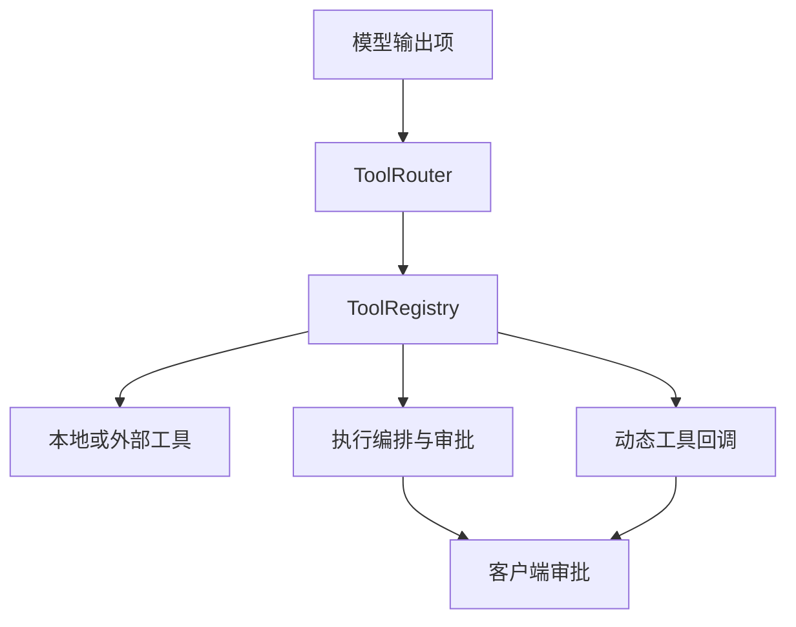
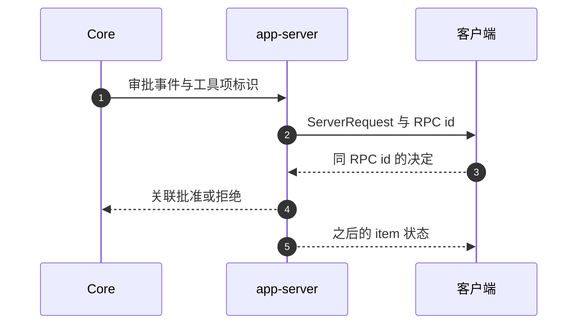
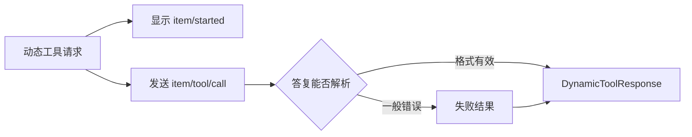

# 工具调用、审批与动态工具协议

同一个业务动作可能跨越模型调用、Core 并发执行和客户端反向请求。协作时需要保留三个独立标识：模型 call ID、Core 内部等待项标识、app-server 发出的 RPC 请求 ID。它们分别匹配模型输出、运行时等待与客户端答复。 [codex-rs/core/src/tools/router.rs:89-137](https://github.com/GLBB/codex/blob/9f42c89c0112771dc29100a6f3fc904049b2655f/codex-rs/core/src/tools/router.rs#L89-L137) [codex-rs/core/src/tools/registry.rs:397-475](https://github.com/GLBB/codex/blob/9f42c89c0112771dc29100a6f3fc904049b2655f/codex-rs/core/src/tools/registry.rs#L397-L475) [codex-rs/core/src/session/mod.rs:2502-2525](https://github.com/GLBB/codex/blob/9f42c89c0112771dc29100a6f3fc904049b2655f/codex-rs/core/src/session/mod.rs#L2502-L2525) [codex-rs/app-server/src/outgoing_message.rs:308-388](https://github.com/GLBB/codex/blob/9f42c89c0112771dc29100a6f3fc904049b2655f/codex-rs/app-server/src/outgoing_message.rs#L308-L388)

| 路径 | 输入 → 结果 | 映射边界 |
| --- | --- | --- |
| 工具调用 | `ResponseItem` → `ToolCall` → 执行结果 | `ToolRouter` 解析载荷，registry 按名称及种类调度。 [codex-rs/core/src/tools/router.rs:89-137](https://github.com/GLBB/codex/blob/9f42c89c0112771dc29100a6f3fc904049b2655f/codex-rs/core/src/tools/router.rs#L89-L137) [codex-rs/core/src/tools/registry.rs:397-475](https://github.com/GLBB/codex/blob/9f42c89c0112771dc29100a6f3fc904049b2655f/codex-rs/core/src/tools/registry.rs#L397-L475) |
| 命令或补丁审批 | 需要用户决定 → app-server 发 request → Core 收到决定 | 反向 RPC 使用它自己的 ID，通过等待对象回到对应工具。 [codex-rs/app-server/README.md:1300-1327](https://github.com/GLBB/codex/blob/9f42c89c0112771dc29100a6f3fc904049b2655f/codex-rs/app-server/README.md#L1300-L1327) [codex-rs/app-server/src/outgoing_message.rs:308-388](https://github.com/GLBB/codex/blob/9f42c89c0112771dc29100a6f3fc904049b2655f/codex-rs/app-server/src/outgoing_message.rs#L308-L388) [codex-rs/core/src/session/mod.rs:2502-2525](https://github.com/GLBB/codex/blob/9f42c89c0112771dc29100a6f3fc904049b2655f/codex-rs/core/src/session/mod.rs#L2502-L2525) |
| 额外权限 | `RequestPermissions` → `item/permissions/requestApproval` | 请求带 cwd、权限结构及 thread/turn/item 标识。 [codex-rs/app-server/src/bespoke_event_handling.rs:751-783](https://github.com/GLBB/codex/blob/9f42c89c0112771dc29100a6f3fc904049b2655f/codex-rs/app-server/src/bespoke_event_handling.rs#L751-L783) |
| 动态工具 | `DynamicToolCallRequest` → `item/tool/call` → `Op::DynamicToolResponse` | 客户端执行，带内容项和成功标志返回。实验能力必须 opt in。 [codex-rs/app-server/src/bespoke_event_handling.rs:785-829](https://github.com/GLBB/codex/blob/9f42c89c0112771dc29100a6f3fc904049b2655f/codex-rs/app-server/src/bespoke_event_handling.rs#L785-L829) [codex-rs/app-server/src/dynamic_tools.rs:14-74](https://github.com/GLBB/codex/blob/9f42c89c0112771dc29100a6f3fc904049b2655f/codex-rs/app-server/src/dynamic_tools.rs#L14-L74) [codex-rs/app-server/README.md:1400-1442](https://github.com/GLBB/codex/blob/9f42c89c0112771dc29100a6f3fc904049b2655f/codex-rs/app-server/README.md#L1400-L1442) |

<!-- Sources: codex-rs/core/src/tools/router.rs:89, codex-rs/core/src/tools/registry.rs:397, codex-rs/core/src/tools/orchestrator.rs:128, codex-rs/app-server/README.md:1300, codex-rs/app-server/src/bespoke_event_handling.rs:785 -->

### 审批与执行边界

Orchestrator 先按策略得出允许、拒绝或需要审批，再选择沙箱及运行尝试。用户审批是其中的决策来源。操作最终是否成功由运行时结果与事件表达。客户端应按请求 ID 回复，按 item ID 更新展示，再按 turn 终态确认结束。 [codex-rs/core/src/tools/orchestrator.rs:128-263](https://github.com/GLBB/codex/blob/9f42c89c0112771dc29100a6f3fc904049b2655f/codex-rs/core/src/tools/orchestrator.rs#L128-L263) [codex-rs/core/src/tools/runtimes/shell.rs:184-257](https://github.com/GLBB/codex/blob/9f42c89c0112771dc29100a6f3fc904049b2655f/codex-rs/core/src/tools/runtimes/shell.rs#L184-L257) [codex-rs/app-server/README.md:1300-1327](https://github.com/GLBB/codex/blob/9f42c89c0112771dc29100a6f3fc904049b2655f/codex-rs/app-server/README.md#L1300-L1327) [codex-rs/app-server/src/outgoing_message.rs:308-388](https://github.com/GLBB/codex/blob/9f42c89c0112771dc29100a6f3fc904049b2655f/codex-rs/app-server/src/outgoing_message.rs#L308-L388) [codex-rs/app-server/README.md:1211-1247](https://github.com/GLBB/codex/blob/9f42c89c0112771dc29100a6f3fc904049b2655f/codex-rs/app-server/README.md#L1211-L1247)

<!-- Sources: codex-rs/core/src/session/mod.rs:2502, codex-rs/app-server/README.md:1300, codex-rs/app-server/src/outgoing_message.rs:308, codex-rs/app-server/README.md:1211 -->

### 动态工具回包错误

Core 发客户端工具请求后，app-server 先发正在进行的 item，再发真正需要回复的 RPC。`on_call_response` 解析答复，普通错误或无效格式可转换成 `success: false` 和诊断文本。某些 turn 切换错误直接退出等待逻辑。成功的或降级的结果以 `call_id` 提交给 Core，方便回到模型可见的输出链。 [codex-rs/app-server/src/bespoke_event_handling.rs:785-829](https://github.com/GLBB/codex/blob/9f42c89c0112771dc29100a6f3fc904049b2655f/codex-rs/app-server/src/bespoke_event_handling.rs#L785-L829) [codex-rs/app-server/src/dynamic_tools.rs:14-74](https://github.com/GLBB/codex/blob/9f42c89c0112771dc29100a6f3fc904049b2655f/codex-rs/app-server/src/dynamic_tools.rs#L14-L74) [codex-rs/core/src/session/turn.rs:1655-1675](https://github.com/GLBB/codex/blob/9f42c89c0112771dc29100a6f3fc904049b2655f/codex-rs/core/src/session/turn.rs#L1655-L1675)

<!-- Sources: codex-rs/app-server/src/bespoke_event_handling.rs:785, codex-rs/app-server/src/dynamic_tools.rs:14 -->

继续阅读 [协议总览](index.md)、[工具调度与权限](../architecture/tools-permissions.md) 和 [MCP 与 Hook](mcp-hooks.md)。
