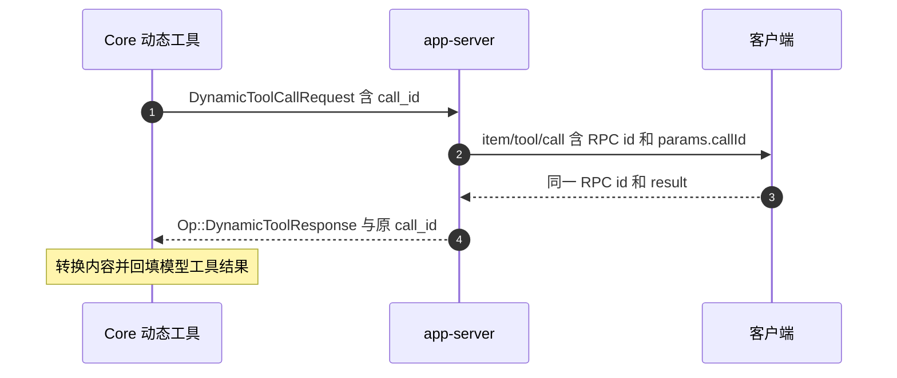

# 工具调用、审批与动态工具

Core 从模型完整输出项构建 `ToolCall`。注册表运行匹配的处理器，必要时发起审批或请求客户端执行。审批和动态工具使用 app-server 反向 RPC，执行结果沿原模型调用的 `call_id` 回填。 [stream_events_utils.rs:342-385](https://github.com/GLBB/codex/blob/9f42c89c0112771dc29100a6f3fc904049b2655f/codex-rs/core/src/stream_events_utils.rs#L342-L385) [router.rs:89-137](https://github.com/GLBB/codex/blob/9f42c89c0112771dc29100a6f3fc904049b2655f/codex-rs/core/src/tools/router.rs#L89-L137) [registry.rs:397-475](https://github.com/GLBB/codex/blob/9f42c89c0112771dc29100a6f3fc904049b2655f/codex-rs/core/src/tools/registry.rs#L397-L475) [bespoke_event_handling.rs:785-829](https://github.com/GLBB/codex/blob/9f42c89c0112771dc29100a6f3fc904049b2655f/codex-rs/app-server/src/bespoke_event_handling.rs#L785-L829) [models.rs:787-847](https://github.com/GLBB/codex/blob/9f42c89c0112771dc29100a6f3fc904049b2655f/codex-rs/protocol/src/models.rs#L787-L847)

## Core 调度输入

| `ToolCall` 字段 | 类型 | 含义 |
| --- | --- | --- |
| `tool_name` | ToolName | 注册表找处理器的名称。函数工具可携带命名空间。 |
| `call_id` | String | 模型工具调用 ID，用于结果回填。 |
| `payload` | ToolPayload | 函数调用保存 JSON 字符串 `arguments`，自由格式调用保存文本 `input`。客户端工具搜索会先解析成搜索参数。 |

关联字段定义见 [ToolCall 和路由](https://github.com/GLBB/codex/blob/9f42c89c0112771dc29100a6f3fc904049b2655f/codex-rs/core/src/tools/router.rs#L24-L137)。

## 反向 RPC 的关联键

| 字段 | 位置 | 用途 |
| --- | --- | --- |
| `id` | JSON-RPC 外层 | app-server 分配的请求 ID，客户端在 `result` 或 `error` 回包中原样使用。 |
| `threadId`、`turnId` | `params` | 将请求定位到对应线程和回合。 |
| `itemId` | 审批 `params` | 审批对应的客户端展示项。 |
| `approvalId` | 命令审批 `params`，可省略 | 单次审批回调 ID。同一展示项可有多个子命令审批，回调路由有此值时优先使用。 |
| `callId` | 动态工具 `params` | 待执行的模型调用，回包转换为 Core 操作时由 app-server 回填。 |

[outgoing_message.rs:308-388](https://github.com/GLBB/codex/blob/9f42c89c0112771dc29100a6f3fc904049b2655f/codex-rs/app-server/src/outgoing_message.rs#L308-L388) [bespoke_event_handling.rs:610-641](https://github.com/GLBB/codex/blob/9f42c89c0112771dc29100a6f3fc904049b2655f/codex-rs/app-server/src/bespoke_event_handling.rs#L610-L641) [bespoke_event_handling.rs:1946-2065](https://github.com/GLBB/codex/blob/9f42c89c0112771dc29100a6f3fc904049b2655f/codex-rs/app-server/src/bespoke_event_handling.rs#L1946-L2065) [dynamic_tools.rs:14-49](https://github.com/GLBB/codex/blob/9f42c89c0112771dc29100a6f3fc904049b2655f/codex-rs/app-server/src/dynamic_tools.rs#L14-L49)

## 审批请求与决定

下列三个方法都带 `threadId`、`turnId`、`itemId`（string）以及 `startedAtMs`（Unix 毫秒整数）。其余字段按方法解释。 [common.rs:1325-1358](https://github.com/GLBB/codex/blob/9f42c89c0112771dc29100a6f3fc904049b2655f/codex-rs/app-server-protocol/src/protocol/common.rs#L1325-L1358) [item.rs:1255-1354](https://github.com/GLBB/codex/blob/9f42c89c0112771dc29100a6f3fc904049b2655f/codex-rs/app-server-protocol/src/protocol/v2/item.rs#L1255-L1354) [permissions.rs:659-694](https://github.com/GLBB/codex/blob/9f42c89c0112771dc29100a6f3fc904049b2655f/codex-rs/app-server-protocol/src/protocol/v2/permissions.rs#L659-L694)

| 方法 | 独有请求字段 | 含义 |
| --- | --- | --- |
| `item/commandExecution/requestApproval` | `approvalId: string`、`reason: string`、`command: string`、`cwd: string`，各自可省略 | 单次回调、提示原因、命令和工作目录。 |
| 同上 | `commandActions: CommandAction[]`、`networkApprovalContext: object`，各自可省略 | 便于展示的命令动作及托管网络审批上下文。 |
| 同上 | `additionalPermissions: object`、`availableDecisions: array`，实验字段 | 请求的附加权限与建议显示的决定选项顺序。 |
| 同上 | `proposedExecpolicyAmendment: object`、`proposedNetworkPolicyAmendments: array`，各自可省略 | 建议写入的执行策略修订或网络规则。 |
| `item/fileChange/requestApproval` | `reason: string 或 null`、`grantRoot: string 或 null` | 补丁审批原因和请求的根目录。 `grantRoot` 的支持程度在源码标为不稳定。 |
| `item/permissions/requestApproval` | `cwd: string`、`reason: string 或 null`、`permissions: object` | 当前工作目录、原因和申请权限。权限对象可包含 `network` 与 `fileSystem`。 |

| 回包字段 | JSON 类型与出现条件 | 含义 |
| --- | --- | --- |
| 命令或文件 `result.decision` | 枚举 | `accept` 同意当前操作，`acceptForSession` 复用会话审批，`decline` 拒绝后继续 turn，`cancel` 拒绝并中断 turn。 |
| 命令 `result.decision` | 带载荷的枚举对象 | 另可承载执行策略修订或网络规则修订。 |
| 额外权限 `result.permissions` | object | 实际授予的权限字段，可给空对象。 |
| 额外权限 `result.scope` | `turn` / `session`；默认 `turn` | 授予有效范围。 |
| 额外权限 `result.strictAutoReview` | boolean，可省略 | 要求该回合后续命令在常规沙箱执行前再审查。 |

异常回包由对应处理器转换为 Core 决定。命令和文件的非法决定回包会走拒绝分支。权限审批会读取授予的权限对象和作用域。 [item.rs:42-100](https://github.com/GLBB/codex/blob/9f42c89c0112771dc29100a6f3fc904049b2655f/codex-rs/app-server-protocol/src/protocol/v2/item.rs#L42-L100) [permissions.rs:150-157](https://github.com/GLBB/codex/blob/9f42c89c0112771dc29100a6f3fc904049b2655f/codex-rs/app-server-protocol/src/protocol/v2/permissions.rs#L150-L157) [permissions.rs:396-415](https://github.com/GLBB/codex/blob/9f42c89c0112771dc29100a6f3fc904049b2655f/codex-rs/app-server-protocol/src/protocol/v2/permissions.rs#L396-L415) [bespoke_event_handling.rs:1815-1875](https://github.com/GLBB/codex/blob/9f42c89c0112771dc29100a6f3fc904049b2655f/codex-rs/app-server/src/bespoke_event_handling.rs#L1815-L1875) [bespoke_event_handling.rs:1900-1987](https://github.com/GLBB/codex/blob/9f42c89c0112771dc29100a6f3fc904049b2655f/codex-rs/app-server/src/bespoke_event_handling.rs#L1900-L1987)

## 动态工具 item/tool/call

客户端用 `thread/start.dynamicTools[]` 声明工具，收到 `item/tool/call` 时执行，再回填结果。该方法需要实验能力。 [thread.rs:39-85](https://github.com/GLBB/codex/blob/9f42c89c0112771dc29100a6f3fc904049b2655f/codex-rs/app-server-protocol/src/protocol/v2/thread.rs#L39-L85) [common.rs:1356-1362](https://github.com/GLBB/codex/blob/9f42c89c0112771dc29100a6f3fc904049b2655f/codex-rs/app-server-protocol/src/protocol/common.rs#L1356-L1362) [dynamic.rs:78-125](https://github.com/GLBB/codex/blob/9f42c89c0112771dc29100a6f3fc904049b2655f/codex-rs/core/src/tools/handlers/dynamic.rs#L78-L125)

| 位置 | 字段 | 含义 |
| --- | --- | --- |
| `dynamicTools[]` | `name: string`、`description: string`、`inputSchema: JSON` | 模型可识别的工具名、描述、输入结构。 |
| `dynamicTools[]` | `namespace: string 或 null`、`deferLoading: boolean`（默认 false） | 可选命名空间和延迟加载开关。 |
| `params` | `threadId: string`、`turnId: string`、`callId: string` | 调用所在的线程、回合和模型调用 ID。 |
| `params` | `tool: string`、`namespace: string 或 null`、`arguments: JSON` | 待执行工具与已经解析的输入。 |
| `result` | `success: boolean`、`contentItems: object[]` | 执行成功标记和工具输出。 |
| `contentItems[]` | `type: "inputText"`、`text: string` | 文本输出。 |
| `contentItems[]` | `type: "inputImage"`、`imageUrl: string` | 图像输出。 |

<!-- Sources: codex-rs/core/src/tools/handlers/dynamic.rs:78-125, codex-rs/app-server/src/bespoke_event_handling.rs:785-829, codex-rs/app-server/src/dynamic_tools.rs:14-74 -->

回包无法解码时，适配器生成 `success: false` 的文本结果。若回合已经切换且收到相应错误，适配器直接结束该等待路径。 [item.rs:1356-1385](https://github.com/GLBB/codex/blob/9f42c89c0112771dc29100a6f3fc904049b2655f/codex-rs/app-server-protocol/src/protocol/v2/item.rs#L1356-L1385) [dynamic_tools.rs:14-74](https://github.com/GLBB/codex/blob/9f42c89c0112771dc29100a6f3fc904049b2655f/codex-rs/app-server/src/dynamic_tools.rs#L14-L74)
